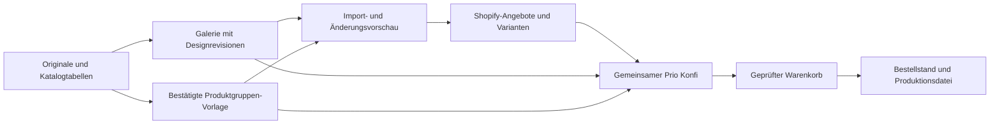

# Prio Konfi – verbindlicher Stand und Anschlussplan

Stand: 08.11.2026. Zuständig: Mika, ausschließlich in Abstimmung mit Mikail. Diese Datei ist der Einstieg für jeden beteiligten KI-Chat. Historische Pläne und Demo-Anweisungen gelten nur, soweit sie den folgenden aktuellen Nutzerentscheidungen nicht widersprechen.

## 1. Was freigegeben ist – und was noch nicht verbunden ist

**R15 ist der vom Nutzer freigegebene offizielle Prio-Konfigurator für Handy und PC.** Die gemeinsame Bedienung bleibt erhalten. Verbesserungen zuerst vorschlagen, nicht eigenständig einbauen. Andere KIs dürfen bei Produktanlagen ausschließlich zuvor vom Nutzer bestätigte produktspezifische Options-/Ausführungsdaten bearbeiten. Gemeinsame Oberfläche, Werkzeuge, Kernlogik, Preis-/Checkout-Verhalten und Ressourcenänderungen gehören zu Mika + Nutzer. Eigenständige Produktgruppen erhalten keinen neuen Konfi-Fork.

| Gegenstand | Exakter Stand / Bedeutung |
| --- | --- |
| Freigegebener R15-Code | `157d0da290993628dd9db9aa82ddb0708bad182f` |
| Code einschließlich abschließender Nachweise | `863b7fd3f6121714ca2b693ffa092ae2edb4944b` |
| Gesicherter GitHub-Tag | [prio-konfi-approved-r15-20261108](https://github.com/Chris83638w/gravuru-2027/tree/prio-konfi-approved-r15-20261108) |
| Öffentliche Referenz | [R15 frisch öffnen](https://app-2027.gravuru-designwerkstatt.de/konfi-demo/mobil-20261107-r15/22x14.html?fresh=1) |
| R15-Prüfprotokoll | [Exakte historische Abnahme](https://github.com/Chris83638w/gravuru-2027/blob/863b7fd3f6121714ca2b693ffa092ae2edb4944b/docs/handoffs/2026-11-07-mobile-demo-r15-ausfuehrung.md) |
| Main vor dieser Dokumentation | `207c0c7e5cb628b70c7df051202e16afa4f6c004`, Tag `backup/main-before-prio-20261108` |
| Laufzeitgrenze | R15 ist weiterhin eine statische Demo: `checkout=false`, `reviewOnly=true`, keine echten Varianten-IDs im Demo-Paket |

**Diese Übernahme nach main veröffentlicht den Freigabevertrag, die unveränderliche Quellreferenz, Sicherungsnachweise und den Anschlussplan. Sie ersetzt keine laufende Galerie, schaltet keinen Shop frei und ist kein Merge sämtlicher R15-Vorgängerarbeiten.** Der R15-Aufgabenbranch umfasst gegenüber dem gelesenen main 123 Commits / 805 Dateien einschließlich Galerie, Datenbankschema und Importarbeiten. Diese Abhängigkeiten müssen für die konkrete Runtimeintegration geprüft werden. Die Freigabe der Bedienoberfläche ist keine pauschale Abnahme dieser gesamten Kette.

Die Zuständigkeitsregel ist eine verbindliche Arbeitsanweisung, keine technische Zugriffssperre. Für technisch erzwungene Freigaben können später Repository-Regeln/CODEOWNERS mit realen berechtigten Accounts eingerichtet werden. Keine Namen oder Rechte erfinden.

## 2. Aktuelle Nutzerentscheidungen

- Ein universeller Konfi zuerst für den eigenen Shopify-Shop; spätere andere Shopanschlüsse über getrennte Adapter.
- **Erster neuer Pilot: Edelstahl-Türschilder.** Sichtbare Produktoptionen: **Form, Größe, Befestigung**. Alle vorhandenen Katalogformen müssen verfügbar werden. Konkrete Größen, Preise, Befestigungen und Ausnahmen vor Produktanlage vollständig anzeigen und bestätigen lassen.
- Beispiel Acrylglasbild: passende Größen, Füße und Wandhalterung als Produktdaten; keine neue Oberfläche. Die genannten Optionen sind Beispiele, keine vollständige Liste für alle Gruppen.
- Erlaubt ein Produkt keine Fotos, darf es keine Fotooption anbieten. Logo ist eine getrennte Fähigkeit und benötigt ebenfalls eine ausdrückliche Zuordnung. Dass eine Vorlage ohne Foto startet, ist nicht automatisch ein generelles Fotoverbot.
- Designgruppen enthalten passende Originaldesigns; jedes Angebot startet mit der Gestaltung seines Hauptbildes. Dafür feste Design-ID und Revision verwenden, keine Bilderkennung.
- Galerie bearbeiten → in dieselbe Originalvorlage speichern → Vorschau/Schnellbearbeitung/Freigabe aktualisieren → bewusst **Synchronisieren**. Bearbeiten allein veröffentlicht nicht im Shop.
- Material-/Formressourcen und Schriften gemeinsam referenzieren, gleiche Quelldateien nicht pro Design duplizieren. Individuelle Angebotsbilder sind abgeleitete Vorschauen und dürfen je Design unterschiedlich sein.
- Neue Produktgruppen-Vorlagen erst nach Bestätigung verwenden. Unbestätigte Daten blockieren die Anlage; unbekannte Werte niemals durch Standardoptionen ersetzen.
- Main-Übernahme ausdrücklich erlaubt. Ein Live-Rollout benötigt weiterhin eine technisch geprüfte Verbindung einschließlich Warenkorb und Produktion; kein bloßes Entfernen der Demo-Sperre.
- Noch nicht umgesetzt: die besprochene klarere Beschriftung **„Schriftart ändern“**. R15 enthält weiterhin „Schrift ändern“. Sie ist keine bereits veröffentlichte Änderung.
- Empfehlung für den übergeordneten Reiter: **„Optionen“**, darunter die konkreten Unterreiter. Diese Benennung ist ein Vorschlag; im eingefrorenen Stand nicht ungefragt umbenannt.

### Bestehende Bedienregeln erhalten

Produkt groß und sichtbar, auf PC dauerhaft sichtbar neben den Werkzeugen; keine Layoutsprünge beim Auswählen. Handy-Menüs wie freigegeben; PC-Hauptreiter nur über der Produktspalte. Textauswahl öffnet das passende Werkzeug; Texteingabe und Schriftwahl bleiben mit Tastatur nutzbar. Schriftgröße ohne sichtbares „mm“, Schrifthöhe mit Regler. Auswahlgriffe, Löschen, Verschieben und Drehen für freigegebene Elemente erhalten. Kleine Motive müssen verschiebbar bleiben; Motive nicht größer als die Produktfläche. Fotos vollständig einfügen, erst auf bewussten Zuschnitt beschneiden, mittig und brauchbar groß beginnen; Eckgriffe und Größenregler erhalten. Klick auf vorhandenes Foto öffnet keinen Dateidialog. Foto-Tab öffnet zunächst den Bereich, Upload erst über dessen Button. Ansicht per Regler; Browserzoom nicht mit Objektgröße verwechseln. Rücksetzen stellt nach Bestätigung das gewählte Originaldesign wieder her. Überlagerungshinweis einmal kompakt; bewusste Bestellung trotz Überlagerung möglich; automatisches Einpassen lässt einen kleinen Abstand. Warenkorb grün, Preis korrekt zugeordnet. Suche hat Vorrang vor Motivkategorie, Suchauswertung in der Shopify-App. „Grundmotive“ samt Inhalt aus der Auswahl entfernt, nicht alle Designmotive. Keine automatischen Änderungen fremder Designs.

Die spezifischen Schieferpreise 19,99 € für 22×14 cm / 24,99 € für 30×20 cm sind **keine Edelstahlpreise**. Der Hinweis „Je Motiv 1,69 €“ und die bestehenden Preisregeln dürfen nicht beiläufig durch eine neue Importlogik verändert werden.

## 3. Edelstahl: alle Formen aus der richtigen Quelle

Quelle: [Katalogfamilie steel-door-signs](https://github.com/Chris83638w/gravuru-katalog./blob/main/familien/edelstahl/steel-door-signs.json). Im Audit bytegleicher Blob `2e046d4a` in Katalog-main und [Katalog-PR #183](https://github.com/Chris83638w/gravuru-katalog./pull/183), geprüfter PR-Stand `c1c389ca`. Designarbeiten folgen weiterhin dem [Design-Master](https://github.com/Chris83638w/gravuru-katalog./blob/main/designs/DESIGN-MASTER.md).

| Code | Form | Vorhandene Größen im Katalog |
| --- | --- | ---: |
| RE | Rechteck | 27 |
| AB | Rechteck mit abgerundeten Ecken R5 | 10 |
| QU | Quadrat | 7 |
| OV | Oval | 10 |
| EL | Ellipse | 7 |
| R | Rund | 5 |
| RT1 | Retro 1, eckig | 7 |
| RT2 | Retro 2, geschwungen | 7 |
| Gesamt | 8 Formen | 80 |

Das ist der vorhandene Datenbestand, noch keine Freigabe, jede Kombination zu verkaufen. Die alte Konfi-Datei `app/designs/steel-door-signs/family.json` umfasst nur fünf Formen / 61 Größen. Sie darf nicht als vollständige Quelle übernommen werden. Katalog-PR #183 mit 73 Rohlingen deckt Retro 2 nicht als Originaldesign ab. Fehlende passende Vorlagen/Ressourcen sichtbar melden; Form nicht heimlich weglassen.

## 4. Tatsächlich vorhandene Strecke und offene Verbindungen

| Teil | Belegt vorhanden | Noch zu erledigen |
| --- | --- | --- |
| R15-Kundenoberfläche | Freigegeben, eigene Paket-/Browsernachweise | Universell mit echten Produktprofilen und Shopkontext verbinden |
| Galerie-Rückspeicherung | PR #184: native Original-ID, Revision, Konflikte, Foto-/Motivrückweg | R15-Shell integrieren; Logo-Neuupload-Rundlauf gesondert prüfen |
| Gruppenbestätigung und Sync | PR #185, Absicherung #189 | Vollständige Produktanlage und sämtliche Design-/Medienzuordnungen verbinden |
| Gemeinsame Ressourcen | #190 / #192, exakte Ressourcenreferenzen | Kompatibilität mit neuestem Galerie-Stand und Produktionsdatenbanken abnehmen |
| Galerie/Designfamilien | Astra PR #194 bereits vorbereitet/staged | Aktivierung und Abnahme koordinieren, keinen zweiten Familienadapter bauen |
| Echter vorhandener Stahlpilot | Astra #191: Edelstahl-Andenken, nicht Türschilder | Bestehende IDs wiederverwenden; nicht nochmals anlegen |

Die vollständigen Quellbelege und Einschränkungen stehen im [Galerie-Audit](docs/reviews/2026-11-08-prio-konfi/gallery-audit.md) und [Shopify-Audit](docs/reviews/2026-11-08-prio-konfi/shopify-audit.md).

Konkrete Anschlussprobleme vor dem Pilot:

1. **Nicht rechteckige Formen:** Der isolierte R15-Motivgrößenadapter unterstützt bisher Rechtecke ohne Rundung. Bei anderen Konturen kann er Größenänderungen festhalten. Konturbezogen abnehmen, statt einfach acht Formen in die Auswahl zu schreiben.
2. **Galerie-Datenbank:** Der R15-Vorgängerstrang enthält Ressourcenschema V5; Astras PR #194 verwendet noch V4. Reader, Writer und Migration kontrolliert zusammenführen. Kein Dateiaustausch auf einer produktiven Datenbank ohne private Kopie, Sicherung und Wiederherstellungsprüfung.
3. **Nicht jeder Galeriedesign-Sync ist fertig:** Bestehender Adapter arbeitet für das jeweilige Startdesign; mehrere Designs/Medien eines Angebots sind nicht vollständig abgedeckt. Nebenentwürfe dürfen nicht unbemerkt Hauptbild/Startdesign ersetzen.
4. **Produktimport:** Das vorhandene allgemeine Skript ist kein unbedenklicher Update-Standard: Listen können ersetzt und Lagerverfolgung abgeschaltet werden. Ein Designabgleich darf fremde Metafelder, Varianten, Bestände oder Veröffentlichung nicht verändern.
5. **Foto-/Logorechte:** Sichtbare Tabs und serverseitige Prüfung müssen dieselben bestätigten Fähigkeiten verwenden. Fehlende Logo-Konfiguration nicht als bewusstes „erlaubt“ deuten. Manipulierte Upload-Anfragen müssen ebenfalls geprüft werden.
6. **Warenkorb:** Aktiver Shop, installierte Funktion, Preise, Varianten, Vorschaubild und gespeicherte Revision gemeinsam nachweisen. Die statische Demo ist hierfür kein Nachweis.

## 5. Empfohlener Aufbau

Die Galerie verwaltet Originale, Designgruppen und neue Designrevisionen. Produktprofile enthalten reale Form/Maße, Material/Verfahren, gültige Kombinationen, Preise und Fähigkeiten. Shopify führt Bestellungen und Bestände. Für Titel, Medien, Preise und Beschreibung wird je Feld eine klare Zuständigkeit festgelegt. Damit ist die gewünschte einfache Verwaltung möglich, ohne jede Shopfunktion doppelt zu bauen.

Ein neues Angebot verweist auf Gruppe, Startdesign, Produktprofil, freigegebene Revision und Shopify-IDs. „Semi“ im Hauptbild öffnet genau Semi. Änderungen in der Galerie erzeugen zunächst einen Entwurf. Erst die bestätigte Synchronisation aktualisiert die betroffenen aktuellen Angebote. Alte Warenkörbe/Bestellungen behalten ihre gespeicherten Revisionen und Originaldateien.

Gemeinsame Grundplatten funktionieren bei passenden Formen/Seitenverhältnissen. 9×6 und 30×20 sind beide 3:2; 22×14 und 30×20 sind nicht exakt proportional. Lochdurchmesser und Randabstände bleiben echte Maße. Ihre relative Darstellung folgt dem Maßstab; Lochgröße allein ersetzt keine Produktgeometrie. Originalfonts und Motive nicht strecken. Neue Materialien benötigen außerdem passende Fertigungsregeln, nicht nur einen anderen Hintergrund.

## 6. Was wir von Zakeke nutzen

Die vollständige [Recherche mit Primärquellen](docs/reviews/2026-11-08-prio-konfi/zakeke-research.md) beruht auf öffentlichen Hilfe-/API-Dokumenten, nicht auf einer angemeldeten Prüfung eures Zakeke-Backends.

- Produkt, Variante, Gestaltungsfläche, Vorlage und Werkzeugfreigaben getrennt verwalten. Vorlagenkategorien und explizite Startvorlagen passen zu unseren Designgruppen. [Zakeke-Vorlagen](https://zakeke.zendesk.com/hc/en-us/articles/360016320114-Pre-designed-Templates)
- Wiederholbarer Tabellenimport mit stabilen Referenzen, Hintergrundauftrag und Fehlerliste ist ein geeignetes Vorbild. Für Gravuru: ein gemeinsamer Importdienst, zunächst per Skript ausführbar, später derselbe Dienst hinter dem Verwaltungsbutton. Shell startet den Auftrag; die API verbindet ihn mit Shopify. [Zakeke CSV v3](https://docs.zakeke.com/docs/API/Integration/Connecting-Product/CSV-v3-method)
- Zakekes dokumentierter Bild-/Namensabgleich geht vom Shop zum Konfigurator. Unser gewünschtes Galerie → Shopify braucht einen eigenen verbindlichen Syncvertrag; eine Zakeke-Funktion übernimmt das nicht automatisch. [Zakeke-Synchronisation](https://zakeke.zendesk.com/hc/en-us/articles/10472925754268-Sync-product-image-and-name-with-e-commerce)
- Keine vorschnelle Übernahme von Produktkopien je Kundenbestellung oder veränderlichen historischen Designs. Bestehende IDs und Bestellstände erhalten.

Für die Umsetzung reicht die vorhandene Werkzeugbasis: GitHub, bestehende Node-/Python-Importe, Shopify Admin GraphQL, bestehender Kunden-/Warenkorbanschluss, Browserprüfungen und Serverdiagnose. Kein zusätzliches kostenpflichtiges Konfigurator-Plugin ist für diesen Plan erforderlich. Zakeke dient als Referenz, nicht als neue Abhängigkeit.

Zur Nutzerfrage „Shopify CLI oder Shell schneller?“: Für unseren Bestand empfiehlt sich ein wiederholbares Skript mit Shopify-API, gestartet aus der Shell. Shopify CLI ergänzt App-/Theme-Arbeit und kann ebenfalls API-/Bulkaufträge ausführen. CLI und API sind keine konkurrierenden Importverfahren; entscheidend sind ein geprüfter Datenplan und Sammelaufträge statt manueller Einzelanlage. Erst einen kleinen Pilot kontrolliert schreiben, dann große bestätigte Stapel als asynchronen Bulkauftrag mit Ergebnisprüfung. Ein CLI-Wechsel allein behebt weder Datenlücken noch erhöht er automatisch Shopify-Limits. [Shopify CLI](https://shopify.dev/docs/api/shopify-cli), [Bulk-Import einschließlich CLI](https://shopify.dev/docs/apps/build/apis/graphql-admin/bulk-operations/imports).

## 7. Konkrete Reihenfolge und Abnahme

| Schritt | Ergebnis | Abnahme |
| --- | --- | --- |
| 1 – erledigt in diesem Paket | R15-Code/Referenzen gesichert, Zuständigkeiten und Plan dokumentiert | Tags, Hashes, 2.026 Paketdateien geprüft; keine Runtime geändert |
| 2 – vorbereitet | Vollständige Edelstahlmatrix aus acht Formen | Alle Formen vorhanden; gültige Größen, Preise, Befestigungen und Foto/Logo-Fähigkeiten dem Nutzer zur Bestätigung vorlegen |
| 3 | R15 mit echtem Profil und Galerie verbinden | Alle acht Formen RE, AB, QU, OV, EL, R, RT1, RT2: Maße, Griffe, Löschen, Schrift, Foto/Logo-Regeln; gleiche Original-ID nach Rückspeicherung; Konflikttest |
| 4 | Shopify-Entwürfe erzeugen | Bestätigte Profile; vorher/nachher-Vorschau; keine Doppelanlage; keine unbeauftragten Bestands-/Metafeldänderungen |
| 5 | Kontrollierter Galerie-Sync | Alle zugeordneten Designs/Medien korrekt; Hauptbild/Startvorlage konsistent; Konflikt stoppt nur betroffene Einträge; Wiederholung erzeugt keine Duplikate |
| 6 | Durchgängiger Verkaufstest | Produktseite → richtige Vorlage → Optionen → Warenkorb → Checkout → unveränderlicher Auftrag → maßhaltige Produktionsdatei |
| 7 | Geprüfter Pilot live | Vorher Code, DB, Uploads, Assets, Theme/Appbindung privat sichern; Rückweg geprüft; erst dann schrittweise weitere Angebote |

Shopify `productSet` ist für Synchronisation geeignet, ersetzt aber übermittelte Listen: weggelassene Einträge können gelöscht werden. Für Designänderungen bevorzugt gezielte, zugeordnete Felder schreiben. Keine Teil-Liste als vollständigen Katalog behandeln. [Shopify productSet](https://shopify.dev/docs/api/admin-graphql/2026-10/mutations/productSet)

Der aktuell verbundene Shopify-Connector meldet `gravuru-design.myshopify.com`, EUR und Shopify Plus; Domain und Währung stimmen mit dem geprüften Repo-/Shop-Einstieg überein. Das erfüllt den Tarifpunkt für diesen Shop, belegt aber noch keine korrekt installierte Preisfunktion. Vor Schreiben die konkrete Serverbindung, App-Berechtigungen, aktive Function und Preisverträge rücklesen. Preisaufschläge müssen serverseitig validiert werden; bloße Warenkorbeigenschaften ändern keinen Shopify-Preis.

Keine belastbare neue Drei-Stunden-Zusage: Die oben gefundenen Integrationslücken benötigen echte Abnahme. Der schnellste tragfähige Weg ist ein bestätigter Pilot mit wiederverwendbarem Importvertrag, danach Stapelanlage.

## 8. Performance – Vorschlag, noch kein Umbau

Produktseite zuerst nutzbar laden. Danach im Hintergrund gezielt Konfi-Einstieg, Produktprofil, Grundplatte, Startdesign und die dafür nötigen Schriftstile vorbereiten. Nicht sämtliche Motive und Fonts gleichzeitig laden. Sichtbare Vorschaubilder zuerst, weitere beim Scrollen, Originaldatei bei Auswahl; seltene Bearbeitungsfunktionen nach Bedarf. Auf schwacher Verbindung/Datensparmodus das Vorladen begrenzen.

Unveränderliche Dateien erhalten versionsgebundene URLs und Cache-Regeln; Einstieg/Profil verweisen auf den freigegebenen Stand. Die bisherigen Demo-no-store-Regeln nicht ungeprüft zur Produktionsstrategie machen. Schriftladen vor verbindlicher Textmessung abschließen. Ob Vorladen zwischen Shop- und Konfidomain wirklich wiederverwendet wird, messen statt annehmen. [MDN Lazy Loading](https://developer.mozilla.org/en-US/docs/Web/Performance/Guides/Lazy_loading)

Prüfmatrix: Handy/PC, kalt/warm, Produktseite/Direkteinstieg, gute/schwache Verbindung. Messen: Serverantwortzeit, Übertragungsmenge, doppelte Dateien, Cachetreffer, Zeit bis richtiger Startgestaltung und erster Bearbeitung, Eingabeverzögerung, Upload/Speichern/Warenkorb. Dazu TLS, Kompression, Assetcache, Serverprozesse, Fehler-/Timeoutquote und Netzverbindung zwischen Shopify und eigenem Server prüfen. Konkrete Performancevorgaben des Nutzers folgen noch. In diesem Dokument stehen keine erfundenen aktuellen Messwerte.

## 9. Sicherung und Erinnerung

Neu erstellt, vor Dokumentationsänderungen:

| Sicherung | Größe | SHA-256 |
| --- | ---: | --- |
| `checkpoints/prio-konfi-20261108/approved-r15-863b7fd3.zip` | 299.376.694 Bytes | `64b82cbd3652489e1ae5a0ed2f2c42cd5937a38071601f69d6cae33c7d81e835` |
| `checkpoints/prio-konfi-20261108/main-before-207c0c7e.zip` | 269.706.553 Bytes | `63e67ba82212fba8a1540f723e6d98a38d9f57fcfc07b36cc69ae968de7a265f` |
| Bestehendes R15-Veröffentlichungs-ZIP | 83.392.489 Bytes | `886d23f631c64d14c9f5048887382d130296e9a6160309d807ae07d815c95125` |

Die beiden neuen ZIPs enthalten den vollständigen versionierten Quellstand, keine privaten Serverdatenbanken/Uploads. Die GitHub-Tags sichern dieselben Commitstände remote; die ZIPs bleiben lokal. R15-Paketmanifest: `ad8c4e8a8131b2f7487a365f4f39e0f11130369a72a10764fe578cbbd23c6ebb`. Alle 2.026 Manifestdateien erneut geprüft, keine Abweichung. Beide Modelle behalten je 43 Designs und 30 Schriften, Design-/Materialhashes identisch. [Prüfnachweis](docs/reviews/2026-11-08-prio-konfi/release-verification.json)

Vor einem tatsächlichen Server-/Shopwechsel ist zusätzlich eine frische **private** Sicherung der Datenbanken, Originaluploads, Assets, aktiven Releasepfade und Shop-/Themezuordnungen mit Wiederherstellungsprobe nötig. Eine MD-Datei ersetzt diese Sicherung nicht. In diesem Paket keine DB-/Shop-/Serveränderung und daher kein vorgetäuschter neuer Live-Datenbackup.

Für dauerhafte Erinnerung: `AGENTS.md` verweist auf diese Datei; `STATUS.md` protokolliert den letzten ausgeführten Schritt; `ENTSCHEIDUNGEN.md` hält neue Nutzerentscheidungen fest; ausführliche Prüfungen sind hier verlinkt. Immer **beschlossen / umgesetzt / getestet / veröffentlicht** auseinanderhalten. Bei Fortsetzung zuerst diese Datei und den jüngsten Status lesen, dann gezielt die betroffene Übergabe. Der freigegebene Tag wird nicht nachträglich verschoben.

## 10. Information an Mitwirkende

Mitteilung im ausdrücklichen Nutzerauftrag versandt: [#168](https://github.com/Chris83638w/gravuru-2027/issues/168#issuecomment-6714512510), [#48](https://github.com/Chris83638w/gravuru-2027/issues/48#issuecomment-6714512710), drei bekannte lokale Designchats („Prüfe Start anhand Issue 76“, „Github-Issue 76 prüfen“, „Issue 75 und Neustart prüfen“) und die drei beteiligten Recherche-Unteragenten. Für andere Accounts ist GitHub der zentrale gemeinsame Übergabekanal. Versand ist belegt; eine Lesebestätigung sämtlicher externer KIs wird nicht behauptet.

**Genau nächster Umsetzungsschritt:** acht Formen und zugehörige verfügbare Größen aus der Katalogquelle in einer prüfbaren Edelstahl-Türschildmatrix sammeln, Preise/Befestigungs- und Fähigkeitenzuordnungen aus bestätigten Quellen ergänzen und fehlende Entscheidungen gebündelt vorlegen. Parallel konkrete R15-/Galerie-Kompatibilität isoliert prüfen. Keine Produktanlage mit geratenen Werten.
