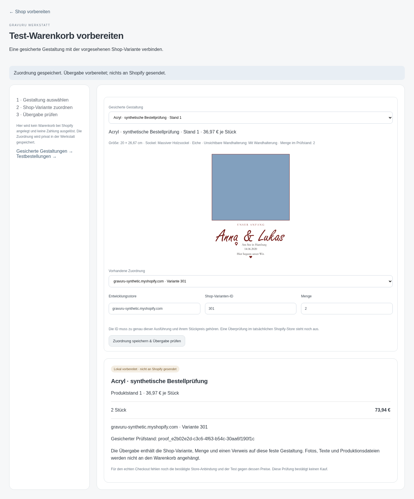

# Acryl-Prüfstand → lokale Bestellübergabe

06.10.2026, Cloud-Prüfungen 10:23–10:26 Uhr Europe/Berlin. Branch `task/acrylic-order-handoff-20261006`, Basis `a6d4e18a50d0b5ee97dde1ee0231c81f59274e54` (Remote bestätigt).

## Bedienung und Ergebnis

Im **Werkstatt-Prüfstand → Test-Warenkorb vorbereiten** sind jetzt auch native Acrylgestaltungen nutzbar. Die Auswahl zeigt die eingefrorene Größe, Sockel, Wandhalterung und Menge. Die Shop-Variante wird an genau diese Ausführung, Produktrevision und ihren serverberechneten Stückpreis gebunden. Die lokale Vorbereitung sendet nichts an Shopify und bestätigt keine Zahlung.

Eine andere Acrylmenge erfordert einen neu gesicherten Stand. Auch gleich teure, aber unterschiedliche Sockel dürfen nicht dieselbe gespeicherte Variantenbindung übernehmen. Kostenpflichtige zusätzliche Kundenelemente werden ohne eingerichtete Shop-Aufpreisbindung abgewiesen. Die neue zusätzliche SQLite-Tabelle speichert Optionsbindungen unveränderlich; alte Formproduktbindungen bleiben gültig. Ausgeführt wurde dies nur mit neuen temporären Prüfdatenbanken, nicht mit privatem Bestand.

Der bestehende HMAC-Empfänger übernimmt ausschließlich signierte **Test**-Bestellnachrichten mit passendem Shop, Variante, Preis, Menge und gültigem Verweis auf den gesicherten Stand. Die native Bestellposition erhält zusätzlich ihre eingefrorene Auswahl. Doppelte Zustellung bleibt ohne Doppelbestellung. Kunden-Download und Fertigungsfreigabe bleiben aus.

## Prüfung

- `node scripts/cloud-check.mjs`: **278 Tests, 0 Fehler, 0 Skips**, Referenzen bestanden, Build **76 Ressourcen / 1 Modell**, 10:24:18–10:25:50 Uhr. [Bericht](acryl-bestelluebergabe-cloud-report.json).
- Drei neue Tests für native Options-/Revisions-/Mengenbindung, gesperrte Zusatzpreise sowie signierte Testbestellung. Vorhandene Form-Bestelltests ebenfalls bestanden.
- `PYTHONPATH=.local-data/python python3 scripts/check-acrylic-order.py`: echte Chromium-Bedienung auf 1440/390/768 px, Zuordnung speichern/neuladen, unveränderte Menge, Warenkorb vorbereiten, falsche Menge abweisen, synthetische Testnachricht samt Wiederholung, Bestellansicht und Rückweg zum unveränderten Prüfstand. **36,97 € × 2 = 73,94 €**, Eiche/groß/Wand, 7 mm Einstecktiefe. Keine JavaScript-Fehler, kein horizontaler Überlauf. [Bericht](acryl-bestelluebergabe-browser-report.json), [Handyansicht](acryl-bestelluebergabe-mobil.png).

Alle Namen, IDs, Fotos und Preise in den Prüfbildern sind synthetisch. Die Beispiel-PNG der Browserfixture wird aus dem nativen Testdesign erzeugt. Der echte Konfi-Foto-/Textablauf und die technische PDF sind separat im vorigen Paket nachgewiesen.

## Grenzen

Keine echte Shopify-Anfrage/Bestellung, kein Checkout, kein Kundenkonto-Nachweis, keine Veröffentlichung. Die lokale Variantenbindung prüft keine fremden Storepreise online. Die vorhandene Domain `gravuru-design.myshopify.com` und der frühere Schiefer-Entwurfsartikel ersetzen keine bestätigte native Acryl-App-/Variantenbindung.

Native Acrylgestaltung aus einer Bestellung als neues Produkt übernehmen ist noch nicht angebunden; dieser Knopf wird für native Positionen nicht als funktionierend angeboten. Bestehende Formprodukte behalten ihren geprüften Weg. Nächster unabhängiger Code-Schritt: native Übernahme als neuer privater Produktentwurf, ohne Kundenfotos/Uploadkennungen zu veröffentlichen. Reale Shopify-Testanbindung und Maschinen-/ICC-Abnahme bleiben separat offen.
