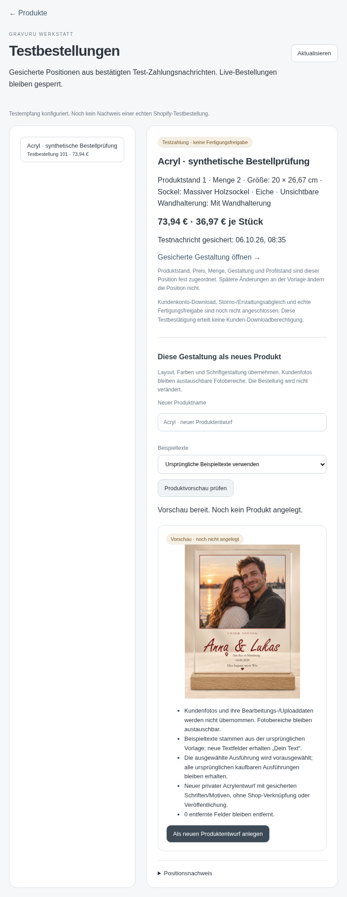

# Acrylgestaltung aus Testbestellung als neues Produkt

06.10.2026, Prüfungen 10:31–10:36 Uhr Europe/Berlin. Branch `task/acrylic-order-product-20261006`, Basis `5f97ce4a964b4e80907bd4a4608c53d4599fcdcf` (Remote bestätigt). Bestehende Cloud-Aufgabe und Repository Chris83638w/gravuru-2027; nur synthetische Prüfdaten.

## Umgesetzt

**Werkstatt → Testbestellungen → Diese Gestaltung als neues Produkt** unterstützt jetzt auch native Acrylgestaltungen. Name vergeben, Beispieltexte wählen, Produktvorschau prüfen, danach als neuen privaten Entwurf anlegen. Der Link öffnet den vorhandenen Acryl-Produkteditor im Dashboard. Kein zweiter Konfigurator und keine Umwandlung in ein Formprodukt.

Layout, Farben, Schriftgestaltung und zulässig entfernte Elemente stammen aus dem unveränderlichen Bestellstand. Standardmäßig kehren ursprüngliche Beispieltexte zurück; neu hinzugefügte Textfelder bekommen „Dein Text“. Die ausdrücklich gewählte Alternative übernimmt Kundentexte als Beispieltexte. Schriften/Motive stammen aus dem gesicherten Paket, ohne spätere globale Profilwahl einzumischen. Die ausgewählte Größe/Sockel/Wandhalterung wird vorausgewählt; die anderen bisherigen Ausführungen und Preisregeln bleiben erhalten.

**Kundenfotos, Bearbeitungszustände, Uploadkennungen und zusätzlich hochgeladene Logos werden nicht zum Produktbestand.** Fotobereiche bleiben austauschbar. In der Vorschau darf das bestehende öffentliche Beispielbild erscheinen; es ist nicht das private Bestellfoto. Der Entwurf erhält keine Shopbindung oder Veröffentlichung. Bestellung und ursprüngliches Produkt bleiben unverändert. Wiederholung und Neustart erzeugen keinen zweiten Produktentwurf; geänderte Übernahmeparameter erfordern eine neue gültige Vorschau.

[Im bestehenden Dashboard geöffnet](acryl-bestellung-neues-produkt-editor.png) · [Handyansicht](acryl-bestellung-neues-produkt-mobil.png)

## Tatsächlich geprüft

- `node scripts/cloud-check.mjs`: **280 Tests, 0 Fehler, 0 Skips**, Referenzen bestanden, Build **76 Ressourcen / 1 Modell**, 10:34:04–10:35:37 Uhr. [Prüfbericht](acryl-bestellung-neues-produkt-cloud-report.json).
- `node --test app/workshop/acrylic-order-product.test.mjs`: zwei native Übernahmetests, einschließlich privatem Foto/Logo, zusätzlichem Text, Löschung, veränderter Position/Schriftgröße/Farbe, ursprünglichen und ausdrücklich gewählten Kundentexten, gleichen Preisregeln, unverändertem Ausgangsprodukt, Paketprüfung, Vorschautoken sowie Wiederholung nach Datenbankneustart. Ergänzte Layoutassertionen anschließend ebenfalls bestanden.
- `PYTHONPATH=.local-data/python python3 scripts/check-acrylic-order.py`: Chromium mit synthetischer Acrylgestaltung → lokale Zuordnung → signierte synthetische Testbestellung → neue Produktvorschau → privater Entwurf → vorhandener Dashboardeditor → erneutes Öffnen. Desktop/Handy/Tablet, keine JavaScript-Fehler oder horizontaler Überlauf. Neue Produktdaten enthalten weder Test-Kundentext im Standardmodus noch Upload-ID; keine zusätzliche Shopbindung. [Browserbericht](acryl-bestellung-neues-produkt-browser-report.json).

Die Skripte verwenden neue markierte temporäre Datenbanken. Alte private Datenbanken wurden nicht geöffnet oder verändert. Die Datei `scripts/check-acrylic-order.py` erweitert den bisherigen Bestellnachweis um den Produktentwurf und schreibt nun nach `.test-output/acrylic-order-product/`.

## Zusammenhängender Stand und verbleibende Grenzen

Die letzten vier aufeinander aufbauenden Pakete sind gesichert:

1. `91541d6d331cb976196942b7c3ea2feb75117a4c`: native eingefrorene Acrylgestaltung → serverseitige technische PDF/ZIP, CMYK 300 dpi, Roland/Mimaki-Weiß, Kontur und optionale Randzugabe.
2. `a6d4e18a50d0b5ee97dde1ee0231c81f59274e54`: gleiche versionierte Acrylpreise in Commerce-Zuordnung und Konfigurator.
3. `5f97ce4a964b4e80907bd4a4608c53d4599fcdcf`: genaue Options-/Mengenbindung und signierte lokale Testbestellung.
4. Dieses Paket: neuer privater Acryl-Produktentwurf aus dem eingefrorenen Bestellstand, ohne Kundenmedien.

**Kein Nachweis einer echten Shopify-Zahlung, Kundenkonto-Berechtigung oder Maschinenfreigabe.** Die öffentliche frühere Testseite wurde nicht aktualisiert. Vor dem echten Checkout fehlen eine bestätigte Test-Store-/App-Anbindung und passende Acrylvarianten; der bekannte Schiefer-Entwurfsartikel darf nicht dafür verwendet werden. Vor Produktion fehlen gemessenes ICC-Profil und reale RIP-/Maschinenabnahme für Roland LEF-200/MO-240 und Mimaki 2513 EX. Native Acrylgravur und in der Druckprüfung ausdrücklich nicht unterstützte Elementtypen bleiben getrennte Grenzen.

Nächste externe Abnahme: den vorhandenen lokalen Ablauf mit der autorisierten Shopify-Testanbindung verbinden und einen echten Testkauf samt Kundenkonto prüfen. Dafür keine Zugangsdaten im Chat/Git; keine neuen Server oder Laptopdateien voraussetzen. Bis diese Anbindung vorhanden ist, bleibt die bewiesene Strecke bewusst lokal/synthetisch. Code und Nachweise liegen in GitHub; private laufende Daten sind damit nicht automatisch dauerhaft gemeinsam gespeichert.
