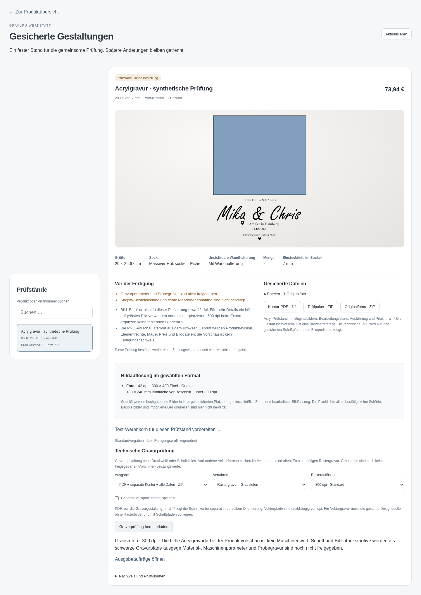

# Bildauflösung im nativen Acryl-Prüfstand

06.10.2026, bestehende verwaltete Cloud-Aufgabe. Branch `task/acrylic-photo-quality-20261006`, Basis `ef36ab0106be85baae2eef58997cb02e8792461b` (Remote bestätigt), Repository Chris83638w/gravuru-2027. Nur synthetische Daten.

## Bedienung und Ergebnis

Im Dashboard bei einem neu gesicherten Acryl-Prüfstand erscheint **Bildauflösung im gewählten Format**. Pro hochgeladenem Bild werden Pixelmaße, Bildfläche vor Beschnitt und daraus resultierende dpi angezeigt. Unter 300 dpi steht ein Hinweis, ein höher aufgelöstes Foto zu verwenden oder es kleiner zu platzieren. Ein 600-dpi-Export ergänzt keine fehlenden Bilddetails. Der Hinweis blockiert den Download nicht.

Die Berechnung verwendet dieselbe physische Skalierung und Fotoplatzierung wie die Fertigungsausgabe: gewählte Plattengröße, Zoom hinter dem Fotofenster und Pixelmaße der tatsächlich verwendeten bearbeiteten Fassung. Verschieben und Drehen verändern die Pixeldichte nicht. Frei eingefügte Bilder werden entsprechend ihrer eingepassten Bildfläche bewertet. Eine Datei in mehreren Platzierungen wird je Platzierung ausgewertet. Originale bleiben byteidentisch.

Die Werte liegen dauerhaft im Manifest des jeweiligen Prüfstands und somit auch in dessen ZIP. Vorhandene alte Prüfstände werden nicht verändert; ohne gespeicherte Auflösungswerte erscheint kein nachträglich erfundener Befund. Die Prüfung gilt für hochgeladene Bilder, nicht für Beispielbilder oder importierte Designquellen. Pixeldichte ist kein Schärfenachweis und erkennt keine frühere künstliche Vergrößerung, Unschärfe oder Kompression.

[Handyansicht](acryl-bildaufloesung-mobil.png)

## Ausgeführte Prüfungen

- `node scripts/cloud-check.mjs`: **286 Tests bestanden, 0 Fehler/Skips**, Python-PDF und Referenzen bestanden, Build **76 Ressourcen / 1 Modell**. 11:04:39–11:06:15 Uhr Europe/Berlin. [Gesamtbericht](acryl-bildaufloesung-cloud-report.json).

- `node --test app/workshop/acrylic-photo-resolution.test.mjs app/workshop/acrylic-review.test.mjs`: fünf Tests bestanden. 300-dpi-Grenze, gewählte Größe, Zoom, Drehung/Versatz, bearbeitete Pixelmaße, Einpassen gegenüber Beschnitt, Manifest/ZIP und unveränderte Originale. Bestehende Preis-/Revisions-/Rechte- und Druckausgabeprüfungen ebenfalls bestanden.
- `PYTHONPATH=.local-data/python python3 scripts/check-acrylic-engraving.py`: echte Browserbedienung am 06.10.2026, 11:05:28–11:05:39 Uhr Europe/Berlin. Hinweis und Bilddaten sichtbar; synthetisches 300 × 400-Pixel-Foto korrekt mit 42 dpi erkannt. PDF/ZIP samt Auflösungsmanifest, Fehlerfall Vektormodus mit Foto und identischer Wiederholungsdownload bestanden. Desktop 1440, Handy 390, Tablet 768 Pixel, keine JavaScript-Fehler und kein horizontaler Überlauf. [Browserbericht](acryl-bildaufloesung-browser-report.json).

## Grenzen und nächste Abnahme

Kein Upload privater Kundenbilder, keine Shopify-/Plesk-Änderung, keine Veröffentlichung. Ausgabe bleibt standardmäßig bei 300 dpi; keine automatische Qualitätssteigerung oder reale Maschinenfreigabe. Die öffentliche frühere Testseite wurde nicht aktualisiert. Nächste externe Voraussetzung für den echten Bestellablauf bleibt eine bestätigte Shopify-Test-App-Anbindung; Maschinen-/RIP-Abnahme separat. Bestehende Konfi-, Druck- und Gravurstrecken werden weiterverwendet.
