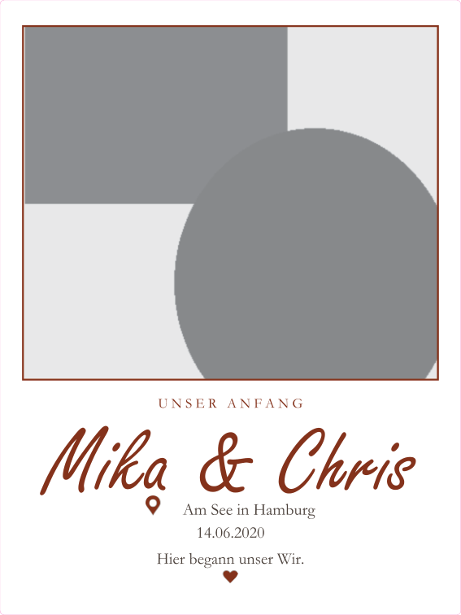

# Acryl-Prüfstand → technische Fertigungs-PDF

Stand: 06.10.2026, Prüfungen 10:03–10:14 Uhr Europe/Berlin. Branch `task/acrylic-snapshot-output-20261006`, Basis `7b071fc64c6604affbdb5190bb1814d3ebf38427` (Remote geprüft). Bestehende verwaltete Cloud-Aufgabe; Repository Chris83638w/gravuru-2027. Ausschließlich synthetische, isolierte Prüfdaten.

## Ergebnis und Bedienung

Im bestehenden Acryl-Konfigurator **Gestaltung fertig → Für die Werkstattprüfung sichern**. Unter **Werkstatt → Prüfstände** den Stand öffnen und die technische Druckprüfung als PDF herunterladen. Der Standard ist PDF, 300 dpi, CMYK, Roland RDG_WHITE ausschließlich unter bedruckten Stellen und ohne Randzugabe. Mimaki-Weißersatz und ZIP sind auswählbar; das ZIP enthält zusätzlich die separate Weiß-PDF und unveränderte Originalfotos.

Die PDF wird serverseitig aus den eingefrorenen Objekten, Schriftpfaden, Motiven, importierten Designquellen und Original-/bearbeiteten Bilddateien zusammengesetzt. Die gespeicherte Browser-PNG dient nur zum Vergleich. Produktmaß und Skalierung kommen aus der vorhandenen Acryl-Geometrie. Szene, Holzsockel, Bediengriffe und Foto-Hinweis werden nicht gedruckt; die verdeckten unteren 7 mm bleiben Teil der Platte. Texte bleiben Vektorpfade. Änderungen am späteren Kundenentwurf ändern den alten Prüfstand und seine bereits erzeugten Dateien nicht.

Optionaler 1-mm-Überdruck wird nur bei Druck am Außenrand hinzugefügt. Weiß bleibt standardmäßig innerhalb der Kontur. Rückseitige Ausgabe wird genau einmal gespiegelt. Auch die separate maßhaltige Kontur-PDF ist abrufbar. Der bisherige Acryl-Exportdialog hatte noch 1 mm vorausgewählt; diese Abweichung ist auf 0 mm korrigiert.

## Tatsächlich geprüft

- `node scripts/cloud-check.mjs`: **270 Tests, 0 Fehler, 0 Skips**, Referenzprüfung bestanden, Build **76 Ressourcen / 1 Modell**, 10:11:43–10:13:15 Uhr. [Maschinenlesbarer Bericht](acryl-fertigung-cloud-report.json).
- `node --test app/workshop/acrylic-review.test.mjs`: zusätzlich native Konturroute, unveränderter Wiederholungsdownload und importierte SVG-Designquelle in der PDF geprüft. Zwei native Tests bestanden; beide gehören zur Gesamtzahl 270. Die frühere Vollflächen-Testvorlage enthielt zunächst unerlaubte Bohrungen bzw. einen Sicherheitsrand; sie wurde auf eine gültige vollflächige rechteckige Acrylvorlage korrigiert. Produktschema unverändert.
- `PYTHONPATH=.local-data/python python3 scripts/check-acrylic-review.py`: echter Chromium-Browser, 1440/390/768 px, Foto hochladen, Graustufen/Zuschnitt, Text ändern, großer Acrylstand/Eiche/Wandhalterung, sichern und beide Exportarten herunterladen. PDF 200 × 266,7 mm, RDG_WHITE/Mimaki-Weiß nur unter Druck, CMYK, 64 Vektorglyphen, Originalfoto bytegleich. Browser-/Server-SVG-Vergleich: mittlere Kanalabweichung 0,001764 auf einer Skala 0–255. Alter PDF-Download nach neuer Kundenänderung bytegleich. Keine JavaScript-Fehler. [Bericht](acryl-fertigung-browser-report.json).
- `PYTHONPATH=.local-data/python python3 scripts/check-konfi-completion.py`: bestehender Formprodukt-Ablauf mit beiden PDFs, ZIP, freien Stellen und Bohrungen, unveränderlichem Stand und lokaler signierter synthetischer Testbestellung erneut bestanden. [Bericht](acryl-fertigung-form-regression.json).
- Vollflächiger nativer Druck: 150 × 200 mm plus gewählte Randzugabe ergibt 152 × 202 mm; farbige linke/rechte Fläche bei Spiegelung korrekt getauscht, Weiß außerhalb der Kontur transparent. Ein Motiv ohne Randkontakt bekommt trotz Anforderung keine Randzugabe.

Die Skripte erstellen eigene temporäre Datenbanken. Ausgabeordner `.test-output/` ist nicht versioniert. Voraussetzungen bleiben die dokumentierten Python-Anforderungen, Node 24 und Chromium/Playwright; keine neuen Abhängigkeiten in diesem Paket.

## Grenzen und nächster Schritt

Dies ist eine **technische Druckprüfung, keine Fertigungsfreigabe** (`productionReady=false`). CMYK ist eine generische Separation: gemessenes ICC-Profil und Abnahme in VersaWorks bzw. dem konkreten Mimaki-RIP fehlen. Keine echte Shopify-Bestellung, Veröffentlichung oder Serveränderung. Die öffentliche frühere Testseite wurde nicht aktualisiert.

Native Acrylgravur, umgefärbte importierte Designbilder und nicht übernommene Raster-/Linienobjekttypen werden ausdrücklich abgewiesen. Die native Acrylvorlage ist weiterhin rechteckig ohne Bohrungen; freie Formen/Bohrungen verwenden den bereits vorhandenen Formproduktweg. Browserreferenz und technische PDF werden nicht als identische fotografische Mockups ausgegeben.

Nächster Code-Schritt: Acryl-Preisprüfung der vorhandenen Commerce-Zuordnung auf dieselbe versionierte Kalkulation wie Konfi/Werkstatt bringen, insbesondere den großen Sockelaufschlag. Danach native Bestellübergabe prüfen. Reale Shop-Anbindung und Maschinenfreigabe bleiben getrennte Voraussetzungen; der bereits bestätigte Schiefer-Shopartikel ist kein Acrylartikel.
