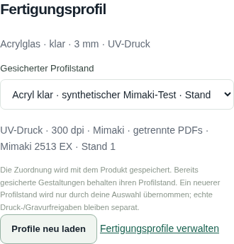

# Feste Fertigungsprofile für native Acrylprodukte – 06.10.2026

Basis: `ece60315a8b016c5f6b741bfd6a226508ea0b13e`, Remote des vorherigen Aufgabenbranches direkt bestätigt. Neuer Branch: `task/acrylic-production-profiles-20261006`. Entwicklung in der vorhandenen verwalteten Linux-Cloud, Node 24.19.0, Python 3.12, PyMuPDF 1.28.2. Keine privaten Datenbanken, keine Veröffentlichung oder Shopify-Anfragen.

## Verhalten

Im vorhandenen Acrylprodukt unter **Fertigung → Fertigungsprofil** lässt sich jetzt eine feste Revision eines gespeicherten Profils auswählen. Die Auswahl wird erst mit dem Produkt gespeichert. Verfahren, klares Acryl und tatsächliche Produktstärke müssen passen; andere Profile werden ausgeblendet und serverseitig abgewiesen. Die Zuordnung gilt für den vorhandenen klaren Acrylpiloten, nicht pauschal für jede Acrylsorte. Die Pilotstärke 3 mm ist keine neue Material-/Maschinenfreigabe.

Eine spätere Profiländerung ersetzt keine Zuordnung automatisch. Der bisher gebundene Stand bleibt wählbar und sichtbar; ein neuer Stand muss ausdrücklich ausgewählt und als neue Produktrevision gespeichert werden. Zuordnung entfernen ist ebenfalls möglich. Alte Produktdokumente ohne das optionale Feld bleiben unverändert gültig.

Neue Acryl-Prüfstände sichern das vollständige gebundene Profil zusätzlich als `fertigungsprofil.json` samt Dateiprüfsumme. Druck und Gravur übernehmen dessen Ausgabevorgaben; bewusste Ausgabeüberschreibungen werden in der Ausgabemetadatei vermerkt. Bereits gesicherte Prüfstände und Dateien ändern sich nicht. Profile bleiben technische Vorgaben, keine automatische Fertigungsfreigabe. Das bestehende Standardverhalten ohne Zuordnung bleibt erhalten.

Native Druckrezepte erhalten Version 4, Gravurrezepte Version 2; alte fertige Ausgaben bleiben gespeichert. Formprodukte verwenden ihren bisherigen Weg. Der separate Konfigurator-Testdownload ist weiterhin sein eigener manueller Weg; diese Profilzuordnung betrifft den gesicherten Werkstatt-Prüfstand und dessen Ausgabeaufträge.

## Nachweise

- Fünf gezielte Tests: Material-/Stärken-/Verfahrensabweisung, Referenzprüfung, alte Dokumente, fehlende gesicherte Metadaten, Kopie und Aufheben der Zuordnung, historischer Profilstand nach Änderung/Archivierung, Druck- und Gravurvorgaben samt bewussten Overrides; vorhandene Formproduktbindung weiter bestanden.
- Tatsächlicher Chromium-Ablauf **06.10.2026, 14:29:15–14:29:23 Uhr Europe/Berlin**: Profil auswählen, speichern, neu laden, neueren Stand ausdrücklich übernehmen, vorhandenen Prüfstand unverändert erhalten, Zuordnung entfernen. Übernahme der Profilvorgaben im Prüfstand; tatsächliche Farb-/Weiß-PDF-Downloads. Desktop 1440, Handy 390, Tablet 768 Pixel; keine JavaScript-Fehler oder horizontalen Überläufe. [Browserbericht](acryl-fertigungsprofile-browser-report.json).
- Heruntergeladene synthetische Mimaki-Dateien mit PyMuPDF geprüft: Weiß **0 Bilder, 7 Vektorzeichnungen, RDG_WHITE und CutContour**; Farbe **kein RDG_WHITE**, CutContour vorhanden. Beide einseitig und ohne PDF-Reparatur lesbar. [PDF-Bericht](acryl-fertigungsprofile-pdf-report.json).
- Vollständiger Cloud-Check **14:29:32–14:31:29 Uhr Europe/Berlin**, **313 Tests / 0 Fehler / 0 Skips**, Referenzen und Build **76 Ressourcen / 1 Modell** bestanden: siehe [Cloud-Bericht](acryl-fertigungsprofile-cloud-report.json).
- Konkrete Änderungen: Produktvalidierung und Produktionsprofilauflösung, Revisionsmetadaten, Acryl-Prüfstand und beide Ausgaberenderer, vorhandener Produkteditor mit neuem `native-production-ui.mjs`, gezielte Tests und synthetischer Browserablauf. Keine neuen DB-Tabellen oder Bestandsmigration.

[Handyansicht](acryl-fertigungsprofile-mobil-20261006.png).

## Erhaltene Druckproben und Grenzen

SHA-256 der drei privaten bisherigen Corel-Testdateien vor Abschluss erneut geprüft, unverändert:

- Roland: `d723225dfbc79c0c682aa5017149c0138d25b987a933b53b5efa7e9899fab6aa`
- Mimaki-Weiß: `c8547a326d05457f1ac6700ba1c7a4a66ead6a640dcb2cc9a64dd831b0fde3e2`
- Mimaki-Farbe: `7a331d08cef266e5b9320f4cedc3eacbb1cfcd3be48d2174a5ae8f835d0f7efc`

Die Profile und Browserdaten dieses Nachweises sind synthetisch. Keine neuen realen RIP-/ICC-/Gravurparameter erfunden. Neue Corel-/Mimaki-Nutzerabnahme, echte Shopify-Test-App-Strecke und dauerhaft erreichbares authentifiziertes Werkstatt-Backend bleiben getrennte offene Abnahmen. Der alte private Muster-Link enthält dadurch kein aktualisiertes Dashboard.

Nächster ausführbarer fachlicher Schritt: das Nutzerergebnis des realen Import-/Probedrucks zur konkreten PDF im vorhandenen Prüfprotokoll erfassen; erst bestätigte Maschinen-/Materialvorgaben als reale Fertigungsprofile hinterlegen. Bis dahin keine Produktionsfreigabe behaupten.
