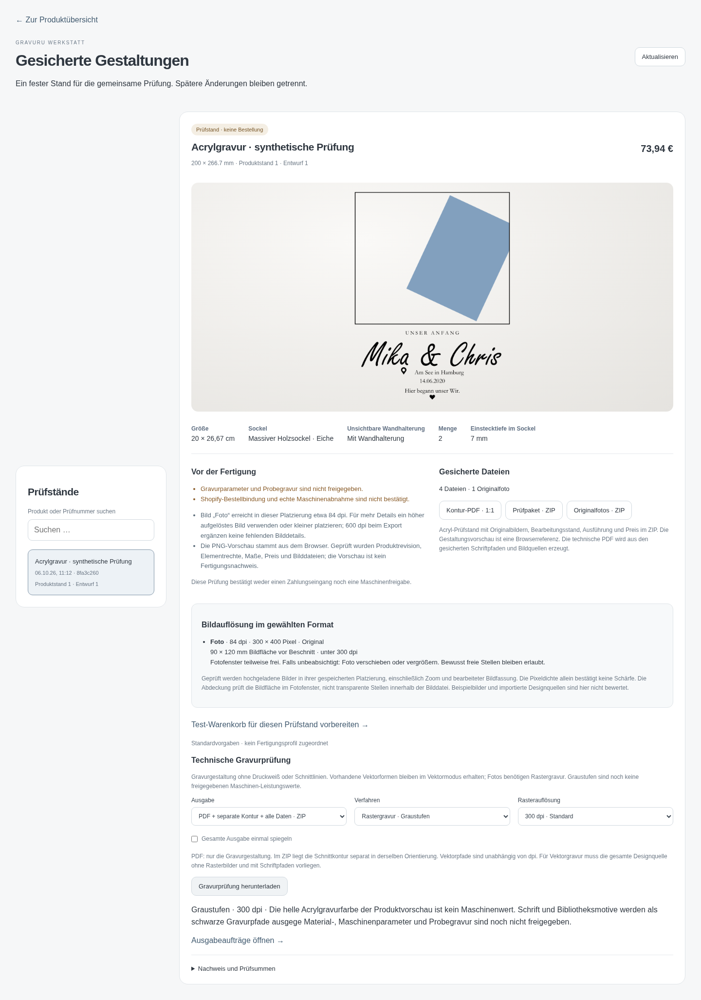

# Fotofenster-Abdeckung im Dashboard

06.10.2026. Bestehende Cloud-Aufgabe, Repository Chris83638w/gravuru-2027, Branch `task/acrylic-photo-coverage-20261006`, Basis `537730a2ac659f2d8cd244d5efa1037a0e07ef5c` (Remote bestätigt). Nur synthetische Prüfdaten.

## Umgesetzt

Die Bildprüfung eines neuen Acryl-Prüfstands zeigt zusätzlich, ob die platzierte Bildfläche das Fotofenster vollständig abdeckt. Bei freiem Bereich: **„Fotofenster teilweise frei. Falls unbeabsichtigt: Foto verschieben oder vergrößern. Bewusst freie Stellen bleiben erlaubt.“**

Das Foto bleibt frei verschiebbar, drehbar und skalierbar. Keine automatische Korrektur, kein zusätzlicher Kundendialog, keine Exportblockade und keine Überlappungswarnung beim Druck. Diese Backendinformation ergänzt den bereits vorhandenen Auflösungshinweis.

Rechteck, Kreis, Ellipse und Bogen werden entsprechend ihrer tatsächlichen Fotomaske geprüft. Die Bogenkontrollpunkte stammen aus derselben Quelle wie die Vorschau; die Kontur wurde nicht verändert. Drehung und Verschiebung des Fotos hinter der Maske werden berücksichtigt. Eine Drehung des gesamten Fotofensters beeinflusst diese relative Abdeckung nicht. Das Ergebnis wird je Platzierung im unveränderlichen Manifest gesichert und liegt auch im ZIP.

[Handyansicht](acryl-fotofenster-mobil.png)

Das blaue Rechteck ist ein synthetisches Testfoto. Es wurde für diese Prüfung absichtlich verkleinert, verschoben und gedreht.

## Prüfungen

- `node scripts/cloud-check.mjs`: **289 Tests bestanden, 0 Fehler/Skips**, Referenzen und Python-PDF bestanden; Build **76 Ressourcen/1 Modell**, 11:13:01–11:14:38 Uhr Europe/Berlin. [Gesamtbericht](acryl-fotofenster-cloud-report.json).

- `node --test app/workshop/photo-frame-coverage.test.mjs app/workshop/acrylic-photo-resolution.test.mjs`: sechs Tests bestanden. Vollständige und teilweise Abdeckung, Verschiebung, Zoom, Drehung, bearbeitete Bildmaße und freie Bildobjekte. Unabhängig gerasterte echte SVG-Masken stimmen mit der geometrischen Abdeckungsprüfung überein. Kreis/Bogen lösen bei fehlenden äußeren Rechteckecken keinen falschen Hinweis aus.
- `PYTHONPATH=.local-data/python python3 scripts/check-acrylic-engraving.py --coverage`: Browserprüfung am 06.10.2026, 11:12:29–11:12:36 Uhr Europe/Berlin. Hinweis sichtbar, Ergebnis im ZIP-Manifest `false`; PDF/ZIP ohne Sperre, Original erhalten und wiederholter PDF-Download byteidentisch. Desktop 1440, Handy 390, Tablet 768 Pixel, keine JavaScript-Fehler/Überläufe. [Browserbericht](acryl-fotofenster-browser-report.json).

- `PYTHONPATH=.local-data/python python3 scripts/check-acrylic-engraving.py`: Gegenprobe mit vollständig gefülltem Fotofenster, 11:13:08–11:13:19 Uhr Europe/Berlin. Anzeige und ZIP-Manifest korrekt `true`; PDF/ZIP und alle drei Ansichtsbreiten ebenfalls bestanden. [Gegenprobe](acryl-fotofenster-voll-browser-report.json).

## Grenzen

Geprüft wird die geometrische Bildfläche. Transparente Pixel innerhalb eines PNG, Bildinhalt und fotografische Schärfe werden nicht erkannt. Beispielbilder und importierte Designquellen bleiben außerhalb dieser Uploadprüfung. Alte Prüfstände werden nicht nachträglich verändert; ohne gespeicherten Befund erscheint keine Aussage zur Abdeckung.

Keine Veröffentlichung oder Änderung der bisherigen öffentlichen Testseite. Keine privaten Daten, keine Shopify-/Plesk-Mutation. Echte Test-App-/Store-Anbindung und Maschinenprobe bleiben separat offen. Die nächste externe Abnahme bleibt ein autorisierter Shopify-Testkauf samt Kundenkonto; dieses Paket benötigt dafür keine Zugangsdaten.
