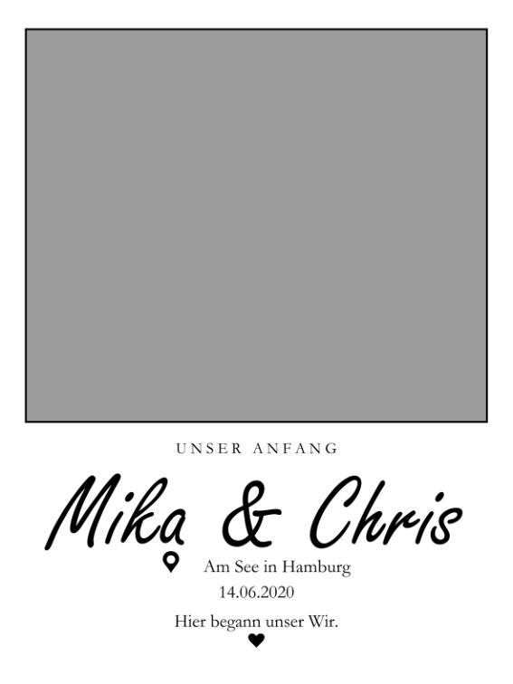

# Native Acryl-Gravurausgabe aus dem Prüfstand

06.10.2026, Prüfungen 10:52–10:54 Uhr Europe/Berlin. Branch `task/acrylic-engraving-output-20261006`, Basis `f5ea76d2fa266d37dfe5d4d2569fd33dc92bc1cf` (Remote bestätigt). Bestehende verwaltete Cloud-Aufgabe, Repository Chris83638w/gravuru-2027. Nur neue synthetische Prüfdatenbanken.

## Ergebnis und Bedienung

Im vorhandenen Dashboard einen gesicherten Acryl-Gravurstand öffnen. Unter **Gravurausgabe** Raster/Graustufen für Fotos oder Vektor für reine Schrift-/Motivpfade wählen, anschließend PDF herunterladen. Standard sind 300 dpi; 600 dpi bleibt ausdrücklich wählbar. ZIP enthält zusätzlich die separate maßhaltige Kontur, Originalbilder, gesicherte Gestaltung und Prüfmetadaten. Es entsteht kein zweiter Editor.

Die Ausgabe verwendet die bereits vorhandene Gravurverarbeitung. Schrift und Bibliotheksmotive werden dunkel ausgegeben, statt die helle Acrylgravurfarbe der Bildschirmvorschau als kaum sichtbare Maschinenwerte zu übernehmen. Fotos erhalten Graustufen. Weiß in der Raster-PDF bedeutet keine Gravur, keine weiße Druckfarbe. Druckweiß, Szene, Sockel und Schnittkonturen sind kein Teil der Gravur-PDF. Eine gewählte Spiegelung wirkt genau einmal und auf Kontur und Gestaltung gleich.

Ein Foto im Vektormodus wird mit „Fotos benötigen Rastergravur“ abgewiesen. Es gibt keine vorgetäuschte Vektorisierung. Unterstützte Schrift-/Motivpfade bleiben im Vektormodus Pfade. Gesicherte Originale und bearbeitete Fotofassung werden unverändert aus dem Prüfstand übernommen; spätere Designänderungen beeinflussen diesen Stand nicht.

[Beispiel-PDF herunterladen](acryl-gravur-300dpi.pdf) · [Dashboard](acryl-gravur-dashboard.png) · [Handyansicht](acryl-gravur-mobil.png)

Das Beispiel verwendet einen künstlichen einfarbigen Fotoplatzhalter. Es ist kein privates Kundenfoto und kein Nachweis einer realen Probegravur.

## Tatsächlich ausgeführte Prüfungen

- `node scripts/cloud-check.mjs`: **283 Tests, 0 Fehler, 0 Skips**, Python-PDF und Referenzen bestanden, Build **76 Ressourcen / 1 Modell**. 10:52:33–10:54:07 Uhr Europe/Berlin. [Gesamtbericht](acryl-gravur-cloud-report.json).
- `node --test app/workshop/acrylic-engraving.test.mjs`: drei gezielte Tests bestanden. Maßhaltige PDF, DeviceGray-Foto, schwarze Pfade, freie Flächen, einmalige Spiegelung, unveränderte Originalbytes, getrennte Kontur, Vektor ohne Rasterbilder/Schriften, Paketprüfsumme, verbotene Druckoptionen, Backend-Auftrag und Wiederholbarkeit.
- `PYTHONPATH=.local-data/python python3 scripts/check-acrylic-engraving.py`: echte Chromium-Bedienung des Dashboards, Standard 300 dpi, PDF- und ZIP-Download, 200 × 266,7 mm, separate Vektorkontur, Originalprüfsumme, verständlicher Foto-/Vektormodusfehler und identischer Wiederholungsdownload. Desktop 1440, Handy 390, Tablet 768 Pixel; keine JavaScript-Fehler oder horizontaler Überlauf. 10:52:11–10:52:21 Uhr Europe/Berlin. [Browserbericht](acryl-gravur-browser-report.json).

## Geänderte Bausteine und Grenzen

`acrylic-engraving-proof.mjs` ergänzt die native Gravurausgabe. `acrylic-artwork.mjs` erzeugt dafür dunkle Schrift-/Motivpfade mit Außenkonturbegrenzung; der bestehende Druckmodus bleibt erhalten. `form-engraving-proof.mjs` stellt den bestehenden Worker gemeinsam bereit. `http.mjs` bindet den Auftrag an die bestehende Ausgabequeue; `acrylic-review.mjs` kennzeichnet Druck/Gravur passend zum eingefrorenen Verfahren. Tests und Fixture dokumentieren den wiederholbaren Ablauf.

Weiterhin keine freigegebenen Laserparameter, reale Materialprobe oder Maschinenabnahme. Nicht unterstützte Elementtypen und umgefärbte importierte Designbilder werden weiterhin ausdrücklich abgewiesen. Reale Shopify-App-/Test-Store-Anbindung, Zahlung und Kundenkonto bleiben offen. Der bekannte Schiefer-Entwurfsartikel ist kein Acryl-Testprodukt. Kein Shopify-/Plesk-Zugriff, keine Veröffentlichung, kein Merge und keine privaten Daten in Git. Die ältere öffentliche Konfi-Testseite wurde nicht aktualisiert.

Nächster externer Schritt: vorhandenen lokalen Bestellablauf mit der bestätigten Shopify-Testanbindung verbinden und echten Testkauf samt Kundenkonto prüfen. Maschinen-/RIP-Abnahme separat am jeweiligen Gerät; dieses Paket erfindet keine Produktionsfreigabe.
