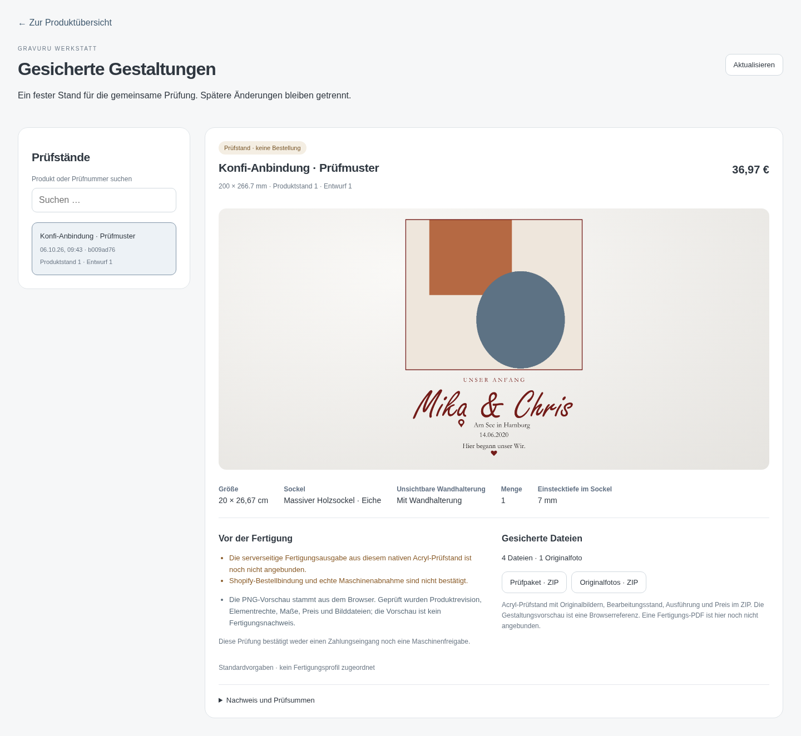

# Acryl-Konfigurator → Werkstattprüfstand

06.10.2026 · ausschließlich in der bestehenden verwalteten Cloud-Aufgabe. Accountname „mika“ laut Nutzer; Runtime bestätigt laufende Cloud, keine konfigurierten Secrets/Identitäten. Repository `Chris83638w/gravuru-2027`, eigener Branch `task/acrylic-review-handoff-20261006`, Ausgangscommit `8cb741d67fb867faefc70f97117a5f741fc5b705` unabhängig am Remote bestätigt.

## Bedienung

Gespeichertes Acrylprodukt im bestehenden Konfigurator öffnen, Text ändern und eigenes Foto hochladen. „Gestaltung fertig – weiter“ → „Für die Werkstattprüfung sichern“. Der anschließende Dashboardlink öffnet genau diesen Prüfstand unter `/werkstatt/pruefstaende/`. Dies ist ein geschützter Werkstattablauf; kein öffentlicher Bestell-/Zahlungsnachweis.

Der Stand enthält die originale native Produktdefinition mit Revision, Kundenobjekte, Schriftpfade/Motivquellen, geprüfte importierte Originaldesigns, Originalbilder und gegebenenfalls bearbeitete Bilddateien. Original- und bearbeitete Bilder bleiben byteidentisch; nur die Anzeigevorschau wird aufbereitet. Alle ZIP-Nutzdateien sind gehasht. Foto-Ausrichtung steht bei den Kundenobjekten, Größe/Sockel/Wandhalterung und Preis werden serverseitig aus der festen Produktrevision berechnet. Aktuell bis vier verwendete Bilder, jedes höchstens 15 MB/20 Megapixel. Die Browserreferenz zeigt die Gestaltung ohne Sockel-/Bedienebenen und wird nicht als Produktion ausgegeben.

Wiederholung desselben Requests liefert denselben Prüfstand. Eine neue Gestaltung erhält einen neuen Stand. SQLite verhindert Updates/Löschen der Prüfstände; ein Neustart oder spätere Produktpreisänderung verändert die gespeicherten ZIP-Bytes nicht. CSRF, Host/Origin-Schutz bleiben erhalten. Fremde Preise, unbekannte Optionen, fehlende/mehrdeutige Bilder, unerlaubte Elementänderungen und ungültige Bilddateien werden abgewiesen.

## Tatsächliche Prüfung

- `node scripts/cloud-check.mjs`: 06.10.2026 **09:42:30–09:43:55 Europe/Berlin**, **269 Tests, 0 Fehler, 0 Skips**, Python-/Referenzprüfung bestanden; Build **76 Ressourcen/1 Modell**. [Maschinenbericht](acrylic-review-cloud-check.json).
- `node --test --test-reporter=tap app/workshop/acrylic-review.test.mjs`: zusätzlich nach Ergänzung des SVG-Originalnachweises bestanden. Alle 28 Ausführungen, explizit groß/Eiche/Wand 3.697 Cent, Menge 2 = 7.394 Cent, 7 mm Verdeckung. Abgelehnte Manipulationen, wiederholte Sicherung, byteidentische Original-/bearbeitete Bilder, importierte SVG-Originalquelle, späterer Preisstand, SQLite-Schreibschutz und Wiederöffnung geprüft.
- `PYTHONPATH=.local-data/python python3 scripts/check-acrylic-review.py`: **09:43:23–09:43:35 Europe/Berlin**, echtes Datei-Uploadfeld, „Mika & Chris“ im Texteingabefeld, Größe/Sockel/Wandwahl, Konfi-Abschluss, Dashboard, ZIP-Hash/Originalfoto, spätere Änderung und getrennte Sicherung. 1.440/390/768 px, keine JavaScript-Fehler oder Seitenüberläufe. [Bericht](acrylic-review-check.json).

- `PYTHONPATH=.local-data/python python3 scripts/check-konfi-completion.py`: bestehende Formstrecke nach gemeinsamer Dashboard-/Speicheränderung erneut bestanden, abgeschlossen **09:45:06 Europe/Berlin**. Roland-PDF/Mimaki-ZIP mit motivbezogenem Weiß, Originalfoto/ZIP-Hashes, unveränderliche Ausgabe sowie ausschließlich lokale synthetische bezahlte Bestellnachricht und Produktentwurf geprüft. [Regressionsbericht](acrylic-review-form-regression.json).

[Handyansicht](acrylic-review-mobile.png)

## Grenzen und nächster Schritt

Die PNG wird im Browser aus der aktuellen Gestaltung erzeugt und serverseitig als Bild geprüft. Ihre visuelle Gleichheit zur validierten Objektliste ist noch kein serverseitiger Nachweis. Deshalb keine Fertigungs-/Kontur-PDF oder Warenkorbbindung aus dieser neuen Snapshotart; solche API-Aufrufe werden ausdrücklich abgewiesen. Die bereits vorhandenen Acryl-Prüfdownloads aus dem aktuellen Editor sind davon getrennt. Nächster Code-Schritt: native Ausgabe aus eingefrorenen Ressourcen und Originalbildern mit korrekter CMYK-/Weiß-/Konturbehandlung implementieren und gegen den bestehenden Konfi prüfen.

Die Werkstatt-SQLite-Dateien bleiben privat außerhalb von Git. Die laufende Cloud-VM ersetzt keine dauerhafte gemeinsame Kundendatenablage. Keine alten privaten Bestände gelesen, kein Restore, keine Shopify-/Plesk-Mutation, Veröffentlichung, PR oder Merge. Die bisherige öffentliche Testseite wurde nicht aktualisiert. Echte Shopify-Testziel-/App-Anbindung und RIP-/Maschinenabnahme bleiben separat offen; der vorhandene Shopify-Link ist dokumentiert und wird nicht erneut erfragt.
