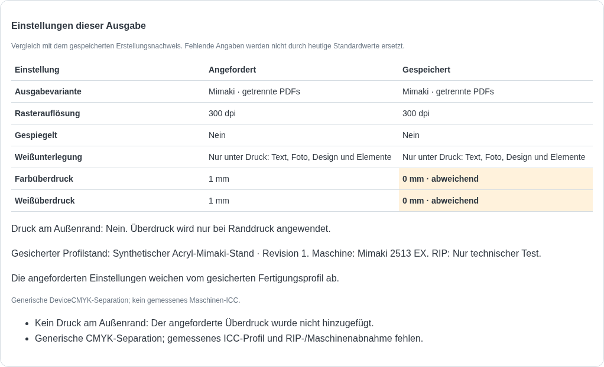

# Gespeicherte Ausgabeeinstellungen sichtbar – 06.10.2026

Branch `task/output-specification-20261006`, Basis `962d10c4725a74e3725818731dcf9819375c813d` im Repository `Chris83638w/gravuru-2027`. Implementierung in vorhandener Linux-Cloud, Node 24.19.0; Konto „mika“ Nutzerangabe.

## Ergebnis

Unter **Ausgaben → Auftrag → Einstellungen dieser Ausgabe** stehen angeforderte und tatsächlich im Erstellungsnachweis gespeicherte Werte nebeneinander: Ausgabevariante, Rasterauflösung, Spiegelung, Weißunterlegung, Farb- und Weißüberdruck. Abweichungen sind mit Text und Farbe markiert. Bei Gravur erscheinen Verfahren und Spiegelung; Vektorpfade werden nicht als Rasterauflösung ausgegeben.

Der gespeicherte Fertigungsprofilstand, eingetragene Maschine/RIP, Profilabweichungen und Rendererhinweise bleiben an die jeweilige Ausgabe gebunden. Kein Zugriff auf heutige Produkt-/Profilwerte. Fehlende historische Angaben bleiben „Nicht dokumentiert“, laufende Aufträge zeigen keine erfundene fertige Ausgabe. PDF-, ZIP-, Foto- und private Quelleninhalte werden nicht in die neue JSON-Projektion übernommen.

API: `GET /api/workshop/export-jobs/:id`, neues Feld `outputSpecification`. Bestehende Renderer, Rezepte, Einstellungen, PDF-Dateien und Datenbankschemata unverändert. Die Anzeige liest den gesicherten Erstellungsnachweis; sie ersetzt keine unabhängige Dateianalyse oder reale Maschinenprüfung.

## Tatsächlich ausgeführte Prüfung

- `node --test app/workshop/output-specification.test.mjs app/workshop/export-recovery.test.mjs`: vier fokussierte Tests bestanden. Anschließend HTTP-Assertions erweitert und im vollständigen Lauf mitgeprüft.
- `node scripts/cloud-check.mjs`: 06.10.2026 **15:43:46–15:45:49 Europe/Berlin**, **319 Tests, 0 Fehler, 0 Skips**, Referenzen/Python/PDF bestanden; Build **76 Ressourcen, 1 Modell**.
- `python3 scripts/check-output-specification.py`: finale Browserprüfung **15:44:26–15:44:49 Europe/Berlin**, synthetische private Testablage. 1 mm Farb-/Weißüberdruck angefordert, mangels Randdruck 0 mm gespeichert und korrekt angezeigt. Fester Profilstand 1 trotz aktuellem Stand 2; Abweichung sichtbar. Wechsel zur zweiten Ausgabe entfernt alte Hinweise und zeigt deren Spiegelung. Gesicherte Gestaltung unverändert.
- Chromium: **1440, 390, 768 px**, keine JavaScriptfehler oder horizontalen Überläufe. Desktop- und Handyansicht zusätzlich angesehen; Handy-Wortumbrüche verbessert und Browserprüfung wiederholt.
- `git diff --check`, JavaScript-Syntaxprüfung bestanden.

[Browserbericht](ausgabe-einstellungen-20261006/report.json) · [Cloud-Testbericht](ausgabe-einstellungen-20261006/cloud-check.json)

[Handyansicht](ausgabe-einstellungen-20261006/einstellungen-390.png)

## Grenzen und nächster Schritt

Keine Veröffentlichung, keine echte Bestellung und keine RIP-/Maschinenfreigabe. Reale Corel-/Mimaki-Abnahme der zuvor bereitgestellten Vektordateien bleibt offen. Nächster konkreter Schritt: das tatsächliche Import-/Probedruckergebnis mit Maschine/RIP und exakter PDF im bestehenden Prüfjournal dokumentieren, sobald Mikails Ergebnis vorliegt. Gemessenes ICC und echte Test-App-/Betriebsanbindung bleiben separat offen.
