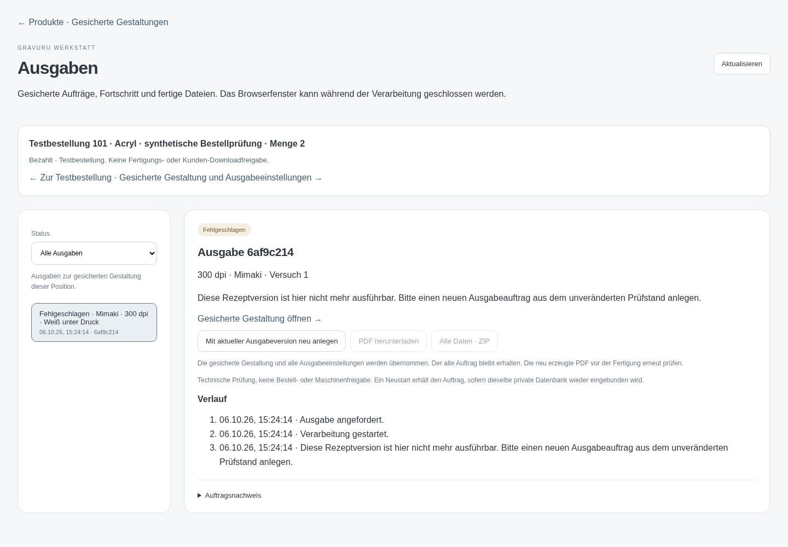

# Alte fehlgeschlagene Ausgabe gezielt neu anlegen – 06.10.2026

Basis `56a7467b4407455f2870066a3cd31916c08875bb` per GitHub-Remote bestätigt; Branch `task/obsolete-output-recovery-20261006`. Umsetzung in der bestehenden verwalteten Linux-Cloud, keine Veröffentlichung oder Serveränderung.

## Behobener Ablauf

Nach einem Wechsel der Ausgaberezeptversion konnten alte fehlgeschlagene Aufträge erneut angefordert werden, scheiterten aber immer wieder an derselben nicht mehr unterstützten Version. Unter **Ausgaben** wird dafür jetzt **Mit aktueller Ausgabeversion neu anlegen** angeboten. Der normale Wiederholbutton bleibt für Fehler unter weiterhin unterstützten Versionen zuständig.

Die Neuanlage verwendet ausschließlich den fest gesicherten Prüfstand und die gespeicherten Einstellungen des alten Auftrags. Keine Übernahme aktueller Produktänderungen oder neuer Profilvorgaben. Alte Aufträge, deren Verlauf und vorhandene Dateien bleiben unverändert. Wiederholung führt zum selben neuen Auftrag statt zu Duplikaten. Der Bestellbezug bleibt beim Wechsel zur neuen Ausgabe erhalten. Existiert der passende aktuelle Auftrag bereits, wird dieser geöffnet.

Die neue PDF entsteht mit dem aktuellen Renderer und ist daher **erneut zu prüfen**; identische Einstellungen sind kein Versprechen byteidentischer Ausgabe über Rendererwechsel. Nicht mehr gültige Einstellungen werden abgewiesen statt stillschweigend ersetzt. Scheitert auch der aktuelle Auftrag, bleibt dessen konkrete Fehlermeldung sichtbar und der normale Wiederholweg verfügbar.

Technisch: bestehende Aufgabenliste und Detailoberfläche erweitert, `POST /api/workshop/export-jobs/:id/recreate` nimmt nur eine leere Anforderung an. Fremde Einstellungen, fehlendes CSRF und nicht geeignete Aufträge werden abgewiesen. Keine neuen Tabellen, keine Änderungen an bestehenden PDF-Rezepten. Archivierte fertig erzeugte PDFs bleiben weiter herunterladbar; es gibt keine automatische Neuberechnung.

## Prüfungen

- Fünf gezielte Queue-/HTTP-Tests bestanden: Druck und Vektorgravur mit alten Rezepten, feste Spiegelungs-/DPI-/Weiß-/Randvorgaben, unveränderlicher alter Auftrag und Prüfstand, mehrfacher Klick ohne Duplikat, abgewehrte Parameteränderung/CSRF, bestehende Wiederaufnahme-/Workerprüfungen.
- Echter Browserablauf **06.10.2026, 15:24:13–15:24:22 Europe/Berlin**: synthetische Testbestellung mit altem fehlgeschlagenem Druckauftrag → Neuanlage → aktuelle Mimaki-Ausgabe → Weiß-PDF-Download. Wiederholte Neuanlage öffnet dieselbe Ausgabe; alter Auftrag samt Ereignissen, Bestellung und Prüfstand unverändert. Desktop 1440, Handy 390, Tablet 768 Pixel ohne JavaScript-Fehler oder horizontalen Überlauf. [Browserbericht](ausgabe-neuanlage-browser-report.json).
- Vollständiger Cloud-Check **15:24:19–15:26:16 Europe/Berlin**: **316 Tests / 0 Fehler / 0 Skips**, Referenzen und Build **76 Ressourcen / 1 Modell** bestanden: [Cloud-Bericht](ausgabe-neuanlage-cloud-report.json).
- Implementierung in `http.mjs` und vorhandener Ausgabenoberfläche; neue HTTP-Regression `export-recovery.test.mjs`, Browserablauf `scripts/check-export-recovery.py`, synthetische Fixture erweitert.

[Handyansicht](ausgabe-neuanlage-mobil-20261006.png).

## Grenzen / nächster Schritt

Nur synthetische Daten, keine Shopify-Anfragen oder echte Bestellungen. Keine bestehenden privaten Druckproben bearbeitet, keine Maschinenfreigabe. Nächste externe Abnahme bleibt das reale Import-/Probedruckergebnis der bereitgestellten Dateien, anschließend bestätigte Fertigungsvorgaben dokumentieren. Echte Test-App-Anbindung und dauerhaft authentifiziert erreichbares Backend bleiben offen; der alte private Muster-Site ist nicht das aktuelle Werkstatt-Backend.
