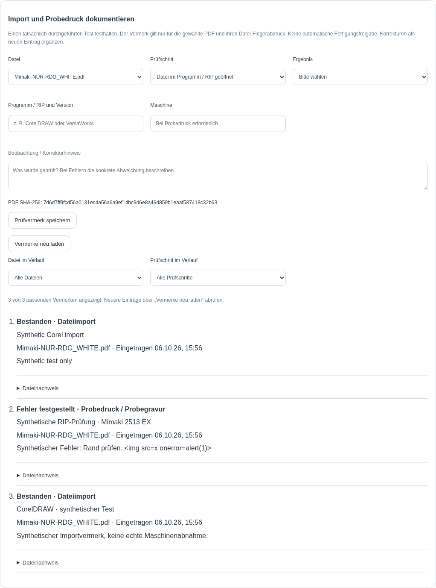

# Vollständiger, filterbarer Prüfverlauf – 06.10.2026

Branch `task/output-check-history-20261006`, Basis `7ca26dfcbdecd4301c72b05004e0d7fb3cf434ca` in `Chris83638w/gravuru-2027`. Vorhandene Cloud-Laufzeit aktuell bestätigt (running/connected, Spec 295); Konto „mika“ Nutzerangabe. Keine neue Umgebung.

## Ergebnis

Der Prüfverlauf unter **Ausgaben → Import und Probedruck dokumentieren** war bisher auf die neuesten 200 Einträge begrenzt. Jetzt lädt **Ältere Vermerke laden** jeweils bis zu 50 weitere Einträge. Filter für Datei (Haupt-/Farb-PDF oder Weiß-PDF) und Prüfschritt (Import oder Druck-/Gravurprobe) gelten vor der Seitenauswahl. Die Gesamtzahl gehört zum gewählten Filter.

Der Seitenverweis ist an einen unveränderlichen Vermerk dieser Ausgabe gebunden. Ein während des Blätterns hinzugefügter Eintrag verursacht weder doppelte noch übersprungene ältere Vermerke. Neuere Einträge werden über **Vermerke neu laden** sichtbar. Die Filter verändern weder die zur Erfassung ausgewählte PDF noch noch nicht gespeicherte Formulareingaben. Beim Wechsel der Ausgabe werden Filter, Verlauf und Formular zurückgesetzt.

API: `GET /api/workshop/export-jobs/:id/checks` unterstützt `format`, `stage`, `before`; Antwort ergänzt `nextBefore`. Die Schreibroute, Dateiprüfsummen, unveränderlichen Einträge, PDF-Erzeugung und Datenbankschemata bleiben unverändert. Keine automatische Maschinenfreigabe.

## Tatsächlich ausgeführte Prüfungen

- `node scripts/cloud-check.mjs`: **15:56:15–15:58:12 Europe/Berlin**, **321 Tests, 0 Fehler, 0 Skips**; Referenzen/Python/PDF bestanden; Build **76 Ressourcen, 1 Modell**. [Cloud-Testbericht](ausgabe-pruefverlauf-20261006/cloud-check.json). `git diff --check` bestanden.

- `node --test app/workshop/output-checks.test.mjs`: fünf Tests bestanden. 207 ältere Einträge ohne Verlust/Duplikate trotz späterem Eintrag; 61 ältere Weiß-/Druckvermerke hinter 205 neueren Farbvermerken vollständig gefunden. Ungültige Filter und Verweise anderer Ausgaben abgewiesen; Unveränderlichkeit/Wiederholschutz weiter geprüft.
- `python3 scripts/check-output-check-history.py`: **06.10.2026, 15:55:52–15:56:08 Europe/Berlin**, bestanden. 206 synthetische Einträge; 55 ältere Weiß-/Importvermerke vollständig erreichbar, neuer Eintrag erst nach Aktualisieren. Leerer Filter, Formularerhalt, Ausgabewechsel und HTTP-Fehlerfälle geprüft.
- `python3 scripts/check-output-checks.py`: **15:56:43–15:57:02 Europe/Berlin**, bestehender durchgehender Ablauf bestanden: synthetische Bestellung → Ausgabe → Prüfvermerke → Reload → unveränderte Weiß-PDF; CSRF, falsche SHA, HTML-Escaping und Auftragswechsel weiterhin geprüft.
- Beide Browserprüfungen auf **1440, 390, 768 px**, keine JavaScriptfehler oder horizontalen Überläufe. Desktop-/Handyscreenshots zusätzlich angesehen.

[Verlaufsprüfung](ausgabe-pruefverlauf-20261006/report.json) · [Bestehender Journalablauf](ausgabe-pruefverlauf-20261006/journal-regression.json)

[Handy: leeres Filterergebnis und erhaltene Eingabe](ausgabe-pruefverlauf-20261006/verlauf-390.png)

## Grenzen und nächster Schritt

Prüfungen ausschließlich mit synthetischen Daten und temporären privaten Testdatenbanken. Keine echten Import-/Druckergebnisse eingetragen, keine vorhandenen privaten Datenbanken verändert, kein Deploy oder Shopify-/Plesk-Zugriff. Reales Corel-/Mimaki-Testergebnis der bereitgestellten PDFs bleibt offen. Nächste externe Handlung: tatsächliches Testergebnis mit genauer Datei, Programm und Maschine dokumentieren. Echte Shop-Bestellstrecke, dauerhafte private Betriebsanbindung und gemessenes ICC bleiben separat offen.
