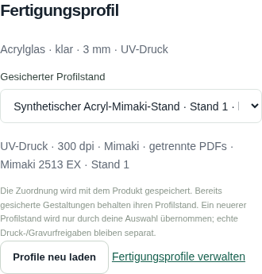

# Fertigungsprofil beim neuen Acrylprodukt aus Bestellung erhalten – 06.10.2026

Basis `928c071ec8a777e10494ba1bbe2d8698735629ea` per GitHub-Remote bestätigt; eigener Branch `task/order-product-profile-20261006`. Bestehende verwaltete Linux-Cloud, keine neue Umgebung oder Serverplanung.

## Korrigierte Lücke

Der vorhandene Ablauf **Bestellung → Gestaltung als neues Produkt** baut native Acrylvorlagen aus dem eingefrorenen Kundenlayout auf. Dabei ging die inzwischen unterstützte Fertigungsprofilreferenz verloren: Der neue Entwurf fiel auf Standardwerte zurück.

Neue Übernahmen erhalten jetzt genau die Profil-ID und Revision des gesicherten Bestellstands. Produktreferenz, Bestellposition, Manifest, gesicherte Profildatei und Profilprüfsumme müssen zusammenpassen. Ein später geändertes oder im neuesten Stand archiviertes Profil ersetzt den ursprünglichen Stand nicht. Die vorhandene serverseitige Material-/Verfahrens-/Stärkenprüfung gilt weiterhin beim Speichern.

Die Vorschau nennt das übernommene Profil und seinen Stand. Der neue private Produktentwurf zeigt die Zuordnung unter **Fertigung**. Standardmäßig bleiben ursprüngliche Beispieltexte; Kundenfotos, Uploadreferenzen und Fotobearbeitungsdaten werden weiterhin entfernt. Die ursprüngliche Bestellung, ihr Prüfpaket, das Ausgangsprodukt und Shopbindungen bleiben unverändert. Bereits vor dieser Korrektur angelegte Produktentwürfe werden nicht nachträglich verändert. Keine Datenmigration oder Änderung von Druckdateien.

## Tatsächliche Prüfungen

- Sechs gezielte Tests bestanden: bisherige native und Formprodukt-Übernahme, Privatdatenentfernung, Vorschautoken/Wiederholung/Neustart sowie neu die erhaltene native Profilrevision nach späterer Änderung und Archivierung. Falsche Profilreferenz oder SHA in der Bestellposition wird abgewiesen.
- Chromium **06.10.2026, 15:08:28–15:08:33 Europe/Berlin**: gesicherte native Gestaltung mit Profilstand 1 → lokale Variantenbindung → signierte synthetische bezahlte Testbestellung → Vorschau → neuer privater Produktentwurf → vorhandener Acryl-Editor. Profilstand 2 war zwischenzeitlich mit anderen Vorgaben archiviert; übernommen wird unverändert Stand 1 samt SHA. Desktop 1440, Handy 390, Tablet 768 Pixel, keine JavaScript-Fehler oder horizontalen Überläufe. [Browserbericht](bestellprodukt-profil-browser-report.json).
- Vollständiger Cloud-Check **15:08:35–15:10:29 Europe/Berlin**: **315 Tests / 0 Fehler / 0 Skips**, Referenzen und Build **76 Ressourcen / 1 Modell** bestanden: [Cloud-Bericht](bestellprodukt-profil-cloud-report.json).
- Geänderte Implementierung: `app/workshop/acrylic-order-product.mjs`. Bestehenden Integrationstest und synthetischen Browserablauf um `--profile` ergänzt; ohne Option bleibt der bisherige Browser-Prüfweg erhalten.

[Handyansicht](bestellprodukt-profil-mobil-20261006.png).

## Grenzen / nächster Schritt

Alle Daten und Profile dieses Nachweises sind synthetisch. Keine Shopify-Anfrage, echte Zahlung, Veröffentlichung oder Maschinenfreigabe. Die gesicherte Profilzuordnung ist keine bestätigte RIP-/ICC-/Gravureinstellung. Vorhandene private Druckproben nicht bearbeitet.

Nächste externe Abnahme: reales Import-/Probedruckergebnis zu den bereits bereitgestellten PDFs dokumentieren und bestätigte Fertigungsvorgaben hinterlegen. Für echte Bestellungen fehlen weiterhin bestätigte Test-App-Anbindung und authentifiziert erreichbares dauerhaftes Werkstatt-Backend. Kein privater Cloud-Dateibestand wird als gemeinsame dauerhafte Datenbank ausgegeben.

Unabhängige reine Zeilenendenänderungen in `README.md` und `CLOUD-AKTUELL.md` bleiben im Arbeitsverzeichnis erhalten und außerhalb dieses Commits.
