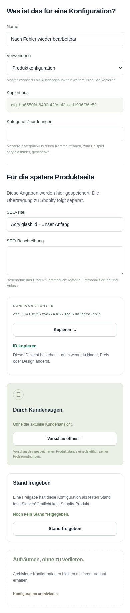
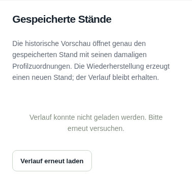

# Produktbearbeitung bei verzögerten und fehlgeschlagenen Antworten

06.10.2026, Cloud-Aufgabenbranch `task/dashboard-completion-20261006`, Ausgangsstand `4b296b28e2d2c7b6f76e82c98589188c40d2af30`.

## Behobene Fehler

- Beim erneuten Laden eines Produkts war das alte Formular weiter bearbeitbar. Eingaben während der laufenden Anfrage konnten durch die Antwort überschrieben werden. Der Browsertest reproduzierte vor der Korrektur das weiterhin aktive Namensfeld. Während des Ladens sind jetzt Bearbeitung und konkurrierende Produktaktionen gesperrt; der Hinweis lautet „Produkt wird geladen …“. Bei einem Ladefehler bleiben ungespeicherte Eingaben erhalten und wieder bearbeitbar.
- Beim Produktwechsel blieb der Versionsverlauf des vorherigen Produkts bis zur Antwort stehen. Bei einem Fehler konnten dadurch fremde Standbezeichnungen und Wiederherstellungsaktionen beim neuen Produkt angezeigt werden. Der Verlauf wird jetzt beim Übernehmen des Produkts geleert; Fehler zeigen keine alten Wiederherstellungsaktionen. „Verlauf erneut laden“ holt ausschließlich den Verlauf nach und bewahrt offene Formulareingaben.

Jede Verlaufsanfrage besitzt eine laufende Kennung. Ein übernommener Produktstand entwertet vorherige Anfragen; auch verspätete Fehler desselben Produkts können den neueren Verlauf oder Erfolgshinweis nicht ersetzen.

Keine Änderung an Produktdatenmodell, Revisionen, Produktionsdateien oder Shopify. Keine privaten Bestände verwendet, keine Veröffentlichung.

## Tatsächlich ausgeführte Prüfungen

- `PYTHONPATH=.local-data/python python3 scripts/check-dashboard-edit-safety.py`: **PASS**, 06.10.2026 **16:28:15–16:28:20 Europe/Berlin**. Frische synthetische SQLite-Datenbank und echte Chromium-Bedienung. Versionskonflikt erzeugt; Produktanfrage zurückgehalten; fehlgeschlagene Antwort; erneutes Laden und Speichern; zweites Produkt mit ausgefallenem Verlauf; Verlauf erneut laden bei erhaltenem Entwurf; ältere erfolgreiche und fehlgeschlagene Verlaufsantworten nach neuerem Speichern desselben Produkts bleiben wirkungslos. 1440/390/768 Pixel ohne horizontalen Überlauf, keine JavaScript-Fehler.
- `node --test app/workshop/repository.test.mjs app/workshop/http.test.mjs app/workshop/product-overview.test.mjs`: **22 bestanden, 0 Fehler, 0 Skips**.
- Die Browser-Fixture baut die vorhandenen **76 Ressourcen / 1 Modell**. Kein separater vollständiger Cloud-Testlauf in diesem Teilpaket; dieser folgt bei der Integration.
- `git diff --check`: bestanden.

[Maschinenlesbarer Browserbericht](dashboard-edit-safety-20261006/browser-report.json)

## Grenzen

Diese Prüfung belegt die genannten Bearbeitungs- und Wiederholungsabläufe im bestehenden Dashboard. Sie ersetzt weder eine vollständige fachliche Gesamtabnahme noch echte Shopify-, Corel-/RIP-, Druck- oder dauerhafte Betriebsabnahme. Historische gespeicherte Produktstände wurden nicht verändert.
