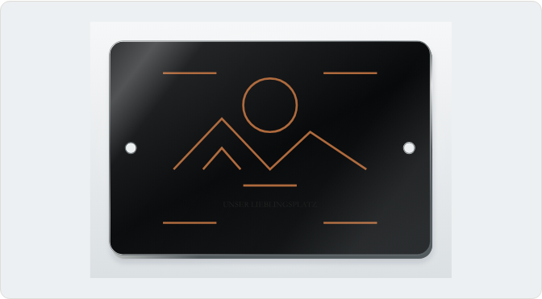
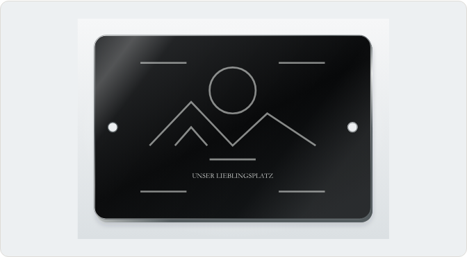
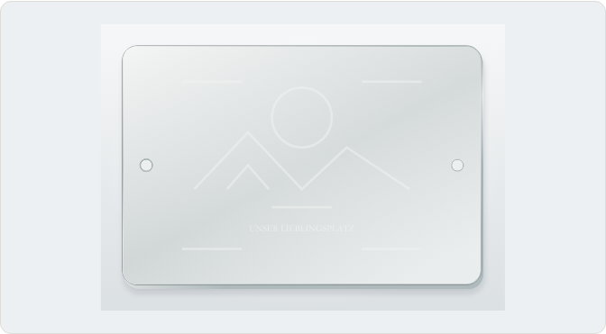

# Acrylgravur in der Materialvorschau – 06.10.2026

Repository Chris83638w/gravuru-2027, Basis `150aa8ea5344f8577686b1ffdff5d40b8e77851f`, Branch `task/acrylic-engraving-preview-20261006`, bestehende Cloud. Kein Deploy/Publish oder Merge.

## Korrektur

Bisher wurden Farbwerte importierter Designs auch im Verfahren Gravur unverändert über das Material gelegt. Daher wirkten beispielsweise braune Drucklinien wie braune Acrylgravur. Die gemeinsame Vorschaukomposition stellt Gravur auf Acryl nun hell dar; Druck zeigt weiterhin Originalfarben. Kein neuer Produktdatensatz oder zusätzlicher Umschalter erforderlich: bestehende Material- und Verfahrenswahl verwenden.

Referenzen für Anthrazit, Schwarz und Satin laut MATERIALREFERENZEN.md. Klares Acryl erhält dieselbe ausdrücklich angenäherte Gravurwirkung; kein neuer realer Mustervergleich behauptet. Die sichtbare Wirkung ist kein Beleg für Laserparameter, Charge oder physische Abnahme.

Dunkle Quellpixel ergeben stärkere helle Gravur, helle schwächere, Weiß/Transparenz keine. Gewichtung wie in der bestehenden technischen Graustufenstrecke (0,2126/0,7152/0,0722), multipliziert mit Originalalpha. Dadurch bleiben Fotos abgestuft statt vollflächig weiß. Originale, Schriftpfade, Lochkonturen, Positionen und Kundenrechte bleiben erhalten. Ein kurzer Kundenhinweis erklärt die Tonwertwirkung. Der Vorschaufilter wird ausschließlich in die Materialansicht eingesetzt; reine Gestaltung und technische Dateien enthalten ihn nicht.

## Sichtbarer synthetischer Vergleich

Dieselbe synthetische Liniengrafik mit braunen Quelllinien, 120 × 80 mm, Acryl 3 mm, zwei Bohrungen. Keine Kundendaten, keine neue kommerzielle Designvorlage.

Druckansicht mit Originalfarben:

Gravuransicht auf schwarzem Acryl:

Gravuransicht auf satiniertem Acryl (materialbedingt geringer Kontrast):

Weitere Aufnahme: [Anthrazit](engraving-acrylic-anthracite.png).

## Tatsächliche Prüfung

- Gezielte Tests: `node --test app/workshop/material-preview.test.mjs app/workshop/form-engraving-proof.test.mjs` – 10 bestanden, keine Fehler/Skips.
- Chromium: alle vier Acrylmaterialien, Druck/Gravur-Wechsel, Speichern/Neuladen, Kundenansicht und direkte Textänderung samt Speichern. Desktop 1536, Handy 390 und Tablet 768 ohne Seitenüberlauf oder JavaScriptfehler.
- Tatsächliche Filterpixel: transparent → Alpha 0; Schwarz → 255; Grau #808080 → 127; Weiß → 0; halbtransparentes Schwarz → 128; braune Quelle → neutrale helle Farbe mit Alpha 139. Keine Farbe in leeren Flächen.
- Reale Raster-PDF: gleiche geprüfte Graustufen-/Maß-/Bilddaten wie vorherige materialunabhängige Ausgabe, schwarze und weiße Originalfotohälften erhalten, Bohrungen ohne Gravur. Vektor-PDF weiterhin echte Pfade, keine Bild-/Weißebene. Gesicherte Materialvorschau enthält den Filter, reine Gestaltung nicht.

**Vollständiger Lauf:** `node scripts/cloud-check.mjs`, 06.10.2026 **06:41:22–06:42:26 Europe/Berlin**: 239 Tests bestanden, 0 Fehler/Skips; Build 76 Ressourcen/1 Modell.

Lauf und Zeitpunkt: [Maschinenlesbarer Nachweis](acrylic-engraving-check.json).

Nicht geprüft: physische Laserprobe, Materialcharge und Leistungswerte. Bestehender separater Acryl-Muster-Site unverändert; Änderung betrifft freie Formprodukte. Nächster unabhängiger Schritt: übrige Material-/Verfahrenskombinationen im Dashboard auf gleiche Vorschau-/Ausgabetrennung abgleichen. Shopify-Test und reale Maschinenfreigabe bleiben separat offen.
