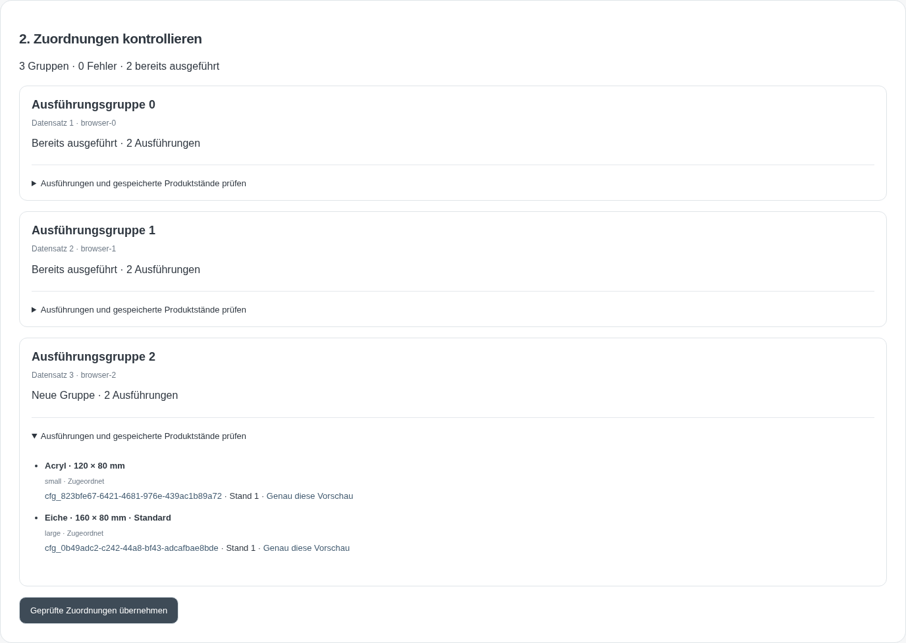

# Ausführungsgruppen aus Excel zuordnen

Branch `task/variant-excel-20261006`, Basis `35e3cae6b34d6ef0daee099e0ada0f81bb63358d`. Fortsetzung des bestehenden Dashboards in der Cloud. Keine neue Umgebung, Veröffentlichung oder Änderung privater Bestände.

## Bedienung und Umfang

**Ausführungen → Excel-Zuordnung** öffnet den neuen Import. Die [Excel-Vorlage](../../app/workshop/templates/ausfuehrungen.xlsx) enthält **Gruppen**, **Varianten** und **Anleitung**. Sie ist absichtlich ohne ausgefüllte Datensätze; es werden keine erfundenen Produkt-IDs oder Beispieldaten versehentlich importiert. Die Vorlage lässt sich außerdem über `/api/workshop/variant-import-template` herunterladen; der tatsächliche Browserdownload wurde geprüft.

Im Blatt **Gruppen**:

| Spalte | Bedeutung |
|---|---|
| `import_key` | Eigener stabiler Importschlüssel, je Änderung eindeutig. Bei Wiederholung derselben Änderung gleich lassen. |
| `name` | Gruppenname; bei Neuanlage Pflicht, bei Update bleibt ein leerer Name erhalten. |
| `action` | Leer/`create`: neue Gruppe. `update`: vorhandene Gruppe ändern. |
| `group_id` | Bei Update die bestehende `variants_…`-ID aus der Gruppen-URL. |
| `expected_revision` | Bei Update der ausdrücklich erwartete aktuelle Gruppenstand. |

Im Blatt **Varianten**:

| Spalte | Bedeutung |
|---|---|
| `import_key` | Verknüpfung zur betreffenden Gruppenzeile. |
| `variant_id` | Stabile Ausführungs-ID; bestehende ID aktualisieren, neue ergänzen. |
| `label` | Eindeutige Kundenbezeichnung innerhalb der Gruppe. |
| `product_id` | Bereits gespeicherte vollständige freie Formkonfiguration (`cfg_…`). |
| `product_revision` | Feste positive ganze Revision dieser Konfiguration; niemals still den neuesten Stand verwenden. |
| `default_variant` | Leer/0 oder genau einmal 1 je Gruppe. Sonst bleibt der bestehende Standard erhalten; bei Neuanlage wird die erste Ausführung verwendet. |

Bis 100 Gruppen und 50 Ausführungen je fertiger Gruppe, höchstens 5000 ausgefüllte Ausführungszeilen und XLSX bis 5 MB. Leere Tabellenzeilen lassen sich erweitern. Formeln, unbekannte Spalten, externe Tabellenbezüge, doppelte IDs/Namen/Produkte und unbekannte Gruppenschlüssel werden abgewiesen. Fehlernummern bezeichnen ausgefüllte Datensätze, nicht Excel-Zeilennummern nach Leerzeilen.

**Tabelle prüfen** zeigt Neuanlagen, Aktualisierungen, Wiederholungen, Standardausführung und genaue referenzierte Produktstände. Der Vorschau-Link bindet die angegebene Revision; der Produkteditor-Link öffnet zur Bearbeitung den aktuellen Produktstand. Erst **Geprüfte Zuordnungen übernehmen** schreibt Gruppen. Eine fehlerhafte Ausführungszeile blockiert ihre ganze Gruppe; gültige Gruppen lassen sich nur ausdrücklich teilweise übernehmen. Verwaiste Importschlüssel stoppen die gesamte Prüfung.

Bei Update bleiben nicht aufgeführte Ausführungen erhalten. Es werden keine Produkte, Preise, Konturen, Bohrungen, Designs oder Kundenrechte verändert und keine Ausführungen still gelöscht. Archivierung/Entfernen erfolgen bewusst in der Gruppenverwaltung. Gruppen mit archivierter Ausgangsrevision müssen dort zuerst aktiviert werden.

## Wiederaufnahme und technische Prüfung

Die Zuordnung verwendet den bestehenden Gruppen-Validator, keine zweite Preis-/Geometrieberechnung. `form_variant_imports` hält Importschlüssel, Fingerprint und Gruppen-ID in der bestehenden Werkstattdatenbank. Gruppenrevision, Mitglieder und Importjournal werden gemeinsam in einer Transaktion geschrieben. Wiederholung bereits ausgeführter Einträge erzeugt keine neue Gruppe/Revision und überschreibt keine nachträglichen Bearbeitungen. Ein wiederverwendeter Schlüssel mit anderen Daten wird abgewiesen. Ein neuer Update benötigt einen neuen Schlüssel und den richtigen erwarteten Stand.

Beim Übernehmen werden Daten und Quellen erneut innerhalb der Transaktion geprüft; ein geänderter Prüftoken oder eine zwischenzeitlich geänderte/archivierte Gruppe wird abgelehnt. Wird ein referenziertes Produkt zwischen Prüfung und Übernahme archiviert, wird keine neue Gruppe gespeichert. Bereits journalisierte Wiederholungen bleiben reine Bestätigungen, auch wenn sich der Bestand später verändert hat.

Der sichere XLSX-Leser ist gemeinsam mit dem bestehenden Produkte-/Designs-Import genutzt. Seine Größen-, XML-, Formel- und Beziehungskontrollen bleiben erhalten. Die bisherige Produktvorlage wurde nach der Änderung erneut im Browser eingelesen. Der neue Template-Generator ist `scripts/build-variant-template.py` (OpenPyXL, bereits vorhandene Python-Abhängigkeit).

`node scripts/cloud-check.mjs`: **06.10.2026, 07:59:15–08:00:32 Europe/Berlin**. Python-Abhängigkeiten und Referenzen, `npm test` mit **259 Tests, 0 Fehlern, 0 Skips**, und `npm run build` bestanden. Build: **76 Ressourcen, 1 Modell**, Editor 461440 Bytes. [Maschinenlesbarer Nachweis](variant-excel-check.json). Der vorherige gezielte Lauf `node --test app/workshop/form-variants.test.mjs` bestand mit 9/9 Tests; der zusätzliche HTTP-Fall wurde im Gesamtlauf geprüft.

Zusätzliche Prüfungen:

- 3 Gruppen anlegen und nach Neustart wiederholen; eine zwischenzeitlich manuell geänderte Gruppe bleibt unverändert.
- 100 Gruppen, davon 3 fehlerhaft: explizite Übernahme speichert 97; korrigierte Tabelle speichert nur die 3 fehlenden Gruppen. Ein simulierter Fehler beim zweiten Journaleintrag rollt sämtliche neuen Gruppen, Revisionen, Mitglieder und Journaleinträge zurück.
- Update nur einer Ausführung erhält die andere, Namen und Historie; veraltete Revisionen, veränderte Tokens und wirkungslose Updates werden abgewiesen.
- Tatsächliche Excel-Browserbedienung: 2 von 3 Gruppen übernommen, Wiederholung 0, Korrektur 1. Danach gezieltes Update und Wiederholung ohne neue Revision. Formel-/Waisenzeilen abgewiesen.
- Vorlage über die Oberfläche heruntergeladen und bytegenau mit dem Repositoryartefakt verglichen; drei Blätter und Dateiprüfsumme dokumentiert.
- Desktop 1440, Handy 390, Tablet 768 Pixel ohne Seitenüberlauf und JavaScriptfehler. API verweigert fehlende/falsche CSRF-Tokens; ein Produktarchiv zwischen Prüfung und Übernahme blockiert die neue Zuordnung.

[Desktop](variant-excel-desktop.png) · [Handy](variant-excel-mobile.png)

Ausschließlich synthetische Prüfdaten; keine private Datenbank oder Zugangsdaten in Git. Kein Merge, PR, Deploy oder Publish. Die separate Acryl-Testseite wurde nicht aktualisiert. Keine Maschinen-/RIP- oder Shopify-Abnahme behauptet.

## Nächster Schritt

Bestehende Gruppen und passende Produktreferenzen als befüllbare Excel-Datei aus dem Backend exportieren, damit IDs und Revisionen nicht abgetippt werden müssen. Der hier fertige Import setzt bereits gespeicherte Produktstände voraus; Produktanlage und anschließende Gruppenzuordnung bleiben ausdrücklich zwei geprüfte Schritte. Keine automatische Ableitung von Konturen oder Kundenfeldern aus Maßangaben.
