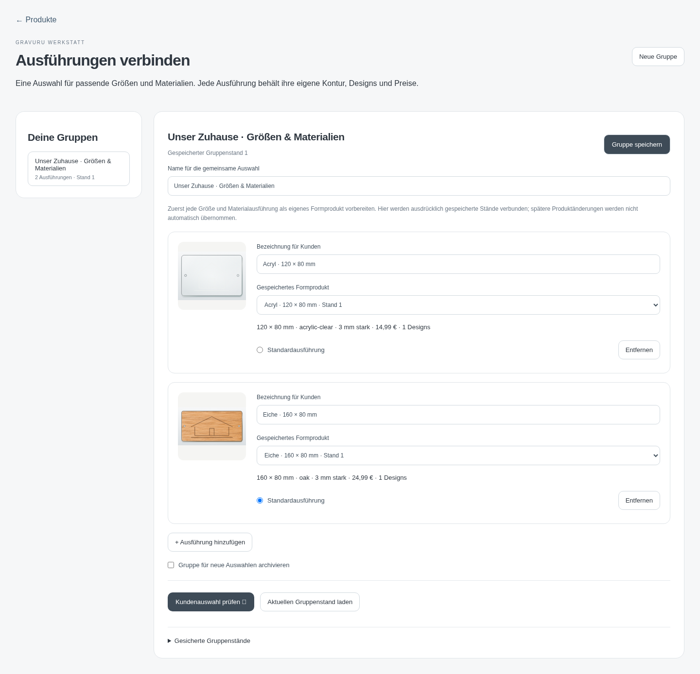
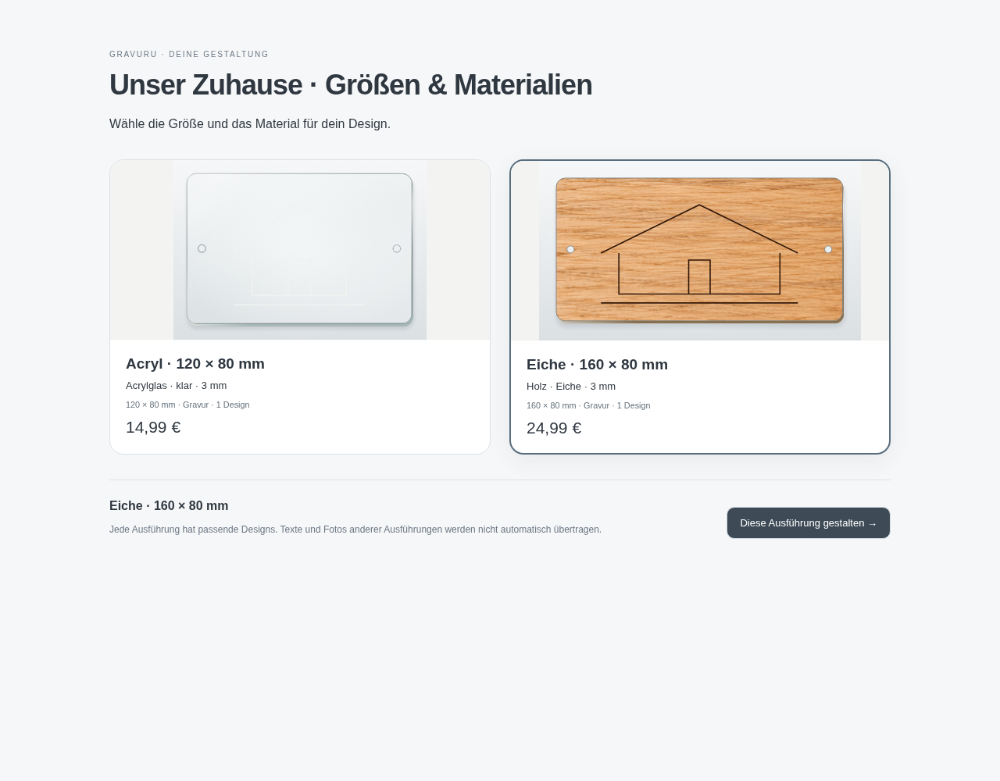

# Größen und Materialien als Ausführungen verbinden

Aufgabenbranch `task/form-variants-20261006`, Ausgangsbasis `67205fa26b8b48fa02f5a0e3959a3f1dcddc91ed`. Fortsetzung in der vorhandenen Cloud, ohne Änderungen an privatem Bestand oder öffentlicher Testseite.

## Ergebnis und Bedienung

Im Dashboard führt **Ausführungen** zur neuen Verwaltung. Vorhandene freie Formprodukte lassen sich mit ihrem ausdrücklich gewählten gespeicherten Stand zu einer gemeinsamen Kundenauswahl verbinden. Eine Gruppe enthält 1–50 Ausführungen und genau eine Standardausführung. Jede Ausführung hat eine stabile ID und eine frei benennbare Kundenbezeichnung. Die Auswahl zeigt Material, tatsächliche Stärke, Maße, passendes Design, Verfahren und Preis aus dem vorhandenen Produktstand.

1. Jede Material-/Größenkombination im bestehenden Formeditor vorbereiten und speichern: Originalkontur/Bohrungen, Material, Stärke, Verfahren, Preis und passende Designs.
2. **Ausführungen → Neue Gruppe**, Gruppennamen eingeben und die vorbereiteten Produktstände hinzufügen. Eine Standardausführung wählen und speichern.
3. **Kundenauswahl prüfen** öffnet eine Auswahl mit Produktvorschauen. **Diese Ausführung gestalten** öffnet den bestehenden Kundenkonfigurator mit genau diesem Produkt und dieser Revision.
4. Soll später eine Änderung übernommen werden, im Backend ausdrücklich den neueren Produktstand auswählen und einen neuen Gruppenstand speichern. Bereits geteilte alte Gruppenlinks bleiben an ihren ursprünglichen Stand gebunden. Archivierte Gruppen und aktuell archivierte Produkte sind für neue Auswahlen gesperrt.

Andere Größen erhalten nicht automatisch die Kundenfelder, Fotos oder Bohrungen einer Vorlage. Jede verknüpfte Ausführung nutzt ausschließlich ihre eigenen vorbereiteten Designs; die bestehende Serverprüfung lehnt ein fremdes Design ab. Der Designwähler bleibt bei einem einzelnen Design ausgeblendet. Die Auswahl selbst verändert keine Produkte und erzeugt keine Shopify-Produkte.

## Technische Entscheidung

Das bestehende Formproduktmodell speichert bereits **eine** genaue Kontur, einen Material-/Verfahrensstand, einen Preis und dessen Designs. Eine alternative Preis-/Geometrieberechnung im Excel-Importer würde Vorschau und Produktion auseinanderlaufen lassen. Deshalb verbindet dieses Paket vollständige, unveränderliche Produktrevisionen statt sie umzurechnen.

Neue, versionierte Ausführungsgruppen liegen in drei zusätzlichen Tabellen der bestehenden Werkstattdatenbank: `form_variant_sets`, `form_variant_revisions`, `form_variant_members`. Keine neue Datenbankdatei und keine Änderung alter Produktdokumente oder -revisionen. Schreiben ist transaktional; Trigger verhindern Änderung/Löschung gespeicherter Gruppensnapshots und Mitglieder. Produktreferenzen werden über die vorhandene Repository-Validierung geprüft; Produktstände selbst sind ebenfalls unveränderlich. Die vorhandene globale DB-Version bleibt unverändert, wie bei den übrigen separaten Werkstatt-Stores.

Gruppenspeichern benötigt die erwartete Revision. Ein Konflikt erhält die Eingaben im Browser. Spätere Produktpreise ändern weder alte Gruppenstände noch bereits gesicherte Kunden-/Prüfstände. Ein Material- oder Größenwechsel öffnet den vorhandenen Formkonfigurator für die ausgewählte Produktrevision; es wird kein zweiter Kundeneditor eingeführt. Die bestehende Produktions-/Bestellstrecke erhält weiterhin die konkrete Produkt-ID und Revision. Eine eigene Shopify-Zuordnung der Gruppe ist hier nicht umgesetzt.

Neue Dateien: `form-variants.mjs`, zugehörige Tests sowie Backend-/Kundenauswahl unter `ui/form-variants*` und `ui/form-variant-picker*`. Integration in `http.mjs`, die bestehende Server-Routenfreigabe und zwei Werkstattnavigationen. Die API bleibt innerhalb der bisherigen geschützten Entwicklungs-/Bedienoberfläche; dieses Paket ersetzt keine Händleranmeldung für einen produktiven Dienst.

## Prüfung

`node scripts/cloud-check.mjs` wurde am **06.10.2026, 07:49:34–07:50:46 Europe/Berlin** ausgeführt. Python-Abhängigkeiten und Referenzen, `npm test` mit **254 Tests, 0 Fehlern, 0 Skips** sowie `npm run build` bestanden. Build: **76 Ressourcen, 1 Modell**, Editor 461440 Bytes. [Maschinenlesbarer Nachweis](variants-check.json).

Der erste Gesamtlauf hatte einen fehlgeschlagenen **Testaufbau** beim Fremd-Host-Test: Node `fetch` übernahm den gesetzten `Host`-Header nicht. Der Test verwendet nun `node:http` wie die bestehenden Schutztests; die erwartete Antwort bleibt 403. Der korrigierte gezielte Lauf bestand mit 5/5 Tests. Ein früher gezielter Test verwendete außerdem einen nicht existierenden Repository-Methodennamen; er wurde auf das vorhandene `setArchived` korrigiert. Keine Schutzprüfung wurde entfernt oder abgeschwächt.

Synthetische Browserprüfung mit 120 × 80 mm Acryl und 160 × 80 mm Eiche, jeweils zwei Bohrungen und separat vorbereitetem Design:

- Gruppe über die Oberfläche angelegt, Standardausführung gewählt, gespeichert und neu geladen.
- Kundenauswahl öffnet korrektes Material, Maße, Preis (1499/2499 Cent) und zugehöriges Design. Fremde Design-ID wird serverseitig abgelehnt; kein Designwähler bei einem Design.
- Preis des Holzprodukts nachträglich auf 3499 Cent geändert: alte Gruppenzuordnung bleibt bei 2499 Cent und Produktstand 1. Neuer Produktstand wird erst ausdrücklich zugeordnet.
- Zweiter Browser-Tab mit altem Gruppenstand abgewiesen, ungespeicherter Name bleibt erhalten.
- Desktop 1440/1280, Handy 390 und Tablet 768 Pixel: kein Seitenüberlauf, keine JavaScriptfehler. Sichtprüfung der Backend-/Kundenaufnahmen.
- API-/Store-Tests prüfen Historie nach Neustart, veränderte Quellenstände, doppelte/fehlende/ungeeignete Zuordnungen, Archivierung auch über alte URLs, Host-/Origin-/CSRF-Schutz und vollständiges Zurückrollen bei simuliertem Schreibfehler.

[Backend am Handy](variants-backend-mobile.png) · [Kundenauswahl am Handy](variants-customer-mobile.png)

## Grenzen und nächster Schritt

Dieses Paket liefert die funktionierende Zuordnungsgrundlage mit Oberfläche. **Die Excel-Kindtabelle für Varianten ist noch nicht angeschlossen.** Nächster Schritt ist deren Übernahme in dieselben Gruppenregeln mit Vorschau, stabilen Schlüsseln und Wiederaufnahme. Automatische Größenumrechnung, hergeleitete Bohrbilder und automatische Foto-/Textübertragung bleiben ausgeschlossen. Die ältere Acryl-Sockelvorlage behält ihre vorhandenen Variantenregeln.

Die Gruppenwahl erfolgt vor dem bestehenden Editor; ein nahtloser Wechsel mitten in einer bearbeiteten Gestaltung ist nicht Teil dieses Pakets. Produktionsreife Materialstärken und Preise werden durch synthetische Beispiele nicht bestätigt. Holzoberfläche stammt aus der dokumentierten gestalteten Referenz, Acryl aus der vorhandenen 2D-Näherung. Reale Maschinen-/RIP-Probe und Shopify-Abnahme bleiben offen.

Keine privaten Kundenfotos/Datenbanken oder Secrets im Repository. Kein Publish/Deploy, Merge oder PR. Die separate Acryl-Testseite wurde nicht aktualisiert.
