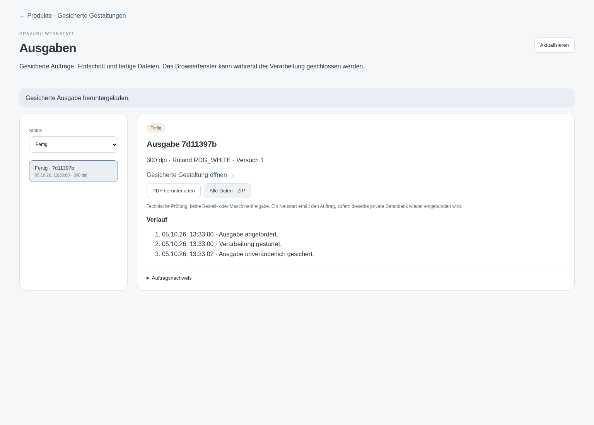
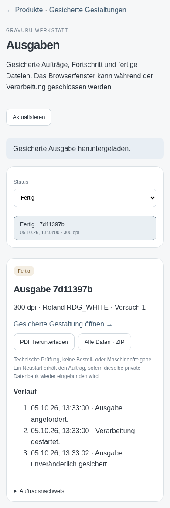

# Persistente Ausgabeaufträge · 05.10.2026

Branch `task/export-queue-20261005`; GitHub-Basis `720d0d1243375109cc237dac4ef9d7d87e416f0a`. Implementiert und geprüft in der bestehenden Cloud, mit synthetischen Produkt-/Kundendaten.

## Ergebnis

Unter `/werkstatt/ausgaben/` stehen wartende, laufende, fertige und fehlgeschlagene Ausgaben mit Verlauf, Wiederholung sowie PDF-/ZIP-Download. Eine technische Druckprüfung aus einem gesicherten Formprodukt legt einen Auftrag an. Das Browserfenster darf danach geschlossen werden. Gleicher Prüfstand, Rezept und Einstellungen ergeben denselben Auftrag; gespeicherte Ausgabedateien bleiben unverändert.

Aufträge, Ereignisse und Ausgaben liegen zusammen in der privaten `workshop.sqlite`. Transaktionale Übernahme mit zeitlich begrenztem Besitz und eindeutiger Kennung verhindert, dass ein verspäteter alter Prozess eine neue Ausgabe überschreibt. Geordnetes Beenden gibt laufende Arbeit sofort frei; nach einem Absturz erfolgt Wiederaufnahme nach Ablauf der 150-Sekunden-Frist. Fehler bleiben sichtbar und sind ausdrücklich erneut anforderbar. Geänderte Rezeptversionen führen nicht zu heimlich anderen Dateien.

Die bisherige Druck-API bleibt kompatibel. Host-/Origin-/CSRF-Schutz gilt auch für Aufträge und Downloads. Keine Browser-Zugangsdaten in URLs oder Auftragsdaten.

## Tatsächlich geprüft

- `npm test`: **204 bestanden, 0 Fehler, 0 Skips**.
- `npm run build`: **76 Ressourcen, 1 Modell**, 461440 Editorbytes.
- Gezielt: SQLite-Neuöffnung nach Fehler; zwei getrennte Datenbankverbindungen mit abgelaufener Verarbeitung; verspätetes Ergebnis; geordnetes Beenden; Wiederholung; unveränderliche Anforderungen und Ereignisse; veraltetes Rezept.
- Echte HTTP-Prüfung: CSRF, Deduplizierung, nicht fertiger Download, fertige PDF und unveränderte Cache-Datei.
- Cloud-Chromium: Kundenprüfstand sichern, Druck anfordern, anfordernde Seite verlassen, Fertigstellung unter Ausgaben, Neuladen, tatsächliche PDF-/ZIP-Downloads und Statusfilter. Desktop 1536 px, Mobil 390 px, Tablet 768 px ohne horizontalen Überlauf oder JavaScriptfehler.

## Grenzen und nächster Schritt

Persistenz setzt dieselbe private Datenbank nach dem Neustart voraus. Die Cloud-VM ist keine dauerhaft gemeinsame Datenablage; kein neuer Speicher oder Server wurde eingerichtet. Browserprüfung nutzte einen isolierten synthetischen Bestand, Persistenztests echte temporäre SQLite-Dateien. Kein externer Dashboard-Publish und keine Änderung des gesicherten Acrylmusters.

Dies sind technische Ausgaben von Prüfständen, keine bezahlten Bestellungen oder Maschinenfreigaben. Gravurausgabe folgt als nächstes; danach verbleibende Dashboard-/Bestellabläufe. Reale RIP-/ICC-/Maschinenabnahme bleibt getrennt.
