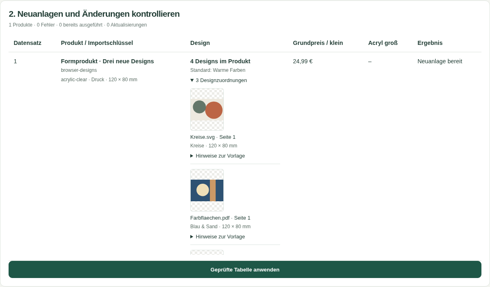
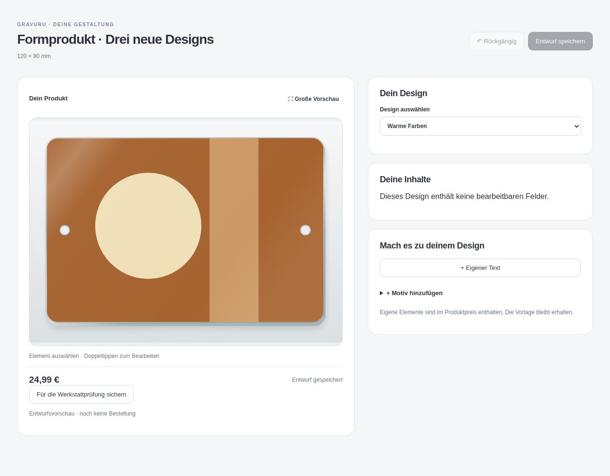

# Mehrere Designs pro Formprodukt per Excel

Stand: 06.10.2026, 07:27 Uhr Europe/Berlin. Aufgabenbranch `task/batch-design-sheet-20261006`, geprüfte Ausgangsbasis `d24d8297d8a751f7961d6b4c989b092783dca3a1`. Fortsetzung des bestehenden Dashboards; keine neue Umgebung, Datenwiederherstellung oder Veröffentlichung.

## Tatsächlich umgesetzt

Die Excel-Vorlage enthält zusätzlich das optionale Blatt **Designs**. Eine Produktzeile kann damit mehrere vollständige Gestaltungen erhalten – bis zu 30 Designs insgesamt in einem Produkt, nicht 30 getrennte Produkte. Neue Zuordnungen verwenden dieselbe Kontur, Materialien, Preise und versionierten Produktdaten wie der Formeditor. Das bisherige Blatt Produkte mit 22 Spalten und CSV bleiben kompatibel.

| Feld im Blatt Designs | Bedeutung |
|---|---|
| `import_key` | Verbindet diese Designzeile mit einer Zeile im Blatt Produkte. |
| `design_id` | Pflicht: vorhandene ID ersetzt dieses Design, neue ID ergänzt ein Design. |
| `design_name` | Optionaler Anzeigename; leer behält bisherigen Namen bzw. verwendet den Dateinamen bei Neuanlage. |
| `design_file` | Exakter Name einer zusätzlich ausgewählten SVG/PDF. Seit 07.10. auch relativer Unterordnerpfad innerhalb eines bewusst ausgewählten Design-Ordners; keine absoluten Pfade oder URLs. [Ordnerimport](DESIGN-ORDNERIMPORT-20261007.md). |
| `design_page` | PDF-Seite ab 1; leer = 1, SVG immer 1. |
| `design_fit` | `original` (Standard, physisches Originalmaß) oder `contain` (proportional innerhalb der Formmaße). |
| `default_design` | Leer/0 oder bei genau einem Design je Produkt `1`. Ohne 1 bleibt der bisherige Standard bestehen, bei leerem Master wird das erste neue Design gewählt. |

Im Blatt Produkte dessen Designspalten bei Verwendung der Kindtabelle leer lassen. Neu anlegen wie bisher aus Master; gezielt aktualisieren mit `action=update`, `product_id`, `expected_revision` und neuem Importschlüssel. Die bestehenden Revisionskonflikte und Wiederholungsregeln gelten unverändert. Es entstehen keine zusätzlichen Produktvarianten allein durch Designzeilen.

Nicht zugeordnete Designs samt Kundenfeldern und Rechten bleiben erhalten. Beim ausdrücklichen Austausch eines Designs entfallen nur dessen bisherige Kundenfelder; neue Felder müssen im Editor zugeordnet werden. Die Freigaben für zusätzlich erlaubte Kundenelemente des ersetzten Designs bleiben erhalten. Flache Bilder oder PDFs werden nicht automatisch in editierbare Bestandteile zerlegt.

Die Prüfung zeigt Designanzahl, Standarddesign, Dateiname, PDF-Seite, Maße, Quellenminiaturen und Übernahmehinweise. Die Liste lässt sich innerhalb des Prüfberichts scrollen und einklappen. Erst **Geprüfte Tabelle anwenden** schreibt Produkte. Eine fehlerhafte Designzeile blockiert das ganze zugehörige Produkt; andere Produkte nur mit ausdrücklicher Teilübernahme. Unbekannte Elternschlüssel stoppen die gesamte Prüfung. Fehlernummern bezeichnen den ausgefüllten Datensatz im Blatt Designs, nicht die physische Excel-Zeilennummer nach Leerzeilen.

Grenzen: bis 100 Produktzeilen, 3000 Designzeilen, 30 Designs je fertigem Produkt und insgesamt 100 unterschiedliche Datei-/Seitenzuordnungen. Tabellen bis 5 MB; einzelne SVG/PDF bis 15 MB. Die Kindtabelle ist für freie Formprodukte implementiert. Die ältere Acrylvorlage verwendet weiterhin ihre einzelne Dateizuordnung im Blatt Produkte. Separate Größen-/Materialvarianten mit je eigener Designfilterung sind noch offen.

## Neu ausgeführte Prüfungen

- `node --test app/workshop/form-batch.test.mjs`: während der Implementierung 8/8 bestanden; danach zusätzlicher Fall für leere Master und Ablehnung der alten Acryl-Kindtabelle im Gesamtlauf.
- `node scripts/cloud-check.mjs`: 06.10.2026 **07:25:57–07:27:06 Europe/Berlin**; Python-Abhängigkeiten, Referenzen, `npm test` und `npm run build` bestanden. **249 Tests, 0 Fehler, 0 Skips; Build 76 Ressourcen / 1 Modell.** Details in [design-table-check.json](design-table-check.json).
- 30 Designs in genau einem Produkt; unberührte Kundenfelder/Geometrie erhalten, ausgewähltes Standarddesign, Wiederholung nach Neustart ohne Duplikate, Grenze über 30 abgelehnt.
- Fehlende Dateien, doppelte Design-IDs, falsche Flags/Spalten, zwei Standarddesigns, unbekannte Elternschlüssel und doppelte Eltern-/Kindzuordnung abgelehnt. Teilübernahme und anschließende Korrektur ohne doppelte Produkte.
- Update unter gleicher Produkt-ID, unveränderliche Historie, kein Überschreiben späterer Änderungen, Änderung nach Prüfschritt durch Tokenvergleich abgefangen.
- Tatsächliche Browserbedienung mit synthetischem XLSX und ausgewählten Originaldateien: eine SVG plus zwei Seiten einer PDF ergeben drei zusätzliche Designs in **einem** Produkt; vorhandenes Design mit Textfeld bleibt bestehen. Standard „Warme Farben“ erscheint in der Kundenansicht, Wechsel zu anderem Design und zurück funktioniert. Wiederholung erzeugt 0 neue Produkte.
- Excel-Formeln, verwaiste Zuordnung, fehlende Datei, doppelte ID und mehrfaches Standarddesign auch über die Oberfläche geprüft; alte Arbeitsmappe ohne Designs akzeptiert. Breiten 1536, 390, 768 ohne Seitenüberlauf oder JavaScriptfehler.
- Excel mit OpenPyXL ergänzt und über Browser eingelesen; der alternative Artifact-Tool-Generator wurde entsprechend angepasst und syntaktisch geprüft, hier nicht ausgeführt.

[Desktop](batch-designs-desktop.png) · [Handy](batch-designs-mobile.png)

Ausschließlich synthetische, isolierte Prüfdaten. Keine privaten Bestände, Originalkundendaten oder Zugangsdaten übernommen. Kein Merge, PR, Deploy oder Environment-Publish. Die bestehende separate Acryl-Testseite wurde nicht aktualisiert. Diese Prüfung ist keine RIP-/Maschinen- oder Shopify-Abnahme.

## Nächster Schritt

Die noch fehlende separate Varianten-Kindtabelle auf das vorhandene versionierte Produktmodell abbilden: explizite gültige Material-/Maßkombinationen und passende Designauswahl, ohne Maße oder Kundenfelder still zu übertragen. Reale Shopify-Anbindung und Maschinenprobe bleiben davon getrennte externe Abnahmen.
