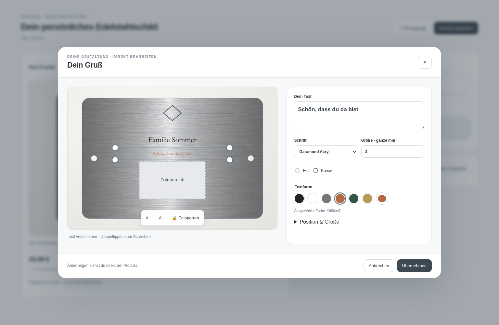
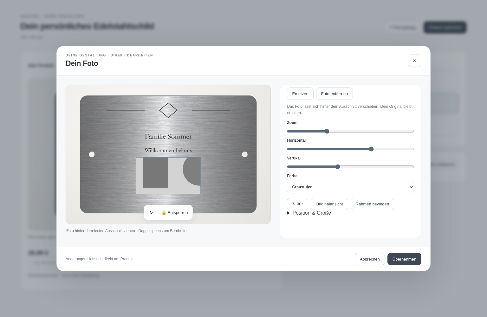
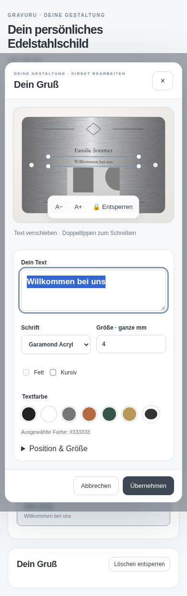
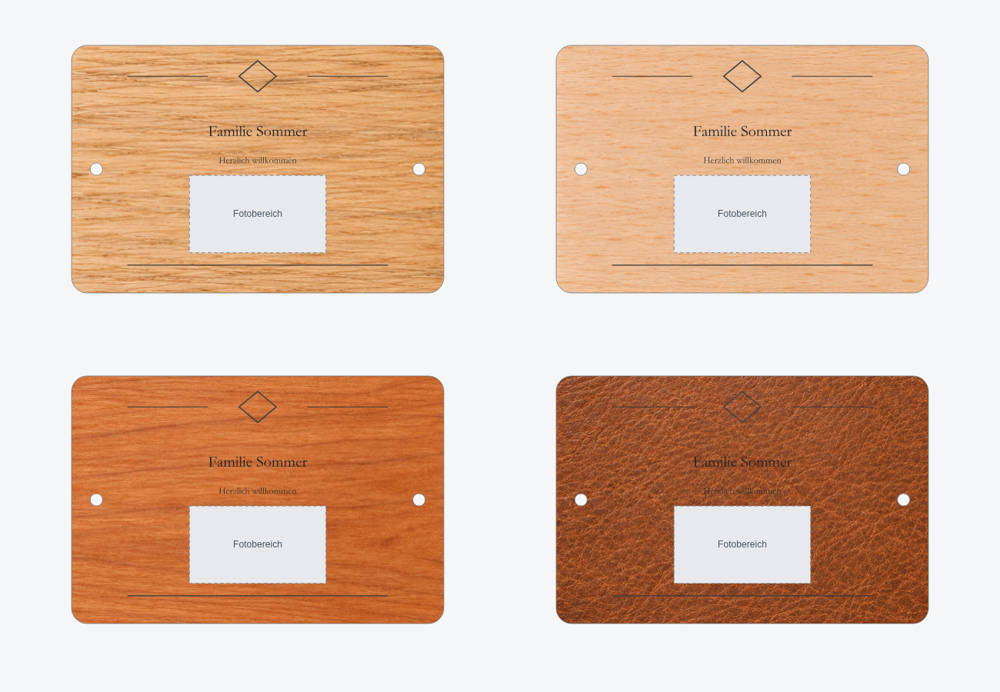

# Cloud-Arbeitsstand: Direktbearbeitung und Materialvorschauen

05.10.2026 · Branch `task/form-direct-edit-20261005` · geprüfte GitHub-Basis `2c932f013332f827ec7471aab1b8bbb42186ae6a`. Fortsetzung des vorhandenen Neuaufbaus; kein Reset auf einen alten Stand.

## Tatsächlich fertiggestellt

Formprodukt-Kundenansicht: Doppelklick/Doppeltippen oder „Bearbeiten“ öffnet die direkte Bearbeitung mit großer vollständiger Produktvorschau links. Rechts stehen Text, vorhandene Schriften, ganze Schrift-mm, verfügbare Fettschnitte, Kursiv und runde Farbpunkte mit freier Farbe. Ein nicht vorhandener Fettschnitt wird nicht erfunden. Beim ersten Fokus wird der Beispieltext ausgewählt; die Plattenmaße ändern sich durch Schriftgröße nicht.

Fotos: Original hochladen/ersetzen, hinter dem festen Ausschnitt ziehen, Zoom/Zuschnitt, Drehung, Graustufen und Sepia. Originalbytes bleiben unverändert. Der Rahmen ist nur bei freigegebenem Backend-Recht beweglich. Auswahlgriffe und direkte Größen-/Drehaktionen berücksichtigen dieselben Feldrechte. Upload löst keinen absichtlichen Scrollsprung aus. Die ersten drei bestätigten Änderungen heben die Vorschau kurz hervor; reduzierte Bewegung wird berücksichtigt.

„Übernehmen“ hält die Bearbeitung im aktuellen Entwurf; „Entwurf speichern“ sichert sie revisionsgeschützt. „Abbrechen“/Escape stellt auch bei verspäteter Vorschauantwort den vorherigen Zustand einschließlich Rückgängig-Verlauf wieder her. Freigegebene Vorlagenfelder müssen vor dem Löschen ausdrücklich entsperrt werden. Rückgängig stellt sie wieder her und sperrt erneut. Pflichtfotos und gesperrte Elemente bleiben geschützt; das eigentliche importierte Design wird nicht verschoben oder gelöscht. Dies zerlegt keine flache PDF automatisch in editierbare Einzelmotive.

Keine Designauswahl bei null/einem Design. Zwei Designs bleiben auswählbar. Die große Vorschau schließt über seitliche freie Flächen; Texte/Fotos auf dem Produkt lösen kein Schließen aus.

Materialvorschauen: vorhandener Edelstahl bleibt erhalten. Eiche, Buche, Kirsche und braunes Leder verwenden eigene leere Texturen, mit `image_gen` aus den vier vorhandenen Musterbildern abgeleitet. Keine alten Leuchttürme/Schriftzüge im Hintergrund neuer Produkte. Originalreferenzen bleiben unverändert; Atlas, Quellenprüfsummen und Herkunft sind unter `app/workshop/ui/material-surfaces/` gesichert. Kontur und Bohrungen bleiben exakt dieselben; unbekannte Stärken werden nicht ergänzt. Diese Vorschaubilder sind keine Herstellerfotos oder Farb-/Materialfreigaben und gelangen nicht in Druck-/Gravurseparationen. Übersichtskarten und gesicherte Vorschau-SVGs betten die geprüfte Struktur ein.

## Tatsächlich ausgeführte Prüfung

Bestehende verbundene Cloud-Laufzeit, Linux/Node 24.19.0; Cloud-Status `provider=cloud`, `running`, aktuelle Beobachtungen, Netzrichtlinie `enforced`. Keine konfigurierten Secrets oder Identitäten. Account „mika“ ist die Nutzerzuordnung, kein erfundener Laufzeit-Anzeigename. Keine Laptopdateien, Bestandsdatenbanken oder Produktionssysteme verwendet.

- Abschließender `node scripts/cloud-check.mjs`: **PASS**, 05.10.2026 **15:32:54–15:33:48 UTC / 17:32:54–17:33:48 Berlin**. Python/PyMuPDF 1.28.2, Referenzprüfung, vollständige Testsuite und Build erfolgreich.
- **226 Tests, 0 Fehler, 0 Skips.** Der Cloud-Check führt dieselben Testdateien wie `npm test` aus. Neue Prüfungen für Eckskalierung/Feldrechte/ganze mm, unabhängige SVG-Clip-IDs und vier Materialzuordnungen mit unveränderter Geometrie/Herkunft. Bestehende Bestell-, Druck-/Gravur-, Archiv-, Wiederholungs- und Schutztests enthalten.
- Build: **76 bestehende Ressourcen, 1 Modell, 461440 Editorbytes**. Der zusätzliche Werkstatt-Materialatlas gehört zum neuen Backend-Dateibaum; die historische Ressourcenanzahl wird dadurch nicht als Gesamtdateizahl ausgegeben.
- Cloud-Chromium: Desktop 1536, Mobil 390, Tablet 768; Text ändern/abbrechen/übernehmen/speichern/neu laden, Farben, gesperrte Felder, Foto-Upload/Pan/Zoom/Graustufen, eindeutige Clip-IDs, seitliches Schließen. Keine JavaScriptfehler oder horizontalen Überläufe.
- Zusätzlicher Browserablauf: Entsperren/Löschen/Rückgängig, Abbruch während verzögerter Antwort, ungültige 3,5 mm abgewiesen, Designwechsel, tatsächliche Touch-Doppeltipps auf beweglichen und festen Textfeldern. Vier Materialansichten sowie alle vier eigenständigen Karten-SVGs ohne externe Unterressourcen sichtbar geprüft. Ausschließlich synthetische Inhalte.

Erster Gesamtlauf scheiterte an zwei konkreten Ursachen: Ein alter Test erwartete für Eiche noch keine eingebettete Materialoberfläche; außerdem verunreinigte die Deprecation-Warnung des alten `fitz`-Importnamens unter PyMuPDF 1.28.2 die JSON-Ausgabe der PDF-Testinspektion. Die Erwartung ist nun positiv gegen die neue Eichenstruktur geprüft; die PDF-Prüfung nutzt `import pymupdf as fitz` und dieselbe dokumentierte Python-Umgebung wie der Import. Die fachlichen PDF-Sollwerte wurden nicht abgeschwächt. Anschließender vollständiger Cloud-Check erfolgreich. Ein anfangs durch Ziel-Neuzeichnung verlorener Doppelklick wurde ebenfalls behoben und mit echten Maus-/Touch-Ereignissen nachgeprüft.

## Gesicherter Gesamtstand und ehrliche Restgrenzen

Vorhandene Verwaltung, Master/Kopien/Revisionen, freie Konturen/Bohrungen, explizite Kundenfelder, Excel-Stapel, Fertigungsprofile, unveränderliche Prüfstände, persistente Druck-/Gravuraufträge und Produktentwürfe aus signierten **synthetischen** Testbestellungen sind in diesem Branch enthalten. Der bisherige Acrylmusterstand wird nicht überschrieben. Produktcode, Referenzen und Entscheidungen werden gemeinsam gesichert; private Entwürfe/Fotos/Datenbanken und Tokens bleiben außerhalb von Git.

Das Gesamtprojekt ist **noch nicht für den Live-Shop freigegeben**:

| Offener Bereich | Konkreter Rest |
| --- | --- |
| Echte Shopify-Strecke | Entwicklungsstore und sichere App-Anbindung fehlen. Warenkorb bisher vorbereitet, synthetische Bestellannahme geprüft; kein echter Checkout, keine Kundenkonto-Downloadberechtigung, kein produktiver Storno-/Erstattungsabgleich. Nächste Nutzerangabe nur die `…myshopify.com`-Adresse des Entwicklungsstores, keine Passwörter. |
| Fertigung | Roland LEF-200/MO-240 mit VersaWorks bestätigt. Mimaki 2513 EX bekannt; genauer RIP-Name/Version und freigegebene ICC-/Materialprofile fehlen. Reale Corel-/RIP-/Maschinenprobe offen; keine Produktionsfreigabe. Gravurmaschine nicht benannt. |
| Weitere Gestaltung | Zusätzliche freie Motive/neue Felder im Formprodukt-Kundeneditor sind noch nicht vollständig aus dem Acryl-Konfigurator übertragen. Weitere Acryl-/Schieferoberflächen, Materialtiefe und Szenen bleiben offen. Nicht sämtliche 18 UV-Designs sind als editierbare Originale nachgewiesen. |
| Integrationen | Drive/KI-Stapel und wiederholbare echte Shopify-Produktübertragung sind nicht als angeschlossen ausgegeben. |
| Zugriff | Backend nur im geschützten Cloud-Entwicklungsserver geprüft. Kein neuer von außen bedienbarer Dashboard-Link und keine dauerhaft gemeinsame private Datenablage zugesagt. Privater Acryl-Testlink ist kein Backend-Zugang. |

Dieser Abschluss sichert den geprüften Arbeitsstand. Er ersetzt weder Mikails visuelle Abnahme noch einen realen Auftrag bis zur Maschine. Kein Merge, keine PR, kein Live- oder Environment-Publish.
