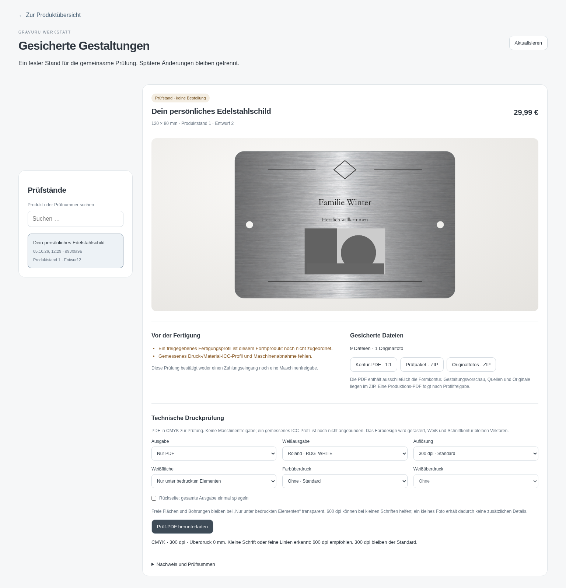

# Technische Druckprüfung aus gesicherten Gestaltungen

Stand: 05.10.2026. Aufgabenbranch `task/form-print-proof-20261005`, GitHub-Ausgangscommit `2b2d75a2ecf1061275feffa76c7da9f90a3d9ba0`. Fortsetzung des bestehenden Dashboards in derselben verwalteten Cloud; Kontozuordnung „mika“ nach Nutzerangabe. Nur synthetische Prüfdaten. Keine privaten Fotos, Datenbanken oder Zugangsdaten eingecheckt.

## Tatsächlich umgesetzt

Werkstatt → Gesicherte Gestaltungen → Druckprodukt auswählen → Technische Druckprüfung. Standard: **nur PDF, DeviceCMYK, 300 dpi, Roland RDG_WHITE, Weiß nur unter bedruckten Elementen, kein Überdruck, keine Spiegelung**. Alternativ Mimaki-Vektorweiß, 600 dpi, ausdrücklich vollflächiges/kein Weiß, PDF mit allen gesicherten Daten als ZIP. Originalfotos sind weiterhin separat herunterladbar. Kunden erhalten hier keinen Produktionsdownload.

Die Druckausgabe liest ausschließlich das anhand SHA-256 geprüfte, unveränderliche Prüfpaket. Die Fotovorschau wird durch das archivierte Original in dessen eigener Auflösung ersetzt; EXIF-Ausrichtung, Ausschnitt und Graustufen/Sepia werden übernommen. Leere optionale Fotofelder werden nicht als Platzhalter gedruckt. Material, Sockel und Bedienelemente sind keine Druckdaten. Ein kleines Foto erhält durch 600 dpi keine zusätzlichen Details. Kleine Schriften lösen eine Empfehlung aus, ohne den Standard zu ändern.

Freie Außenkontur und Innenausschnitte ersetzen die rechteckige Hilfsgeometrie im bestehenden Acryl-PDF-Modul. Die Schnittkontur bewahrt Linien/Kurven; Ellipsenbögen werden wie im Kontur-PDF mit höchstens 22,5° je kubischem Segment angenähert. Optionaler Farbüberdruck erweitert ausschließlich die Außenform um 1 mm und wird ohne bedruckten Außenrand nicht erzeugt. Randfarben werden aus den inneren Randpixeln fortgesetzt, leere Randabschnitte bleiben leer. Die Pufferkontur nutzt die vorhandene 0,005-mm-Pfadabtastung. Bohrungen bleiben frei. Weißüberdruck ist separat wählbar und kann den Farbüberdruck nicht überschreiten. Rückseitenspiegelung transformiert Farbe, Weiß und Kontur genau einmal.

Die vorhandene Weißmaskenregel ist binär: Alpha ab 128 erzeugt Weiß. Transparente Stellen bleiben frei; Halbton-/Tönungsregeln für eine echte Maschine sind damit noch nicht freigegeben. `RDG_WHITE` ist eine echte PDF-Sonderfarbe; Mimaki erhält eine Vektorfüllung ohne diesen Sonderfarbnamen. `CutContour` bleibt eine eigene Sonderfarbe.

Pro Prüfstand, Rezeptversion und Einstellungen werden PDF, ZIP und Ausgabemetadaten unveränderlich in der privaten SQLite-Datei gespeichert. Wiederholte Downloads liefern dieselben Bytes. Gleichzeitige Erstellung wird begrenzt, ein Prozesskonflikt übernimmt die zuerst gespeicherte Ausgabe. Fehler werden angezeigt und können erneut versucht werden; dies ist noch keine persistente Hintergrund-Warteschlange. Host-/Origin-/CSRF-Schutz und bestehende geschützte Entwicklungszugänge bleiben erforderlich.

## Installation und Start

Zusätzlich zu den bereits dokumentierten Kontur-/Fotoanforderungen benötigt die Druckprüfung CairoSVG 2.8.2 und systemseitig libcairo. In dieser Cloud ist libcairo vorhanden; CairoSVG wurde in die vorhandene ignorierte Python-Ablage installiert:

```sh
python3 -m pip install --target .local-data/python -r app/workshop/requirements-contours.txt -r app/workshop/requirements-photos.txt -r app/workshop/requirements-print.txt
npm run build
npm start
```

Backend-Pfad: `/werkstatt/pruefstaende/`. Der vorhandene geschützte Entwicklungsserver und seine dokumentierten Host-/Origin-Einstellungen gelten. Kein neuer öffentlich erreichbarer Dashboard-Link wurde veröffentlicht. Neue Tabelle `form_print_proofs` ergänzt die bestehende private Datenbank; vorhandene Prüfstände werden nicht überschrieben. Die Cloud-VM ist weiterhin keine zugesicherte dauerhafte gemeinsame Datenablage.

## Prüfung dieses Pakets

- `npm test`: **197 bestanden, 0 Fehler, 0 Skips** am 05.10.2026.
- `npm run build`: **76 Ressourcen, 1 Modell, 461440 Editorbytes**.
- Neue Integrationstests: freie konkave Form, Bohrung, transparente Leerflächen, Originalfoto statt manipuliertem Vorschaufoto, CMYK-Bilddaten, Roland-/Mimaki-Weiß, 300/600 dpi, Randüberdruck, Spiegelung, Maße, PDF-/ZIP-Prüfsummen, CSRF, ungültige Einstellungen und byteidentische Wiederholung.
- Echter Chromium-Ablauf: Kundenfoto hochladen, Text ändern, speichern, Prüfstand sichern, Backend öffnen, Standard-PDF herunterladen sowie Mimaki/600-dpi-ZIP mit unverändertem Original und geprüfter PDF-Prüfsumme herunterladen. Desktop 1536 px, Mobil 390 px und Tablet 768 px ohne horizontalen Überlauf oder JavaScriptfehler.
- Bei der Randprüfung zeigte die stark verkleinerte PyMuPDF-Ansicht Alpha 253 trotz deckender 255 in der eingebetteten Bildmaske. Die Separationsprüfung rendert deshalb mit doppelter Bildschirmauflösung; keine Sollwerte auf fehlerhafte Druckdaten abgesenkt.



[Mobile Browseraufnahme](form-print-mobile.png). Sichtbares Foto und Material sind synthetische Prüfdaten bzw. vorhandene Materialstruktur, kein echtes Kundenprodukt oder Herstellerbeleg.

## Grenzen und genau nächster Schritt

Diese PDF ist **keine fertigungstechnisch freigegebene Produktionsdatei**. Die CMYK-Separation ist generisch, ohne gemessenes Druck-/Material-ICC-Profil. Farbgestaltung inklusive Schrift wird mit gewählter Auflösung gerastert; originale Schriftpfade bleiben im gesicherten Gestaltungssvg. Weiß und Schnittkontur sind Vektoren. SVG-Masken werden ausdrücklich abgelehnt, weil der verwendete Rasterizer deren Luminanz nicht zuverlässig abbildet. Maximal 500 mm je Achse und 32 Megapixel Ausgabe; Fotooriginale maximal 20 Megapixel gemäß bestehendem Import.

Als Nächstes Schrift-/Designvektoren in der Druckausgabe erhalten und ein versioniertes Fertigungsprofil zuordnen. Reale ICC-/RIP-/Maschinenprüfung, Gravurausgabe, Shopify-/Zahlungsbindung und gehostete Operator-/Kundenrechte bleiben eigenständige offene Punkte. Keine Server-, Shopify- oder Live-Veröffentlichung, kein Merge. Das gesicherte Acrylmuster bleibt unverändert.
