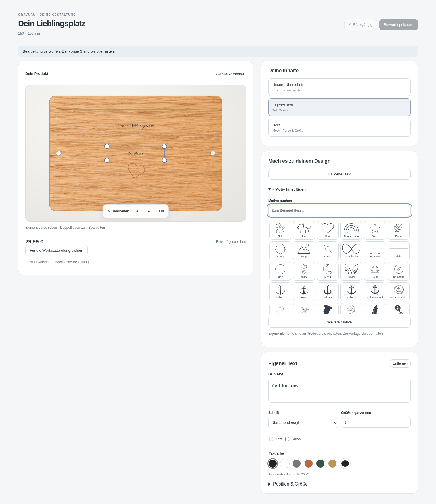

# Eigene Texte und Motive im Formprodukt-Konfigurator

05.10.2026 · Aufgabenbranch `task/form-added-elements-20261005`. Ausgangsstand: Sicherungscommit `5dd07c49da473c309281d6203e600ecca9577f4d`, darin Produktcode `0265ed5ad83c05fd3d7569ccb522b75e8b464e94`. Bestehenden Neuaufbau fortgesetzt, vorherigen Arbeitsbereich samt ungesicherten Zeilenendenänderungen erhalten. Kein neuer Chat und keine neue Cloud-Umgebung.

## Jetzt umgesetzt

Kunden können eigene Texte und Motive zu einer Formprodukt-Gestaltung ergänzen. Die vorhandene Bibliothek mit 721 passiven Vektormotiven wird wiederverwendet: kompakte Auswahl, Suche, weitere Einträge auf Anforderung. Die 18 ursprünglichen Grundmotive erhalten exakt die im vorhandenen `editor-source.html` definierten Linienattribute (keine erfundene Flächenfüllung). Ihre Quellen bleiben unverändert. Beschriftungen der Grundmotive sind deutsch.

Die Platzsuche verwendet die vorhandene Pixel-/Alpha-Prüfung des Konfigurators. Sie berücksichtigt sichtbare Designfarbe, die vollständigen belegten Feldbereiche sowie die originale Außenform und Bohrungen. Ohne ausreichend freien Platz wird nichts hinzugefügt. Späteres bewusstes Überlagern ist beim Druck weiterhin zulässig; Gravur behält ihre Hinweise. Die feste Designgrafik und das Originalprodukt werden nicht verändert.

Eigener Text nutzt dieselbe direkte Bearbeitung: ganze Schrift-mm, vorhandene Schriftarten/Fettschnitte, Kursiv, Farben, Auswahlgriffe und Rückgängig. Motive bieten Farbe einschließlich sechs runder Vorgaben, Positions-/Größenänderung und 15°-Drehung. Eigene Ergänzungen sind direkt entfernbar; ursprüngliche Vorlagenfelder behalten die explizite Entsperrung. Fotoausschnitte bleiben erhalten.

Im Backend unter „Designs & Kundenfelder → Kunden dürfen ergänzen“ lassen sich eigene Texte, Motive und die maximale Anzahl je Design einstellen. Neue Designimporte starten mit beiden Freigaben und höchstens acht Ergänzungen; bestehende Designrevisionen ohne diese Einstellungen erhalten keine stillschweigend erweiterten Rechte. Insgesamt bleiben höchstens 19 Felder/Ergänzungen erlaubt. Ergänzungen sind bei diesen Formprodukten im bestehenden Grundpreis enthalten; es wird keine unbestätigte Aufpreislogik erfunden. Die bisherigen Acryl-Aufpreisregeln werden nicht verändert.

Speichern und Neuladen erhalten die Ergänzungen mit dem fest gebundenen Produkt-/Designstand. Der Server prüft Typen, Kennungen, Rechte, Grenzen, Geometrie, Schrift und Motivprüfsumme; manipulierte Rechte, unbekannte Quellen oder überschreibende Kennungen werden abgewiesen. Die Freigabeänderung an einer späteren Produktrevision verändert keinen alten Kundenentwurf.

## Prüfstand, Export und neue Vorlage aus Bestellung

Unveränderliche Prüfstände enthalten Ergänzungen, verwendete Schriftpfade und Motivquellen mit SHA-256. Zusätzliche Texte werden in der Druck-PDF als echte Schriftpfade übernommen. Motive bleiben in der gespeicherten SVG vektoriell; im aktuellen Druck-PDF-Farbmotiv werden sie wie andere Nicht-Text-Grafiken gerastert. Keine vollständige Vektor-PDF behauptet.

PDF-Standard bleibt CMYK / 300 dpi / Roland RDG_WHITE / Weiß nur unter bedruckten Flächen / kein Überdruck. Im Integrationstest bleiben freie Flächen und Bohrungen ohne Weiß, das zusätzliche Motiv wird korrekt unterlegt. Keine neue Corel-/RIP-/Maschinenfreigabe.

Die vorhandene Übernahme einer synthetischen Testbestellgestaltung als privater Produktentwurf berücksichtigt auch neue Elemente. Im Modus „Beispieltexte aus Vorlage“ wird für zusätzliche Kundentexte „Dein Text“ eingesetzt; persönliche Inhalte werden nur nach ausdrücklicher Auswahl übernommen. Eigene Motive bleiben in der neuen Vorlage als bearbeitbare Felder erhalten. Original und Bestellung bleiben unverändert. Bei zu engem Textfeld kann auch der neutrale Beispieltext eine bewusste Korrektur erfordern.

## Tatsächlich geprüft

- Abschließender `node scripts/cloud-check.mjs`: **05.10.2026, 20:33:46–20:34:44 Uhr Europe/Berlin** (18:33:46–18:34:44 UTC), PASS. Node 24.19.0, PyMuPDF 1.28.2, Referenzprüfung, gesamte Testsuite und Build.
- **229 Tests, 0 Fehler, 0 Skips. Build: 76 Ressourcen / 1 Modell / 461440 Editorbytes.** Drei neue Integrationstests für Rechte/Limit/Quellen, SQLite-Neustart, feste Revisionen, HTTP/CSRF, unveränderte Vorlage, gesicherte PDF-Weißgeometrie und datensparsame Weiterverwendung.
- Cloud-Chromium: Desktop 1536, Mobil 390, Tablet 768. Text/Motiv hinzufügen, Farbe und Drehung, Löschen/Rückgängig, Speichern/Neuladen und Abbrechen in der Direktbearbeitung. Keine JavaScriptfehler oder horizontalen Überläufe.
- Backend: Motivfreigabe ändern, speichern, neu laden; neue Revision blendet die Motivbibliothek aus, bestehende Revision bleibt unverändert.
- Vollflächig belegte synthetische Vorlage: kein Platz, keine Ergänzung. Zusätzlicher echter Touch-Ablauf: eigenen Text hinzufügen, doppeltippen, ändern, übernehmen und speichern.
- Der erste Testaufruf ohne zusätzliche Netzwerkfreigabe meldete nur fehlgeschlagene Testprozesse ohne Detailursache. Der folgende Aufruf mit der vorhandenen erlaubten Cloud-Netzwerkausführung bestand; daraus wird keine weitergehende Fehlerursache behauptet. Ein erster Browser-Prüfskriptlauf erwartete nach Neuladen fälschlich ein offenes Bibliotheksfeld; der Prüfschritt öffnet es jetzt wie ein Nutzer. Die anschließende Sichtprüfung deckte die fehlenden ursprünglichen Linienattribute auf; behoben und abschließend erneut vollständig geprüft.

[Maschinenlesbarer Prüfnachweis](form-added-elements-check.json). Ausschließlich synthetische Daten in einer separaten temporären Prüfablage. Keine alten privaten Datenbanken geöffnet oder wiederhergestellt.

[Mobile Ansicht](form-added-elements-mobile.png) · [Tablet](form-added-elements-tablet.png) · [Backend-Freigaben](form-additions-backend.png)

## Verbleibende Grenzen und Fortsetzung

Dieses Paket ist im vorhandenen geschützten Cloud-Entwicklungsserver geprüft und auf seinem Aufgabenbranch gesichert. Kein neuer extern erreichbarer Dashboard-Link und kein Live-/Environment-Publish. Die bekannte private Acryl-Musterseite wurde nicht verändert. Lokale Cloud-Vorschauadressen sind kein zugesagter Nutzerzugang.

Nächste unabhängige Arbeit: verbleibende Material-/Szenendarstellung und deren visuelle Prüfung fortführen. Echte Shopify-Teststrecke benötigt weiterhin die konkrete Entwicklungsstore-Zuordnung/Anbindung. Der Nutzer hat die angefragte Adresse bereits in einem anderen Chat angegeben; ihr Wert ist hier nicht verfügbar. Keine neue allgemeine Migration, keine Serverplanung und keine fehlenden Bestandsdaten als pauschalen Entwicklungsblocker. Reale RIP-/ICC-/Maschinenabnahme, vollständige UV-Designserie und gehostete Kunden-/Operatorrechte bleiben offen.
