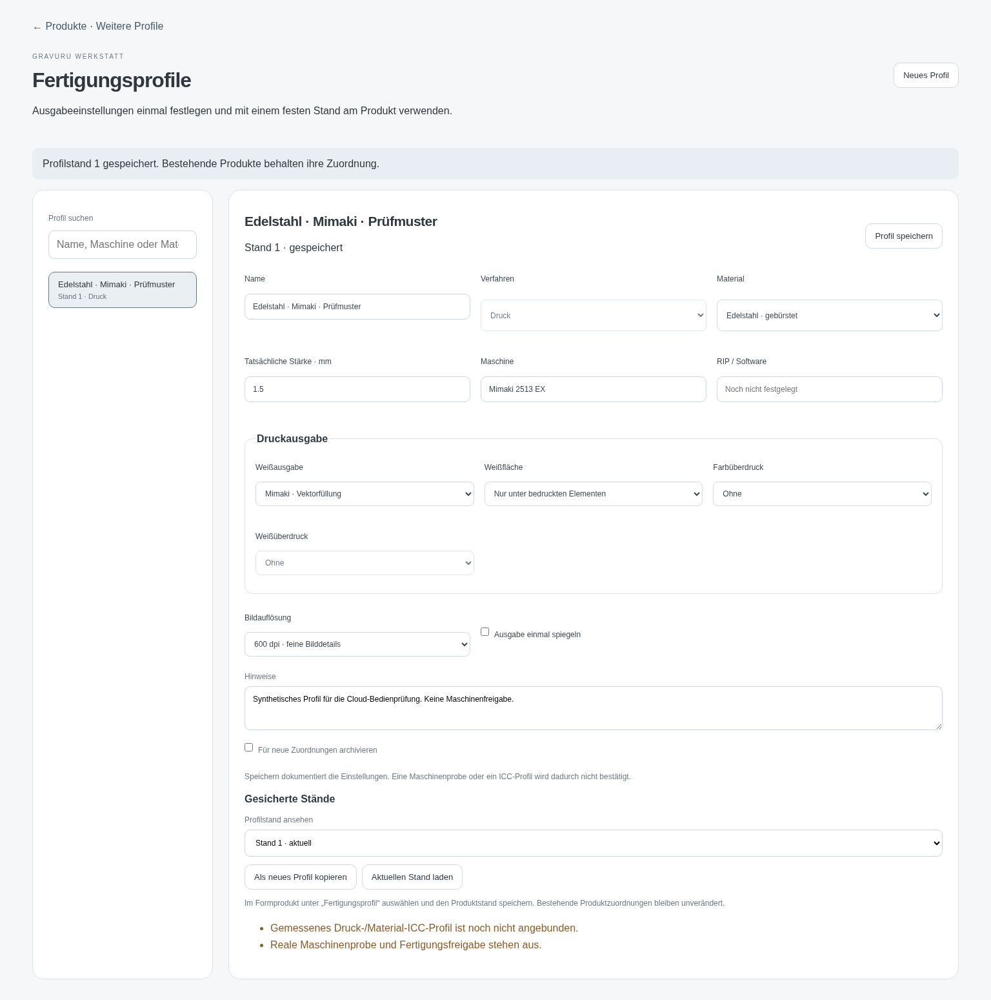

# Versionierte Fertigungsprofile

05.10.2026 · `task/production-profiles-20261005` · GitHub-Basis `62243a23ad8734a28c30f9f9552dfe0f1730b865`. Bestehende Cloud, synthetische Prüfdaten, keine Live-Veröffentlichung.

## Bedienung und tatsächliche Funktion

Werkstatt → **Fertigungsprofile** (`/werkstatt/fertigung/`). Ein Profil enthält Namen, Druck/Gravur, Material und tatsächliche Stärke, Maschine, RIP/Software, Hinweise sowie Ausgabevorgaben. Anlegen, Suchen, Ändern, Historie, Übernahme eines früheren Stands als neue Revision, Kopieren und Archivieren sind implementiert. Gleichzeitiges Speichern gegen eine veraltete Revision wird abgewiesen; Eingaben bleiben stehen. Gesicherte Profilrevisionen sind auch in SQLite gegen Änderungen und Löschen geschützt.

Druck startet mit den bekannten Vorgaben: Roland RDG_WHITE, 300 dpi, Weiß nur unter bedruckten Elementen, kein Überdruck, keine Spiegelung. Gravurprofile enthalten Raster-/Vektorart, Bildauflösung und Spiegelung, aber noch keine Gravurausgabe oder erfundene Leistungs-/Geschwindigkeitswerte. Maschine/RIP können ausdrücklich offen bleiben. Speichern ist keine Produktionsfreigabe.

Im **Formprodukt** unter „Fertigungsprofil“ einen passenden Stand wählen und speichern. Verfahren, Material und Stärke müssen übereinstimmen; der Server prüft die Bindung ebenfalls. Ein späterer Profilstand wird nicht automatisch auf vorhandene Produkte übernommen. Historische Produktstände und bereits gespeicherte Zuordnungen bleiben erhalten. Archivierung verhindert die Auswahl des archivierten neuen Profilstands; vorher gebundene historische Stände bleiben nachvollziehbar.

Der gesicherte Kundenprüfstand übernimmt das vollständige Profil mit ID, Revision, Datum, Inhalt und SHA-256. Das ZIP enthält `fertigungsprofil.json`; Änderungen an der Profilbibliothek ändern diese Datei nicht. Im Backend ist die Bindung sichtbar und belegt die Druckvorgaben vor. Abweichende manuelle Ausgabeeinstellungen sind möglich und werden in den Ausgabemetadaten als Abweichung dokumentiert. Rezept `gravuru-form-print-proof/v3` lässt ältere Ausgabedateien unverändert.

## Maschinenangaben des Nutzers

Am 05.10.2026 bestätigt: **Roland LEF-200, Roland MO-240 und Mimaki 2513 EX**. Diese Namen werden als Eingabevorschläge angeboten. Weitere Modellbezeichnungen, RIP-Software, ICC-Profile, Tinten-/Materialfreigaben oder Maschinenparameter wurden daraus nicht abgeleitet. RIP-Software ist noch offen. Die im Browser gezeigte Beispielzuordnung bleibt ein ausdrücklich synthetischer Test, keine freigegebene Maschinenkonfiguration.

## Nachweise

- `npm test`: **201 bestanden, 0 Fehler/Skips**.
- `npm run build`: **76 Ressourcen, 1 Modell, 461440 Editorbytes**.
- Neue Integrationsprüfungen: immutable Revisionen/Hashes, SQLite-Neustart, Konflikte, Archivierung, Material-/Stärken-/Verfahrensprüfung, CSRF, gesicherter Produkt-/Prüfstand, Profil im ZIP, alte Ausgabevorgaben nach Bibliotheksänderung, ausdrückliche Overrides und echte HTTP-PDF.
- Chromium: Profil 1 anlegen, am Produkt binden/speichern, Profil 2 mit anderen Einstellungen anlegen, Produkt bleibt auf Profil 1, Historie prüfen, Kundenprüfstand sichern, ursprüngliche Mimaki/600-dpi-Vorgaben sehen und PDF herunterladen. 600 dpi wurden nur im synthetischen Profil bewusst ausgewählt; der allgemeine Standard bleibt 300 dpi.
- Abschließender Browserlauf einschließlich aller drei Maschinenvorschläge; Desktop 1536 px, Mobil 390 px, Tablet 768 px ohne horizontalen Überlauf oder JavaScriptfehler.

[Mobile Ansicht](production-profile-mobile.png).

## Datenhaltung, Grenzen, Fortsetzung

Zusätzliche `manufacturing_profiles`-/`manufacturing_profile_revisions`-Tabellen in der bestehenden privaten `profiles.sqlite`. Die bisherigen Schrift-/Motiv-/Farbprofile bleiben unverändert. Produktbindungen sind optional und rückwärtskompatibel. Keine Kundendaten oder Datenbanken im Git-Stand, kein neuer Server, kein Merge, kein Shopify-/Plesk-Eingriff.

Fertigungsprofile sind nachvollziehbare Vorgaben; ICC-Anbindung und Maschinenprobe bleiben ausstehend. Der Prüfstand bleibt ausdrücklich `productionReady: false`. Gehostete Rollen, Bestellung/Zahlung und dauerhafte gemeinsame private Datenhaltung werden damit nicht als erledigt ausgegeben.

Nächstes Paket: Ausgabeaufträge dauerhaft speichern, Status/Fehler anzeigen und nach Abbruch wieder aufnehmen. Anschließend den gesicherten Stand an die Gravurausgabe anbinden. Der Nutzer hat die selbstständige Fortsetzung des Gesamtprojekts autorisiert; nur konkrete fehlende Entscheidungen sollen unterbrechen.
