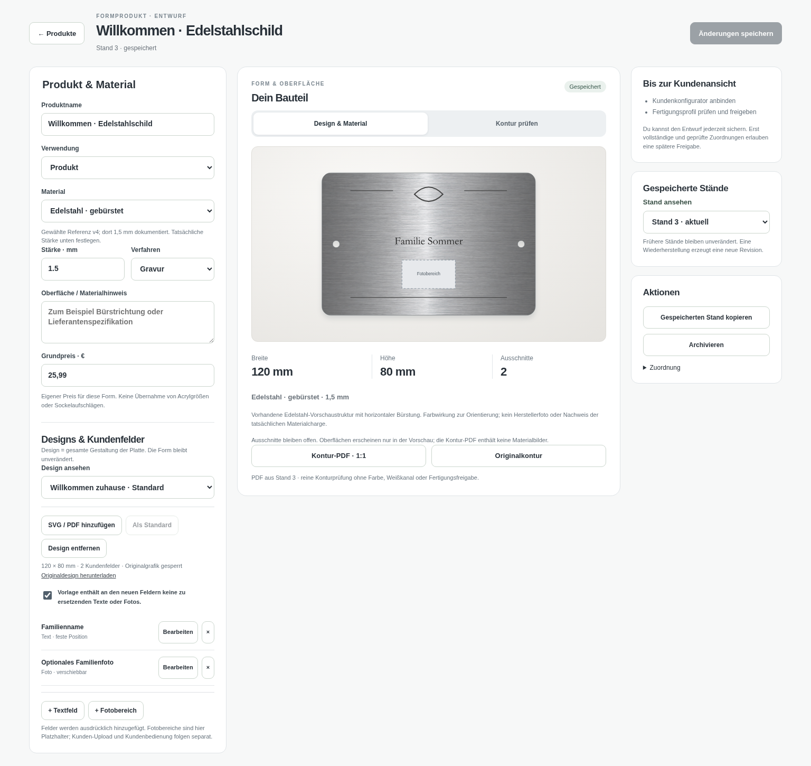

# Designvorlagen und Kundenfelder für Formprodukte

05.10.2026 · Branch `task/dashboard-form-designs-20261005`. Direkt auf GitHub geprüfte Basis `34bb395cfacba140a486bb987c8f90a98a90a736`; lokaler Parent `4c0239c71308bf6b4eab08990fb0ca745fd09d03`, identischer Baum `cf63c638f768894d8d208e35bb8cf5d73b9ef1c6`. Bestehende Cloud-Ausführung bestätigt, Konto mika laut Nutzerangabe. Keine neue Umgebung oder Serverplanung.

## Bedienbarer Backend-Umfang

Im Formprodukt unter **Designs & Kundenfelder → SVG / PDF hinzufügen** eine neue Datei prüfen oder eine bereits vorhandene Datei aus derselben Designablage auswählen. PDF-Seite wählen, Originalmaß 1:1 oder ausdrücklich proportionales Einpassen. Originalmaß wird bei überschrittenem Formmaß abgelehnt; kein automatisches Stauchen. Neue Designzuordnung zunächst im Entwurf prüfen und anschließend mit **Änderungen speichern** sichern. Bis zu 30 Designs; Auswahl, Standarddesign, Entfernen aus dem Entwurf, Originaldownload. Originaldateien und historische Stände bleiben erhalten.

Für explizite Kundenfelder zuerst bestätigen, dass die Vorlage an den vorgesehenen Stellen keine zu ersetzenden Texte oder Fotos enthält. Eine flache PDF wird nicht automatisch in editierbare Elemente zerlegt. Bis zu 19 Felder je Design:

- Text: Bezeichnung, Beispielinhalt, Links/Oben/Breite/Höhe in mm, vorhandene Schrift, ganze Schriftgröße 1–100 mm, Farbe, Fett/Kursiv und Farbfreigabe. Tatsächlich verfügbare Schriften stammen aus dem bestehenden Ressourcenbestand (aktuell Garamond Acryl und Freestyle Acryl); fehlende Schriften/Fettschnitte oder Zeichen werden abgewiesen. Dieselbe vorhandene Pfadmessung/-darstellung wird wiederverwendet. Text passt vollständig ins Feld oder wird erklärt abgewiesen; keine automatische Verzerrung.
- Fotobereich: Bezeichnung, Geometrie, Rechteck/Kreis und Pflichtfeldangabe. Kreis braucht gleiche Breite/Höhe. Aktuell ausdrücklich **Platzhalter im Backend**, noch kein Kundenfoto-Upload für diese neue Produktart.
- Kundenrechte: Verschieben, Skalieren und Entfernen getrennt; neue Felder standardmäßig frei. Für feste Textfelder Position und Größe sperren. Diese Rechte werden hier gespeichert; die künftige Kundenansicht samt serverseitiger Kundenprüfung ist noch nicht angebunden. Keine bestehende Kundenstrecke als fertig behauptet.

Die Grafik der Vorlage bleibt gesperrt. Form- und Designimport sind getrennte Rollen. In der 2D-Vorschau wird die Gestaltung auf die vorhandene Materialoberfläche gelegt. Dieselben originalen mm-Pfade begrenzen Grafik und Felder; Außenbereiche und Bohrungen bleiben durchsichtig. Ohne Materialtextur gibt es eine kenntlich gemachte neutrale Designansicht. Konturprüfung lässt die Gestaltung bewusst weg.

## Datenmodell und Wiederverwendung

Optionale gepaarte Felder `designs` und `defaultDesignId` erweitern `gravuru-form-product/v1`; alte Dokumente ohne Designs behalten ihre Form und werden nicht ungefragt umgeschrieben. Designs binden geprüfte Asset-ID und Original-SHA, unverzerrte physische Platzierung und explizite Felder. Zuordnungen/Schriften/Geometrie werden auch beim normalen Repository-Speichern geprüft. Bestehende immutable `design_sources`/`design_assets`, Konverter und Produktrevisionen werden wiederverwendet; keine zweite Datenbank, kein neuer Rohdatenimport alter Bestände.

`POST /api/workshop/products/:id/form-design-import` prüft aktiven Produktstand, CSRF, erwartete Revision und aktuellen Entwurf. Es speichert gegebenenfalls das Original in der bestehenden Bibliothek und gibt einen geprüften Produktentwurf zurück. Die Produktrevision ändert sich erst beim normalen Speichern. Abbrechen verwirft keine Originale. `GET /api/workshop/design-assets` liefert die letzten 300 Vorlagen-Metadaten; bestehende Ablage enthielt keine ursprünglichen Anzeigenamen, daher Auswahl mit Format/Maß/Kennung. Kundendaten gehören nicht in Git.

Die Kontur-PDF bleibt ausschließlich eine maßhaltige Vektorprüfung ohne Grafik, Schrift, Materialtextur oder Weiß. Der bestehende Acryl-Druckexport bleibt unverändert. Neue Formprodukte können weiterhin nicht in den Shop freigegeben oder als fertiges Kundenmodell aufgelöst werden.

## Tatsächliche Prüfungen

- `node --test app/workshop/form-designs.test.mjs app/workshop/form-product.test.mjs app/workshop/material-preview.test.mjs`: 6 bestanden, 0 Fehler/Skips. Echte SVG-/PDF-Konvertierung, Assetbindung, Originalmaße/Proportionen, Feldbestätigung, ungültige Schrift/größen/überlaufender Text, CSRF/Versionskonflikt, Standarddesign/Kopie/Wiederherstellen und SQLite-Neuöffnung. Altes Acrylprodukt unverändert; Original-SVG byte-identisch erhalten.
- `npm test`: 191 bestanden, 0 Fehler/Skips. `npm run build`: 76 Ressourcen, 1 Modell, Editor 461440 Bytes.
- Anschließend kleine UI-Sicherung gegen Designaktionen bei ungültigen Produktangaben; derselbe komplette Browserablauf erneut bestanden.
- Cloud-Chromium mit synthetischen Daten: Kontur anlegen → Edelstahl → Original-SVG importieren → Vorbereitung bestätigen → Textfeld anlegen, feste Position/Größe einstellen → zu großen Text mit Fehlermeldung erhalten/korrigieren → Fotobereich ergänzen → speichern/reload → vorhandenes Original wiederverwenden → zweites Standarddesign → historische Ansicht → Wiederherstellung. Kundenfeld-Dialog auch mobil geöffnet und bedient.
- Tatsächlicher Browser-Pixeltest bestätigt offene Bohrungen nach der Designüberlagerung. API-PDF heruntergeladen und mit PyMuPDF überprüft: genau drei Vektorpfade, keine Bilder und kein Text.
- Desktop 1536, Mobil 390, Tablet 768 ohne horizontalen Überlauf und ohne JavaScript-Seitenfehler. Bei der ersten Bedienprüfung sprang die Vorlagenbestätigung während der Anfrage zurück; Ursache war erneutes Formularrendern. Behoben und vollständigen Ablauf erneut bestanden.

[Mobilansicht](dashboard-form-designs-mobile.png). Tatsächliche Cloud-Browseraufnahmen; kein veröffentlichter bedienbarer Dashboard-Link. Beispielgestaltung und Preise sind synthetische Prüfdaten, kein angelegtes Kunden-/Lieferantenprodukt.

## Grenzen und genau nächster Schritt

**Nächster Schritt:** eine Formprodukt-Kundenansicht mit tatsächlichem Foto-Upload und Anwendung/Prüfung der gespeicherten Elementrechte an dieselbe Geometrie anbinden. Der alte Acrylkonfigurator wird nicht als freie Form ausgegeben. Fotos bearbeiten/zuschneiden, kundenseitiges Bewegen und Auftragsexport für freie Formen sind noch offen. Die aktuelle Vorschau erhält Originalfarben; kein realer materialabhängiger Gravur-/Weiß-/RIP-Nachweis. Andere leere Materialoberflächen, Kanten/Tiefe und Maschinenabnahme weiterhin offen.

Kein Zugriff auf private Bestandsdaten, keine Veröffentlichung, Shopify/Plesk/Produktion unverändert, kein Merge. Bestehendes Muster Acrylglasbild erhalten. Kein neuer Migrationstest behauptet.
