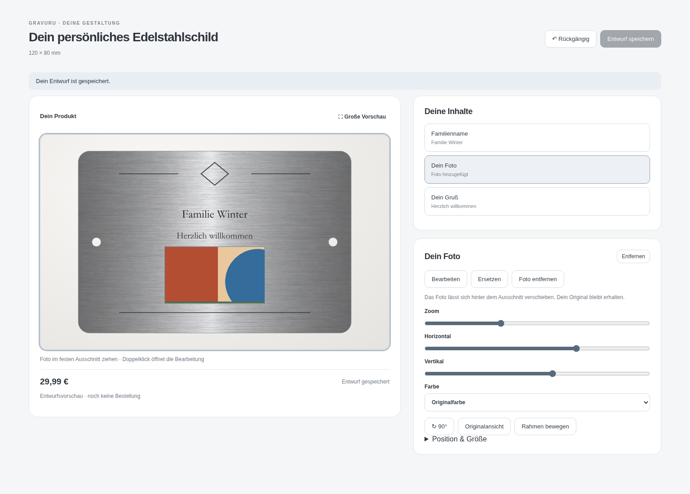
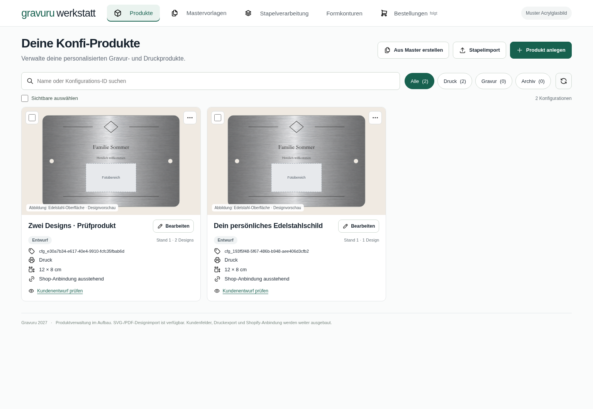

# Formprodukt-Kundenansicht und Übersicht – 05.10.2026

Aufgabenbranch `task/form-customer-editor-20261005`, Ausgangscommit auf GitHub `cb878ffaaf1f794f2aadb226b47dcc0f4f2091b6`. Fortsetzung im vorhandenen Cloud-Checkout; keine neue Umgebung, keine Server-/Shopify-Mutation. Kontozuordnung mika laut Nutzer. Laufzeitstatus bestätigt Cloud, running/connected, aktuelle Beobachtung. Node 24.19.0, Python 3.12.14, Pillow 12.3.0, Chromium; private synthetische Prüfstände.

## Tatsächlich umgesetzt

- Backend → gespeichertes Formprodukt → „Kundenansicht prüfen“; alternativ direkt aus der Produktkarte. Produktrevision und Design werden fest gebunden. Spätere Produktänderungen verändern vorhandene Entwürfe nicht.
- Text per Doppelklick auswählen und direkt überschreiben, vorhandene Schriftpfade/ganze Schrift-mm, Fett/Kursiv und Farbe. Backend-Rechte für Position, Größe, Farbe und Löschen gelten auch bei manipulierten API-Anfragen. Erforderliche Fotofelder können nicht gelöscht werden.
- Tatsächlicher JPEG-/PNG-/WebP-Upload, höchstens 15 MB/20 Megapixel, EXIF-Ausrichtung. Originaldatei byteidentisch separat erhalten; Vorschau bis 1600 Pixel ohne Kamerametadaten. Verschieben hinter festem Ausschnitt, Zoom, 90°-Drehung, Original/Graustufen/Sepia; freigegebener Rahmen separat verschiebbar/skalierbar. Originalansicht und Rückgängig. Runde Fotobereiche halten gleiche Breite/Höhe.
- Gespeicherte Kundenwerte und Originalfotos in der bestehenden privaten SQLite-Ablage; eigene unveränderliche Entwurfsrevisionen, Konfliktschutz bei parallelen Tabs. Kundentoken nur im Arbeitsspeicher bzw. Browser-sessionStorage und Header, nie im Link. Tokenprüfung auch beim Lesen und bei Fotos; fremde Entwürfe können ein Foto nicht übernehmen. Kundenfotos gelangen nicht in die Designbibliothek oder Kartenansicht.
- Foto-Upload ohne Scrollsprung; Vorschauhinweis nach jeder Änderung für 1,6 Sekunden, auch bei reduzierter Bewegung wieder entfernt. Weiße Außenflächen schließen die große Vorschau. Designauswahl bei höchstens einer Vorlage ausgeblendet. Überlagerungshinweise nur für Gravur, nicht für Druck.
- Produktkarten verwenden gespeicherte Standardgestaltung und vorhandene Edelstahloberfläche. Originale Kontur/Innenausschnitte bleiben erhalten. Selbstständiges SVG mit eingebetteten geprüften Vorschaudateien, damit Bilder auch in Karten tatsächlich laden. Frühere Revisionen zeigen ihren damaligen Stand; Material ohne zugeordnete Oberfläche bleibt Konturansicht.

## Prüfung dieses Pakets

`npm test`: **193 bestanden, 0 Fehler, 0 Skips**. `npm run build`: **76 Ressourcen, 1 Modell, 461440 Editorbytes**. Anschließend zusätzliche Foto-Metadaten-/Fehleingabe-/Kartenergänzungen: betroffene Kunden-, Formprodukt-, Design- und Übersichtsprüfungen bestanden (8 Fälle insgesamt). Ein falscher Materialschlüssel im erweiterten Test wurde auf die vorhandene Eichen-ID korrigiert; keine Produktvalidierung gelockert. Kein alter 137-Test-Nachweis als neuer Lauf übernommen.

Tatsächliche Chromium-Bedienung in der Cloud auf Desktop, Mobil (390 px) und Tablet (768 px): Backend-Verlinkung, Ein-/Mehrfachdesign, Erstfokus/Doppelklick, feste/freie Rechte, echter synthetischer Foto-Upload ohne Scrollsprung, Graustufen, Zoom und Zeigerbewegung hinter der Maske, Speichern/Neuladen, Löschen/Rückgängig, Zwei-Tab-Konflikt mit erhaltenen Eingaben, seitliches Schließen. Separat fünf Änderungen mit Hinweisrahmen/anschließendem Ausblenden. Übersicht mit gerenderten eingebetteten Material-/Designbildern und funktionierendem Kundenlink. Keine JavaScript-Seitenfehler oder horizontaler Mobilüberlauf.

[Mobile Aufnahme](form-customer-editor-mobile.png). Ausschließlich synthetische Namen, Preise, Form und Farbgrafik; keine echten Kundenfotos. Edelstahl-Vorschaustruktur stammt unverändert aus dem vorhandenen Bestand und belegt keine konkrete Materialcharge. Für den Nutzer die Bilder direkt im Chat anzeigen; private GitHub-Bildlinks ersetzen keine erreichbare App.

## Weiterarbeiten und Grenzen

Zusätzliche Python-Abhängigkeit: `python3 -m pip install -r app/workshop/requirements-photos.txt` (Pillow 12.3.0). Dokumentierte Importabhängigkeiten bleiben nötig. `npm start` startet die bestehende geschützte Entwicklungsvorschau. Kundenroute: `/konfigurator/form/?configuration=<gespeicherte-id>&revision=<stand>`, ausschließlich aus dem Backend/der Karte öffnen. Keine Bearbeitung bestehender Privatbestände für diese Prüfung erforderlich.

Die vorhandene Werkstatt ist ein geschützter Entwicklungs-/Operatorserver. Private Entwurfstoken sind keine fertige Shopify-Kundenanmeldung; sessionStorage überlebt Neuladen, nicht zuverlässig das Schließen des Tabs. Noch keine kontogebundene Entwurfswiederherstellung, Aufbewahrungs-/Löschverwaltung, Bestellung oder Fertigungsfreigabe. SQLite-Dateien samt Originalfotos gehören in private Datenspeicherung, niemals in Git oder veröffentlichte Snapshots. Temporäre Cloud-Prüfdaten sind keine dauerhafte gemeinsame Datenbank.

Formprodukt-Kundenansicht arbeitet mit ausdrücklich im Backend angelegten Text-/Fotofeldern. Freies Hinzufügen von Motiven/weiteren Texten und Entsperren einzelner Bestandteile einer flachen Importgrafik ist hier noch nicht angebunden; die existierenden Acrylfunktionen bleiben erhalten. Keine automatische Zerlegung beliebiger PDFs behauptet. Fotovorschau ist keine Produktionsdatei. Keine Export-/Kauf-Schaltfläche ohne fertige Bestellstrecke.

Die neuen Ansichten wurden auf Loopback in dieser Cloud geprüft. Der bestehende private Link „Muster Acrylglasbild“ wurde nicht durch das Dashboard ersetzt; es gibt noch keinen zusätzlich gehosteten Dashboard-Link. Kein Merge, PR oder Live-Deployment. Nächste ausführbare Entwicklung: unveränderliche Bestell-/Produktionsstände auf Basis dieser geprüften Entwürfe, mit vorhandenen Produktionsmodulen und expliziten fehlenden Profilen.
