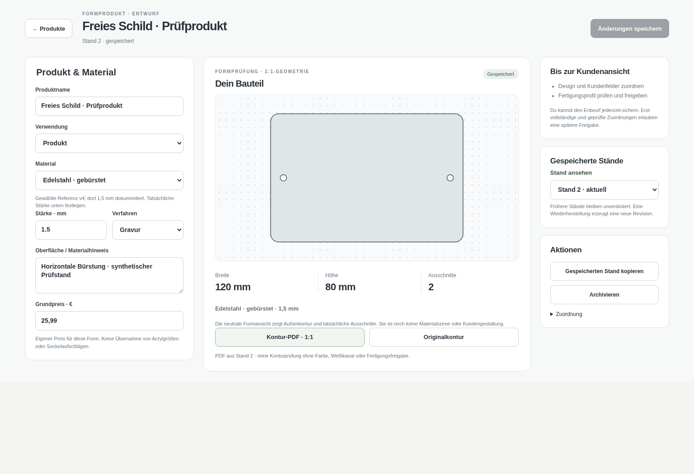

# Formprodukt, Material und Kontur-PDF – 05.10.2026

Branch `task/dashboard-form-products-20261005`, GitHub-Basis `7943804ad30a4e94e023c880d24ef9cec5d899a2`. Basis erneut direkt auf dem GitHub-Branch bestätigt. Lokaler Vorgänger `8c72359cb329a296002b02c1fc05491482c71575` besitzt denselben geprüften Tree `23658fe8274c7aaa1d88dbb034ec703fc68130fc`; die abweichenden Commit-IDs stammen aus der GitHub-Connector-Sicherung des vorherigen Pakets. Weiterhin dieselbe laufende Cloud, keine neue Umgebung. Konto „mika“ laut Nutzerzuordnung.

## Bedienbarer Umfang

**Werkstatt → Formkonturen → Produkt aus dieser Form anlegen.** Der neue Entwurf erscheint mit eigener Konfigurations-ID in der vorhandenen Produktübersicht. Im Formprodukt: Name, Produkt/Master, Materialreferenz, tatsächliche Stärke in mm, geplantes Druck-/Gravurverfahren, Oberflächenhinweis und eigener Grundpreis in Euro. Keine angenommenen Preise oder Materialstärken: zunächst ausdrücklich offen. Gespeicherte Centpreise sind ganze Zahlen.

Verwendete Materialauswahl stammt aus `MATERIALREFERENZEN.md`: Edelstahl ausdrücklich v4, Holz-/Lederstärken weiterhin als unbestätigte Musterannahmen erklärt. Das Materialregister ersetzt weder Originalbilder noch Lieferantenspezifikation. Bei Wahl des Materials wird keine vermeintlich bestätigte Stärke automatisch eingetragen. Keine gestalteten Materialbilder als leere Oberflächentextur ausgegeben.

**Gemeinsame Speicherung:** neues diskriminiertes Produktdokument `gravuru-form-product/v1` in der bestehenden `products`/`product_revisions`-Datenbank, kein Parallelbestand. Kontur-ID, Originalhash, Geometriehash und die unveränderte mm-Geometrie sind Teil des Produktstands; Validierung gleicht sie gegen die tatsächlich gespeicherte Originalkontur ab. Kein freies Verändern der Geometrie im Client. Vorhandene Acrylprodukte behalten ihr bisheriges Modell und ihre Preise. Der Produkttyp kann nicht per normalem Speichern ausgetauscht werden.

Kopieren (auch im Kartenmenü), als Master verwenden, Archivieren/Reaktivieren, Speichern, Wiederöffnen und historische Stände verwenden dieselbe vorhandene Repository-Logik. Historische Ansicht ist schreibgeschützt; Wiederherstellen erzeugt eine neue Revision. Bei konkurrierender Änderung bleiben eigene Eingaben erhalten; separat sichern oder bewusst den aktuellen Stand laden. Ungespeicherte Änderungen warnen beim Verlassen. Formprodukte werden von der bisherigen Acryl-Excel-Stapelanlage ausgeschlossen, statt dort falsche Preise oder Designeinstellungen zu übernehmen.

## Dieselbe Kontur in Vorschau und PDF

Die Formvorschau verwendet genau die beim Produkt gespeicherte, gegen das Original geprüfte Kontur. Echte Ausschnitte bleiben durchsichtig; keine Verdoppelung vorhandener Bohrungen. Die Ansicht ist ausdrücklich eine neutrale technische Formprüfung, **noch keine Materialszene oder gestaltete Kundenansicht**.

**Kontur-PDF · 1:1**: ausschließlich Vektorpfade aus demselben gespeicherten Produktstand, Seite exakt im Originalmaß, getrennte Außen-/Innenpfade. Keine Hintergründe, Bediengriffe, Texte, Fotos oder erfundene Weißkanäle. PDF enthält Produkt-ID, Revision und Geometriehash als Metadaten. Solange der Entwurf ungespeichert ist, bietet der Editor keinen missverständlichen Download dieses Entwurfs an. Die historische Ansicht liefert die PDF ihrer damaligen Revision.

PDF kennt keine exakten Ellipsenbögen. SVG-Bögen werden deshalb in kubische Béziersegmente mit höchstens 22,5° Bogenwinkel überführt. Linien und vorhandene kubische Kurven bleiben Vektoren; quadratische Kurven werden exakt in kubische umgerechnet. Vergleich einer gedrehten Ellipse über den vollständigen Kurvenverlauf: Abweichung unter 0,002 mm im synthetischen Prüffall. Das ist kein globaler Maschinen-/RIP-Freigabenachweis. Die Datei heißt bewusst Konturprüfung, nicht fertiger Druck-/Gravurauftrag.

[**1:1-PDF-Beispiel: 120 × 80 mm, zwei Ø4-mm-Ausschnitte**](konturpruefung-120x80-beispiel.pdf) – synthetischer Produktstand 2; Ausschnittmitten (8,40) und (112,40) mm.

## Tatsächliche Prüfungen

- 29 gezielte vorhandene Produktmodell-/Repositorytests bestanden.
- `npm test`: **188 bestanden, 0 Fehler, 0 Skips** zu diesem Integrationsstand. Anschließend zusätzlicher Vergleich der kompletten PDF-Ellipsenkurve ergänzt; `node --test app/workshop/form-product.test.mjs`: **4 bestanden, 0 Fehler/Skips**. Damit enthält die Testsuite jetzt 189 Tests; ein zweiter kompletter 189er-Lauf wurde nicht behauptet.
- `npm run build`: **76 Ressourcen, 1 Modell, Editor 461440 Bytes**. Die Acryl-Kundenoberfläche blieb unverändert.
- Tatsächliche Python-/PDF-Konvertierung, keine Mocks: Seitengröße, getrennte Innenpfade, Kurven, Original-/Geometriebindung, keine Rasterbilder oder Texte, Revisionsmetadaten. Gefälschte Geometrie trotz neu berechnetem Hash abgewiesen.
- API-Ablauf mit synthetischer SQLite-Ablage: Erstellen, Entwurfsvorschau ohne Schreibwirkung, Speichern, alte Revision, Konflikt, Kopie/Master, Archiv/Reaktivierung, Wiederherstellen und erneutes Öffnen der Datenbank. Vorhandenes Acrylprodukt exakt erhalten. Falscher CSRF-Token, Austausch des Produkttyps, Freigabe und vermeintliche Kundenkonfiguration zurückgewiesen.
- Cloud-Chromium/Playwright: SVG-Upload → Formprodukt → Material/1,5 mm/Gravur/25,99 Euro als ausdrücklich synthetische Eingabe → Speichern/Reload → echter PDF-Download. Historische Ansicht/Wiederherstellung, zwei parallele Editoren mit erhaltenen Konflikteingaben, Kopieren, Archiv, Produktübersicht und Routing tatsächlich bedient. Desktop 1536 px, Mobil 390 px, Tablet 768 px ohne horizontalen Überlauf und ohne JavaScript-Seitenfehler. Kartenmenü-Kopie abschließend separat geprüft.

[Mobilansicht](dashboard-form-product-mobile.png).

## Grenzen und nächster Schritt

Formprodukte bleiben Werkstattentwürfe. Fehlende Design-/Kundenfeldzuordnung und freigegebenes Fertigungsprofil sind sichtbar. Kein aktiver Kundenkonfigurator, keine Shop-Bestellung oder Produktionsfreigabe für diese neue Produktart. Grundpreis ist eine gespeicherte Vorgabe, noch keine neue Kunden-Preisstrecke. Die neutrale Formprüfung erfüllt noch nicht die geplante Materialdarstellung mit realer Oberfläche, Kante, Tiefe und Szene. Neue Größen/Bohrregeln, Schnitt-/Weiß-/Druckprofile und Maschinenabnahme sind weitere Pakete.

**Nächster Schritt:** Designvorlagen und ausdrücklich editierbare Kundenfelder an das Formprodukt binden. Dabei die vorhandene Designbibliothek wiederverwenden, Designmaß gegen die unveränderte Kontur prüfen und Ausschnitte in der Vorschau freihalten. Keine automatische Übernahme des Acryl-Sockel-/Szenenmodells oder willkürliche Verzerrung einer Gestaltung.

Keine privaten Bestandsdaten oder Secrets benötigt oder übertragen, keine Live-Veröffentlichung, keine Shopify-/Plesk-Mutation, kein Merge. Screenshots und PDF ausschließlich synthetisch. Der Entwicklungsserver ist Cloud-Loopback; der GitHub-Nachweis ist kein öffentlicher Dashboard-Bedienlink. Muster Acrylglasbild bleibt unverändert erreichbar.
