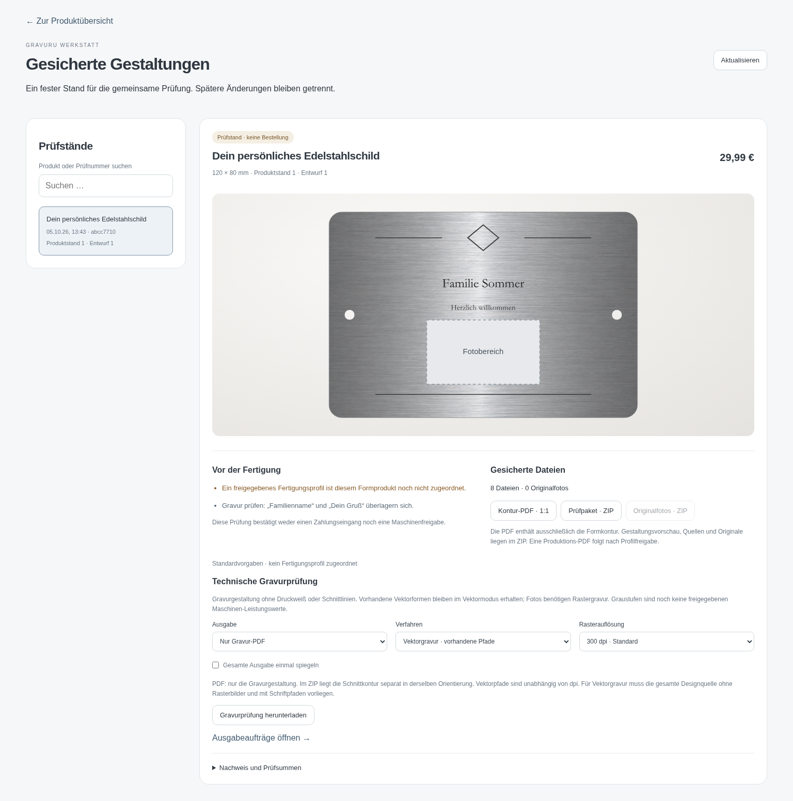
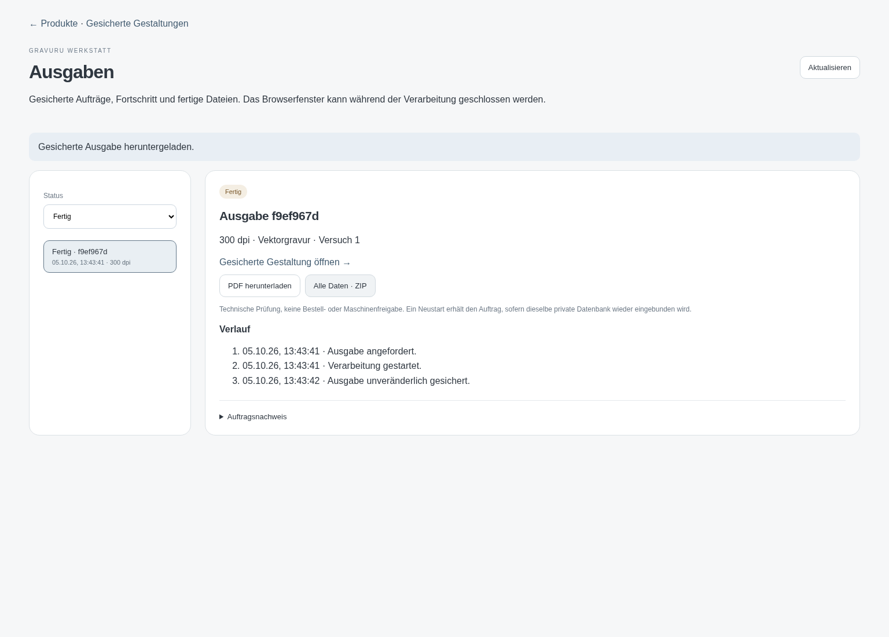
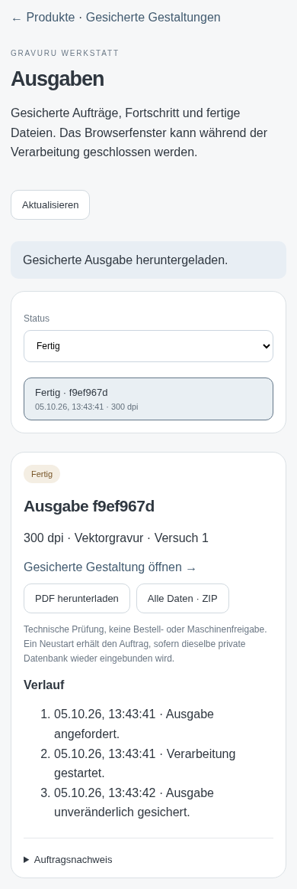

# Technische Gravurprüfung · 05.10.2026

Branch `task/form-engraving-20261005`; GitHub-Basis `6a23acc56a7f98f629107dd4f8769a901a2af164`. Bestehende Cloud; ausschließlich synthetische Prüfbestände.

## Ergebnis

Gesicherte Formprodukte mit Verfahren Gravur erhalten eine eigene Ausgabe ohne Druckweiß. Standard: PDF, Graustufenraster, 300 dpi, keine Spiegelung. Wahlweise 600 dpi oder vorhandene Vektorformen/Schriftpfade. Ein gebundenes Fertigungsprofil liefert seine unveränderlich gesicherten Vorgaben. Aufträge verwenden dieselbe persistente Warteschlange mit Fehlerstatus, Wiederholung und gesicherten Dateien.

Originalfotos werden mit gespeicherter Ausrichtung/Farbbehandlung verarbeitet, nicht aus einer verkleinerten Vorschau exportiert. Nicht belegte Fotofelder werden entfernt. Form, Innenausschnitte und optionale einmalige Spiegelung bleiben erhalten. Raster ist DeviceGray; Weiß bedeutet keine Gravur. Graustufenwerte sind ausdrücklich keine freigegebenen Maschinenleistungswerte.

Vektorausgabe erhält vorhandene SVG-Vektorformen und Schriftpfade. Fotos, in Designquellen eingebettete Rasterbilder/gerasterte Effekte oder nicht in Pfade umgewandelte Schrift werden abgelehnt. Keine automatische Vektorisierung. Vektorfarben werden zu Grauwerten umgesetzt; Linien-/Flächenauslegung und Materialparameter benötigen Maschinenabnahme.

Die Gravur-PDF enthält keine Schnittlinien. Das optionale ZIP enthält `gravur-kontur-1zu1.pdf` separat und in derselben Orientierung, Gravur-PDF, Originale und `gravurpruefung.json`. Der frühere Konturbeleg des Prüfstands bleibt unverändert. Kein `RDG_WHITE` und keine erzwungene Druckseparation.

## Prüfung

- `npm test`: **208 bestanden, 0 Fehler, 0 Skips**.
- `npm run build`: **76 Ressourcen, 1 Modell**, 461440 Editorbytes.
- PDF-Prüfung mit PyMuPDF: tatsächliche mm, DeviceGray-Raster, Originalfotos, klare Löcher/freie Flächen, einmalige Spiegelung, Vektorpfade ohne Bilder/Fonts, separate Kontur, kein Druckweiß. Rasterquelle als Vektor abgewiesen, als Raster erfolgreich.
- HTTP: Verfahren und Einstellungen geprüft; Gravur über persistente Aufträge, Wiederholung ohne Duplikate, identische gespeicherte PDF. Druck-API lehnt Gravurprodukte ab.
- Cloud-Chromium: Kundenstand sichern, Gravur statt Druck angezeigt, Vektorausgabe anfordern, Seite verlassen, fertigen Auftrag öffnen, PDF/ZIP herunterladen, neu laden und filtern. Desktop/Mobil/Tablet ohne JavaScriptfehler und horizontalen Überlauf.

## Grenzen und Fortsetzung

Keine reale Probegravur oder Maschinenfreigabe. Die genannten Roland LEF-200, Roland MO-240 und Mimaki 2513 EX sind bestätigte Druckmaschinenangaben, keine erfundenen Gravurmaschinenprofile. Konkrete Gravurmaschine, Material-/Leistungsparameter und RIP bleiben offen. CMYK-ICC-Freigabe für Druck bleibt ebenfalls offen.

Keine bezahlte Bestellung, externe Dashboard-Veröffentlichung, Shopify-/Plesk-Mutation oder Änderung des gesicherten Acrylmusters. Nächster Schritt: verbleibende Dashboard-/Kunden-/Bestellabläufe gegen den vereinbarten Umfang prüfen und unabhängig bearbeitbare Lücken schließen.
