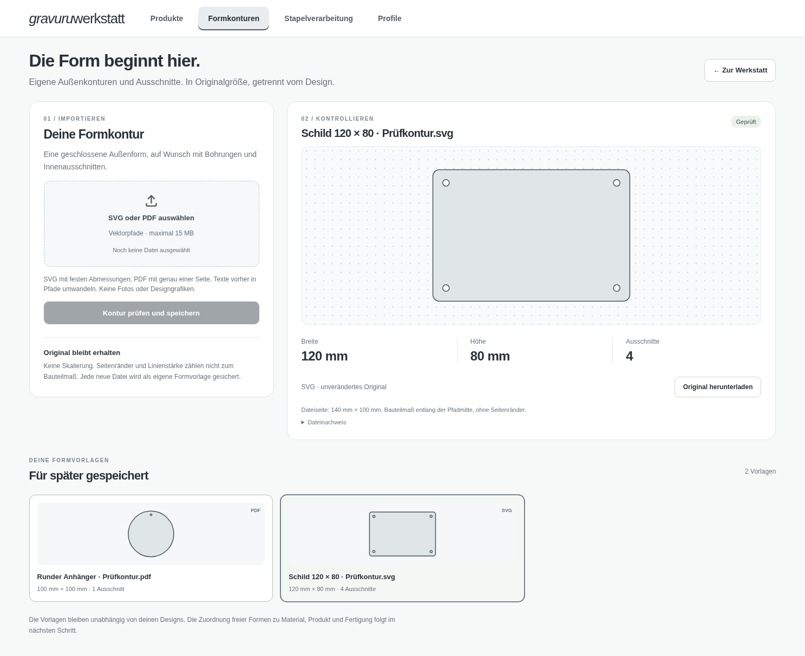

# Formkonturen: SVG-/PDF-Import – 05.10.2026

Aufgabenbranch `task/dashboard-contour-import-20261005`, Basis `138dc8bbc3dc7f742d40f86fa813fc706a41ec26`. Der vorhandene GitHub-Connector bestätigte diesen Remote-Stand des vorherigen Variantenpakets. Entwicklung und Browserprüfung in derselben laufenden verwalteten Cloud; keine neue Umgebung. Konto „mika“ ist die Nutzerzuordnung. Dieses Paket ist der Import-/Bibliotheksanteil von G27-03, nicht dessen vollständige Produkt-/Fertigungsanbindung.

## Tatsächliches Ergebnis

Werkstatt → **Formkonturen** (`/werkstatt/konturen/`): SVG/PDF auswählen, prüfen und als unveränderliche Formvorlage speichern. Vorschau mit ausgesparten Innenkonturen, Breite/Höhe in mm, Ausschnittzahl, Originaldownload und SHA-256-Nachweis. Gespeicherte Vorlagen lassen sich erneut auswählen. Ungültige Dateien überschreiben weder die letzte Vorschau noch vorhandene Vorlagen oder Produkte. Erneutes Hochladen desselben Originals erzeugt kein Duplikat. Die Bedienung folgt den bestehenden Dashboard-Komponenten in neutralem Grau; kein gesonderter bestätigter Mockup für diesen neuen Bereich wird behauptet.

- SVG: explizite Abmessungen und viewBox, Einheiten, Gruppen-/Affine-Transformationen, geschlossene Pfade, Rechtecke mit Rundung, Polygone und Kreise/Ellipsen. Native SVG-Bögen und Bézierkurven bleiben Kurven. Pixelmaße folgen SVG-konformen 96 dpi mit Hinweis des bestehenden Importers; fehlende oder prozentuale Seitengröße wird nicht geraten.
- PDF: genau eine Seite, tatsächliche Pfadgeometrie mit Drehung, CropBox und UserUnit. Seite und Linienstärke bestimmen nicht die Bauteilgröße. PDF-Kurven bleiben Bézierkurven. Seitenbeschnitt wird nur akzeptiert, wenn er die Kontur nicht schneidet; sonst Ablehnung.
- Genau eine Außenform mit klar getrennten Innenausschnitten. Offene, selbstüberschneidende, berührende, doppelte, verschachtelte oder mehrere Außenformen werden zurückgewiesen. Keine Masken, optionalen PDF-Ebenen oder Rasterbilder; kein automatisches Nachzeichnen von Fotos. Mehrseitige, verschlüsselte oder Text enthaltende PDF muss passend vorbereitet werden.
- Maße bleiben als Zahlen in mm erhalten. Nur die Oberfläche rundet auf höchstens drei Nachkommastellen. Für Topologieprüfungen werden Kurven bis 0,005 mm abgeflacht, nicht für gespeicherte Geometrie oder Bauteilmaße. Zwischen Ringen sind mehr als 0,02 mm Abstand erforderlich. 15 MB, maximal 128 Ringe/5000 Segmente, begrenzte Prüfpunkte und 45 Sekunden Laufzeitlimit.

Eigene Module `app/workshop/contour-converter.py` und `contours.mjs`; bestehender sicherer SVG-Parser wiederverwendet, Designimport unverändert. Bibliothek in zusätzlicher Tabelle `form_contours` der bereits vorhandenen privaten `design-assets.sqlite`, ohne vierte Datenbank. Originalbytes, Quell-/Geometriehash und normalisierte Kontur zusammen gespeichert. Bestehende Tabellen und Produktrevisionen bleiben erhalten. Keine Update-/Delete-API; neue Datei erzeugt eine neue Vorlage. Nicht in Git aufnehmen: `.local-data/`, SQLite, Uploads und private Originale.

## Ausführung / Einrichtung

Node ≥24, Python 3.12. Zusätzlich zum vorhandenen Import:

```sh
python3 -m pip install --target .local-data/python -r app/workshop/requirements-contours.txt
npm test
npm run build
npm start
```

Pinning: PyMuPDF 1.28.2, svgpathtools 1.7.2, Shapely 2.1.2. Der Python-Unterprozess berücksichtigt `.local-data/python` selbst. Kein neues Secret nötig. Mit `npm start` schreibt die Entwicklungswerkstatt in die vorhandene lokale Entwicklungsablage; diese ist keine dauerhafte gemeinsame Cloud-Datenbank. In diesem Paket wurden ausschließlich neue synthetische Prüfdaten genutzt.

## Tatsächlich geprüft, 05.10.2026 UTC

- `node --test app/workshop/contours.test.mjs`: **8 bestanden, 0 Fehler/Skips** nach Behebung der erkannten Fehler. Reale Python-Konvertierung synthetischer SVG-/PDF-Dateien, keine Converter-Mocks.
- `npm test`: **185 bestanden, 0 Fehler, 0 Skips**. Nach Ergänzung des PDF-UserUnit-Falls gezielt dieser Test erneut erfolgreich ausgeführt (1 bestanden, keine Skips).
- `npm run build`: **76 Ressourcen, 1 Modell, Editor 461440 Bytes**. Kundenkonfigurator und Druckexport durch dieses Paket nicht geändert.
- 120 × 80 mm mit vier Ø4-mm-Ausschnitten an den Mittelpunkten (8,8), (112,8), (112,72), (8,72), unabhängig von 140 × 100 mm Seitengröße und 4 mm Linienstärke. Zusätzlich zwei Löcher, Kurven, gedrehte/gespiegelte/gescherte Ellipsen, SVG-cm/in/viewBox, PDF-Drehung/CropBox/UserUnit, eindeutige Fehlerfälle.
- Originalhash/-bytes, Wiederöffnung des SQLite-Speichers, unveränderte Produktrevision, Host/Origin/CSRF, private Dateipfade nicht über HTTP erreichbar, Original nur als Download mit restriktiver CSP.
- Cloud-Chromium/Playwright: echte SVG-/PDF-Uploads, Ergebnismaße und Ausschnitte, Originaldownload bytegleich, ungültiger Upload erhält vorheriges Ergebnis, Auswahl und Neuladen. Desktop 1487 px, Mobil 390 px, Tablet 768 px; kein horizontaler Überlauf oder JavaScript-Seitenfehler. Screenshotinhalt ausschließlich synthetisch. Entwicklungsserver im Cloud-Loopback; kein öffentlicher Dashboard-Link.

Gefundene und behobene Ursachen: mikroskopischer Schließfehler beim numerischen Aufteilen eines Kreisbogens; PDF-CropBox wurde zunächst pauschal als unzulässiger Beschnitt behandelt; SQLite-JSON-Pfad der Sortierung benötigte `$.createdAt`. Ein zwischenzeitlicher Browserlauf traf noch den alten Entwicklungsprozess; nach dessen gezieltem Neustart war der gespeicherte aktuelle Stand im Browser erfolgreich. Alle genannten Ergebnisse beziehen sich auf die tatsächlich korrigierte Ausführung.



[Mobilansicht](dashboard-contours-mobile.png).

## Grenzen / genau nächster Schritt

Die importierte Form ist eine eigenständige Formvorlage; noch keine freie Produktgeometrie im Konfigurator oder Fertigungsauftrag. Bestehende Acrylgrößen, Sockel-/Preisregeln, Designs und Muster Acrylglasbild werden nicht heimlich durch andere Konturen ersetzt. Kein neuer Kunde-/Bestellbestand und keine bestätigte Maschinenabnahme. Es wurde keine echte Kundenkonturdatei als geprüft ausgegeben. Entwicklung benötigt für den nächsten Schritt keine alte private Datenbank.

**Nächster Schritt:** Die gespeicherte Kontur-ID samt unveränderlicher Geometrie in das versionierte Material-/Formproduktmodell einbinden; dieselbe Geometrie für 2D-Vorschau und Produktionskontur verwenden. Dabei vorhandene Materialreferenzen und freigegebene Stärken beachten, vorhandene Ausschnitte nicht noch einmal bohren und keine Acryl-Sockelpreise auf freie Schildformen übertragen. Keine Shopify-/Plesk-/Produktionsmutation, Veröffentlichung oder Merge.
