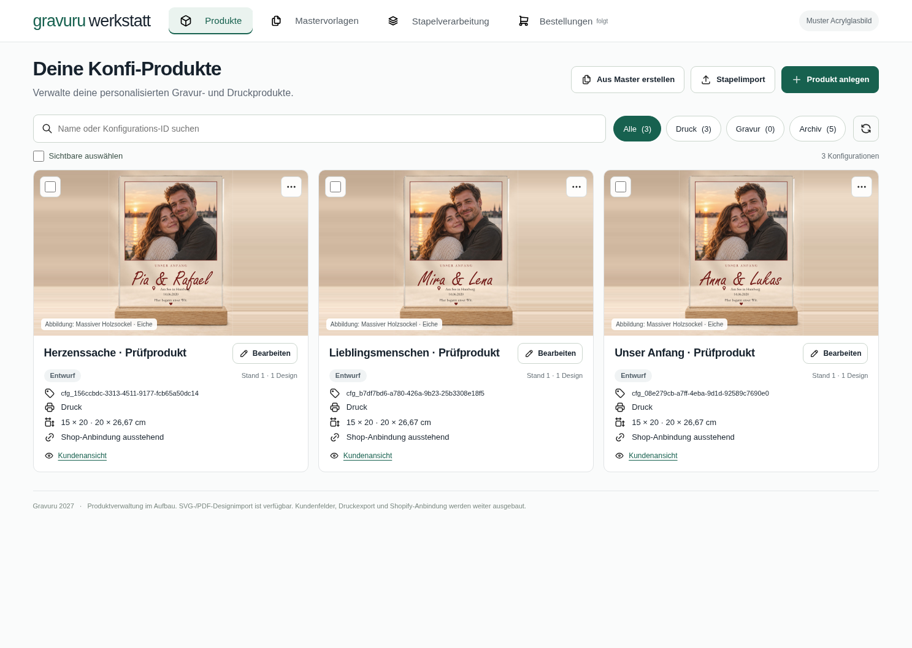
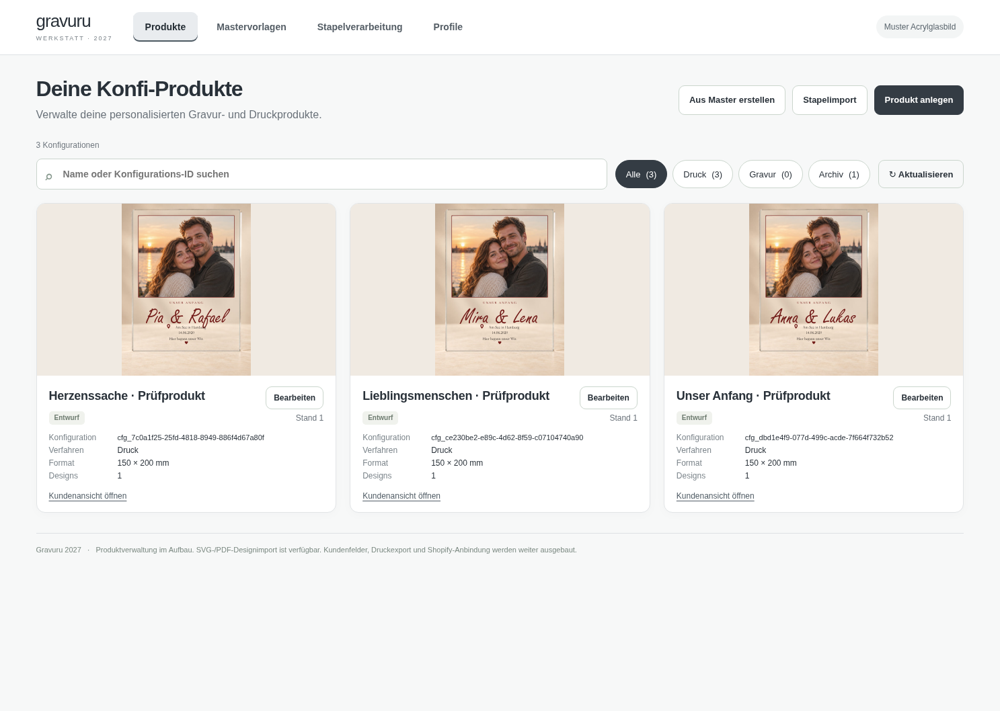

# M01-Produktübersicht – überprüfte Fortsetzung, 05.10.2026

Branch `task/dashboard-m01-overview-20261005`, Ausgangscommit `8227eb7db836de5e30779e42fdd7bd36cb1a68f4` (M02). Ausführung in der bestehenden bestätigten Cloud; Kontoname mika bleibt Nutzerangabe. Keine neue Umgebung, kein Laptopzugriff.

## Tatsächlich umgesetzt

- Große fotografische Karten nach M01, aus der gespeicherten Produktrevision: vorhandene Originalszene, Foto, Texte und Designrenderer. Für das Querformat werden ausschließlich die leeren fotografischen Seitenränder der Szene verlängert. Platte und Gestaltung behalten ihre Proportionen und bleiben vollständig sichtbar. Keine ausgedachten Holz-/Schieferprodukte aus dem Referenzmockup.
- Abgebildete Sockelausführung klar beschriftet: Eiche, sofern im Produkt erlaubt, sonst gespeicherte Standardauswahl. Diese reine Abbildung verändert weder Kundenstandard noch Preis, Design oder Historie. Historische Karten verwenden weiter genau ihre Revision.
- Kompakte Angaben mit allen tatsächlich freigegebenen Größen, Konfigurations-ID, Designanzahl, Stand und Status. Suche nach Name/ID, Master-/Stapelzugang und Kundenansicht bleiben angebunden. Shopify ist ausdrücklich ausstehend; keine vorgetäuschten Bindungen oder Suche nach nicht vorhandenen Shopify-IDs.
- Mehrmenü: Bearbeiten, Kopieren, Archivieren/Wiederaktivieren. Die vorhandene Kopierfunktion kann im Dialog auch eine neue Mastervorlage erzeugen.
- Mehrfachauswahl und „Sichtbare auswählen“ mit Bestätigungsdialog und Liste der betroffenen Namen/Stände. Archivierung je Produkt über bestehende CSRF- und revisionsgeschützte API. Konflikte werden pro Produkt gemeldet; andere erfolgreiche Aktionen bleiben erhalten. Keine atomare Gruppenänderung behauptet, keine automatische Wiederholung mit fremder neuer Revision.
- Filterwechsel nimmt versteckte Produkte aus der Auswahl. Nach Aktualisieren werden zwischenzeitlich geänderte Produkte abgewählt statt still auf die neue Revision umzuschalten. Tastatur/Escape, mobile Auswahl, leere Liste und Bildladefehler berücksichtigt.

## Tatsächlich geprüft

`npm test`: **176 Tests bestanden, 0 Fehler, 0 Skips**, 05.10.2026. Neuer HTTP-Test `app/workshop/product-overview.test.mjs`: vollständige Größen, erlaubte Sockel, historische Revision, keine Schreibnebenwirkung, separater Karten-/Portraitmodus. Der M02-Vorschautest bleibt bestanden. `npm run build`: **76 Ressourcen, 1 Modell**, Editor 461440 Bytes.

Chromium/Playwright in derselben Cloud, geschützter Loopback-Port 8974; synthetische In-Memory-Daten für Werkstatt, Profile und Designassets. Tatsächlicher Browserablauf: Suche nach Name und vollständiger ID; Filter/Leerliste; Auswahl; Archivieren/Zurückholen; zweiter API-Schreiber ändert einen ausgewählten Stand bei geöffnetem Dialog (409 verhindert Überschreiben); Abbrechen; Tastatur/Escape; Kopie mit neuer ID und unveränderten Designs; geänderter Stand wird bei Refresh abgewählt; Masterzugang; Mobil 390 × 844; Bildladefehler bleibt bearbeitbar. Keine JavaScript-Seitenfehler. Keine privaten Datensätze verwendet.

[Mobilansicht](dashboard-m01-overview-mobile.png) · [Mobile Mehrfachauswahl](dashboard-m01-selection-mobile.png) · [Visueller Vergleich](../../design-qa.md)

## Grenzen und nächster Schritt

Die aktuelle Vorschau läuft ausschließlich in der bestehenden Cloud-Entwicklungsaufgabe, nicht unter dem privaten Muster-Link. Keine neue Site oder Veröffentlichung; Muster Acrylglasbild unverändert. Dieser Lauf schreibt keine privaten Datenbanken oder Server. Die In-Memory-Prüfprodukte sind keine dauerhafte Werkstattablage.

M01-Struktur und Aktionen mit vorhandener Acrylszene geprüft, nicht bildidentisch zu den generierten Produktfotos im Mockup und keine Gesamtfreigabe der App. Bestellungen, echte Shopify-Bindungen, weitere Material-/Formadapter und RIP-/Maschinenabnahme bleiben offen. M02 ist aus dem Ausgangscommit erhalten.

**Genau nächster Umsetzungsschritt:** In M02 unter „Optionen & Preise“ die verfügbaren Acrylgrößen, Sockel und jeweilige Startauswahl aus dem bestehenden Variantenmodell bearbeitbar machen; derzeit kann dort nur die Vorschauausführung gewählt und das Preisprofil geändert werden. Gemeinsame Modellprüfung/Revisionen nutzen, keinen zweiten Variantenstand anlegen.

---

## Historischer erster M01-Durchlauf

> Einordnung nach dem visuellen Abgleich vom 05.10.2026: Die technischen Prüfungen sind gültig, die M01-Produktkarten entsprechen jedoch noch nicht vollständig der ausgewählten fotografischen Referenz. M02 wurde anschließend als eigenes Paket angebunden: [aktueller Stand](DASHBOARD-M02.md).

# Dashboard: Produktübersicht M01

Umgesetzt am 05.10.2026 nach Nutzerbestätigung „Dashboard“. Aufgabenbranch `task/dashboard-product-cards-20261005`, Basis `775557fef6933509d095b9e2756a5f799a7fd670`.

Obere Navigation mit Produkte, Mastervorlagen, Stapelverarbeitung und Profile; Direktlink zum separat gesicherten Muster Acrylglasbild. Große Karten aus der bestehenden API, Suche nach Name/ID, Druck/Gravur/Archivfilter und tatsächliche Zähler. Vorschau und Metadaten gehören zur gespeicherten Revision. Bearbeiten öffnet den vorhandenen Editor; Rückweg schützt ungespeicherte Eingaben. „Aus Master erstellen“ kopiert die gewählte gespeicherte Vorlage über die vorhandene revisionsgeprüfte API.

Neue lesende Route `/api/workshop/products/:id/preview.svg?revision=N` verwendet den gemeinsamen Renderer und die bestehenden Acrylquellen. Vorschau verändert keinen Datensatz; historische Revisionen bleiben gleich. Kompakte JPEG-Ableitungen ausschließlich für Karten, Druckoriginale erhalten. Kein beliebiges externes Bildladen, keine neue Authentifizierung oder Rechtefreigabe. Bestehender Host-/Origin-/CSRF-Schutz bleibt aktiv.

Prüfung: 174 Tests bestanden, 0 Fehler, 0 Skips; anschließend zwei gezielte HTTP-Tests nach Vorschaubildoptimierung bestanden. Build 76 Ressourcen/1 Modell. Browser Desktop 1487 × 1058 und Mobil 390 × 844: echte API mit separater In-Memory-Prüfdatenbank, drei synthetische Produkte, ein Master, ein Archivdatensatz. Suche/Filter/Archiv, Anlegen aus Master und Reload, Warnung bei ungespeicherten Eingaben, keine Seitenfehler oder horizontaler Überlauf. [Visueller Bericht](../../design-qa.md).

Keine privaten Werkstattdaten angebunden oder verändert, keine Testprodukte in den privaten Bestand geschrieben. Keine neue öffentliche oder private Dashboard-Veröffentlichung. Das laufende Cloud-Entwicklungssystem ist kein dauerhafter gemeinsamer Datenbestand. Der vorhandene Muster-Link führt weiterhin zum Acrylkonfigurator, nicht zum Dashboard.

Start in vorhandener Cloud: `npm start -- --port=8972` (legt bei leerer Entwicklungsdatenbank einen Master an); Tests über `npm test`. Der tatsächliche Browserprüflauf verwendete eine gesonderte In-Memory-Datenbank, nicht diesen persistenten Standardpfad.

Nächster fachlicher Schritt: M02-Produktbearbeitung mit Elementen links, großer Vorschau mittig und Einstellungen rechts weiterführen; vorhandene Kundenfelder-/Import-/Revisionsmodule nutzen. Shopify-Anbindung und Bestellübernahme bleiben eigene offene Funktionen.
