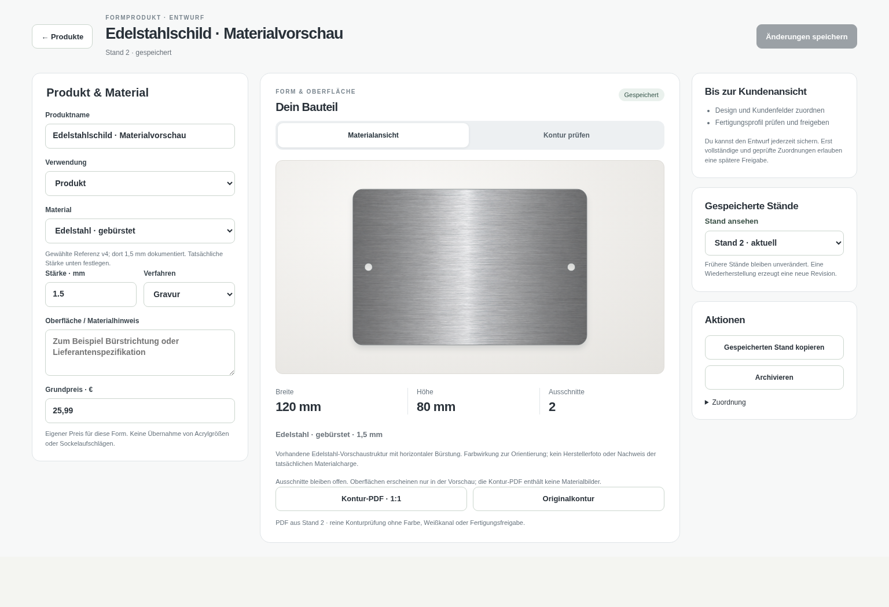

# Materialansicht für Formprodukte – 05.10.2026

Branch `task/dashboard-material-preview-20261005`, geprüfte GitHub-Basis `3d0d60480c283c19945ea8c534693f35830b5b19` (vorheriges Formprodukt-Paket), lokaler Parent `4a1c38ca5a09a132f6aaacb2da20ad18e7f182c7`. Beide Ausgangsbäume identisch: `f071120568080fb5e6e399bb014bfd031854c476`. Bestehende laufende Cloud, Konto mika laut Nutzerangabe.

## Tatsächlich umgesetzt

Der Formprodukt-Editor zeigt bei Edelstahl jetzt die vorhandene leere Oberfläche innerhalb der unveränderten Originalkontur. Materialansicht und technische Konturprüfung sind umschaltbar. Die Bildproportionen und horizontale Bürstrichtung bleiben erhalten; Außenform und alle Innenausschnitte verwenden denselben geprüften mm-Pfad. Kein Rechteck über den Bohrungen. Die Vorschau ergänzt eine neutrale Fläche und einen leichten Schatten, keine erfundene fotografische Raum-/Montageszene oder maßhaltige Tiefensimulation.

Quelle: `app/designs/aosu-labrador/runtime/images/gravuru-edelstahl-feine-maserung-vorschau.png`, unverändert bereits im Repository vorhanden. SHA-256 `74f75d42041d70b20bb559ebe317006c1058534bfedcb6fe0f490c872f44e3e6`, gemäß `image-source-verification.json` und `RIGHTS-AND-DEPENDENCIES.md` desselben Ressourcenpakets. Diese leere Vorschaustruktur ist ausdrücklich nicht das gestaltete Referenzbild v4. Die gewählte Materialreferenz v4 bleibt erhalten; keine v6-Übernahme. Kein Herstellerfoto oder neuer Nachweis realer Materialchargen behauptet. Keine öffentlichen Rechte aus privater Herkunft abgeleitet.

Materialwechsel entfernt die bisherige Oberfläche sofort. Für nicht zugeordnete Materialien steht eine klare Konturansicht mit Hinweis bereit. Ein fehlgeschlagener Bildabruf fällt ebenfalls sichtbar auf die Konturprüfung zurück. Gespeicherte und historische Produktstände liefern ihre jeweilige Materialwahl; überholte asynchrone Antworten überschreiben die aktuelle Vorschau nicht. Texteingaben blenden die bereits gültige Oberfläche nicht bei jedem Tastendruck aus.

Die vorhandene Kontur-PDF bleibt Vektor-only, ohne Oberflächenbitmap. Es gibt keine Änderung am Produktions-PDF des Acrylkonfigurators. Produktkarten bleiben als technische Konturansicht gekennzeichnet; die neue Materialansicht gehört bisher zum Formprodukt-Editor.

## Prüfungen

- `node --test app/workshop/material-preview.test.mjs app/workshop/form-product.test.mjs`: 5 bestanden, 0 Fehler/Skips. Geometrie, Quellhash, ausdrücklich fehlende Materialien und vorhandene Revisions-/PDF-Prüfung.
- `npm test`: 190 bestanden, 0 Fehler/Skips. `npm run build`: 76 Ressourcen, 1 Modell, Editor 461440 Bytes.
- Anschließend kleine UI-Optimierung gegen Flackern bei Texteingaben; vollständiger unten beschriebener Browserablauf erneut erfolgreich durchgeführt.
- Echte Cloud-Chromium-Bedienung mit synthetischem SVG und in-memory SQLite: Import → Formprodukt → Edelstahl → Speichern/Reload → Umschalten → Materialwechsel → historische Revision. Geladenes Oberflächenbild HTTP 200; tatsächlicher Pixeltest bestätigt transparente Bohrungsmitten und gefüllte Metallfläche. PDF heruntergeladen und mit PyMuPDF geprüft: drei Vektorpfade, kein Rasterbild.
- Browser zusätzlich: abgefangener fehlgeschlagener Bildabruf zeigt Konturfallback, keine JavaScript-Seitenfehler, Desktop 1536 / Mobil 390 / Tablet 768 ohne horizontalen Überlauf.
- Git-Diff auf notwendige Dateien begrenzt. Vorhandene EOL-Arbeitsanzeigen in README.md und CLOUD-AKTUELL.md nicht aufgenommen. Keine privaten DBs, Benutzerfotos oder Geheimnisse verwendet.

[Mobilansicht](dashboard-material-steel-mobile.png). Screenshots sind tatsächliche Browseraufnahmen, kein veröffentlichter bedienbarer Dashboard-Link.

## Noch offen / nächster Schritt

Andere Materialien benötigen separat geprüfte leere Oberflächen; gestaltete Holz-/Lederbilder nicht als universelle Textur einbauen. Schiefer-Rohlingquelle bleibt ungeklärt. Materialtiefe/physische Kante und freigegebene Materialszene fehlen weiterhin. Für Formprodukte folgen Designvorlagen und ausdrücklich editierbare Kundenfelder mit derselben Kontur; Maße/Bohrungen nicht verändern oder Gestaltung automatisch verzerren. Shopify, Kundenfreigabe und reale Fertigungsabnahme bleiben separate Pakete. Bestehendes Muster Acrylglasbild unverändert, nichts live veröffentlicht.
