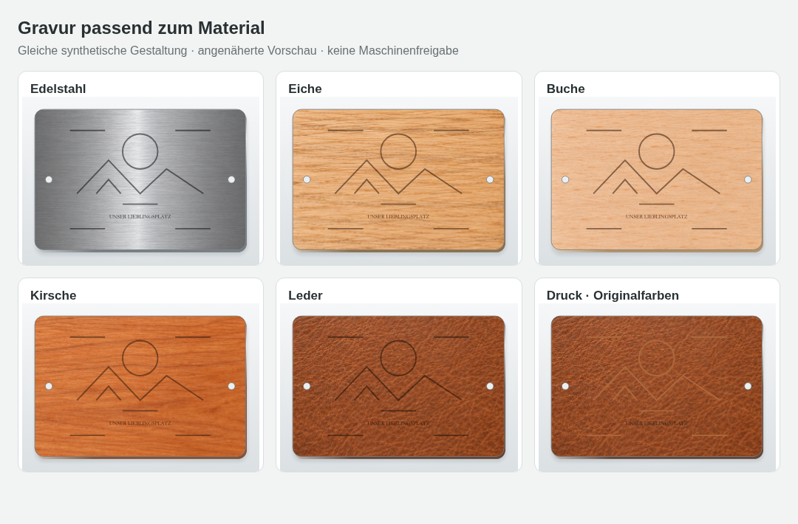

# Gravurwirkung der übrigen Materialien – 06.10.2026

Bestehende Cloud, Repository Chris83638w/gravuru-2027; Aufgabenbranch `task/material-engraving-preview-20261006`, Basis `725a7c62b9be6536f9bdd2cd502547424228e867`.

## Ergebnis

Edelstahl, Eiche, Buche, Kirsche und braunes Leder übernehmen bei Gravur keine ungefilterten Druckfarben mehr. Edelstahl erscheint dunkel/neutral, Holz und Leder dunkelbraun entsprechend den vorhandenen Referenzmustern. Acryl bleibt hell. Dieselbe Komposition wird in Backend, Kundenansicht, Produktkarte und gespeicherter Materialvorschau verwendet. Quellhelligkeit und Alpha bestimmen die relative Stärke; Weiß und Transparenz ergeben keine Gravur.

Originalfarben kehren beim Verfahren Druck zurück. Originaldateien, Preise, reale Stärke, Außenkontur, Bohrungen, Rechte und technische Fertigungsdateien werden nicht umgeschrieben. Keine zusätzliche Weißebene. Bildschirmtöne sind Näherungen, keine Materialchargen-/Maschinenfreigabe. Schiefer bleibt ohne leere Materialvorschau; kein Rohling erfunden. Die bestehenden Texturen bleiben unverändert.

## Sichtbarer Vergleich

Gleiche synthetische Liniengrafik; 120 × 80 mm, zwei Bohrungen. 3 mm ist ausschließlich die explizite Stärke der Prüfdaten, keine neue Lieferantenspezifikation. Bilder stammen aus den tatsächlich erzeugten Produktkarten-SVGs, im Cloud-Browser gemeinsam dargestellt. Keine Kundenbilder oder neue kommerzielle Designs.

## Gelesene Originalreferenzen

Archiv `REFERENZ-MATERIALIEN-20260930.zip`, `material-references/`:

| Original | SHA-256 |
| --- | --- |
| edelstahl-gewaehlte-originalfassung-v4.png | bceaac4cd6bdba8aa1b5428625856d6eeec37a2d40ba0210bbbcb670b36198f4 |
| eiche-5mm-muster.png | 924aa1646412ecab8aab9614280e8890635243439f86d0ad35bd135fec0a4e01 |
| buche-5mm-muster.png | cbc1ea62a52c71c047311fcae824ae97d79e0936346921cbd5bd21164c47a200 |
| kirsche-5mm-muster.png | 3af5de26787a0d1ec60e7d199feac318820e2ea0b5caed6152cc9690730b913e |
| leder-2mm-muster.png | 0f94df666521693b9f726d3bcb998e986f94522d5143b9bfe1d31b4a84facc98 |

## Tatsächlich geprüft

- Gezielter Lauf `node --test app/workshop/material-preview.test.mjs app/workshop/form-engraving-proof.test.mjs`: 12 Tests bestanden, keine Fehler/Skips.
- Reale Gravur-PDFs aller fünf Materialien: gleiche geprüfte Graustufenpixel, Fotoabstufungen, Maße/Bilddaten; keine RDG_WHITE-Ebene. Freiflächen und Bohrungen ohne Gravur. Materialfilter ausschließlich in der Vorschau, nicht in der reinen Gestaltung.
- Chromium: alle fünf Materialien auswählen, speichern und neu laden; Produktkarten laden mit eingebetteten Ressourcen. Leder-Kundenansicht direkt per Doppelklick bearbeiten und speichern; Verfahren auf Druck umschalten mit unveränderten Originalfarben. Desktop 1536, Handy 390, Tablet 768 ohne Seitenüberlauf und JavaScriptfehler.
- Tatsächliche Filterpixel je Material: transparent 0, Schwarz 255, Grau 127, Weiß 0, halbtransparentes Schwarz 128 (Alpha); rote Quellfarbe wird im Gravurbild neutral bzw. dunkelbraun. Keine roten Gravurlinien oder künstliche Deckfläche.

**Vollständiger Lauf:** `node scripts/cloud-check.mjs`, 06.10.2026 **06:47:19–06:48:25 Europe/Berlin**, **241 Tests bestanden, 0 Fehler/Skips**, Build **76 Ressourcen/1 Modell**.

Nachweis: [Maschinenlesbarer Nachweis](material-engraving-check.json).

Kein Merge, Publish/Deploy oder Produktionszugriff. Separate bestehende Testseite unverändert. Die bereits vorhandenen EOL-Abweichungen in CLOUD-AKTUELL.md/README.md wurden nicht in dieses Paket aufgenommen. Nächster Schritt: die verbliebenen Dashboard-Import-/Variantenabläufe mit dem dokumentierten Soll abgleichen. Physische Probegravuren und echte Shopify-Teststrecke bleiben separat offen.
