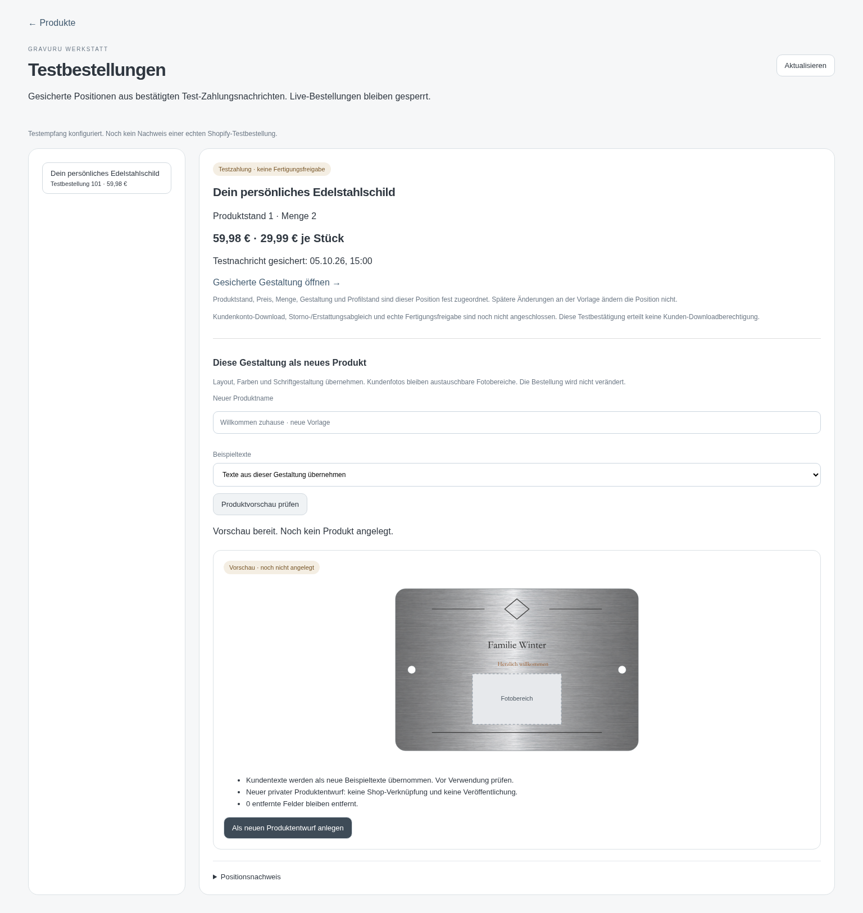
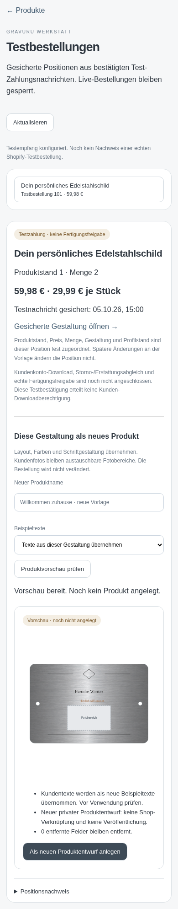

# Produktentwurf aus einer gesicherten Bestellgestaltung

05.10.2026, bestehende Cloud-Arbeitsumgebung. Branch `task/order-product-drafts-20261005`, Basis `7786a685bb8d4e876805a5196f88280abdca601c`.

## Bedienung

Werkstatt → Testbestellungen → Position auswählen → „Diese Gestaltung als neues Produkt“. Neuen Namen eingeben, Beispieltexte auswählen, Vorschau prüfen und erst dann als Produktentwurf anlegen. Anschließend öffnet der Link den bestehenden Formprodukteditor. Nach Neuladen wird derselbe angelegte Entwurf angeboten.

Die ursprüngliche Idee des Nutzers wird für die bereits gesicherten **Formprodukt-Positionen** umgesetzt: Aus einer gelungenen Kundengestaltung ein neues, weiterbearbeitbares Produkt machen. Das ausgewählte Design, Kundenpositionen, Feldgrößen, Schriften, Farben und gelöschte Felder werden aus dem unveränderlichen Prüfstand übernommen. Kontur, Bohrungen, Material, Grundpreis und gebundene Profilrevision bleiben aus diesem Stand erhalten. Aktuelle Änderungen an der alten Produktvorlage wirken nicht hinein.

Standardmäßig bleiben die ursprünglichen Beispieltexte stehen. „Texte aus dieser Gestaltung übernehmen“ ist eine ausdrückliche Auswahl. Falls die ursprünglichen Texte nicht in die veränderten Felder passen, erklärt die bestehende Geometrieprüfung den Konflikt; kein automatisches Stauchen. Kundenfotos werden nicht zu öffentlichen Produktbildern: Die positionierten Fotobereiche bleiben editierbare Platzhalter. Keine personenbezogenen Beispielbilder automatisch erzeugt oder veröffentlicht.

## Technische Umsetzung

`order-product-draft.mjs` liest das vorhandene Prüfpaket ausschließlich im Speicher über `readReviewPackage`. Gesamt- und Dateiprüfsummen, Positions-/Prüfstandbezug und verfügbare Schriftressourcen werden geprüft. Bestehende Kundenrechte, Kontur- und Designprüfung bleiben maßgeblich. Vorschautoken bindet Namen, Textauswahl, Inhalt und Herkunft; geänderte Eingaben erfordern eine neue Vorschau.

Das Anlegen nutzt die vorhandene transaktionale `importBatch`-Speicherung mit einem festen Schlüssel je Bestellposition. Wiederholung und Neustart liefern denselben Produktentwurf; abweichende erneute Inhalte überschreiben ihn nicht. Weitere Varianten können anschließend über die vorhandene Produktkopie erstellt werden. Der neue Datensatz ist `draft`, ohne veröffentlichte Revision, Masterbindung oder Shopify-Zuordnung. Die ursprüngliche Position und ihr Paket bleiben unverändert.

Private Medienbytes, Entwurfszugangstoken, Roh-Webhooks und Zahlungsdaten werden nicht in den neuen Produktdatensatz übernommen. Die Herkunft bleibt über den privaten Übernahmeschlüssel mit der Position verbunden. Vorschau und Anlegen sind ausschließlich im bestehenden Operator-Backend mit dessen CSRF-/Host-/Origin-Schutz erreichbar. Dies ergänzt keine gehostete Benutzeranmeldung.

## Prüfung

- `node --test app/workshop/order-product-draft.test.mjs`: **3 bestanden**, einschließlich tatsächlichem Foto-Upload mit synthetischem Bild, geprüftem ZIP, Textvarianten, Positionen/Farben/Löschung, unverändertem Original, geänderten Schriften/Hashes, ungültigem Token, Wiederholung und SQLite-Neustart sowie HTTP/CSRF.
- `npm test`: **222 bestanden, 0 Fehler, 0 Skips**. Anschließend nur einen veralteten Hilfetext korrigiert und den Browserablauf erneut geprüft.
- `npm run build`: **76 Ressourcen, 1 Modell**.
- Cloud-Chromium: Desktop 1536, Mobil 390, Tablet 768. Beide Textauswahlen prüfen; Vorschau erzeugt kein Produkt; eigene Gestaltung anlegen; nach Neuladen vorhandenen Entwurf öffnen; Preis aus altem Stand und veränderte Feldposition erhalten; Editor erreichbar; ursprüngliche Bestellung unverändert. Keine JavaScriptfehler oder horizontalen Überläufe.

Ein erster Browserprüflauf scheiterte am falschen Testselektor für das Produktnamensfeld (`name` statt vorhandener `id`). Der Editor war geladen; nach Korrektur des Selektors bestand der vollständige Ablauf mit frischen synthetischen Daten. Kein Anwendungsfehler als bestandene Prüfung ausgegeben.

## Grenzen und Fortsetzung

Nur Formprodukt-Positionen der vorhandenen Testbestellstrecke geprüft. Keine tatsächliche Shopify-Bestellung, keine Übernahme des Acryl-Browserzustands, keine Shop-Veröffentlichung, keine Maschinenfreigabe. Der bisherige Acrylmusterstand bleibt unverändert. Die neutrale Vorlage enthält keine Kundenfotos; eine spätere bewusste Verwendung lizenzierter Beispielbilder ist eine getrennte Funktion.

Weitere unabhängige Aufgaben: Materialansichten und Funktionsparität des Formprodukt-Kundeneditors. Die reale Shopify-Teststrecke benötigt weiterhin den bestätigten Entwicklungsstore und dessen sichere App-Anbindung. Roland LEF-200/MO-240: VersaWorks bestätigt; Mimaki 2513 EX: genauer RIP-Name/Version offen. Keine zusätzliche Serverplanung begonnen.
