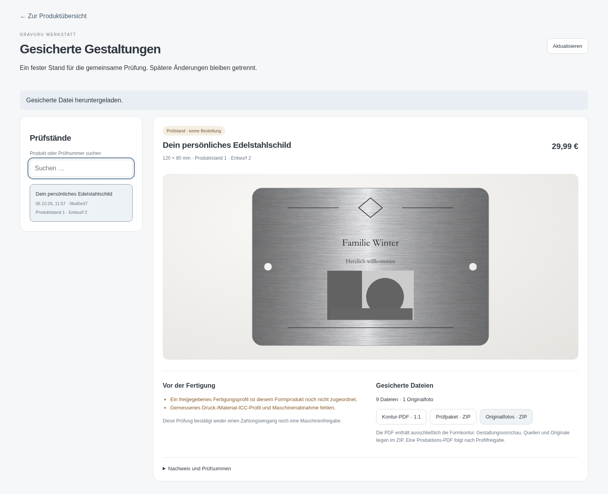

# Gesicherte Gestaltungen für die Werkstattprüfung

Stand 05.10.2026. Aufgabenbranch `task/form-production-snapshots-20261005`; bestätigter GitHub-Ausgangscommit `280c773c72b55aefecdc0d5d6680fdd0cd07d663`. Vorhandene Cloud-Laufzeit running/connected mit aktuellen Beobachtungen; Kontozuordnung mika laut Nutzer. Keine neue Umgebung oder Serverplanung. Ausschließlich synthetische Prüfdaten.

## Bedienablauf

1. Gespeichertes Formprodukt aus dem Dashboard im Kundenentwurf öffnen.
2. Text/Foto bearbeiten, den Entwurf speichern, danach **Für die Werkstattprüfung sichern** wählen. Ungespeicherte Änderungen können nicht versehentlich als gesicherter Stand ausgegeben werden. Erforderliche Fotos müssen vorhanden sein.
3. Im Dashboard **Prüfstände** öffnen: `/werkstatt/pruefstaende/`. Suche nach Produktname oder Prüfnummer, festen Stand auswählen. Gestaltung, damaliger Preis, Produkt-/Entwurfsrevision, Originaldateien und offene Fertigungspunkte ansehen.
4. Backend-Downloads: **Kontur-PDF · 1:1**, **Prüfpaket · ZIP**, **Originalfotos · ZIP**. Die PDF enthält ausschließlich die physische Vektorkontur und Ausschnitte, kein Druckmotiv. Der Kunde erhält hier keinen Downloadbutton.

## Gesicherter Inhalt

Neue private Tabelle `form_review_snapshots` in derselben Werkstatt-SQLite. Produktdokument, Kundenwerte, gewähltes Design, Material/Preis/Kontur und verwendete Schriften bleiben an die Ausgangsrevision gebunden. Kopien der Design-/Konturoriginale und der verwendeten privaten Originalfotos werden tatsächlich mitgesichert; spätere Verfügbarkeit der Importbibliothek ist zum erneuten Herunterladen nicht erforderlich. Fotos behalten ihre ursprünglichen Bytes und bekommen keine erfundenen zusätzlichen Details.

Die vorhandene `formContourPdf`-Ausgabe und `zipFiles` aus dem bestehenden Exportmodell werden wiederverwendet. Die beim Sichern erzeugten Dateien werden gespeichert, später nicht aus veränderten Quellen neu berechnet. SQL-Trigger verhindern normales Überschreiben/Löschen; Wiederholung desselben Entwurfsstands liefert denselben Prüfstand. Neue Entwurfsrevision ergibt einen eigenen Prüfstand. Nach der asynchronen Paketerstellung wird die erwartete Entwurfsrevision nochmals in der Schreibtransaktion geprüft.

Paket enthält `produkt-und-gestaltung.json`, `schriften.json`, Originalquellen, `vorschau.svg`, `gestaltung-vorschau.svg`, `kontur-1zu1.pdf`, verwendete `fotos/*-original.*` und `manifest.json`. Letzteres enthält SHA-256 und Byteanzahl aller Nutzdateien; die Prüfsumme des gesamten ZIP steht separat im Backend-Datensatz, damit kein selbstreferenzieller Hash entsteht. Keine Tokens, Passwörter oder privaten Pfade im Paket. Originalfotos können ihre ursprünglichen Kamerametadaten enthalten; diese byteidentischen Dateien bleiben privat. Sichtbare Fotovorschauen enthalten keine Kamerametadaten.

Gestaltungsvorschau ohne Material/Bediengriffe ist eine RGB-SVG-Prüfansicht mit Fotovorschauen bis 1600 Pixel, **keine CMYK-Produktionsdatei**. Originale und Bearbeitungswerte liegen separat für die spätere hochauflösende Ausgabe vor. Hinweise nennen zu niedrige tatsächliche Fotoauflösung. Materialvorschau ist gesondert und bleibt außerhalb der Kontur-PDF.

## Wirklich ausgeführte Prüfungen

- `npm test`: **194 bestanden, 0 Fehler, 0 Skips**; `npm run build`: **76 Ressourcen, 1 Modell, 461440 Editorbytes**. Nach der Speicherzugriffsoptimierung gezielter Prüfstandtest erneut erfolgreich.
- HTTP/SQLite: fehlendes/falsches Kundentoken, fehlendes CSRF, fremder Host/Origin/Cross-Site, unerlaubte Schreib-/Downloadarten und eingeschleuste ungespeicherte Werte abgewiesen. Erforderliches Foto, Retry ohne Duplikat, transaktionaler Versionskonflikt, unveränderliche SQL-Datensätze geprüft.
- ZIP tatsächlich geöffnet: alle manifestierten Hashes/Byteanzahlen, identische Design-/Kontur-/Fotooriginale und eingefrorene verwendete Schriftressourcen geprüft. Kontur-PDF mit PyMuPDF gelesen: 120 × 80 mm, drei Konturpfade einschließlich zwei Ausschnitten, keine Rasterbilder. Preis-/Textänderung ändert vorhandene Downloads nicht. Nach Schließen/Neuöffnen mit entfernter ursprünglicher Importbibliothek sind Paket, PDF und feste Vorschau bytegleich weiterhin vorhanden.
- Tatsächlicher Cloud-Chromium-Ablauf: leerer Zustand, Backend-Navigation, Kundentext/Foto, Speichersperre bei offenen Eingaben, Sichern/Retry, späterer anderer Text, feste Backend-Vorschau, Suche, **alle drei echten Browserdownloads**, erneutes Laden sowie Desktop, 390-px-Mobil und 768-px-Tablet. Keine JavaScript-Seitenfehler oder horizontaler Überlauf.

[Mobile Aufnahme](form-review-mobile.png). Namen, Preis, Fotografik und Schild sind synthetische Prüfdaten. Das Material nutzt die vorhandene Edelstahl-Vorschaustruktur, kein neues Herstellerfoto. Aufnahmen direkt im Chat anzeigen; private GitHub-Bildlinks ersetzen keinen erreichbaren App-Link.

## Grenzen und nächste Umsetzung

Prüfstandstatus ausdrücklich `review-only`, keine Bestellung, keine Zahlung, keine Produktionsfreigabe. Formprodukte besitzen noch kein angebundenes freigegebenes Fertigungsprofil. Druck benötigt zusätzlich echte ICC-/Maschinenabnahme; fehlendes Material, Stärke oder Preis wird angezeigt. Das technische Profil-/Exportmodell kann als nächstes entwickelt werden, ohne eine reale Profilfreigabe zu erfinden.

Die Backend-Routen bleiben Teil des vorhandenen geschützten Loopback-Operatorservers. Kundentoken sichern Entwürfe, ersetzen aber keine gehostete Rollen-/Kundenanmeldung. Keine produktive Bestellstrecke oder Kundenkontodownloadberechtigung behauptet. Neue Daten bleiben privat in der SQLite-Ablage; keine privaten Prüfstände/ZIPs in Git oder veröffentlichte Snapshots. Die Cloud-VM ist keine dauerhafte gemeinsame Produktivdatenbank. Aufbewahrungs-/Löschverwaltung ist noch nicht umgesetzt; eine spätere gezielte Retentionmigration muss die Unveränderlichkeitsregeln berücksichtigen. Übersicht zeigt die letzten 200 Prüfstände.

Keine Shop-/Plesk-/Produktionsänderung, kein Merge/PR, keine neue Website veröffentlicht. Bestehender Acrylmusterlink unverändert. Die neue Backend-Ansicht wurde ausschließlich im Cloud-Entwicklungsserver geprüft; weiterhin kein zusätzlicher extern erreichbarer Dashboard-Link.
