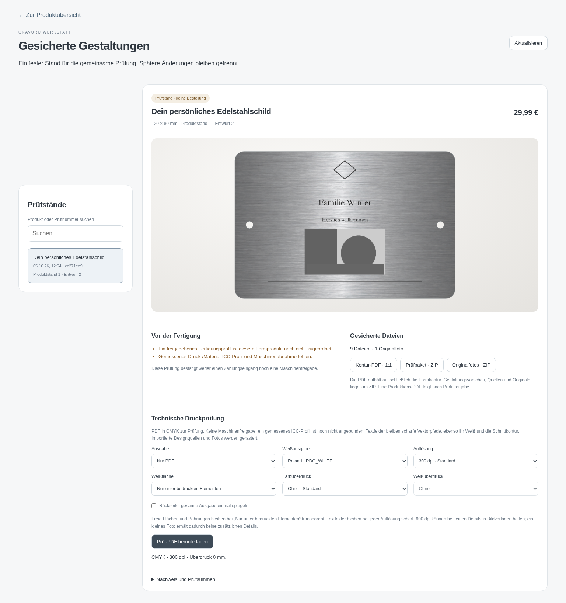

# Schriftpfade in der technischen Druckprüfung

05.10.2026 · Branch `task/form-vector-text-20261005` · Ausgangscommit auf GitHub `886a7573b91f7c25edbe491205435af8e2401416`. Fortsetzung in derselben bestehenden Cloud; Zuordnung „mika“ nach Nutzerangabe. Nur synthetische Prüfdaten.

## Umsetzung

Explizit zugeordnete Kunden-Textfelder werden aus dem unveränderlich gesicherten SVG als echte Pfade in die CMYK-Prüf-PDF übernommen. Keine neue Schrift, keine OCR, kein Nachzeichnen eines flachen Bildes. Die vorhandenen Glyphenpfade einschließlich Mehrzeiligkeit, Skalierung, Position, Farbe und Kursivtransformation bleiben maßgeblich. Leere Glyphen erzeugen keine Druckelemente. Nicht unterstützte Pfadeigenschaften werden abgewiesen.

Nichttextliche Ebenen werden in ihrer ursprünglichen Reihenfolge gerastert und auf ihren belegten Bildbereich zugeschnitten. Dazwischen bleiben Textfelder als Vektoren erhalten. Ein Foto vor einem Text verdeckt diesen weiterhin; ein Text davor bleibt sichtbar. In den Bilddaten steckt keine zweite Kopie der Texte. Die Prozessfarbe wird als isolierte DeviceCMYK-Transparenzgruppe zusammengesetzt: Text und Foto ersetzen sich innerhalb der Gruppe gemäß ihrer Reihenfolge. Die Gruppe wird gegen die separate Weißunterlegung ausgegeben. Reale RIP-Prüfung bleibt erforderlich.

Bei Weiß „nur unter bedruckten Elementen“ bekommt jedes Textfeld dieselben Schriftpfade als Weiß. Die bestehenden Bild-/Design-Weißflächen bleiben erhalten. Konturen, Bohrungen und Spiegelung begrenzen Farbe und Weiß gemeinsam. Textpfade werden immer an der ursprünglichen Form abgeschnitten; ein optionaler Randüberdruck außerhalb der Form wird wie zuvor aus den Randpixeln fortgesetzt. Weiß außerhalb der Form entsteht nur bei ausdrücklich aktiviertem Weißüberdruck. Vollflächiges/kein Weiß und die Roland-/Mimaki-Auswahl bleiben unverändert.

Standard bleibt **nur PDF, CMYK, 300 dpi, Roland RDG_WHITE, Weiß nur unter bedruckten Elementen, ohne Überdruck und ohne Spiegelung**. 600 dpi betreffen die Bildteile. Kleine explizite Textfelder erzeugen deshalb keine pauschale 600-dpi-Empfehlung mehr. Importierte Designquellen und Fotos können weiterhin von höherer Rasterauflösung profitieren; fehlende Originaldetails werden nicht ergänzt.

Rezept `gravuru-form-print-proof/v2` hat einen eigenen Cache-Schlüssel. Bereits gespeicherte v1-PDFs/ZIPs werden nicht verändert. Quellen, Prüfpakete und Originalfotos bleiben unverändert. Es gibt keine neue Python-Abhängigkeit; Installation/Start wie im [vorherigen Druckpaket](DASHBOARD-DRUCKPRUEFUNG.md).

## Tatsächlich geprüft

- `npm test`: **199 bestanden, 0 Fehler, 0 Skips**.
- `npm run build`: **76 Ressourcen, 1 Modell, 461440 Editorbytes**.
- Identische Glyphenpfade und Positionen bei 300/600 dpi; zugehörige Weißpfade exakt gleich; keine PDF-Schriftressourcen erforderlich. Mehrzeiliger kursiver Text und einmalige Spiegelung geprüft.
- Foto-/Textreihenfolge in beiden Richtungen geprüft; zusätzlich keine Textfarbe in den extrahierten Rasterbildern. Originalfotos, Transparenz, Bohrungen, CMYK, Überdruck, PDF-/ZIP-Prüfsummen und Wiederholungsdownloads bleiben durch die Exporttests abgedeckt.
- Der erste Fett-Test wurde vor dem Export korrekt abgewiesen: Die beiden vorhandenen Schriftressourcen haben keinen Fettschnitt. Keinen Ersatz erfunden. Die Pfadprüfung nutzt die tatsächlich vorhandene reguläre Schrift mit bereits gespeicherter Kursivtransformation. Auch ein zu kleines mehrzeiliges Testfeld wurde korrekt abgewiesen und nur der synthetische Testaufbau vergrößert.
- Echter Chromium-Ablauf: Kundenfoto/Text speichern, Prüfstand sichern, Backend öffnen, Roland/300-dpi-PDF sowie Mimaki/600-dpi-ZIP herunterladen, Rezept v2 und Original-/PDF-Prüfsumme prüfen. Die tatsächlich heruntergeladene PDF enthält **31 Schriftpfade und 0 Schriftressourcen**.
- Desktop 1536 px, Mobil 390 px und Tablet 768 px ohne horizontalen Überlauf oder JavaScriptfehler.

[Mobile Ansicht](form-vector-mobile.png). Sichtbares Foto ist ein synthetisches Prüfbild. Die vorhandene Edelstahlstruktur ist eine Gestaltungsvorschau, kein Herstellerbeleg.

## Grenzen und nächster Schritt

Dies betrifft explizite Textfelder der neuen **Formprodukte**. Schrift, die bereits fest in einer importierten Designquelle liegt, wird hier weiterhin mit dieser Quelle gerastert. Die ältere Acryl-Musterseite und ihre Ausgabe wurden nicht umgestellt. Keine allgemeine Vektorisierung von Bildern behauptet.

Die Farbe nutzt weiterhin generische DeviceCMYK-Separation ohne gemessenes ICC-Profil. Weißmasken für Rasterteile nutzen weiterhin den dokumentierten Alpha-Schwellwert; SVG-Luminanzmasken bleiben ausdrücklich nicht unterstützt. Fertigungsfreigabe, Gravurausgabe, Shopify-/Zahlungsbindung und gehostete Rollen bleiben offen. Kein externer Dashboard-Publish und kein Merge.

Nächster Schritt: Ein versioniertes Fertigungsprofilmodell mit dem festen Prüfstand verbinden; fehlende reale Druck-/Material-/Maschinenparameter klar als ungeprüft führen.
