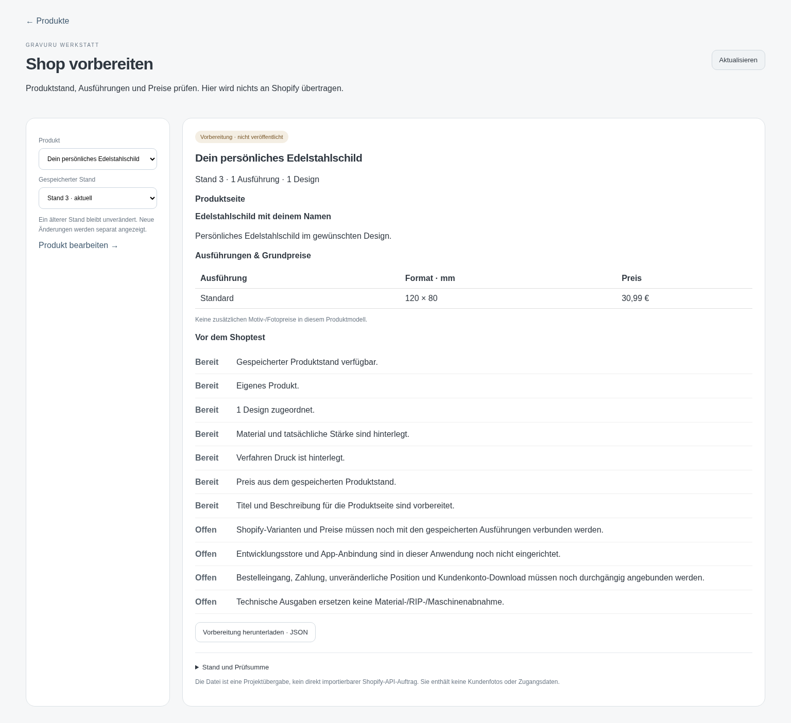
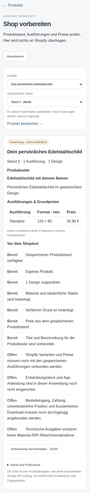

# Shop-Vorbereitung und Umfangsabgleich · 05.10.2026

Branch `task/dashboard-readiness-20261005`; GitHub-Basis `82db3b5798ae9b27443e041f94c4517fd3b2f0a7`. Cloud, synthetische Prüfdaten, keine Shopify-/Servermutation.

## Neu umgesetzt

Werkstatt → Shop vorbereiten zeigt einen ausdrücklich gewählten gespeicherten Produktstand mit Designs, SEO, Ausführungen und Grundpreisen. Die 28 Acrylkombinationen verwenden die vorhandene Varianten-/Preisberechnung: groß/Eiche/Wand = 3697 Cent. Formprodukte behalten ihren eigenen Preis. Zusätzliche Motiv-/Fotopreise sind getrennt ausgewiesen; keine falsche Behauptung, die Grundvarianten deckten bereits individuelle Aufpreise ab.

Die JSON-Übergabe enthält Stand und Prüfsumme, keine Kundenmedien oder Zugangsdaten. Sie ist kein erfundener direkt ausführbarer Shopify-API-Auftrag. Archivierte Produkte, Master, fehlende Designs/Preise/Materialdaten und offene Shop-/Bestell-/Fertigungsanbindungen sind sichtbar. Ein früherer Produktstand bleibt auch nach Preisänderung reproduzierbar. Formprodukte erhalten bearbeitbaren Seitentitel/Kurzbeschreibung und einen Link zur Vorbereitung. Veraltete Aussagen, Design und Kundenansicht seien grundsätzlich noch nicht implementiert, wurden korrigiert.

## Tatsächlich geprüft

- `npm test`: **211 bestanden, 0 Fehler, 0 Skips**; danach reine Eingabefeld-/Textanpassung zusätzlich im Browser geprüft.
- `npm run build`: **76 Ressourcen, 1 Modell**, 461440 Editorbytes; auch nach der Eingabefeldergänzung erfolgreich.
- Tests: 28 Preise ohne zweite Preislogik, historische Revision trotz neuer Preise unverändert, Formprodukte ohne fremde Acrylaufschläge, fehlende Daten explizit, GET ohne Datenbankänderung, Host/Origin/CSRF.
- Cloud-Chromium: JSON-Download ohne neue Revision, Formproduktpreis und SEO ändern/speichern/neu laden, historische Vorbereitung weiter mit altem Preis, neuer Stand mit neuer Beschreibung, alle 28 Acrylvarianten sichtbar. Desktop 1536, Mobil 390, Tablet 768 ohne horizontalen Überlauf oder JavaScriptfehler.

## Gezielter Umfangsabgleich

| Bereich | Nachgewiesener Stand / offene Grenze |
| --- | --- |
| M01/M02, Produktstände, Kopien, Archiv, Historie | Bestehende Implementierungen erhalten; keine Neuentwicklung der alten Pipeline. |
| Masterregeln Acryl | Gesichertes Muster erhalten: ganze Schrift-mm, Direktbearbeitung, kompakte Motive/Farben, gesperrte Vorlage, freigegebene Elementrechte. Keine neue visuelle Abnahme durch Mikail behauptet. |
| Freie Formprodukte | Kontur, Materialzuordnung, explizite Text-/Fotofelder, privater Kundenentwurf, gesicherter Prüfstand und technische Druck-/Gravurausgabe vorhanden. Nicht sämtliche erweiterten Acrylfunktionen automatisch auf Formprodukte übertragen. |
| Fertigung | Profilrevisionen, Schriftpfade, Originalfotos, Weiß/Überdruck, Spiegelung, Raster-/Vektorgravur und persistente Ausgaben geprüft. ICC und reale Maschine/RIP weiterhin offen. |
| Excel | Bestehende 3-/100-/97+3-Importstrecke und Wiederholbarkeit im Gesamtlauf bestanden. |
| Materialien / Szenen | Edelstahlstruktur angebunden. Andere gestaltete Referenzen bleiben erhalten; neutrale Ableitungen, Materialtiefe und Szenen nicht als fertig behauptet. |
| Weitere UV-Designs | Pilot und Quellenregister erhalten. Kein Nachweis, dass alle 18 Originale in dieser Aufgabe als bearbeitbare Vorlagen verfügbar sind; siehe UV-DESIGN-PILOT.md. Keine erfundenen Designs als Originale einsetzen. |
| Bestellungen / Shopify | Vorbereitung der festen Stände und Preise vorhanden. Authentifizierte Bestell-/Zahlungsübernahme, echte Variantenbindung, Kundenkonto-Download und Wiederverwendung einer Bestellung als Produkt bleiben offen. |
| Zugriff | Cloud-Browserprüfung ist belegt; kein extern erreichbarer Dashboard-Link. Keine privaten Bestandsdaten veröffentlicht. |

## Konkrete Fortsetzung

Bestellannahme als eigenes Teilstück auf genau diese unveränderlichen Prüfstände und serverseitigen Preise aufbauen. Shop-/Zahlungsbestätigung muss aus einem authentifizierten Adapter kommen; Browserparameter dürfen keine Kaufberechtigung schaffen. Ohne benannten Entwicklungsstore/App-Zugang keine echte Shopify-Testbestellung behaupten. RIP-/ICC-/Maschinenangaben betreffen die reale Fertigungsabnahme, nicht die weitere Codearbeit.
