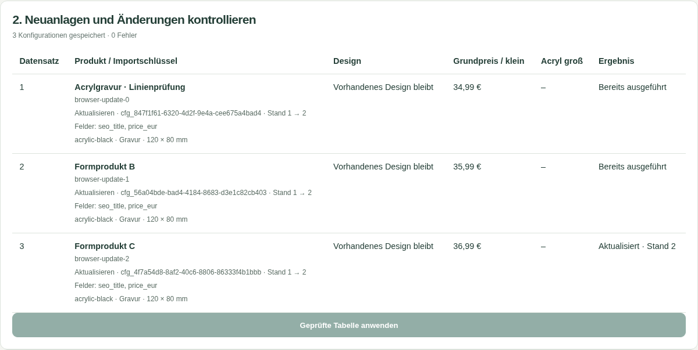

# Vorhandene Produkte per Tabelle aktualisieren – 06.10.2026

Branch `task/batch-update-20261006`, Basis `5dc75f9e84db992e139cfc17ce43527601e07ea3`, Repository Chris83638w/gravuru-2027. Umsetzung und Prüfung in der bestehenden Cloud, ausschließlich synthetische private Testdatenbanken. Kein Publish/Deploy, Merge oder Livezugriff.

## Bedienung

Werkstatt → Produktserien → neue Excel-Vorlage herunterladen (22 Spalten). Bestehende 19-Spalten-Dateien bleiben für Neuanlagen gültig; CSV/TSV ebenfalls unterstützt.

| Spalte | Aktualisierung |
| --- | --- |
| action | `update`; leer oder `create` legt wie bisher aus Master neu an |
| product_id | genaue bestehende `cfg_…`-Produkt-ID aus dem Editor |
| expected_revision | aktueller erwarteter Stand, beispielsweise `2` |
| import_key | neuer eindeutiger Schlüssel je Änderungsauftrag; für Wiederholung desselben Auftrags denselben Schlüssel behalten |
| name / Preise / Kategorien / SEO | nur gewünschte Änderungen ausfüllen; leer lässt den bisherigen Wert stehen |
| master_id / master_revision | bei Aktualisierung leer lassen; Grundlage ist das bestehende Produkt |

Erst prüfen: Ergebnis zeigt Ziel-ID, Standwechsel, ausgefüllte Änderungsfelder und resultierende Preise/Designzuordnung. Danach „Geprüfte Tabelle anwenden“. Fehlerhafte Zeilen können ausdrücklich zurückgestellt werden. Eine Tabelle darf neue und bestehende Produkte enthalten; reine Aktualisierung benötigt keine Masterauswahl. Ein Zielprodukt darf pro Tabelle nur einmal vorkommen. Mastervorlagen und archivierte Produkte können nicht auf diesem Weg verändert werden.

Freie Formen verwenden weiterhin `price_eur`; die alte Acrylvorlage ihre kleinen/großen Preise. Die vorhandenen Preisgrenzen und Variantenregeln werden unverändert angewendet. Formprodukt-Kundenfelder bleiben erhalten; die bisherigen Textspalten gehören weiter zur Acrylvorlage. Designersatz per zugeordneter SVG/PDF ist möglich: nur das gewählte Design, mit bestehender Warnung über neu zuzuordnende Kundenfelder. Keine automatische Zerlegung flacher Designs.

## Sicherung gegen Überschreiben

Die Aktualisierung basiert auf der unveränderlichen erwarteten Revision, niemals auf einem erneut kopierten Master. Produkt-ID und Masterherkunft bleiben erhalten; eine neue Revision wird angehängt. Leere Felder, kundenspezifische Produktfelder/Rechte, Kontur, Material und Szene bleiben erhalten. Gezielt Felder leeren bleibt im Einzel-Editor möglich; leere Tabellenzellen löschen nichts.

Der bestehende Importbeleg speichert Ziel und Inhaltsfingerabdruck. Bereits angewendete Aufträge erzeugen bei Wiederholung keine weitere Revision, auch nach Neustart oder nach späterer manueller Bearbeitung. Abweichende Inhalte unter demselben Schlüssel werden abgewiesen. Neue Aktualisierungen prüfen den aktuellen Stand erneut innerhalb derselben SQLite-Transaktion. Fehler rollen Produktrevisionen und Importbelege gemeinsam zurück. Keine neue Datenbankschema-Version.

## Tatsächlich ausgeführte Abnahme

- `node scripts/cloud-check.mjs`, **06.10.2026 07:08:28–07:09:39 Europe/Berlin**: **245 Tests bestanden, 0 Fehler/Skips**, Build **76 Ressourcen/1 Modell**.
- Gezielter abschließender Lauf `node --test app/workshop/batch.test.mjs app/workshop/form-batch.test.mjs`: 12 bestanden. Bestehende Dateizuordnungs-/HTTP-Tests zusätzlich in der vollständigen Suite enthalten.
- 100 Aktualisierungen mit 3 Fehlern: ohne Teilauswahl keine Änderung, ausdrücklich 97 angewendet, anschließend nur 3 korrigierte Zeilen; jede Zielrevision genau einmal fortgeschrieben.
- Stabile IDs, erhaltene historische Dokumente, unveränderte ausgelassene Inhalte; Wiederholung nach Datenbankneustart und späterer manueller Änderung ohne Überschreiben. Doppelte Zielprodukte, fehlende Aktion/Revision, Masterziele, unveränderte Zeilen und veraltete Revisionen abgewiesen.
- Erzwungener Datenbankfehler: keine Teilrevision und kein verwaister Importbeleg. Revision auch beim direkten Transaktionsaufruf geprüft.
- Formprodukt: eigene Kontur, Szene, Felder und Rechte bleiben statt Master-Neukopie erhalten. Gezielt zweites Design ersetzt, erstes Design unverändert.
- Chromium mit echter 22-Spalten-XLSX: 2 gültig/1 fehlerhaft → 2 Aktualisierungen; Wiederholung → 0; Korrektur → genau 1. Richtige Produktlinks, Desktop 1536/Handy 390/Tablet 768 ohne Seitenüberlauf und JavaScriptfehler. Nach Korrektur eines geerbten Code-Block-Layouts im Erklärungstext erneut geprüft.
- Excel mit OpenPyXL geschrieben, erneut gelesen und im Browser verwendet; ohne Formeln oder externe Tabellenverknüpfungen. Optionaler Artifact-Tool-Generator angepasst und syntax-/Spaltenzahl-geprüft; in diesem Lauf nicht ausgeführt.

[Maschinenlesbarer Lauf](batch-update-check.json) · [Desktop](batch-update-desktop.png) · [Handy](batch-update-mobile.png)

## Grenzen und nächster Schritt

Neue Form-/Material-/Größenvarianten aus separaten Excel-Kindtabellen bleiben offen. Kein automatischer Drive-/KI-Import und kein automatisches Veröffentlichen in Shopify. Private Bestandsdaten nicht angefasst; vorhandene EOL-Abweichungen in CLOUD-AKTUELL.md/README.md nicht mitcommittet. Nächster Schritt: Varianten- und Designzuordnung aus separaten Tabellen gegen das bestehende Produktmodell abgleichen. Echte Store-/Maschinenabnahme bleibt unabhängig offen.
