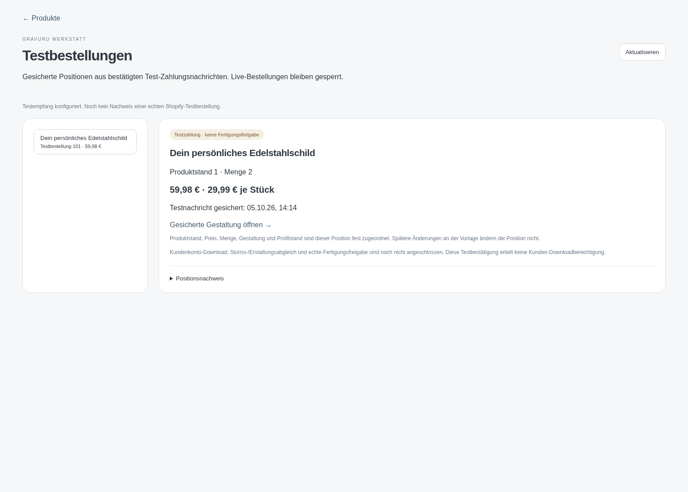
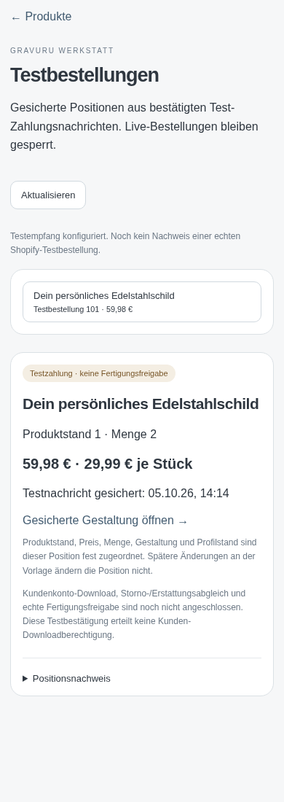

# Signierte Testbestellungen im Backend

Stand 05.10.2026, bestehende Cloud-Arbeitsumgebung. Aufgabenbranch `task/order-intake-20261005`, Basis `a06d821bd5389016d92d0ff0087c7f066c4f864a`. Kein Livezugriff und kein externer Dashboard-Publish.

## Umgesetzt

Werkstatt → Testbestellungen (`/werkstatt/bestellungen/`) zeigt feste Positionen, Produktrevision, Menge, Stückpreis, ursprünglichen Prüfstand und dessen Prüfsumme. Der Prüfstand öffnet die vorhandene technische PDF-/ZIP-Ausgabe. Spätere Produktänderungen verändern die Position nicht.

Eine Operator-Zuordnung verbindet eine gespeicherte Formproduktrevision mit einer Shop-Variante. Der Preis kommt aus dem gespeicherten Produkt, nicht aus dem Browser. Ein zeitlich begrenzter Checkout-Verweis verbindet genau diesen Prüfstand mit Variante und Menge. Nur sein Hash wird gespeichert. Derselbe Verweis kann nicht für eine andere Bestellposition verwendet werden.

Der Empfänger prüft HMAC-SHA256 über die unveränderten Nachrichtenbytes, Shop-Domain, API-Version, Thema `orders/paid`, Testkennzeichen, Zahlungsstatus, EUR, Variante, Menge und Preis. Wiederholte Zustellungen sind idempotent. Eine ungültige Position verwirft die gesamte Übernahme atomar. Gesicherte Positionen und Ereignisse sind unveränderlich. Vollständige Nachrichten, Kundenadressen, E-Mail-Adressen und Secretwerte werden nicht gespeichert.

## Tatsächlich geprüft

- `node --test app/workshop/order-intake.test.mjs`: 4 bestanden. Signaturmanipulation, falscher Shop/Preis/Menge, doppelte Zustellung, Wiederverwendung, Ablauf, geänderter Prüfstand, atomarer Rücklauf, SQLite-Neustart und HTTP-Schutz.
- `npm test`: **215 bestanden, 0 Fehler, 0 Skips**.
- `npm run build`: **76 Ressourcen, 1 Modell**.
- Chromium in dieser Cloud: Desktop 1536, Mobil 390 und Tablet 768 Pixel. Synthetische signierte Testposition → Produkt ändern → ursprüngliche Revision und Preis bleiben erhalten → neu laden → festen Prüfstand öffnen → tatsächliche PDF herunterladen. Keine JavaScriptfehler oder horizontale Überläufe. Die Zuordnungs-API weist einen vom Client zusätzlich gelieferten Preis zurück.

## Konfiguration und klare Grenzen

Der Empfänger ist standardmäßig deaktiviert. Der interne Einstieg `createWorkshop({orderWebhook:{shopDomain,apiVersion,secret}})` nimmt eine ausdrücklich übergebene Konfiguration an; dieses Paket liest keine Secrets aus vorhandenen Umgebungen und richtet keinen Zugang ein. Der Test verwendet ausschließlich kurzlebige, zufällig erzeugte Werte. Nur der HMAC-geprüfte Webhook ist von der Browser-CSRF-Prüfung ausgenommen; übrige Mutationen und vorhandener Host-/Origin-Schutz bleiben bestehen.

Dies ist ein geprüfter Adapter für **synthetische Testnachrichten**, kein Nachweis einer echten Shopify-Testzahlung. Selbst korrekt signierte Live-Bestellungen werden abgewiesen. Die erste Zuordnung unterstützt eigene Formprodukte mit Design und Preis; eine Warenkorbanbindung des Acrylkonfigurators ist noch offen. Die Variantenbindung wurde noch nicht gegen eine Shopify-API verifiziert. Kein Kundenkonto, keine gehostete Händleranmeldung, keine Kauf-Downloadberechtigung, keine Storno-/Erstattungsabstimmung und keine Produktionsfreigabe. `productionReady` und `customerDownloadAllowed` bleiben false.

Die Daten liegen privat in der bestehenden Werkstatt-Datenbank. Cloud-Temporärdateien sind keine dauerhaft gemeinsame Ablage. Keine Datenbank, Originalfotos, Exportdateien oder Geheimnisse wurden nach GitHub übernommen; die Aufnahmen enthalten synthetische Daten.

## Protokollquelle und nächster Schritt

HMAC-Verfahren und Header wurden mit dem offiziellen Shopify-Quellcode abgeglichen:

- [Webhook-Validierung](https://github.com/Shopify/shopify-app-js/blob/main/packages/apps/shopify-api/lib/webhooks/validate.ts)
- [HMAC-Validierung](https://github.com/Shopify/shopify-app-js/blob/main/packages/apps/shopify-api/lib/utils/hmac-validator.ts)

Die direkte Shopify-Dokumentationsseite war durch die Netzwerkfreigabe nicht erreichbar. Kein Live-Payload- oder API-Kompatibilitätsnachweis wird daraus abgeleitet.

Nächster Schritt ist die Zuordnung eines bestätigten Entwicklungsstores und die echte Test-Checkout-Anbindung. Die öffentliche Store-Adresse wurde beim Nutzer angefragt, ohne Zugangsdaten anzufordern. Für Maschinenabnahme stehen Roland LEF-200, Roland MO-240 und Mimaki 2513 EX fest; RIP-/ICC-/Materialabnahme bleibt separat offen. Weitere Material-/Design- und Dashboard-Arbeiten benötigen diese Angaben nicht grundsätzlich.
