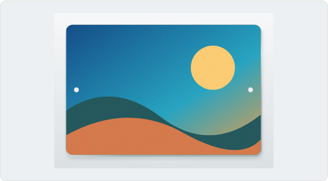
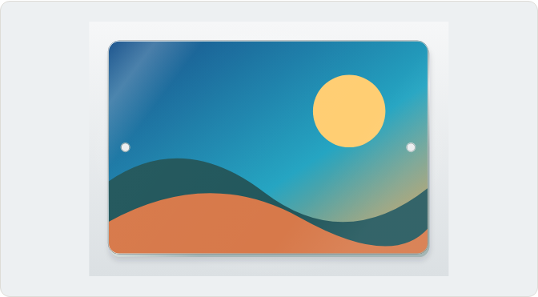

# UV-Druckansicht – 06.10.2026

Basis `0a0a7bf3d018ed00e687227724bf57810181298a`, Aufgabenbranch `task/uv-print-surface-20261006`, bestehende Cloud, Repository Chris83638w/gravuru-2027.

## Bestätigte Regel und Bedienung

Werkstatt → Formprodukt → Produkt & Material → Verfahren Druck → **UV-Druckansicht**. „Vorne bedruckt · matt“ zeigt feine dezente UV-Druckpunkte im Druckbild; „Hinter klarem Acryl · glänzend“ zeigt die Glasreflexion vor dem Design. Benutzer meint mit Markern diese Druckpunkte, keine Passermarken. Originalfarben, Formen und Löcher bleiben Grundlage. Keine Lackkanäle erfunden.

Die Auswahl wird optional unter `presentation.printSurface` gespeichert, ist revisionsgebunden und wird mit Master-/Produktkopien übernommen. Bestehende Dokumente ohne Auswahl behalten ihre bisherige Materialansicht. Bei Gravur ist das Bedienelement verborgen und die UV-Darstellung inaktiv. Glänzender Hinterdruck ist nur bei klarem Acryl zulässig; satiniertes oder opakes Material wird dafür nicht als klare Front ausgegeben.

Gemeinsame Komposition für Backend, Kundenansicht, Produktkarte und gespeicherte Vorschau. Vorderdruck liegt über dem Glasfinish, Hinterdruck darunter. Deterministische feine SVG-Filterstruktur nur auf der Artwork-Gruppe; originale Alpha bleibt erhalten. Keine künstlichen Druckpunkte auf leerem Glas oder in Bohrungen. Es handelt sich um eine angenäherte Bildschirmdarstellung, keine fotografische Material-/Maschinenfreigabe.

**Produktion separat:** Diese Vorschauauswahl ändert keine Fertigungsprofile, Weißregeln oder Spiegelung. Bestehende einmalige Spiegelung wird weiterhin ausdrücklich in der technischen Ausgabe gewählt. Reale Druckseite und Maschinenprofil müssen bei Fertigungsabnahme abgestimmt werden. Rein technische PDF enthält weder Materialreflexion noch Druckpunktfilter.

## Sichtbares synthetisches Prüfbeispiel

Gleiche farbige Prüfgrafik, 150 × 100 mm, klares Acryl 3 mm, zwei Bohrungen; keine privaten Kundendaten oder kommerzielle neue Designvorlage.

Vorderdruck matt:

Hinterdruck glänzend:

## Tatsächlich ausgeführte Prüfungen

- `node --test app/workshop/material-preview.test.mjs app/workshop/form-print-proof.test.mjs`: 11 bestanden. Validierung, historische Dokumente, Reihenfolge, Gravurausschluss und reale PDF-Separationen für beide Ansichten.
- `node scripts/cloud-check.mjs`: **237 Tests, 0 Fehler, 0 Skips**, Build **76 Ressourcen/1 Modell**. 06.10.2026, **06:01:33–06:02:37 Europe/Berlin** (Maschinenzeiten im Nachweis UTC).
- Chromium: tatsächliche Backend-Auswahl, Speichern, Neuladen für beide Ansichten; Kundenansicht mit Hinterdruck; Breiten 1536/390/768 ohne Seitenüberlauf und JavaScriptfehler. Bilder nach Verringerung der zunächst zu starken Druckstruktur erneut aufgenommen.
- Chromium-Canvas mit isolierter Druckstruktur: freier Bereich Alpha 0, deckende Farbe 255, halbdurchsichtige Farbe 128. Struktur macht transparente Pixel nicht deckend.
- Zwei tatsächliche Druck-PDFs (vorn/hinten) identisch in geprüften Farb-/Weißpixeln, Maßen, Bild-/Vektordaten; Bohrung und freie Fläche bleiben Alpha 0. Keine Vorschaufilter im Produktions-SVG.

[Maschinenlesbarer Nachweis](uv-print-check.json). Kein Deploy/Publish, Merge oder private Datenänderung. Bestehender separater Acryl-Muster-Site wurde nicht aktualisiert. Nächster unabhängiger Schritt: Material-/Gravurvorschau, insbesondere weiße Gravur statt Druckfarben auf Acryl.
