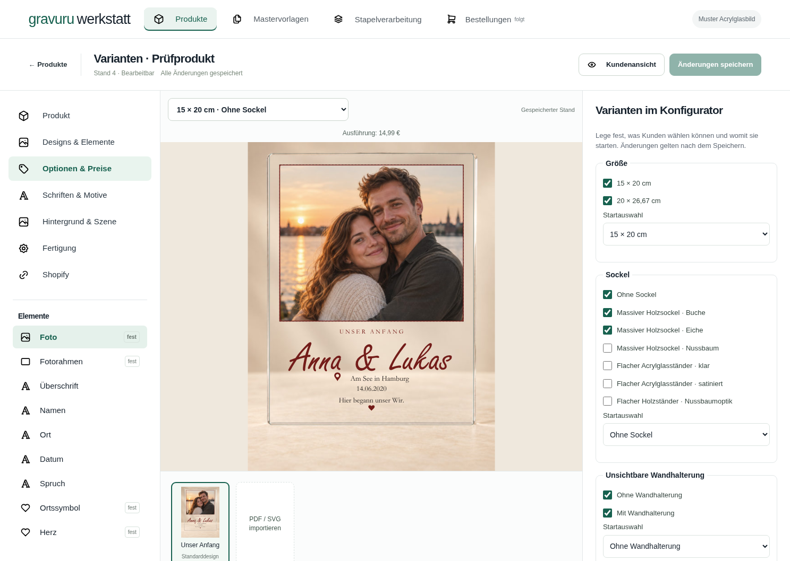

# M02: Varianten und Startauswahl – 05.10.2026

Aufgabenbranch `task/dashboard-options-20261005`, Basis `092228adb0fbc6a14b0850cdeccee947c2c17a45`. Dieser Stand enthält die zuvor am Remote bestätigte M01-Fortsetzung vollständig. Entwicklung in derselben bestätigten Cloud, keine neue Umgebung oder Veröffentlichung.

## Ergebnis

In „Optionen & Preise“ können die verfügbaren Acrylgrößen, Sockel und Wandhalterungen sowie die Kunden-Startauswahl eingestellt werden. Der Katalog stammt aus der bestehenden geprüften Acrylvorlage; Auswahl und Defaults werden direkt im bestehenden `config.profile.optionGroups` gespeichert. Keine zweite Produkt-/Preisdatenbank und keine erfundenen Materialien oder Größen.

Je Gruppe bleibt mindestens eine Auswahl. Wird die bisherige Startauswahl entfernt, setzt die Oberfläche die erste verbleibende und meldet das ausdrücklich. Eine ausschließlich vorhandene Wandhalterung ist verpflichtend; mit „Ohne Wandhalterung“ bleibt sie optional. Entfernte Optionen sind aus dem Katalog auch nach Neuladen wieder aktivierbar. Vorschauänderungen sind bis zum Speichern nur Entwurf, danach eine neue unveränderliche Revision. Die bestehenden Rechte-/Konflikt-/Archivregeln gelten weiter.

Die mittlere M02-Auswahl enthält nur erlaubte Kombinationen einschließlich Wandhalterung. Beim Öffnen eines Produkts und bei Änderung der Backend-Defaults folgt sie der gespeicherten bzw. bearbeiteten Startauswahl. Der dortige Wechsel bleibt eine reine Prüfung, ohne die Kunden-Startauswahl zu ändern. Der Preis neben der Vorschau kommt aus dem bestehenden serverseitigen `resolveProduct`/`quote`, einschließlich Größen-/Sockelaufschlag; bei ausstehender oder fehlgeschlagener Vorschau wird kein alter Preis weiter angezeigt.

Die vorhandene Acrylszene zeigt Platte und Sockel. Eine unsichtbare Wandhalterung wird korrekt in Optionen/Preis berücksichtigt; eine neue Wandbefestigungsszene wurde nicht erfunden.

## Tatsächlich ausgeführt

- `npm test`: **177 Tests, 177 bestanden, 0 Fehler, 0 Skips**. Neuer HTTP-Test: Katalog, reduzierte Varianten, 36,97-Euro-Preis, aktuelle Kundenmodell-Route, unveränderte historische Revision, Ablehnung nicht erlaubter Größe/falscher Default, keine Schreibnebenwirkung der Vorschau. M01/M02- und bestehende Prüfungen ebenfalls bestanden.
- `npm run build`: **76 Ressourcen, 1 Modell**, Editor 461440 Bytes.
- Browser in Cloud-Chromium/Playwright mit eigenem synthetischen In-Memory-Prüfprodukt: Freigaben, Defaultwechsel, Ersatzhinweis, letzte Option geschützt, Speichern/Neuladen, tatsächlicher Kundenkonfigurator initialisiert groß/Eiche/Wand, Preis 36,97 Euro; danach klein/ohne/ohne 14,99 Euro; entfernte Optionen wieder aktiviert; Warnung vor ungespeichertem Verlassen, Mobil 390 px ohne horizontalen Überlauf. Keine JavaScript-Seitenfehler.
- Referenz M02 und endgültige Fotoansicht bei 1487 × 1058 gemeinsam betrachtet; zusätzlich neue Optionenansicht und mobile Eigenschaften geprüft. Der neue Variantenbereich ist eine funktionale Ergänzung innerhalb der bestätigten M02-Struktur, kein weiterer ausgewählter Mockup-Entwurf.

[Eigenschaften vollständig](dashboard-m02-options-panel.png) · [Mobil](dashboard-m02-options-mobile.png) · [M02 mit Fotoeigenschaften](dashboard-m02-continuation.png).

## Grenzen

Keine privaten Bestandsdaten oder Secrets verwendet, keine Änderung am Muster Acrylglasbild, keine Shopify-/Plesk-/Produktionsmutation. Dashboard ausschließlich in dieser Cloud-Entwicklung geprüft, kein zugänglicher Dashboard-Publish behauptet. Synthetische In-Memory-Daten sind kein dauerhafter gemeinsamer Werkstattbestand. Weitere Materialien/freie Formkonturen, echte Bestellungen/Shopify und RIP-/Maschinenabnahme weiterhin offen.

**Nächster Schritt:** Das dokumentierte Material-/Formmodell um den maßhaltigen Import geschlossener SVG-/PDF-Konturen erweitern, getrennt vom bereits vorhandenen Designimport; Originalmaße und vorhandene Materialreferenzen erhalten.
