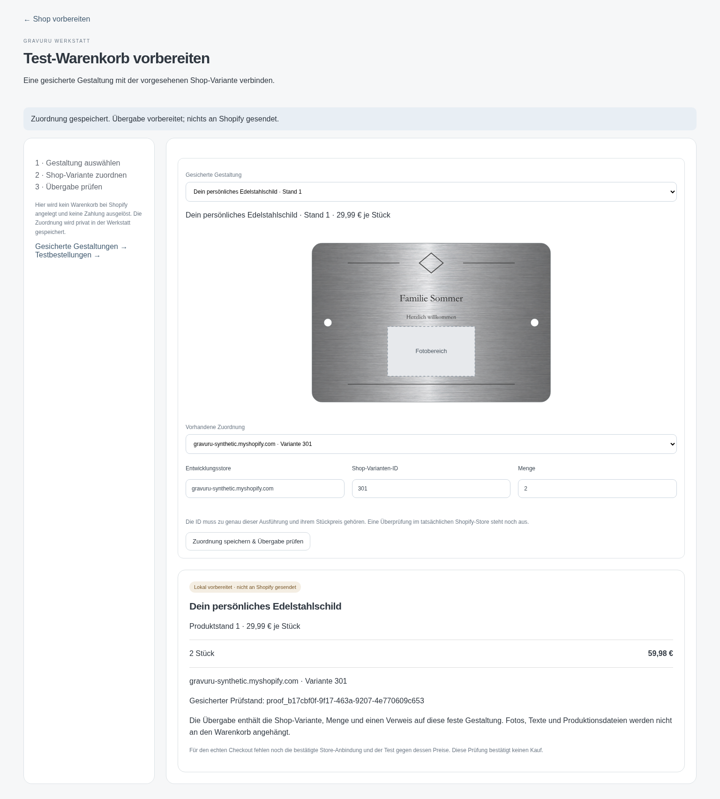
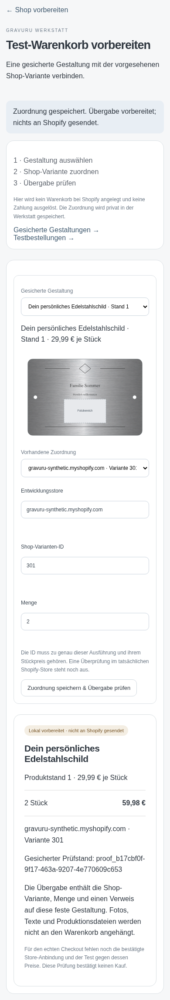

# Warenkorb-Übergabe aus einem gesicherten Formprodukt

05.10.2026, bestehende Cloud; Aufgabenbranch `task/checkout-handoff-20261005`, Basis `0785d0fe7bfe2f6266996382b09220139ddfd642`.

## Bedienung und Verhalten

Werkstatt → Shop vorbereiten → „Gesicherte Gestaltung für den Test-Warenkorb zuordnen“. Alternativ direkt aus einem Prüfstand. `/werkstatt/warenkorbpruefung/` zeigt Gestaltung, festen Produktstand und Stückpreis. Operator wählt vorhandene Zuordnung oder gibt bestätigte Entwicklungsstore-Domain und Varianten-ID ein; Menge 1–99. Die vorhandene private Datenbank speichert die Zuordnung. Historische Produktstände bleiben unverändert.

„Zuordnung speichern & Übergabe prüfen“ erzeugt einen Storefront-`cartCreate`-Auftrag aus serverseitig geprüfter Variante, Menge und opakem Verweis auf genau diesen Prüfstand. Kein vom Browser angegebener Preis; Fotos, Texte und Produktionsdateien gehen nicht in die Cart-Attribute. Das Ergebnis zeigt Stückpreis, Gesamtpreis und feste Revision. Nach Eingabeänderung verschwindet das alte Ergebnis sofort. Neuladen erhält die gespeicherte Zuordnung; der flüchtige Checkout-Verweis wird weder in URL, Browserablage, DOM noch Git übernommen. Die Antwort verwendet `Cache-Control: no-store`.

Ein wiederverwendbarer Antwortprüfer verweigert die Weiterleitung bei GraphQL-Fehlern, Warnungen, unvollständigen Positionen, abweichender Variante, Menge, Gestaltung oder EUR-Preis. Checkout-URLs sind auf HTTPS ohne eingebettete Credentials und den ausdrücklich angegebenen `myshopify.com`-Host begrenzt. Abweichende echte Checkout-Domains müssen später anhand der tatsächlichen Store-Antwort geprüft werden; derzeit keine automatische Freigabe.

## Tatsächlich geprüft

- `node --test app/workshop/storefront-cart.test.mjs`: 4 bestanden (Datensparsamkeit, verfälschte Antworten, Weiterleitungsgrenzen, echte private Speicherung/HTTP/CSRF).
- `npm test`: **219 bestanden, 0 Fehler, 0 Skips**.
- `npm run build`: **76 Ressourcen, 1 Modell**.
- Cloud-Chromium: 1536/390/768 Pixel. Tatsächlicher Ablauf vom importierten SVG-Prüfstand über Zuordnung bis Übergabe; 2 × 29,99 EUR = 59,98 EUR, Mengenänderung und Neuladen. Danach Produkt auf 35,99 EUR geändert: historische Übergabe behält 29,99 EUR. Keine Bestellposition erzeugt, kein externer Browserrequest, keine JavaScriptfehler oder horizontalen Überläufe.
- VersaWorks-Auswahlhilfe sichtbar, Profilfeld bleibt ohne Benutzerauswahl leer; gespeicherte Profile unverändert.

## Shopify-Protokoll und Grenzen

Dokumentation über den offiziellen Shopify-Connector gelesen: [Cart erstellen/ändern](https://shopify.dev/docs/storefronts/headless/building-with-the-storefront-api/cart/manage), [CartLineInput](https://shopify.dev/docs/api/storefront/2026-10/input-objects/CartLineInput). Die generierte Mutation wurde mit `shopify_validate_graphql_codeblocks`, API `storefront-graphql`, erfolgreich gegen das verfügbare Schema validiert.

Der Skill-CLI-Suchversuch für 2026-07 scheiterte an fehlendem Netzwerkzugang; die CLI-Validierung meldete fehlende gebündelte Schema-Assets (`/tmp/assets`). Deshalb wurde der vorhandene Shopify-Dokumentations-/Validierungsconnector genutzt. Dessen Validierung lieferte keinen expliziten Schema-Versionsnachweis; eine spezifische 2026-07-Kompatibilität wird nicht behauptet. Keine Shop-Operation ausgeführt.

Die neue Seite ist eine private Operator-Vorbereitung. Es fehlt weiterhin ein bestätigter Entwicklungsstore mit Varianten-/Preisanbindung, Storefront-Transport, Test-Checkout, gehosteter Autorisierung und tatsächlicher Zahlungsnachricht. Kein Kaufknopf, keine bezahlte Bestellung und kein Kundendownload wurden simuliert. Kundenkonto-/Storno-/Rückerstattungsstrecke und persistente gemeinsame Betriebsablage sind noch offen. Der erste Adapter unterstützt gesicherte Formprodukte; Acryl-Warenkorbparität ist separat offen. Vorhandenes Acrylmuster und dessen Export bleiben unverändert. Keine Live-Veröffentlichung, Shopify-/Plesk-Mutation oder neue Umgebung.

## Maschinenangaben

Vom Nutzer bestätigt: Roland LEF-200 und Roland MO-240 mit **VersaWorks**, ohne Versionsangabe. Mimaki 2513 EX nutzt laut Nutzer „die von Mimaki“; Name und Version noch nicht bestätigt. **RasterLink ist lediglich eine Vermutung und wird nicht als Konfiguration gespeichert.** VersaWorks steht im Fertigungsprofil als Auswahlhilfe bereit. Reale ICC-/Material-/Maschinenabnahme bleibt offen.

Nächster ausführbarer externer Schritt: bestehenden Entwicklungsstore anhand seiner `…myshopify.com`-Adresse eindeutig zuordnen. Geheimnisse ausschließlich über die vorhandenen sicheren Umgebungseinstellungen, niemals im Chat. Unabhängige Dashboard-/Materialarbeiten bleiben möglich.
