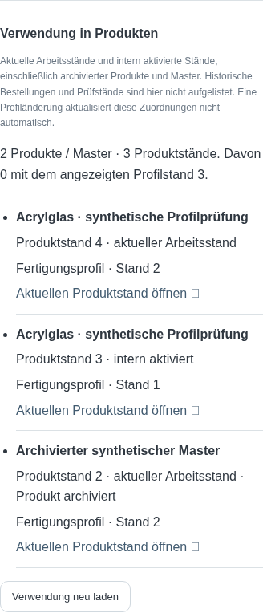

# Verwendung von Fertigungsprofilen – 06.10.2026

Branch `task/production-profile-usage-20261006`, Basis `8f2a0539923d5f2e9adb7914b095ce1464be382e`, Repository `Chris83638w/gravuru-2027`. Bestehende Cloud-Laufzeit running/connected, Spec 298; Konto „mika“ Nutzerangabe.

## Ergebnis

Unter **Fertigungsprofile → Profil öffnen → Verwendung in Produkten** erscheinen die zugeordneten aktuellen und intern aktivierten Produktstände. Produkt-/Mastername, Produktrevision, gebundene Profilrevision und Archivstatus sind sichtbar. Ein Produkt kann dabei mit zwei unterschiedlichen Ständen erscheinen; identische aktuelle/aktivierte Revisionen werden nur einmal gezeigt. Links öffnen ausdrücklich den aktuellen Produkteditor.

Die Anzeige umfasst Acryl- und Formprodukte, auch archivierte Master. Ein neu gespeichertes Profil bindet vorhandene Produkte nicht automatisch um. Die Zahl der zum gerade angezeigten Profilstand gehörenden Produktstände wird getrennt genannt. Historische Bestellungen und Prüfstände sind ausdrücklich nicht Teil dieser Verwendungsliste; eine leere Liste behauptet deshalb nicht, dass ein Profil niemals verwendet wurde.

API: `GET /api/workshop/production-profiles/:id/usage`. Nur lesend; keine Produktinhalte, Fotos oder private Revisionsmetadaten in der Antwort. Ungültige/nicht vorhandene Profile werden abgewiesen; keine Schreibaktion auf dieser Route. Die Liste wird mit einer Abfrage aus aktuellen/aktivierten Repositoryrevisionen ermittelt. Keine Änderung an Datenbankschema, Exportrezept oder Profilzuordnungen.

## Tatsächlich geprüft

- `node scripts/cloud-check.mjs`: **16:07:25–16:09:19 Europe/Berlin**, **322 Tests, 0 Fehler, 0 Skips**. Referenzen/Python/PDF und Build **76 Ressourcen, 1 Modell** bestanden. [Cloud-Testbericht](fertigungsprofil-verwendung-20261006/cloud-check.json). Dokument-/Codediff ohne Whitespacefehler.

- `node --test app/workshop/repository.test.mjs app/workshop/production-profiles.test.mjs`: **21 Tests bestanden**. Historische, nur früher genutzte Zuordnungen ausgeschlossen; aktive Bindung bleibt trotz geändertem/ungebundenem Arbeitsstand sichtbar. Archivierte Master enthalten, keine doppelten identischen Produktstände, Verläufe unverändert. Formprodukt über HTTP geprüft; unbekanntes Profil 404, Schreibversuch auf Verwendung 405.
- `python3 scripts/check-production-profile-usage.py`: **06.10.2026, 16:07:01–16:07:04 Europe/Berlin**, bestanden. Zwei synthetische Produkte/Master, drei Produktstände. Historisches Profil schreibgeschützt lesbar, neue Profilrevision 3 ohne automatische Produktänderung, Profilzuordnung 2 beim Öffnen des aktuellen Editors erhalten. Ungespeicherte Notizen über „Verwendung neu laden“ erhalten; Wechsel zu unbenutztem Profil leert die vorherige Liste.
- Chromium auf **1440, 390, 768 px**: keine JavaScriptfehler, keine horizontalen Überläufe. Handyansicht zusätzlich angesehen.

[Browserbericht](fertigungsprofil-verwendung-20261006/report.json)

[Desktopansicht](fertigungsprofil-verwendung-20261006/verwendung-1440.png)

## Grenzen und Anschluss

Keine Live-Veröffentlichung, keine echte Maschinenfreigabe. Interne Aktivierung im synthetischen Browserfixture ist kein Shopify-Deploy. Reale Corel-/Mimaki-Abnahme, gemessenes ICC und tatsächliche Shop-/Betriebsanbindung bleiben offen. Nächster konkreter externer Schritt: tatsächliches Ergebnis der bereitgestellten Druckproben zur jeweiligen Datei festhalten; bestätigte Fertigungsvorgaben danach gezielt einem neuen Profilstand zuordnen.

Vorhandene fremde Zeilenendenänderungen in `README.md` und `CLOUD-AKTUELL.md` bleiben unberührt und werden nicht mitcommittet.
