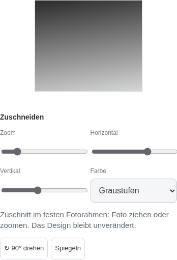

# Foto bearbeiten: Quellauflösung im Zuschnitt erhalten

06.10.2026 · Branch `task/photo-resolution-20261006` · Basis `4b296b28e2d2c7b6f76e82c98589188c40d2af30`.

## Behobene Ursache

Der native Konfigurator speicherte nach Zuschneiden oder Graustufen die 1200-Pixel-Arbeitsvorschau als bearbeitete Druckquelle. Schon das Öffnen und Übernehmen eines ausreichend großen Kundenfotos konnte damit dessen nutzbare Auflösung reduzieren. Der Prüfstand verwendete diese bearbeitete Fassung korrekt, erhielt aber zu wenige Pixel.

Jetzt entsteht die bearbeitete PNG getrennt von der Vorschau aus der unverkleinerten Bildquelle. Verwendeter Ausschnitt, Zoom, Drehung, Spiegelung, Farbe und feste Fotomaske bleiben erhalten. Die Pixelzahl richtet sich nach den tatsächlich verfügbaren Pixeln des Ausschnitts; kleine Bilder werden nicht künstlich hochgerechnet. Erneutes Öffnen und Übernehmen verwendet die ursprüngliche Bearbeitungsquelle, ohne den Zuschnitt erneut auf die schon zugeschnittene Ausgabe anzuwenden.

Die Arbeitsvorschau bleibt klein. Die Ausgabe ist auf 20 Megapixel und 8192 Pixel Kantenlänge begrenzt; eine tatsächlich nötige Begrenzung wird beim Übernehmen genannt. Eine bearbeitete PNG über 15 MB wird vor dem Ersetzen mit konkretem Hinweis abgewiesen. Originaldatei, vorherige Bildfassung und Gestaltung bleiben dann erhalten. Keine Änderung an den PDF-Renderern oder bereits gespeicherten Druckdateien.

## Ausgeführte Prüfung

- `node --test app/configurator/variant-m/image-processing.test.mjs app/configurator/variant-m/ui-event-regressions.test.mjs`: **15 bestanden, 0 Fehler, 0 Skips**. Neue Fälle für Quellen-/Zuschnittpixel, Zoom, 90°-Drehung, kleine Quellen ohne Hochrechnung, Ausgabegrenzen und unveränderte Daten beim Überschreiten von 15 MB.
- `python scripts/check-photo-resolution.py`: tatsächlicher Chromium-Konfigurator → 4000 × 3000 Pixel synthetisches Farbfoto → Zuschnitt mit 1,25-fachem Zoom/Versatz und Graustufen → unveränderlicher Werkstattprüfstand. Bearbeitete Datei **2817 × 2400 Pixel**, Vorschau **1200 × 1022 Pixel**. Graustufen und Ausschnitt anhand unabhängiger Pixelkoordinaten geprüft; Original im ZIP bytegleich. Erneutes Öffnen, Original wiederherstellen, Rückgängig und Übernehmen ergeben bytegleiche bearbeitete PNG.
- Browser 06.10.2026 **16:25:50–16:26:02 Uhr Europe/Berlin**, Desktop/Handy/Tablet (1440/390/768), keine JavaScriptfehler oder Seitenüberläufe. Fixture-Build **76 Ressourcen / 1 Modell**. Die erste Ausführung überschritt lediglich die 5-Sekunden-Wartezeit beim Kodieren des großen PNG; der begrenzte Browser-Wartewert wurde auf 15 Sekunden erhöht. Erfolgreicher Lauf im [Browserbericht](foto-aufloesung-browser-20261006.json).
- Vollständige Testsuite bewusst nicht hier wiederholt; gemeinsame Integrationsprüfung erfolgt nach Übernahme in den Abschlussbranch.

## Grenzen

Nur synthetische Dateien und eine neue temporäre Prüf-Datenbank. Kein Zugriff auf private Fotos, keine Veröffentlichung, keine echte RIP-/Maschinenfreigabe. Fehlende Details einer kleinen Quelle lassen sich durch größere Ausgabe-dpi nicht zurückholen. Früher gespeicherte reduzierte Bildfassungen werden nicht automatisch geändert; eine neue Bearbeitung aus dem vorhandenen Original ist erforderlich.
