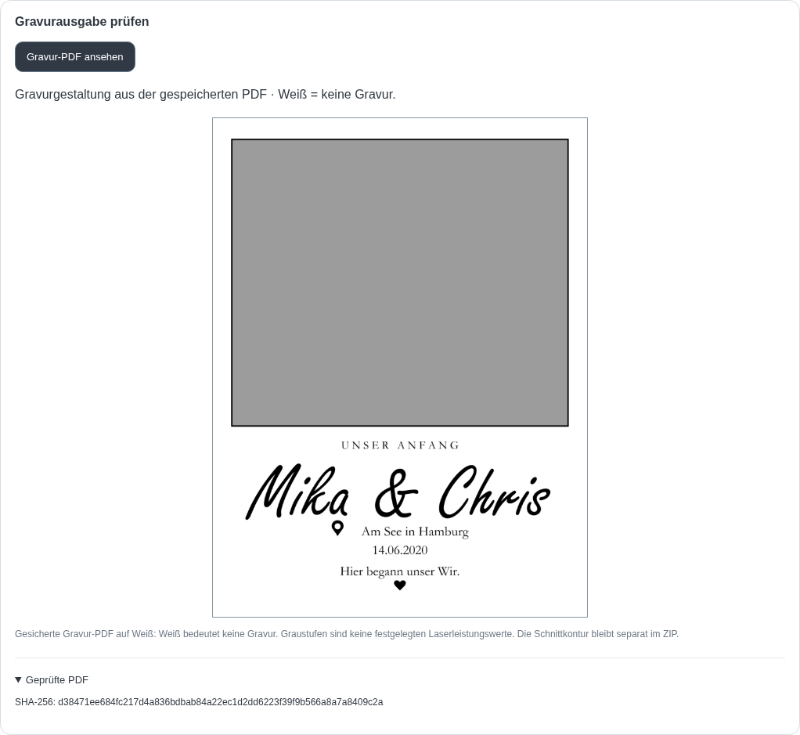

# Gesicherte Gravur-PDF im Dashboard prüfen – 06.10.2026

Basis `d7bf81fed4bad7a381eb4a43e0bdc4ce545d0d78` per Remote bestätigt; Branch `task/engraving-pdf-preview-20261006`. Umsetzung in der bestehenden verwalteten Linux-Cloud. Keine Veröffentlichung, Shopify-Anfrage oder private Kundendaten.

## Änderung

Bisher waren PDF-Vorschauen unter **Ausgaben** auf Farbe und Weiß bei Druckaufträgen beschränkt. Fertige Gravuraufträge erhalten jetzt **Gravur-PDF ansehen**. Der Server liest die tatsächlich gespeicherte PDF und rendert sie als Bildschirmbild auf Weiß. Keine zusätzliche Spiegelung, Umfärbung, Materialsimulation oder Änderung der Ausgabedatei. Schwarz/Graustufen zeigen die vorhandene Gestaltung, Weiß bedeutet keine Gravur; Graustufen sind keine festgelegten Laserleistungswerte. Die separate Schnittkontur bleibt im ZIP.

Farbe und Weiß bleiben ausschließlich für Druckaufträge verfügbar. Beim Auftragswechsel verschwinden altes Bild und alter Dateinachweis. Die angezeigte SHA-256 gehört zur verwendeten PDF; eine vorhandene gespeicherte PDF-Prüfsumme wird vor dem Rendern verglichen. Größen-, Zeit- und Parallelitätsgrenzen sowie Host-/Origin-/CSRF-Schutz bleiben erhalten. Vorschauen sind nicht zwischenspeicherbar und höchstens 1000 Pixel an der langen Seite; diese Bildschirmauflösung ändert nicht die Druck-/Gravurauflösung oder die Vektorpfade im Download.

Dateien: `print-preview.mjs`, `print-preview.py`, bestehender HTTP-Endpunkt und Ausgabenoberfläche; zusätzliche Tests in `print-preview.test.mjs` sowie Browserablauf `scripts/check-engraving-pdf-preview.py`. Keine Datenmigration, Änderung von Ausgaberezepten oder Neuberechnung vorhandener PDFs.

## Tatsächlich geprüft

- Vier gezielte Vorschautests bestanden: bisherige Roland-/Mimaki-Farb-/Weißtrennung, Fehlerfälle sowie neue Raster- und Vektorgravur. Asymmetrisches Motiv bleibt an derselben Position; Graustufen und Weiß unverändert; falsche Methode und abweichende PDF-Prüfsumme abgewiesen.
- Vollständiger Cloud-Check **06.10.2026, 14:56:20–14:58:23 Europe/Berlin**: **314 Tests / 0 Fehler / 0 Skips**, Referenzen und Build **76 Ressourcen / 1 Modell**. [Cloud-Bericht](gravur-pdf-vorschau-cloud-report.json).
- Echter Chromium-Ablauf **14:58:02–14:58:14 Europe/Berlin**: nativen Acryl-Prüfstand als Rastergravur ausgeben, gespeicherte PDF ansehen, Hash vergleichen, PDF erneut herunterladen (byteidentisch), zur gespiegelten Ausgabe wechseln. Ungültige Modi und fehlendes CSRF abgewiesen. Desktop 1440, Handy 390, Tablet 768 Pixel, keine JavaScript-Fehler oder horizontalen Überläufe. [Browserbericht](gravur-pdf-vorschau-browser-report.json).
- Bisheriger Druck-Browserablauf **14:56:28–14:56:49 Europe/Berlin** erneut bestanden: Farb-/Weißvorschau, transparente Bereiche, separate Mimaki-Downloads, Vektorweiß und CutContour, byteidentische Wiederholung, Ghostscript. [Regressionsbericht](gravur-pdf-vorschau-druck-regression.json).
- Erste Browser-Skriptläufe verwendeten versehentlich den Druck-Auftragslink und lasen danach die ID aus einem geschlossenen Detailfeld mit `inner_text`. Das Prüfsystem wurde auf den vorhandenen Gravur-Auftragslink und `text_content` korrigiert; die obigen Ergebnisse stammen aus dem anschließend bestandenen Lauf.

[Handyansicht](gravur-pdf-vorschau-mobil-20261006.png). Das graue Fotofeld ist eine bewusst synthetische Bildquelle, keine fehlgeschlagene echte Fotoübernahme.

## Grenzen / nächster Schritt

Keine reale Corel-/RIP-/Laserprobe, keine Leistungsparameter oder automatische Maschinenfreigabe. Private bisherige Druckproben wurden in diesem Paket nicht bearbeitet. Das ältere private Muster-Site enthält dadurch kein aktualisiertes Werkstatt-Backend.

Nächste externe Abnahme: konkretes reales Import-/Probedruck-/Probegravurergebnis zu einer gesicherten PDF im bestehenden Prüfprotokoll dokumentieren und bestätigte Material-/Maschinenvorgaben als Fertigungsprofil hinterlegen. Shopify-Test-App und authentifizierter dauerhafter Backendzugriff bleiben separat offen; hierfür keine neuen Server oder Umgebungen angelegt.
