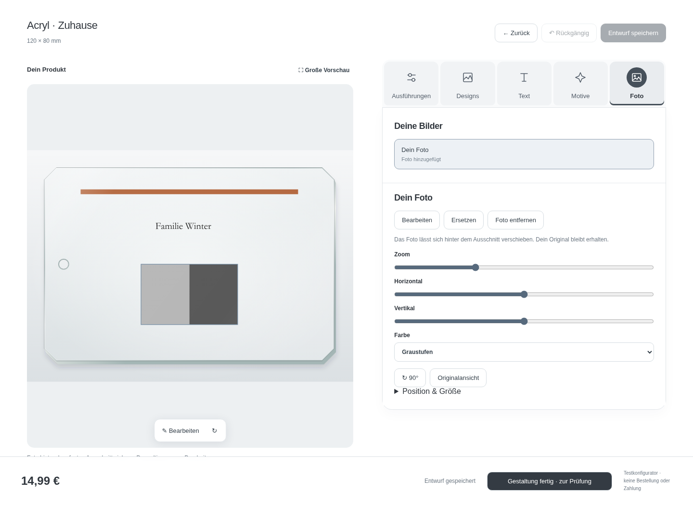

# Gemeinsamer Konfigurator-Einstieg und durchgehender Prüfablauf

06.10.2026 · bestehende Cloud-Ausführung. Branch `task/konfi-form-completion-20261006`, Ausgangscommit `3ddb7c4d6ba26f686a74bec0f680cec6b1354f36`. Keine Veröffentlichung, keine Shopify-Mutation, kein Merge oder PR.

## Ergebnis

Dashboard-Produktkarten, Formeditor und Ausführungsgruppen öffnen den gemeinsamen Einstieg `/`. Dieser lädt den gespeicherten Produktstand und wählt den vorhandenen Acryl-Editor oder den Formmodus. Der Acryl-Editor einschließlich des gesicherten Musters bleibt erhalten. Die Formbearbeitung verwendet die bereits geprüften Kundenfeld-, Material-, Geometrie-, Foto- und Entwurfsmodule; keine zweite Preisberechnung, keine nachgebaute Datenbank. Technisch bleiben Acryl- und Formrenderer unterschiedliche Adapter. Diese Anbindung behauptet keine identischen intern gespeicherten Zustände oder vollständige Shopify-Parität.

Im Formmodus: gesamte Produktvorschau links, Ausführungen/Designs/Text/Motive/Foto rechts, Preis und Abschluss unten. Designauswahl nur bei mehreren Designs, Fotos nur bei vorhandenen Fotofeldern. Motivfarben, ganze mm-Schriftgröße, direkte Foto-/Textbearbeitung und Rechte bleiben erhalten. Die neue Ausführungswahl sitzt im selben Konfigurator. Preis, Maße und Designs stammen aus dem fest gebundenen Produktstand. Texte/Fotos werden je Produktrevision und Design getrennt gespeichert; ein Wechsel skaliert keine fremden Entwürfe still um. Die komplette Auswahl wird im Elternlink nachgeführt, ohne Entwurfszugangstoken.

„Gestaltung fertig · zur Prüfung“ speichert die letzte gültige Änderung und sichert anschließend einen unveränderlichen Werkstattprüfstand. Das ist bewusst keine bezahlte Bestellung. Ein gescheitertes Speichern verhindert die Übergabe. Die Downloadfunktionen bleiben im Operator-Backend.

Historische Direktlinks `/konfigurator/form/` und die Ausführungsübersicht bleiben kompatibel. Neue Dashboardlinks verwenden den gemeinsamen Einstieg. `/models.json` liefert für Formprodukte nur den nötigen Routingbezug mit ID/Revision, keine privaten Daten oder neue Preisquelle. Archivierte oder designlose Produkte werden dort abgewiesen.

## Tatsächliche Abnahme

- `node scripts/cloud-check.mjs`: am 06.10.2026 09:08:17–09:09:42 Europe/Berlin, **268 bestanden, 0 Fehler, 0 Skips**, Quellenprüfung erfolgreich, Build **76 Ressourcen / 1 Modell**. [Nachweis](konfi-completion-cloud-check.json). Der erste Durchlauf scheiterte an einem fehlenden Anführungszeichen im ergänzten Test, vor dessen Ausführung; nach Korrektur bestand der vollständige Lauf.
- `PYTHONPATH=.local-data/python python3 scripts/check-konfi-completion.py`: 09:15:09–09:15:27 Europe/Berlin, bestanden. [Nachweis](konfi-completion-check.json). Echter Browser: Text, synthetisches Foto hochladen, Graustufen/Zoom, Ausführung wechseln/zurück, Design wechseln/zurück, Neuladen, Desktop 1440 / Handy 390 / Tablet 768, keine JavaScriptfehler oder horizontalen Überläufe.
- Anschließend im selben Ablauf: automatisch gespeicherter Entwurf → Werkstattprüfung → tatsächlicher Roland-PDF-Download und Mimaki-ZIP-Download. PDF mit 120 × 80 mm, CMYK, vektorieller CutContour. Roland-Schmuckfarbe `RDG_WHITE`, Mimaki-Vektorweiß; freie Stellen und Bohrung ohne Weiß, bedruckte Linie und Foto weiß hinterlegt. Standard 300 dpi, Weiß nur unter Druck, kein Überdruck. ZIP-Dateihashes stimmen; separat heruntergeladenes Originalfoto byteidentisch. Eine spätere Kundenänderung verändert weder Prüfstand noch erneut heruntergeladene PDF.
- Lokale zufällig signierte **synthetische** Testbestellung → unveränderliche Position → wiederholte Zustellung ohne Duplikat → neuer Produktentwurf mit ursprünglichem Beispieltext und austauschbarem Fotofeld, ohne privates Kundenfoto → wiederholtes Anlegen ohne Duplikat. Keine echte Shopify-Zahlung simuliert oder behauptet.
- Angepasster `scripts/check-excel-customer-flow.py`: 09:08:49–09:09:09 Europe/Berlin, echte XLSX-/SVG-/PDF-Anlage, ausgefüllte Design-/Varianten-Excel bearbeiten/reimportieren, drei Varianten mit passenden Preisen und gespeicherten Kundenfeldern im gemeinsamen Einstieg. Spätere Backendänderung bleibt aus historischem Gruppenstand ausgeschlossen. [Nachweis](konfi-excel-regression.json).
- `scripts/check-existing-konfi.py`: 09:11:27–09:11:38 Europe/Berlin, ursprünglicher Acryl-Editor weiterhin erreichbar, Dashboardtexte und feste Revision korrekt, drei Bildschirmbreiten bestanden. [Nachweis](konfi-acryl-regression.json).

Die Browser-Fixtures erzeugen ausschließlich frische, private temporäre SQLite-Dateien mit synthetischen Daten. Nach Abschluss werden Server und Dateien entfernt. Sie greifen nicht auf bestehende Datenbanken zu. Die Testsignatur ist kurzlebig und wird nicht veröffentlicht. PDF/ZIP-Prüfdateien liegen nur in ignorierten Testausgaben. Laufzeitanforderungen stehen in `scripts/requirements-browser.txt` und den bestehenden Python-Anforderungen; Chromium wird über `/usr/bin/chromium` benutzt.

[Handy](konfi-completion-mobile.png) · [Werkstatt und Export](konfi-completion-export.png)

## Shopify-Bezug wiedergefunden, nur gelesen

Der Nutzer hatte die Adresse bereits am 05.10.2026 im Chat `01a10cff-6a30-776b-9d52-309065d62072` geschickt. Dieser Chat wurde über das vorhandene Chat-Lesewerkzeug gelesen; kein Laptop-Dateizugriff. Link: https://admin.shopify.com/store/gravuru-design/products/16138521641340 .

Am 06.10.2026 bestätigen Shopify-Connector `get_shop_info`, ID-Suche und `get_product` den Store `gravuru-design.myshopify.com` sowie das Produkt `gid://shopify/Product/16138521641340`, „Grabtafel Oma Naturschiefer mit Fotogravur 22×14 cm“, Status `DRAFT`, sieben Varianten. Es handelt sich um eine Schieferreferenz, **keine automatische Zuordnung zum Acrylmuster**. Store-Adresse und lesender Connectorzugang fehlen damit nicht mehr. Keine Kunden-/Bestelldaten gelesen oder gespeichert. Keine App installiert, keine Varianten, Preise, Bestände oder Veröffentlichung verändert. Der Connector-Lesezugang belegt noch keine App-Anbindung dieser Cloud-Laufzeit und keine Entwicklungsstore-Eigenschaft.

## Tatsächlich noch offen

1. Echte Shop-Verknüpfung: bestätigtes Testziel, freigegebene App mit Storefront-/Warenkorbtransport und authentifizierter Bestellannahme. Live-Bestellungen bleiben gesperrt. Acryl besitzt einen vorbereiteten Commerce-Adapter; seine Warenkorb-/Backend-Prüfstandparität mit den Formprodukten ist noch nicht abgenommen. Kundenkonto-Kaufdownloads, Storno/Erstattung und gehostete Händleranmeldung bleiben Teil der realen Shop-Anbindung, nicht dieses synthetischen Nachweises.
2. Reale Fertigungsabnahme: Roland LEF-200/MO-240 mit VersaWorks, Mimaki 2513 EX; konkretes Mimaki-RIP/Version, gemessene ICC-/Materialprofile und Maschinenproben. Aktuell generisches DeviceCMYK, keine erfundene Maschinenfreigabe.
3. Dauerhafte private Betriebsablage und Zugriffsrechte für beide Konten sind nicht durch die temporäre Cloud-VM oder GitHub ersetzt. Die bestehenden privaten Wiederherstellungen wurden nicht geöffnet oder veröffentlicht.
4. Ursprüngliche 18 UV-Designs und noch fehlende bestätigte Material-/Schriftreferenzen bleiben gemäß bestehender Übergabe zuzuordnen; kein automatisches Erfinden ihrer Inhalte.

Die bestätigten Schutzregeln untersagen Shopify-/Produktionsmutation und Live-Veröffentlichung. Nächster externer Schritt ist deshalb die Entscheidung für das konkrete Testziel und die autorisierte App-Anbindung, **nicht** die erneute Suche nach der bereits gefundenen Shop-Adresse. Die Dateien und der geprüfte Code sind die Fortsetzungsgrundlage; noch keine Aussage „Gesamtprojekt produktionsfertig“.
