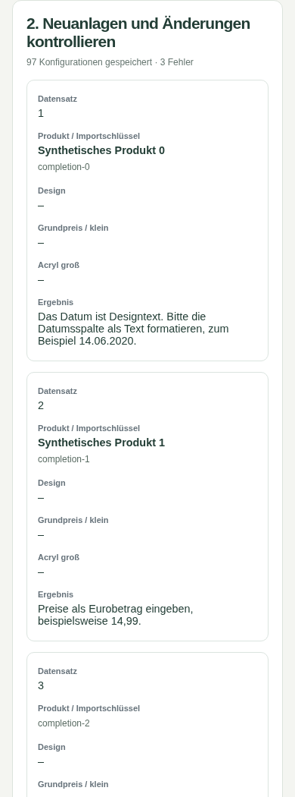
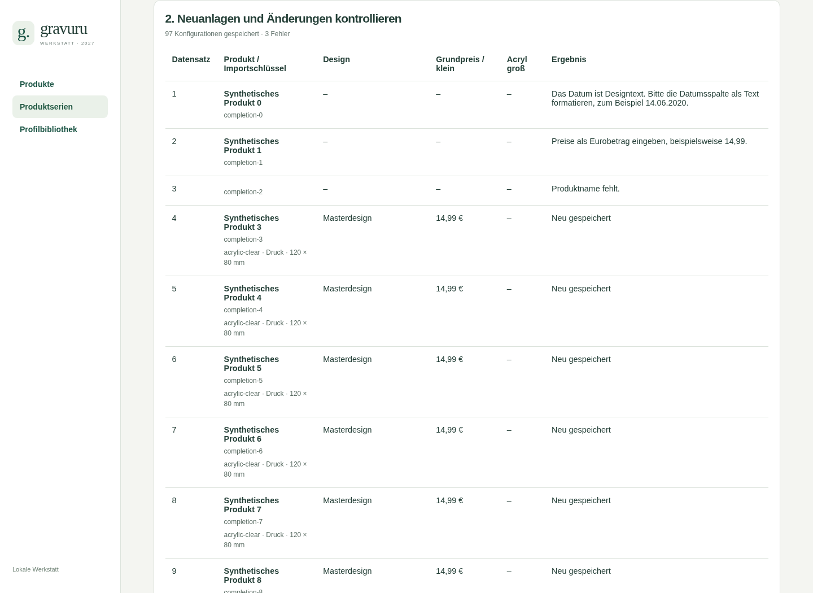

# Excel-Stapel: einzelne Datumsfehler isolieren und direkt weiterarbeiten

06.10.2026 · Cloud · Aufgabenbranch `task/batch-completion-20261006` · Ausgangscommit `4b296b28e2d2c7b6f76e82c98589188c40d2af30`.

## Tatsächliche Korrekturen

Eine numerische Datumszelle ließ zuvor schon den Excel-Leser abbrechen. Dadurch erschien kein zeilenweiser Prüfbericht und die übrigen gültigen Produkte konnten nicht übernommen werden. Beim direkten API-Zugriff konnte die gleiche Zahl unbeabsichtigt als gedruckter Datumstext übernommen werden.

Die Datumsprüfung liegt jetzt in der gemeinsamen Planung je Produktzeile. Die betroffene Zeile erhält den konkreten Hinweis, das Datum als Text einzutragen. Andere Zeilen können nach ausdrücklicher Auswahl „Nur gültige Datensätze anwenden“ übernommen werden. Zahlen werden weder stillschweigend in ein Datum umgerechnet noch als Designtext gedruckt. Strukturell ungültige Tabellen, externe Tabellenbezüge und Formeln werden weiterhin vor der Übernahme abgelehnt.

Nach einer erfolgreichen Übernahme wird außerdem die Produktauswahl für den Excel-Download aktualisiert. Neue Formprodukte sind sofort auswählbar; zuvor angekreuzte Produkte bleiben ausgewählt. Scheitert nur dieses Nachladen, bleibt die bereits erfolgreiche Speicherung als solche erkennbar.

## Ausgeführt und bestanden

- `node --test app/workshop/batch.test.mjs`: **8 Tests bestanden, 0 Fehler, 0 Skips**. Darin 100er-Anlage und -Aktualisierung, 97+3-Teilerfolg, Wiederholung nach Neustart, Transaktionsrollback, Revisionsschutz sowie numerische Datumswerte einschließlich Null. Korrekte Datumstexte bleiben unverändert.
- `PYTHONPATH=.local-data/python python3 scripts/check-batch-completion.py`: echter Chromium-Browser mit neu angelegter, rein synthetischer Datenbank, **06.10.2026 16:23:33–16:23:38 Europe/Berlin**. Echte XLSX-Datei mit 100 Produkten und drei Fehlern: numerisches Datum, ungültiger Preis und leerer Name.
- Vor ausdrücklicher Teilübernahme keine Produkte gespeichert. Danach **97 neue Entwürfe / 3 konkrete Fehler**; korrigierte Datei erzeugt nur die fehlenden drei. Weitere Wiederholung erzeugt **0** neue Produkte. Alle bestehenden Produkt-IDs und Revisionen erhalten.
- Ohne Neuladen echte XLSX-Datei mit **100 Produkten und 100 Designzuordnungen** heruntergeladen und mit OpenPyXL wieder eingelesen; Produkt-IDs und erwartete Revisionen stimmen. Die Auswahl bleibt beim Nachladen erhalten.
- Nach der Vorprüfung parallel bearbeitetes Produkt wird nicht überschrieben. Erneute Prüfung meldet die veraltete Revision; die anderen 99 Produkte bleiben unverändert.
- Sichtprüfung bei **1440 / 390 / 768 px**, keine JavaScript-Fehler oder horizontalen Seitenüberläufe. Build der synthetischen Browserfixture: **76 Ressourcen, 1 Modell**.

Die Gesamtsuite wurde in diesem Teilpaket nicht erneut ausgeführt; die integrierte Prüfung erfolgt im übergeordneten Abschlusslauf. Keine Produktivdatenbank, keine Shopify-Anfrage, kein Restore, kein Deployment. Vorhandene Druckdateien und Produktionsrenderer unverändert. Externe Shop-/Maschinenabnahme wird durch diesen technischen Stapeltest nicht ersetzt.

[Maschinenlesbarer Browsernachweis](STAPEL-ABSCHLUSSPRUEFUNG-20261006.json)

