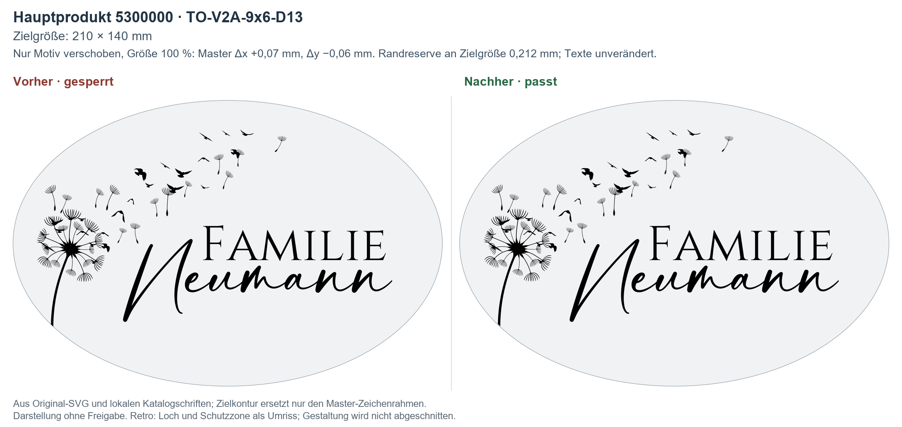
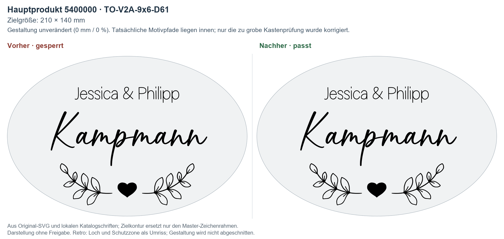
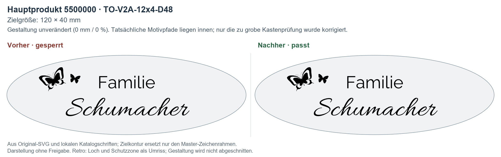
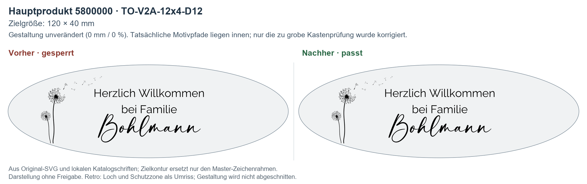
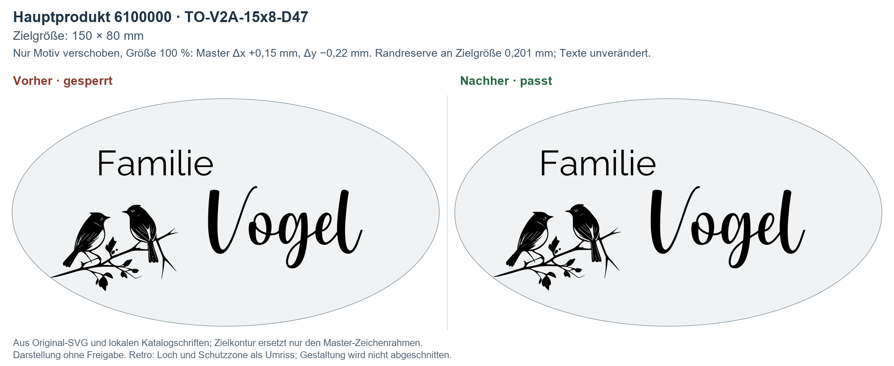
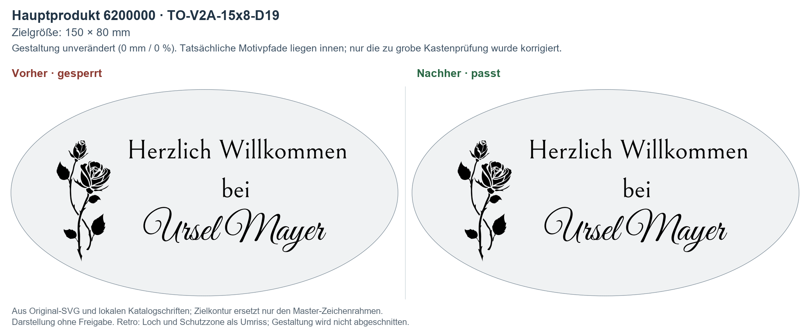
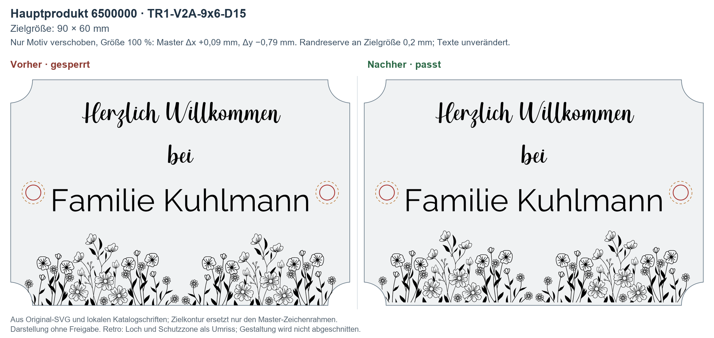
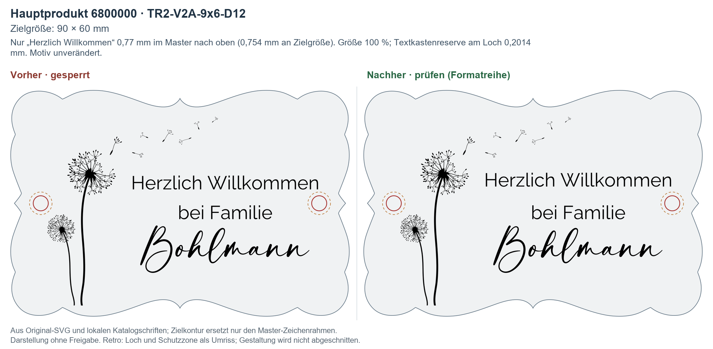
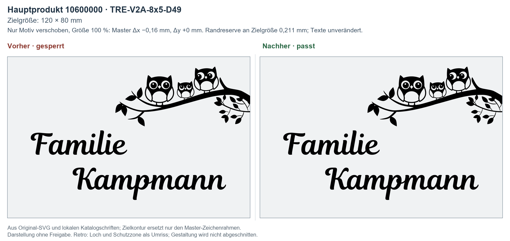
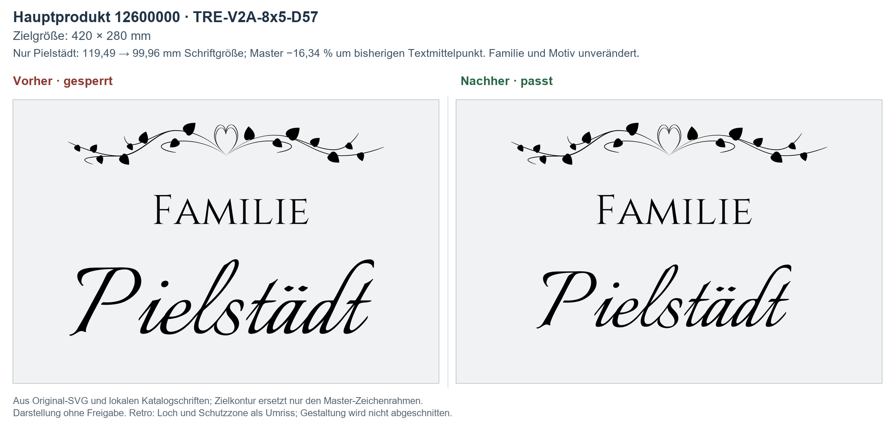

# Paket J · Original-Startdesigns einpassen · 24.10.2026

**Ergebnis:** 104 Zuordnungen / 102 Designs; alle zehn beauftragten Fälle ohne size_fit- oder design_invalid-Sperre. Gesamt: **98 passt / 6 prüfen / 0 passt nicht**. Die übrigen 94 Fit-Ergebnisse sind exakt unverändert. Sechs Designs wurden angepasst, vier bleiben bytegleich. Keine Designfreigabe gesetzt.

Chris hat entschieden: **Motiv bleibt, kein Tausch auf D1.** IDs, Zuordnungen, Größenlisten, Grundpreise, Familien, Bohrbilder und Konturen bleiben unverändert.

## Stand und Merge-Reihenfolge

Basis: main 3e42c13411003add34645bc258623851982e7809 plus korrigierter [PR #16](https://github.com/Chris83638w/gravuru-2027/pull/16), Stand 07d65b3254227bb2590ee6f4710869bfd47bf5a7. Paket J baut auf diesem separat zu prüfenden PR auf. Erst #16 übernehmen, dann Paket-J-Code und Katalog gemeinsam prüfen/übernehmen. Kein Merge durch Astra.

- Eigener Implementierungscommit: bc1c7ce671ddc616855ef7c5eafea22d06827665.
- Katalogbasis: 1be49ee792667357fff1061eb5d21bacf3b4e3c1; Paket-J-Katalogcommit: fbf020e7bc5ac930ac75790b3325c0df8204c219.
- Beide Branches: dev/designs-einpassen-20261024-astra; PRs gegen main.
- [Prüfnachweis](2026-10-24-paket-j-pruefung.json), [Bildergalerie](paket-j-bilder/index.html), [Kontaktblatt](paket-j-bilder/kontaktblatt.png).

## Zehn Fälle mit Originalbildern

PNG links vorher, rechts nachher: aus den jeweiligen design.svg, in der zugeordneten Zielgröße, mit echten Katalog-TTFs. Text wird nur in einer temporären Renderkopie in Glyphenpfade umgesetzt; die Katalogtexte bleiben editierbar. 24 Textzeilen gegen die gemeinsamen Schriftmetriken geprüft (maximale Abweichung 1,42e−14 mm). Die Zielplatte ersetzt den Master-Zeichenrahmen; nichts wird abgeschnitten. Bei Retro sind Loch und Schutzzone markiert.

### 5300000 · TO-V2A-9x6-D13 · 21 × 14 cm

Motiv +0,07 / −0,06 mm im Master verschoben, Größe 100 %. Ziel-Randreserve 0,212313 mm. Status: **passt**.

### 5400000 · TO-V2A-9x6-D61 · 21 × 14 cm

Keine Datenänderung: tatsächlicher Motivpfad lag bereits 5,47281 mm innen. Status: **passt**.

### 5500000 · TO-V2A-12x4-D48 · 12 × 4 cm

Keine Datenänderung: tatsächlicher Motivpfad lag bereits 2,69109 mm innen. Status: **passt**.

### 5800000 · TO-V2A-12x4-D12 · 12 × 4 cm

Keine Datenänderung: tatsächlicher Motivpfad lag bereits 0,49937 mm innen. Status: **passt**.

### 6100000 · TO-V2A-15x8-D47 · 15 × 8 cm

Motiv +0,15 / −0,22 mm im Master verschoben, Größe 100 %. Ziel-Randreserve 0,201290 mm. Status: **passt**.

### 6200000 · TO-V2A-15x8-D19 · 15 × 8 cm

Keine Datenänderung: tatsächlicher Motivpfad lag bereits 3,82776 mm innen. Status: **passt**.

### 6500000 · TR1-V2A-9x6-D15 · 9 × 6 cm

Beide Motivpfade gemeinsam +0,09 / −0,79 mm verschoben, Größe 100 %. Ziel-Randreserve 0,200383 mm. Status: **passt**.

### 6800000 · TR2-V2A-9x6-D12 · 9 × 6 cm

Nur Spruch 0,77 mm im Master nach oben, tatsächlich 0,754 mm am Ziel. Textkasten-Lochreserve 0,2014 mm; Motiv unverändert. Status: **prüfen** (bekannter 1,50-%-Contain-Seitenverhältnishinweis, keine Sperre).

### 10600000 · TRE-V2A-8x5-D49 · 12 × 8 cm

Motiv 0,16 mm im Master nach links, Größe 100 %. Ziel-Randreserve 0,211000 mm. Status: **passt**.

### 12600000 · TRE-V2A-8x5-D57 · 42 × 28 cm

Nur Pielstädt von 22,76 auf 19,04 mm Master-Schriftgröße (−16,344464 %), um den bisherigen Textmittelpunkt. Am Ziel 119,49 →99,96 mm. Status: **passt**.

## Messung und minimale Änderung

Vier echte Motivüberstände vor der Korrektur: 5300000 0,00138 mm, 6100000 0,06377 mm, 10600000 0,00300 mm, 6500000 0,15538 mm. Bei Retro I beschreibt der frühere Kastenwert 0,005 mm den tatsächlichen Kontureinschnitt nicht. Die fünf bereits innen liegenden Motive (einschließlich Retro II) werden durch die genauere Prüfung akzeptiert; Textkastenregeln bleiben erhalten.

Verglichen wurden Translationen auf dem 0,01-mm-Masterraster und zentrierte uniforme Verkleinerungen. Die gewählten Translationen bewahren alle vier Motive zu 100 % und haben in den untersuchten Varianten die geringere maximale Punktbewegung. Kein globales Optimum beliebiger kombinierter Transformationen wird behauptet. Maßgeblich sind die Werte nach tatsächlicher Import-/Skalierungsrundung. Die mindestens 0,2 mm Reserve beziehen sich auf die beauftragte Zielgröße. Kleinere angebotene Größen wurden zusätzlich geprüft; keine neue oder verschlechterte Lochkollision entsteht.

Für Retro II ist 0,77 mm der kleinste ausreichende 0,01-mm-Schritt: 0,76 mm lässt nur 0,1914 mm Reserve; 0,77 mm lässt 0,2014 mm. Der zuvor lokal angewendete 0,78-mm-Schritt und die Feinjustierung sind im fortgeführten Protokoll nachvollziehbar.

## D57 auf allen zehn angebotenen Größen

Das Schema hat keine Schriftbegrenzung je Größe. 19,04 mm ist die größte zulässige 0,01-mm-Masterstufe für 420×280: 19,05 mm würde 100,0125 mm ergeben. Die 100-mm-Grenze bleibt unverändert. Nur der Namensschriftzug wurde verkleinert; Familie, Motive und restliche Inhalte bleiben gleich.

| Ziel mm | Schrift vorher mm | nachher mm | Fit vorher → nachher | Bild |
|---|---:|---:|---|---|
| 80 × 53.3 | 22.76 | 19.04 | passt → passt | [Vergleich](paket-j-bilder/d57-groessen/12600000-GR-ES-RE-80X53P3-T15.png) |
| 90 × 60 | 25.605 | 21.42 | passt → passt | [Vergleich](paket-j-bilder/d57-groessen/12600000-GR-ES-RE-90X60-T15.png) |
| 120 × 80 | 34.14 | 28.56 | passt → passt | [Vergleich](paket-j-bilder/d57-groessen/12600000-GR-ES-RE-120X80-T15.png) |
| 150 × 100 | 42.675 | 35.7 | passt → passt | [Vergleich](paket-j-bilder/d57-groessen/12600000-GR-ES-RE-150X100-T15.png) |
| 180 × 120 | 51.21 | 42.84 | passt → passt | [Vergleich](paket-j-bilder/d57-groessen/12600000-GR-ES-RE-180X120-T15.png) |
| 210 × 140 | 59.745 | 49.98 | passt → passt | [Vergleich](paket-j-bilder/d57-groessen/12600000-GR-ES-RE-210X140-T15.png) |
| 240 × 160 | 68.28 | 57.12 | passt → passt | [Vergleich](paket-j-bilder/d57-groessen/12600000-GR-ES-RE-240X160-T15.png) |
| 300 × 200 | 85.35 | 71.4 | passt → passt | [Vergleich](paket-j-bilder/d57-groessen/12600000-GR-ES-RE-300X200-T15.png) |
| 420 × 280 | 119.49 | 99.96 | >100 mm → passt | [Vergleich](paket-j-bilder/d57-groessen/12600000-GR-ES-RE-420X280-T15.png) |
| 450 × 300 | 128.025 | 107.1 | >100 mm → >100 mm, weiterhin gesperrt | [Vergleich](paket-j-bilder/d57-groessen/12600000-GR-ES-RE-450X300-T15.png) |

## Code und Schutzregeln

Der Objektkasten bleibt der schnelle positive Vorfilter. Nur identifizierte eingebettete Vorlagenmotive können einen geometrischen Kastenfehler auf Oval/Kontur durch ihre tatsächlichen Pfade auflösen. Abbildung wie im Renderer (viewBox, meet, Rotation), Kurvenreserve 0,0005 mm plus vorhandene Konturreserve 0,002 mm; vollständige Kanten- und gefüllte Lochprüfung. Unbekannte SVG-Formen behalten den ursprünglichen Fehler. Textprüfung bleibt getrennt.

Die authentische, unveränderte Startposition wird gegen Vorlage und Ressourcen geprüft und bleibt erhalten. Drag, Größenänderung und Rotation verwenden weiterhin die bisherigen Clamping-Funktionen. Echte Neuauswahl startet auch auf einer zunächst inaktiven Rückseite wieder korrekt. Die reale Retro-II-Fixture belegt, dass der frühere Kasten-Clamp das Motiv verschoben hätte; die neue Startprüfung erhält seine exakten Koordinaten. Ressourcen-/Geometrieänderungen invalidieren den gebundenen Cache.

## Prüfungen

- Windows-Vollauf: alle 178 Testdateien unter app/configurator/variant-m/*.test.mjs und app/workshop/*.test.mjs: **1270 Tests, 1265 bestanden, 0 Fehler, 5 Skips, 0 Abbrüche**. Sämtliche 175 Dateien von main vorhanden, plus zwei Paket-I- und eine Paket-J-Datei. Keine Tests gestrichen oder Assertions abgeschwächt. Skips sind im JSON einzeln ausgewiesen.
- Zusätzlich **15/15 shared Tests** (7 bestehende Konturtests + 8 neue Pfadtests). Gezielt insgesamt 53/53 eindeutige Tests, darunter 14 neue; diese überschneiden sich mit dem Vollauf und werden nicht doppelt addiert. Ein Agent-HTTP-Sandboxfehler wurde durch Root-Einzellauf und Vollauf aufgelöst.
- Vollauf-Integrität: keine Änderungen an Testquellen oder geschützten Arbeitsdaten. Node 24.20.0 / Python 3.12.14. Ein Linux-Vollauf wurde hier nicht ausgeführt.
- designDashboardWithFit: zehn Fälle ohne die beiden Sperrcodes, 94 Fits und alle Zuordnungen/Freigaben identisch. 1491 übrige lokale Design-Dateien (davon 1462 design.json/design.svg-Dateien) bytegleich. Exakt 17 Design-/Logdateien geändert: sechs JSON/SVG-Paare und fünf Protokolle; historische Logpräfixe erhalten.
- Vollständiger Katalogbau: PYTHONUTF8=1 python -X utf8 -I scripts/build-katalog.py --katalog <katalog>, Exit 0. 11 PDFs und 11 PNGs geöffnet, Excel mit acht Tabellen lesbar. KATALOG.md ist bytegleich zu 1be49ee; Familienartefakte werden nicht wegen plattformabhängiger Neugenerierung ersetzt. UTF-8 auch für Build-Unterprozesse gesetzt. Optionaler Zeichnungs-Seed ist in main nicht enthalten; reguläre Gruppierung verwendet.
- Unabhängige Code- und Katalogprüfung: keine offenen P1/P2. 23 Bild-/HTML-Artefakte, 90 lokale Links geprüft, keine externen Abhängigkeiten. Alle geänderten Textdateien LF.

Vollauf: node scripts/test-portability/run-full-tests.mjs --repo . --python <python> --temp <temp> --output <nachweise> --expected-files 178 --run. Zusätzlich: node --test app/platform/sources/app/shared/models/contour-geometry.test.mjs app/platform/sources/app/shared/models/embedded-motif-fit.test.mjs. Dashboard: designDashboardWithFit(katalogRoot,{linie:"edelstahl-tuerschilder",startDesigns:true,converter:convertFont}). Vorher-/Nachher-Zuordnungen und Prüfsummen stehen im JSON-Nachweis.

## Bestehende Grenzen und nächster Schritt

450×300 bei D57 bleibt wegen 107,1 mm Schriftgröße gesperrt (vorher 128,025 mm). Zwei optionale Lochkonflikte außerhalb der beauftragten Ziele bleiben: D13 in 9×6 verbessert sich von −3,0000 auf −2,9528 mm; unveränderter D49-Text in 9×6 bleibt bei −0,3363 mm. Diese Varianten werden nicht als lochfrei behauptet. Die bestehende Rechteck-/Oval-Lochpolitik wird nicht stillschweigend geändert.

Die Original-SVGs verwenden evenodd, der vorhandene Import nonzero. Das ist ein bestehender Unterschied, keine Füllregeländerung in Paket J; beide Varianten ergeben dieselben hier maßgeblichen Rand-/Lochklassifikationen. Die Bilder zeigen die Original-SVGs, die Codeprüfung den tatsächlichen Importstand.

Claude prüft zunächst #16, danach den eigenen Paket-J-Codecommit und die Katalogänderungen zusammen. Chris prüft die Bilder und gibt Designs im Dashboard selbst frei. Kein Livezugriff, keine Installation, kein Merge und keine automatische Designfreigabe durch Astra.
