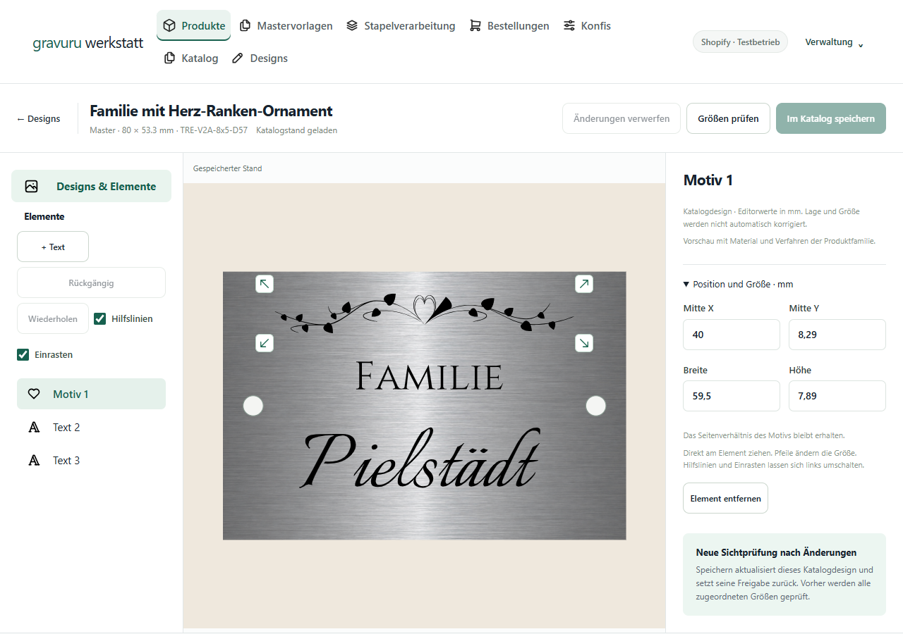
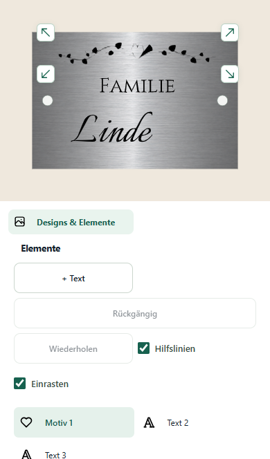

# Paket L · Designs im Dashboard bearbeiten · 24.10.2026

Basis: Code main 196de81e92d86d997f60c3a91732fe4f2b1a12ef, Katalog main 27d46beeae8cd91748ae8096f0bb63a4c550573a. Branch: dev/dashboard-bearbeiten-20261024-astra. Finaler Code: dbf3addf54167ce1a4381275fa8f24d9ec4b12b0. PR gegen main; kein Merge und kein Livezugriff.

## Was und warum

Lieferform-2-Designs lassen sich über **Bearbeiten** direkt aus der Dashboardzeile im vorhandenen Werkstatteditor öffnen. Dafür entsteht kein Konfi-Produkt. Der Editor erhält Familie, Materialstruktur, Form und Bohrungen über denselben familyProductConfig-Weg wie der Import. Seine Text-/Motivwerkzeuge, Hilfslinien und das Einrasten werden wiederverwendet. Die Auswahl verwendet die vier originalen grünen Konfi-Pfeile aus einem gemeinsamen Helfer: identische Form, Position und proportionale Größenänderung, kein blauer Auswahlrahmen. Der Kunden-Konfi behält seine CSS-Darstellung. Ein reiner Innenabstand der Katalog-Gestaltungsfläche hält auch bei Randmotiven die vollständigen 42-px-Trefferflächen sichtbar; Masterwerte und SVG-Geometrie bleiben dabei gleich. Die Knöpfe bleiben bei Vorschauwechseln erhalten, damit wiederholte Tastaturbedienung den Fokus behält. Die roten mechanischen Hilfsringe um Bohrungen sind im Katalogeditor ausgeblendet. Echte Bohrungen, Gestaltungsrand und interne Konfliktprüfungen bleiben erhalten; andere Vorschauen behalten ihre bisherigen Einstellungen.

Bearbeitbar sind Textinhalt, Katalogschrift, Größe, Position, Ausrichtung und Laufweite, neue/entfernte Texte sowie Position, proportionale Größe und Entfernung bestehender Motive. Bestehende Fotofelder und Hilfselemente bleiben unverändert; neue Motive gehören nicht zu dieser Stufe. Die Vorschau nutzt die tatsächlichen Katalogglyphen. Schriftdateien sind nicht Teil dieses PRs.

## Schreiben und Schutz

- Gemeinsamer Rückweg mit katalogDesignToTemplate/scaleTemplate und der inversen Master-Umrechnung. CLI --template verwendet dieselben Servicefunktionen; der frühere Korrekturadapter teilt Center/Baseline-Umrechnung und SVG-Textlayout.
- design.json und design.svg bleiben geometrisch konsistent: Texte als text/tspan, Motive als transformierte ursprüngliche Pfade. Originale Textanker, negative Laufweite, Zeilenabstände und Leerzeilen bleiben erhalten. Ein unveränderter Rundlauf schreibt nichts.
- JSON, SVG und Audit werden unter gemeinsamer Katalogsperre vorbereitet. Ein dauerhaftes Journal ermöglicht Rollback bei Schreibfehlern und Wiederherstellung nach Prozessabbruch. Auch normale Dashboard-/Vorschaulesen prüfen ein vorhandenes Journal vor der Cache-Rückgabe.
- Prüfsumme über JSON und SVG; zwischenzeitliche Änderung ergibt 409. Der Entwurf bleibt im Browser erhalten. Pfadausbruch, Symlink/Junction und Hardlinks werden vor dem Schreiben abgewiesen.
- Jede Inhaltsänderung setzt freigabe auf offen und protokolliert Sitzungskonto, Zeitpunkt sowie tatsächliche Master-Werte alt → neu je Ebene in _aenderungen.jsonl. Metadatenänderungen behalten ihre bisherige Freigabesemantik.
- Vor dem Speichern erscheinen alle zugeordneten Größen aus templateFit. Bei passt nicht ist eine zusätzliche ausdrückliche Bestätigung erforderlich. Es wird nichts automatisch verschoben oder angepasst.
- Die neuen Routen verwenden die bestehende Händleranmeldung, eingebettete Sitzungstoken, CSRF-/Origin-Prüfung und acrylRoute. Quellgeometrie, Ressourcen, Katalogherkunft und Urheber werden serverseitig bestimmt; Client-Manipulationen daran werden nicht übernommen.
- Zurück führt zur ursprünglichen Designlinie. Ein gespeicherter Inhalt verwirft frühere Vorschau-/Auswahlberechtigungen und lädt aktuelle Vorschaubytes. Auch Zurück-Navigation und Änderungen in einem zweiten Fenster sind abgedeckt; ein offener Namensentwurf bleibt erhalten.

## Geometrie und vorhandene Kataloggrenzen

D57 wird auf seinem Master 80 × 53,3 mm bearbeitet. Bei Retro II sind Master 90,6 × 61,3 mm und gezeichnete Familienkontur 90 × 60 mm unterschiedlich. Der Editor verwendet die vorhandene gezeichnete Kontur samt festen Bohrungen und den gemeinsamen Contain-Weg; gespeichert wird exakt zurück in Master-mm. Beide Maße werden im Editor erklärt. Es wird keine neue Kontur erfunden.

Bei 22 Schieferdesigns wird die Familie aus der ausdrücklich zugeordneten Linie `gedenktafeln-22x14-tiere` aufgelöst (`gedenktafel-22x14-schiefer-natur`). Die weitere Familie mit abweichenden Bohrungen wird nicht anhand eines Namens geraten. Zwei sichtbare Designs bleiben mit 422 gesperrt: **GT-S-22x14-D234 (Bunny)** und **GT-S-22x14-D235 (Macho)**. Ihre allgemeinen Themen liefern keine eindeutige Linien-/Familienzuordnung. Claude/Chris müssen die richtige Katalogzuordnung entscheiden; dieser PR ändert keine Katalogdaten.

Welcome (TQ-V2A-8x8-D14) und ParmaPetit (TO-V2A-9x6-D38) fehlen im Katalog. Diese beiden Designs öffnen mit einer klaren 422-Meldung statt Ersatzschrift. Eine fehlgeschlagene Editoröffnung zeigt ausschließlich die Katalogansicht mit Zurück/Erneut laden, keine Produktanlage.

D57 hat auch die Größe 45 × 30 cm zugeordnet. Dort meldet der vorhandene Schriftgrößenvertrag bei der skalierten Schrift über 100 mm **passt nicht**. Der Browsernachweis zeigt genau diese Warnung und die erforderliche Bestätigung; keine Größen- oder Schriftkorrektur wurde im Katalog vorgenommen.

## Prüfung

Windows, Node 24.20.0, Python 3.12.14. Die Zähler überschneiden sich und werden nicht addiert.

| Prüfung | Ergebnis |
| --- | --- |
| Vollständiger Durchlauf aller 183 damaligen Testdateien | 1.363 Tests: **1.355 bestanden, 1 Fehler, 7 Skips**, 0 Abbrüche |
| Nachprüfung nach Konfi-Pfeilen und Fokusfix: alle 42 Konfi-Dateien plus 3 betroffene Werkstattdateien | **271/271 bestanden**, 0 Fehler/Skips/Abbrüche |
| Nachprüfung nach Importkorrektur: Prepared, Platzierung, Writeback, Convert, Editor | **63 bestanden / 65 Tests**, 2 Link-Skips, 0 Fehler/Abbrüche |
| Nachprüfung Bohrlochvorschau: Editor-Service, Editor- und Materialvorschau | **27/27 bestanden**, 0 Fehler/Skips/Abbrüche |
| Zusätzliche gemeinsame Kontur-/Motivmodelle | **15/15 bestanden** |

Der einzige Fehler im Vollauf war die unveränderte Assertion in prepared-design.test.mjs:52: Vorbereitete Kundenfelder müssen negative Laufweite weiterhin ablehnen. Die für LF2 nötige Erweiterung des gemeinsamen Textmodells hatte diese Grenze gelockert. Der Prepared-Import prüft sie jetzt ausdrücklich; die ursprüngliche Assertion sowie der authentifizierte HTTP-Weg bestehen im Nachlauf. LF2 behält negative Quell-Laufweite.

Der Quellenwächter des Vollaufs meldete drei zwischenzeitlich aktualisierte Testdateien (element-rights, ui-event-regressions, katalog-editor-ui). Alle drei wurden mit den endgültigen Quellen im 271er-Nachlauf erneut erfolgreich geprüft. Geschützte lokale Daten blieben unverändert. **Kein zweiter Gesamtvollauf des finalen Commits**; der finale Bestand umfasst 184 Dateien einschließlich der neuen Pfeiltests. Es bleiben keine bekannten offenen Testfehler; Claude führt den unabhängigen Linux-Vollauf aus.

Die sieben Skips betreffen zwei nicht verfügbare Link-Prüfungen und fünf bestehende Prüfungen privater POSIX-Rechte/Symlinks unter Windows. Sie zählen nicht als bestanden. Python-Pakete und der lokale HTTP-Testweg waren im Elternlauf verfügbar.

Originalausgaben: [Vollauf](paket-l/vollauf.tap.txt), [Pfeile/Fokus](paket-l/pfeile-nachpruefung.txt), [Importkorrektur](paket-l/import-nachpruefung.txt), [Bohrlochvorschau](paket-l/bohrloch-nachpruefung.txt). Der Vollauf wurde mit dem bestehenden scripts/test-portability/run-full-tests.mjs und --expected-files 183 --run ausgeführt; die Nachläufe mit Node --test --test-concurrency=1 und derselben Windows-Python-Vorladung. Der Bericht und pruefung.json nennen die Dateibereiche und Einzelzähler.

Rein lesender Rundlauf auf dem finalen Quellstand: **759 von 761 regulären Lieferform-2-Mastern bytegleich**; die zwei übrigen Fälle sind die genannten fehlenden Schriften. Die 780 SVG-Dateien aus Paket K enthalten zusätzlich technische/Testordner. Die Kontextprüfung löst 759 Familien auf; 757 Designs bestehen zusätzlich die Schriftprüfung. In 43 tatsächlichen Editoröffnungen einschließlich aller 24 Schieferdesigns und jeder regulären Serie waren 39 erfolgreich; die vier beschriebenen Fälle liefern erwartete 422. Das ist kein vollständiger Fit aller 761 Designs.

Browser: lokaler Chrome mit Playwright, Desktop 1280 × 900 und iPhone-13-Geräteemulation (kein physisches iPhone). Ein künstlicher eingebetteter Admin-Rahmen verwendet den echten Token-/Händlerweg. Externe Anfragen sind gesperrt. Auf der privaten Katalogkopie liefen für beide Ansichten D57 öffnen → Name ändern → Motiv 1 mm bewegen → Größenprüfung → Speichern → Rückkehr → aktuelle Dashboardvorschau. JSON/SVG, Prüfsumme, Audit und Freigaberücksetzung wurden nachgelesen. Desktop zusätzlich Text hinzufügen/entfernen. An den originalen Konfi-Pfeilen werden echte Maus- bzw. Touch-Bewegungen, gleichproportionale Größe, unveränderter Mittelpunkt sowie Rückgängig/Wiederholen geprüft. Zwei aufeinanderfolgende Tastaturschritte und der Wechsel in ein anderes Feld sichern den Fokus ab. Für D57, Retro II D12 und Oval D13 wurden zusätzlich alle vier vollständigen Trefferflächen gegen die Handy-Gestaltungsfläche geprüft. iPhone zusätzlich Retro II D12 und Oval D13: Form, Bohrungen, proportionale Motivänderung und Fit. Beide vollständigen Browserabläufe und die Handy-Bildnachweise wurden nach Ausblenden der roten Ringe erneut ausgeführt; jede aktualisierte Editorvorschau prüft deren Abwesenheit.

Die vorherige Freigabe wurde ausschließlich als **synthetischer Ausgangszustand der privaten Testkopie** angelegt. Keine echte Designfreigabe und kein PATCH zur Freigabe. Alle Editor-API-Anfragen authentifiziert, keine Browserfehler, keine blockierten/externen Anfragen. Die echte Katalogquelle blieb unverändert: 1.843 Dateien per SHA-256 unverändert.

### Bildnachweise

Weitere Nachweise: [Desktop-Fit](paket-l/desktop-02-fit.png), [Desktop-Vorschau](paket-l/desktop-03-dashboard-preview.png), [Handy-Einstieg](paket-l/iphone13-01-editor.png), [Handy-Fit](paket-l/iphone13-02-fit.png), [Handy-Vorschau](paket-l/iphone13-03-dashboard-preview.png), [Retro II](paket-l/iphone13-sample-contour.png), [Oval](paket-l/iphone13-sample-ellipse.png).

## Abnahme und Übergabe an Claude

- [x] Einstieg ohne Import/Produktanlage, Desktop und Handy.
- [x] Material, Rechteck/Oval/Retro-Kontur und Lochschutz aus vorhandener Familie.
- [x] Originale Konfi-Pfeile; Maus, Touch, Tastatur, Rückgängig/Wiederholen; keine sichtbaren roten Bohrloch-Hilfsringe.
- [x] Gemeinsamer Hin-/Rückweg, No-op, Text/Schrift/Hinzufügen/Entfernen, Motive.
- [x] Größenprüfung und bewusstes Speichern eines nicht passenden Entwurfs.
- [x] Freigaberücksetzung, Master-Audit, 409, Pfadschutz, Rollback/Prozessabbruch.
- [x] Eingebetteter Tokenweg, acrylRoute und Produktdatenbank unverändert.
- [x] Quellen mit LF; keine Schriftdateien oder Zugangsdaten eingecheckt.
- [ ] Claude prüft und merged; hier weder Merge noch Installation/Livezugriff.

Bitte stichprobenartig D57 auf eigener Katalogkopie speichern, Retro II D12 mit den zwei dokumentierten Maßsystemen prüfen und bei D21 eine reine horizontale Textverschiebung gegen den ursprünglichen Zeilenabstand 6,81 mm vergleichen. Zusätzlich parallele Änderung für 409 und Rückkehr aus dem eingebetteten Admin prüfen. Neue Layoutfelder sind auch im Kunden-Rechtegate, den Glyphen-/Autofit-Caches und den Größenänderungen berücksichtigt.

Nach einer später autorisierten Installation schreibt die App nur in die Katalog-Arbeitskopie. Sicherung/Commit über den bestehenden Hostprozess bleibt bei Claude; die App führt keine Git-Operationen aus.

## Dateien

- Einstieg und Bedienung: `ui/app.mjs`, `ui/design-dashboard-ui.mjs`, `ui/product-editor-ui.mjs`, `ui/katalog-editor-ui.mjs`, zugehöriges CSS; `ui/editor-selection.mjs` und gemeinsamer `variant-m/selection-arrows.mjs`.
- Service und Auth: `design-editor.mjs`, `http.mjs`, `acryl-employee-host.mjs`, `variant-m/server.mjs`.
- Quellen und Transaktion: `katalog-convert.mjs`, `katalog-template-writeback.mjs`, `katalog-transaction.mjs`, `katalog-writeback.mjs`, `design-dashboard.mjs` und CLI.
- Gemeinsames Textlayout: `doorbell-preview.mjs`, `design-content.mjs`, Vertrag/Rechte, explizit erhaltene Prepared-Importgrenze, Cache-Schlüssel und alle bisherigen Größenwerkzeuge einschließlich KI-/Schriftersetzung.
- Regressionen: Service, Writeback, Dashboard-UI, Editor-UI, Auswahlpfeile/Fokus, eingebettete Routen, UI-Ereignisse, Layoutrechte, Zeilenabstand, Bundle/Modulauslieferung.
- Vollständige Liste der 45 Quell-/Testdateien mit SHA-256, Testzählern und Browsernachweisen: [pruefung.json](paket-l/pruefung.json).
