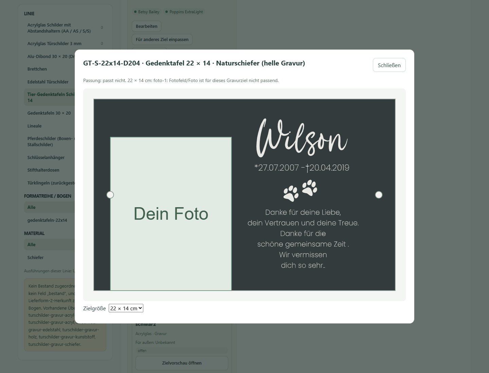
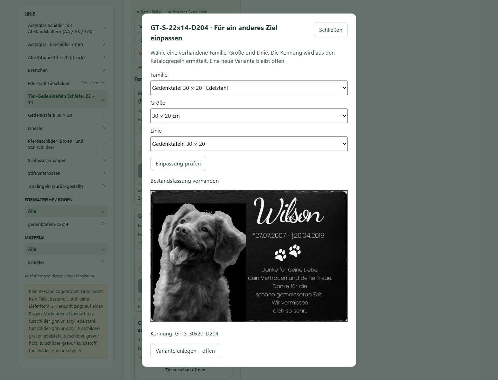
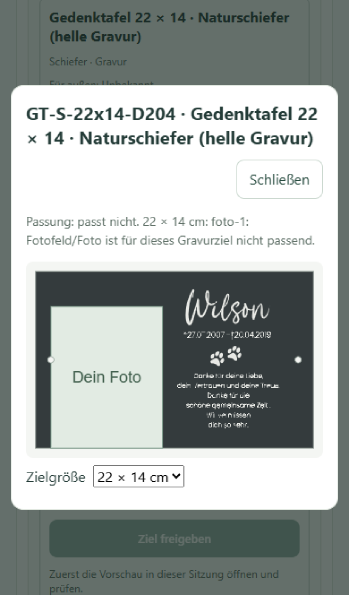
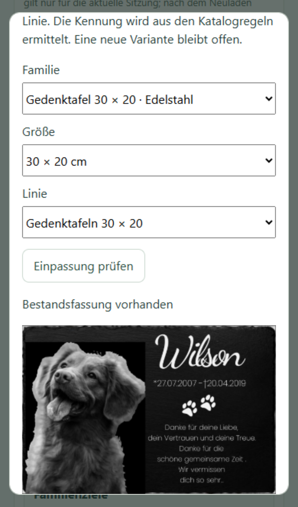
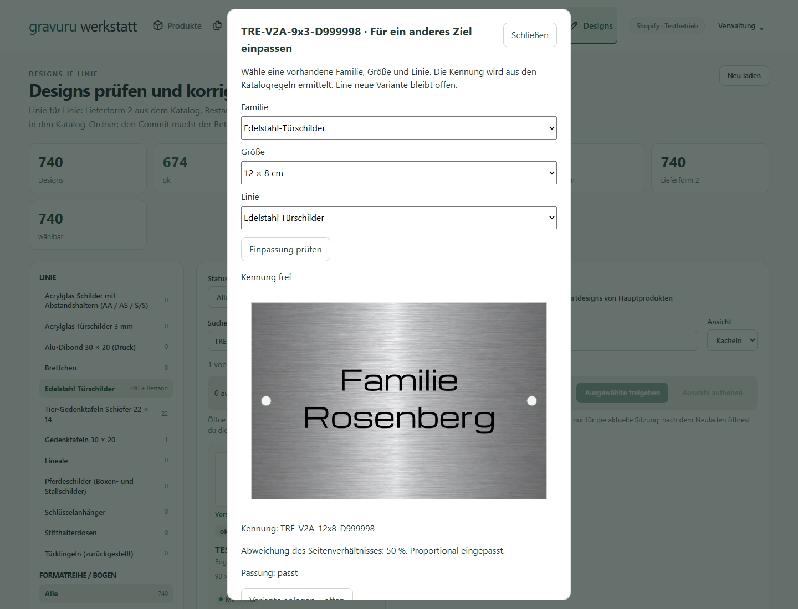
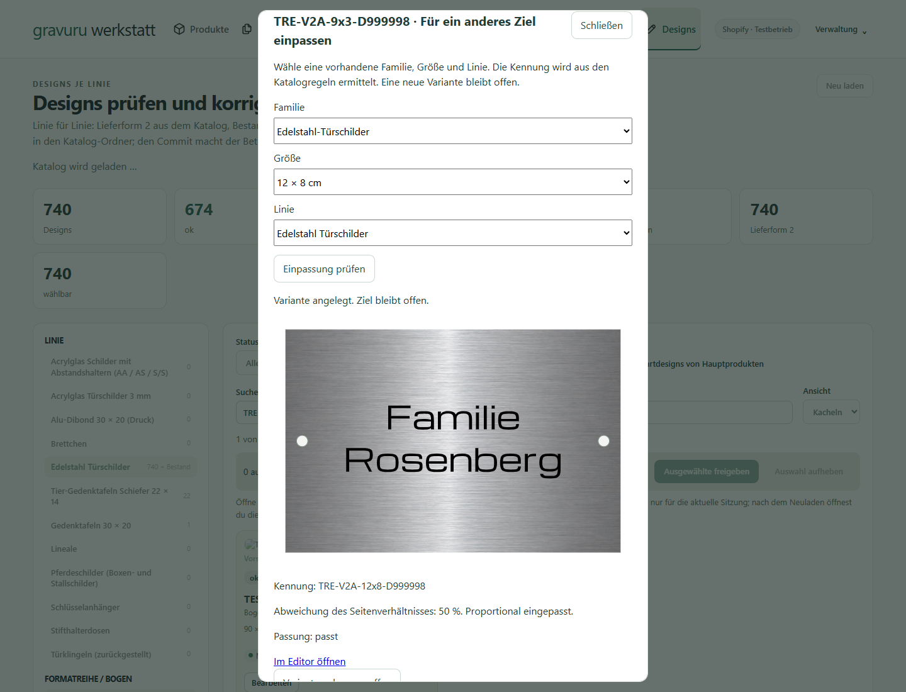

# Paket M · Designziele und Varianten · 24.10.2026

Basis: Code main 67b8f1c60e8e52e5c0cd03e5357d379a27820baf, Katalog main 57939029216bda6fa058b788b9111aaa6156fcf3. Branch in beiden Repositories: dev/design-ziele-20261024-astra. [Code-PR #20](https://github.com/Chris83638w/gravuru-2027/pull/20) und [Katalog-PR #5](https://github.com/Chris83638w/gravuru-katalog./pull/5) liegen zur Prüfung vor; kein Live-Zugriff, Import, Merge oder Force-Push. Keine echten Designfreigaben und keine Migration des Originalkatalogs. Der Katalog-PR enthält ausschließlich Schema-Dokumentation.

## Ergänzung vom 25.10. · Kundenfotos

Automatische Graustufen ausschließlich für Kunden-Fotouploads auf Schiefer und bei Acrylgravur; Originalfarbe unter Bearbeiten wiederherstellbar. Echte Vorlagen-PNGs und Zielregeln unverändert. Fotofeld inklusive Maske gemeinsam verschiebbar, eigener Ausschnittmodus mit Konfi-Pfeilen. **286/286 Konfigurator-Tests**, **35/35 betroffene Werkstatt-Tests**; Desktop und iPhone geprüft. [Nachtrag mit Umfang, Windows-Gegenprobe und Screenshots](2026-10-25-paket-m-kundenfotos.md). Der nachfolgende 188-Dateien-Vollauf gehört zur Basis 33951c7 vor dieser Ergänzung.

## Verhalten

- Familie als Ziel mit eigener Freigabe. Explizites ziele (auch []) verdrängt die historische globale Freigabe. Linien lesen Ziele; Import und Shop-Abgleich prüfen genau die betreffende Familie, Form, Größe, Originalfarben/Fotofelder, Schriften und geometrische Passung. Diagnosepläne mit allen Designs bleiben schreibgeschützt.
- Dashboard: bestätigte Ziele, Themenvorschläge mit Einzel-/Mehrfachbestätigung, Themen-Häkchen, getrennte Sichtprüfung und Freigabe. Sitzungsakteur, CSRF, bestehender Shopify-Sitzungstoken und Änderungsprotokoll bleiben erhalten. Eine geänderte Quelle, Familie oder Schriftversion erfordert eine neue Vorschau; der Schreiblock prüft sie erneut. Inhaltsänderungen setzen alle Ziel-Freigaben zurück.
- Zielvorschauen verwenden familyProductConfig und echte Glyphenpfade. Der ausdrückliche previewOnly-Modus öffnet keine Produktionsadapter. Fehlende physische Angaben bleiben als Vorschau offen sichtbar; Preise werden nur intern in einer flüchtigen Ansicht neutralisiert und nie zurückgeschrieben.
- Varianten folgen designs/README.md: Material-/Verfahrenswechsel allein ergänzt ein Ziel; D-Nummer und Materialcode des Masters bleiben stabil. Format in cm, vorhandene Kommaschreibweise bleibt erhalten; Form-/Linienkürzel muss belegt und eindeutig sein. Kollisionen gegen sämtliche lokalen design.json/index.json/designs.json, auch Bestand, blockieren Überschreiben. Fremde LF2-Kennung: beide Vorschauen und neuer ausdrücklicher Entschluss zum offenen Ziel. Bestandsfassung: echte PNG-Vorschau, keine automatische Anlage.
- Neue Varianten: proportionaler Contain-Transfer mit Prozentabweichung, Originaltext als Text, Motive als Pfade, varianteVon und geometrisches transfer.from/fromKey. JSON, SVG, index.json, lokale Fotovorlagen und Audit werden zusammen transaktional geschrieben; Konflikte brechen ab. Danach ist die Variante im vorhandenen Editor bearbeitbar.
- Regeln: unter 3 mm Schrift = prüfen (alle Verfahren); Farbe/Fotofeld auf Gravur = passt nicht. V2A unter 0,5 mm: explizite Striche und geometrisch nachweisbar schmale geschlossene Motivkomponenten warnen mit Element/Pfad/Ort. Die Analyse ist kein vollständiger Fertigungsnachweis für jede innere Feinheit eines komplexen gefüllten Motivs. Bohrnähe von Text bleibt gemäß vorhandener Konfi-Regel eine Warnung, keine zusätzliche Sperre; mechanische Schutzringe werden nicht gezeichnet.
- Walnuss erhält einen dunklen, kontrastarmen Vorschauton, ausdrücklich als Näherung ohne Maschinenabnahme markiert. Keine Materialwerte oder Familien erfunden. outdoorSuitable bleibt optional (fehlend/null = unbekannt), ausfuehrungen.modus an Linien ist zunächst Schema/Validierung/Anzeige.

## Migration auf der Testkopie

Der reine Dry-run am unveränderten Designstand und anschließend Apply ausschließlich auf work/paket-m-catalog-test ergaben: 761 Master, 759 eindeutig migrierbar, 2 blockiert, Freigaben 0 → 0. Apply schrieb 759 Design-JSONs mit Audit. Zweiter Dry-run: 759 unverändert, 0 neue Schreibkandidaten, dieselben 2 blockiert. Bestehende globale Angaben bleiben erhalten. Tests decken vorhandene Freigaben samt Datum/Urheber, Wiederholung und Abbruch/Rollback ab. Die Migration ist je Design samt Audit atomar, nicht für den gesamten Katalog.

GT-S-22x14-D234 und D235 bleiben mehrdeutig zwischen gedenktafel-22x14-schiefer-hunde-2027 und gedenktafel-22x14-schiefer-natur. Keine Auswahl erfunden. Der letzte Dry-run hat 1.957 lokale Katalogdateien vor/nach bytegleich bestätigt. Alle 104 Edelstahl-Hauptproduktzuordnungen einschließlich Startdesign, IDs, Größen und SKU/Varianten sowie 761 Designfingerprints sind vor/nach der Zielmigration gleich.

## Beispiele und Grenzen der Kopie

- GT-S-22x14-D204 (Wilson): Schiefer 22×14 als vorhandenes Ziel. Separate offene Ziele Edelstahl und Acryl 30×20 nur in der Kopie bestätigt. Das Fotofeld führt nach der ausdrücklichen Regel von Paket M zu passt nicht für Gravur, auch wenn Foto-Gravur grundsätzlich zum Produktwissen gehört. Die 30×20-Familien haben zusätzlich offene physische Angaben.
- 30×20 wird korrekt GT-S-30x20-D204: Bestandsfassung vorhanden, Originalbild angezeigt, kein zweiter Master. Die realen Bestands-JSONs aller 24 Schieferdesigns tragen dieselben erwarteten GT-S-30x20-D<n>-Kennungen. Übernahme bleibt Paket Q.
- Freier Fall ausdrücklich synthetisch: Kopie von TRE-V2A-9x3-D1 als TESTKOPIE M · TRE-V2A-9x3-D999998. Im Browser nach 120×80 eingepasst → TRE-V2A-12x8-D999998, edelstahl-gravur-120x80, 50 % Seitenverhältnisabweichung. Nur in der privaten Kopie angelegt, Ziel offen, keine Freigabe. Die freie Kennung ist keine Zusage für den vollständigen Originalbestand. Readback: zwei Texte weiterhin als Text, Herkunft/Index/Audit konsistent, Ziel nicht freigegeben, Editor und Vorschau per authentifiziertem GET 200. Die Demo enthält keine Motive; Pfaderhalt wird deshalb hier nur durch die separaten Varianten-Tests belegt.
- Vollständiges Remote-Pfadinventar des Bestands: 72.943 Einträge / 19.356 design.json, alle 20.058 Git-Bäume rekonstruiert, 0 SHA-Abweichungen. Lokal bewusst nur 63 ausgewählte Bestandsdateien (darunter 24 echte Gedenktafeln mit PNG); keine Behauptung einer JSON-Vollkopie. Produktionscode prüft den vollständigen angeschlossenen lokalen Katalog. Unit-Tests decken auch Indexreservierungen, fremde LF2, gleiche Originale, Symlinks/Hardlinks und konkurrierende Änderungen ab.

## Fehlende Familien und Entscheidungen für Chris

- Druckfamilien für Edelstahl, Schiefer, Acrylglas und Holz fehlen im gelesenen Stand; die 11 vorhandenen Familien sind Gravur. Druckpreise und die konkrete Ausführung müssen aus den CDR-Linien kommen (Paket N).
- Holzfamilien fehlen, einschließlich Walnuss; der neue Vorschauton erzeugt keine Familie.
- Herz- und Kreuzfamilien fehlen. Bei anderen Formen/Linien ohne eindeutiges vorhandenes Bogenkürzel: Kennung offen.
- Linien ohne Familien: Acryl-Türschilder, Alu-Dibond 30×20, Brettchen, Lineale, Pferdeschilder, Schlüsselanhänger, Stifthalter, Türklingeln. Das Dashboard meldet Familie fehlt.
- Vorhandene Edelstahl/Acryl/Premium-Schiefer-Familien 30×20 enthalten offene Angaben zu Stärke, Gestaltungsrand, Bohrbild und teilweise Preisen. Es wird keine maßhaltige Materialvorschau aus erfundenen Angaben hergestellt.
- Außen-Eignung und Produkt-/Variantenmodus bleiben überall unbekannt, solange die jeweilige JSON-Quelle nichts festlegt. Bestseller-/Produktanlage bleibt Paket O, Produktbilder Paket P.

## Prüfung

Windows-Abschlussvollauf auf dem endgültigen Implementierungsstand dc8c481809cedbc7c66ff34f88030a7fc127915a: 188 Dateien; 1449 Tests, 1442 bestanden, 0 Fehler, 7 übersprungen, 0 abgebrochen. Alle direkten Testsammlungen in app/configurator/variant-m und app/workshop wurden erfasst. Testquellen und geschützte Datenverzeichnisse blieben unverändert; alle 40 Paket-M-Quelldateien entsprechen dem veröffentlichten Quellmanifest. Nach diesem Lauf wurden nur Dokumentation und Nachweise ergänzt. Der erste Vorlauf wurde nach 61 Dateien / 356 bestandenen Tests zur Korrektur von drei Druckpfadbefunden abgebrochen und ist kein Abschlussnachweis. Die korrigierten Pfad-/Materialtests: 25/25. Zusätzliche Shop-/Offline-/Bind-Skripttests auf dem endgültigen Quellstand außerhalb dieses Vollaufumfangs: 26 Tests, 25 bestanden, 0 Fehler, 1 bestehender optionaler Realkatalog-Skip.

Übersprungene Fälle des Vollaufs (unveränderte vorhandene Plattform-/Umgebungsbedingungen):

- app/workshop/katalog-writeback.test.mjs: Symlink/Junction als Designordner ist gesperrt — Dateisystem erlaubt hier keine Links.
- app/workshop/katalog-writeback.test.mjs: Mehrfach verknüpfte Quelldatei wird vor jedem Schreiben gesperrt — Dateisystem erlaubt hier keine Hardlinks.
- app/workshop/shopify-runtime-config.test.mjs: workshop.sqlite — File symlink capability unavailable: EPERM; Filesystem does not expose private POSIX permissions after chmod(0700): mode 40666; the runtime must reject it.
- app/workshop/shopify-runtime-config.test.mjs: profiles.sqlite-wal — File symlink capability unavailable: EPERM; Filesystem does not expose private POSIX permissions after chmod(0700): mode 40666; the runtime must reject it.
- app/workshop/shopify-runtime-config.test.mjs: design-assets.sqlite-shm — File symlink capability unavailable: EPERM; Filesystem does not expose private POSIX permissions after chmod(0700): mode 40666; the runtime must reject it.
- app/workshop/shopify-runtime-config.test.mjs: real authenticated server and databases with confirmed private permissions — Filesystem does not expose private POSIX permissions after chmod(0700): mode 40666; the runtime must reject it.
- app/workshop/shopify-runtime-config.test.mjs: Git ancestor guard after the private-permission check — Filesystem does not expose private POSIX permissions after chmod(0700): mode 40666; the runtime must reject it.

Browser: Desktop 1440 × 1100 und iPhone-13-Emulation. Zielvorschau mit Glyphenpfaden, D204-Bestandssperre, getrennte Zielbestätigung, fehlende Geometrie, Themenvorschläge und freie Testvariante geprüft. Keine Browserfehler, keine externen Aufrufe; der emulierte Shopify-Admin benutzt einen synthetischen Sitzungstoken. Horizontale Überläufe im Dokument und im Varianten-Dialog geprüft. Keine Sichtprüfung auf einem physischen iPhone.

Reproduzierbarer Windows-Vollauf mit Node 24 und den vorhandenen Python-Abhängigkeiten:

```text
node scripts/test-portability/run-full-tests.mjs --repo <Code-Kopie> --python <python.exe> --temp <isolierter-temp-Ordner> --output <Berichtsordner> --label paket-m-final2 --run
node --import ./scripts/test-portability/full-tests-python-windows.mjs --test --test-concurrency=1 scripts/shop-sync.test.mjs scripts/shop-sync-dry-run.test.mjs scripts/shop-bind.test.mjs
```

Für die zusätzliche Skriptprüfung waren GRAVURU_PYTHON, TEMP/TMP und PYTHONUTF8=1 wie beim Runner gesetzt. Der Runner inventarisiert beide vollständigen Verzeichnisse, startet jede Testsammlung separat, isoliert temporäre Daten, entfernt App-Zugänge aus der Umgebung und prüft unveränderte Testquellen und geschützte Datenverzeichnisse.

Nachweise: [Vollauf-Zähler](paket-m/full-tests-summary.json), [Vollauf-Protokoll](paket-m/full-tests.log), [Testinventar](paket-m/full-tests-inventory.json), [Integrität](paket-m/full-tests-integrity.json), [abschließender Quellvergleich](paket-m/final-verification.json), [Quellstand](paket-m/source-manifest.json), [Originaldaten unverändert/Testkopie-Apply](paket-m/source-integrity.json), [Migration/104 Zuordnungen](paket-m/migration.json), [Demo-Readback](paket-m/demo-readback.json), [Bestandsinventar/Grenzen](paket-m/bestand-inventar.json), [Browserprotokoll](paket-m/browser.json), [zusätzliche Skripttests](paket-m/scripts-tests.log).









Weitere Bilder: [Themenvorschläge / Familie fehlt](paket-m/desktop-d204-vorschlaege.png), [fehlende physische Angaben](paket-m/desktop-stahl-geometrie-offen.png).

## Übergabe an Claude

Codebasis 67b8f1c, Katalogbasis 579390292; [Katalog-PR #5](https://github.com/Chris83638w/gravuru-katalog./pull/5) dokumentiert nur das Schema. Bitte [Code-PR #20](https://github.com/Chris83638w/gravuru-2027/pull/20) und Katalog-PR zusammen prüfen, Linux-Vollauf ausführen und erst dann über Merge entscheiden. Besonders ansehen: explizite leere Ziele, Zielfreigabe unter Quelle/Familie/Font-Checksum und Schreiblock, Rücksetzung sämtlicher Zielfreigaben, Diagnose-Apply-Sperren, Kennungskollisionen und transaktionaler Varianten-Rückweg. Der Zusatzmodus previewOnly öffnet keine Produktionsadapter.

D234/D235 bleiben offen. Fehlende Druck-/Holz-/Formfamilien und physische Angaben sind oben gelistet; N/O/P/Q bleiben getrennte Folgepakete. Keine Freigabe von Chris durch dieses Paket vorweggenommen. Die echten Daten wurden nicht migriert. Nach Review ist eine spätere echte Migration separat mit Dry-run und Betreiberentscheidung auszuführen.
