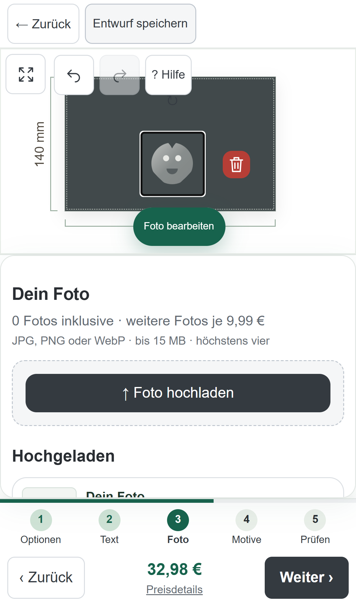
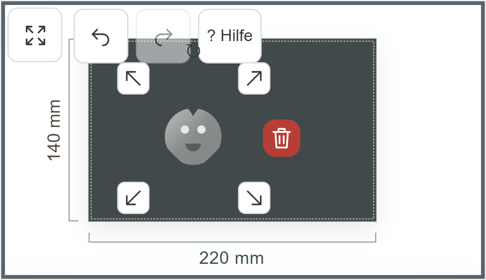
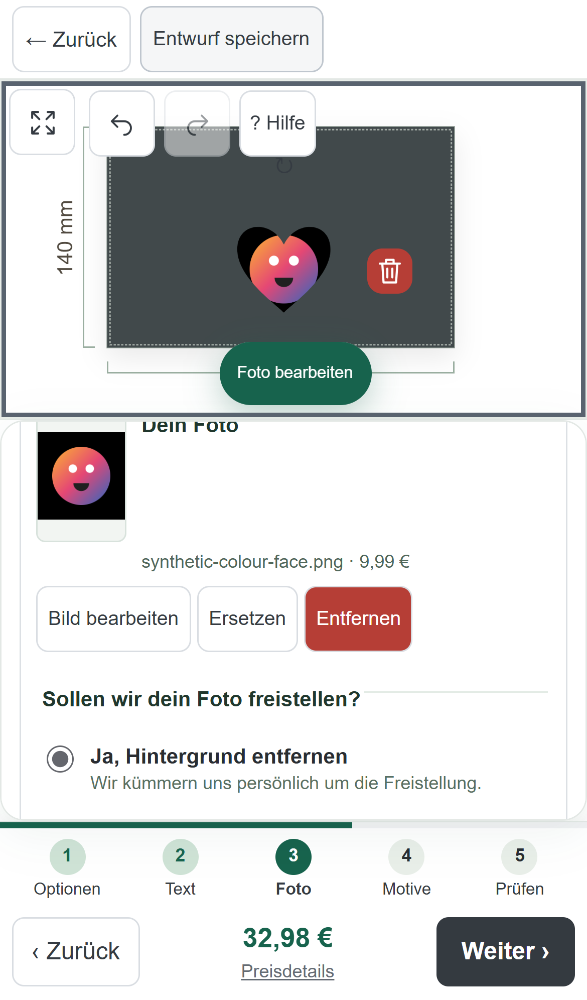

# Paket M · Kundenfotos und bewegliche Masken · 25.10.2026

Ergänzung zu Code-PR #20, gleicher Branch dev/design-ziele-20261024-astra. Die Katalogquelle und ihre PNGs bleiben unverändert.

## Kundenverhalten

- Nach einem Kunden-Upload wird ein Foto auf Schiefer sowie bei Acrylgravur automatisch in Graustufen dargestellt. Andere Materialien, Acryl-Druck und Logos erhalten durch diese Ergänzung keinen Graustufenstandard.
- Unter Bild bearbeiten kann der Kunde Original wiederherstellen. Die explizite Wahl bleibt beim Speichern, Wiederöffnen und erneuten Bearbeiten erhalten; die hochgeladene Originaldatei bleibt unverändert.
- Nur echte Kunden-Fotouploads mit Upload-ID erhalten die Vorgabe. Vorlagen, echte Katalog-PNGs, Beispiele und Platzhalter werden nicht umgewandelt. Das ist Chris’ ausdrückliche Präzisierung vom 25.10.
- Bewegliche Fotofelder werden einschließlich Maske gemeinsam verschoben. Foto im Ausschnitt ausrichten aktiviert die getrennte Bildausrichtung mit den vorhandenen Konfi-Pfeilen. Rechte für Bewegung und Bildaustausch bleiben unabhängig; feste Felder behalten ihre Einschränkungen.
- Die helle Gravurdarstellung verrechnet Kundenfotos mit der Materialoberfläche. Dieser Anzeigeeffekt gelangt nicht als neue Maschinenpolarität in den Export. Gewählte Graustufen werden bei Druckausgabe berücksichtigt. Native Druckcache-Rezeptversion v6 verhindert alte Ausgaben unter der neuen Farbregel.

## Bestandsbild D204

Das schwarze Rechteck des alten 30×20-Bestands ist bereits in foto-1.jpg und preview.png enthalten. Die echte aktuelle 22×14-PNG hat Alpha, ist aber anders ausgerichtet und trägt den Upload-Hinweis. Sie wird nicht still gegen die 30×20-Bestandsfassung ausgetauscht. Der vorübergehende Versuch einer neu zusammengesetzten Bestandsvorschau wurde nach Chris’ Präzisierung vollständig zurückgenommen und nicht veröffentlicht. Die alte PNG und die bisherigen Zielregeln bleiben unverändert; die Bestandsübernahme bleibt Paket Q. Dieser Nachtrag behauptet keine Reparatur des alten Bestandsbildes.

## Prüfung

Alle 44 Konfigurator-Testdateien: **286/286 bestanden**, 0 Fehler, 0 Skips. Werkstatt: **35/35 unterschiedliche Tests in 9 betroffenen Dateien bestanden**, 0 verbleibende Fehler/Skips. Der erste Werkstattlauf hatte 20 bestanden / 15 Python-Startfehler (python3 EACCES). Nur die vier betroffenen Dateien wurden mit dem bereits vorhandenen Windows-Preload erneut ausgeführt: 15/15 plus 3/3 grün; überlappende Tests werden nicht doppelt gezählt. Keine Assertion wurde abgeschwächt. Die neue Crop-Leistenkorrektur ist im finalen 286er-Lauf enthalten. Der frühere Paket-M-Vollauf von 188 Dateien / 1449 Tests gehört zum Stand 33951c7 vor dieser Fotoergänzung und ist kein neuer Vollauf dieses Nachtrags.

Browser: isolierter realer Konfigurator mit synthetischem Kundenfoto und Herzmaske auf Schiefer; Desktop und iPhone-13-Emulation. Upload, gemeinsame Bewegung, Undo/Redo, Tastaturfokus, separate Crop-/Zoom-Bedienung, Original wiederherstellen, Übernehmen, Wiederöffnen und Reload wurden geprüft. Die Testpreise sind ausschließlich Fixturewerte. Kein Browserzugriff auf Live-Systeme.

Keine Katalogmutation, Designfreigabe, Live-Systeme, echter Import, Merge oder Force-Push. Keine Schriftdateien hinzugefügt.

Nachweise: [Zähler und Umfang](paket-m/photos/verification.json), [Quellhashes](paket-m/photos/paket-m-photo-source-freeze.json), [Konfigurator-Rohlog](paket-m/photos/paket-m-photo-variant-final2.log), [Werkstatt-Erstlauf](paket-m/photos/paket-m-photo-workshop.log), [Python-Gegenprobe](paket-m/photos/paket-m-photo-workshop-python-final.log), [Masken-Gegenprobe](paket-m/photos/paket-m-photo-frame-final.log), [Browserablauf](paket-m/photos/photo-browser-checks.json), [freie Pfeile](paket-m/photos/photo-crop-browser-checks.json), [PNG-Vergleich](paket-m/photos/paket-m-photo-template-png-checks.json).

