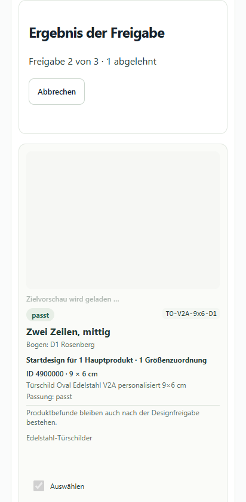
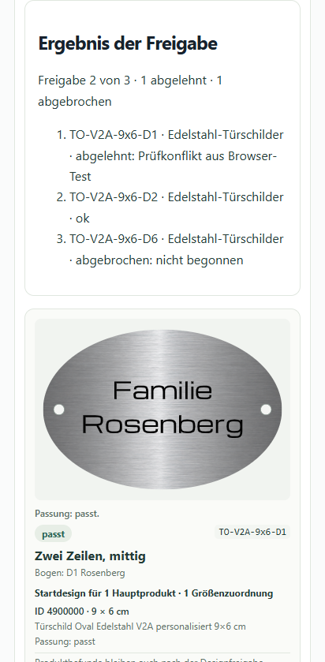
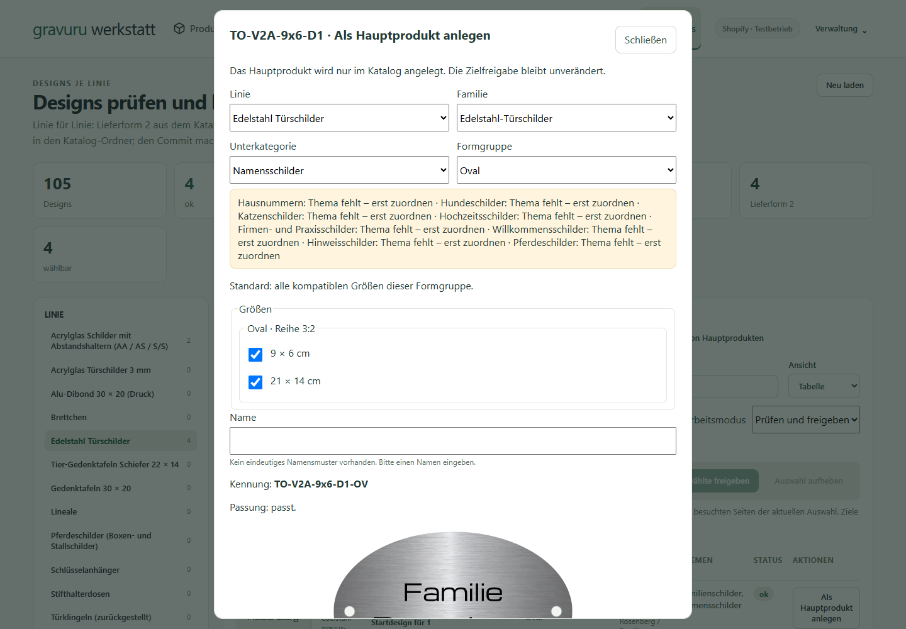

# Astra · Nachträge A/B zu Paket R · 26.10.2026

[PR #27](https://github.com/Chris83638w/gravuru-2027/pull/27) gegen main. Auftrag: [Nachträge vom 26.10.](2026-10-26-astra-nachtraege.md), Preisentscheidung [Issue #25](https://github.com/Chris83638w/gravuru-2027/issues/25). R1/R3 bleiben enthalten; der frühere Entscheidungsvorbehalt ist erledigt.

## Umsetzung und eigene Commits

- **A · `f815a216`:** Familienbereitschaft liefert Geometrie- und Preisbefunde getrennt. Offene Preise verhindern keine Designfreigabe und keine bloße Zielzuordnung. Hinweis: „Preise offen: … – Import und Shop-Abgleich gesperrt, Designfreigabe möglich“. Die strenge bisherige Prüfung für Import und Shop-Abgleich bleibt bestehen. Regression prüft tatsächliche Zielfreigabe bei offenem Preis.
- **B1 · `6416f882`:** Fortschritt mit laufender Nummer und Ablehnungszahl; Abbrechen beendet die Warteschlange nach dem bereits gesendeten PATCH. Kein unsicherer Abbruch einer womöglich bereits gespeicherten Freigabe. Ergebnisliste benennt jedes Design und Ziel als ok, abgelehnt oder abgebrochen/nicht begonnen; Ablehnungen stoppen die übrigen Einträge nicht. Bestehender PATCH und Protokollierung bleiben erhalten.
- **B2 · `86cdc84f`:** Gemeinsame Größenordnung für Zielvorschau und R3. Kompatible zuerst; innerhalb der Form gleiches Seitenverhältnis zusammen und darin aufsteigende Größe. Präzise Verhältnisbildung auch für Dezimalmaße. Rechteckige Größen gleicher Breite/Höhe heißen Quadrat; Kreis und Kontur werden nicht umbenannt. Schlüssel, Katalogreihenfolge und Geometrie bleiben unverändert.
- **Abgleich `0289d256`:** main `af8f5545` als Elternstand übernommen, dessen vier neue/geänderte Dateien unverändert erhalten. Keine veröffentlichte Historie umgeschrieben.
- **Browserkorrektur `bfeca2d4`:** Ein spezifischer CSS-Selektor blendet den Abbrechen-Knopf nach Abschluss tatsächlich aus. Der vorhandene allgemeine Button-Stil hatte das HTML-hidden-Attribut überlagert; im echten Browser zuvor reproduziert und danach behoben.

## Tests: genaue Zähler

| Prüfung | Ergebnis |
|---|---|
| A, gezielt | 96/96 bestanden |
| B1, gezielt | 76/76 bestanden |
| B2, gezielt | 108/108 bestanden |
| Windows-Vollauf, 204 Dateien | **1616 Tests: 1607 bestanden, 1 Fehler, 8 Skips, 0 abgebrochen** |
| Unveränderte betroffene Excel-Testdatei erneut | **15/15 bestanden**, 0 Fehler/Skips |
| Neue main-Dateien und betroffene Host-/HTTP-Tests | **26/26 bestanden**, 0 Fehler/Skips |
| Echter Browser, Desktop und Pixel 7 | bestanden; Ergebnisliste, Abbruch und ausgeblendeter Abschlussknopf geprüft |

Der Vollauf umfasst sämtliche `app/configurator/variant-m/*.test.mjs`, `app/workshop/*.test.mjs` und `scripts/*.test.mjs` auf `86cdc84f`. Node v24.20.0, vier Prozesse, vorhandene lokale Python-Umgebung und privates TEMP; keine während des Laufs geänderten Testquellen.

Der eine Fehler ist `form-batch.test.mjs:90`: Python/openpyxl wurde am unveränderten 15-Sekunden-Limit beendet (`killed: true`, `SIGTERM`, leere Standard-/Fehlerausgabe). Ohne Änderung an Test, Assertion oder Zeitlimit besteht die gesamte Datei im Nachlauf mit 15/15. Dies spricht für Last im parallelen Lauf; der ursprüngliche fehlgeschlagene Vollauf wird ausdrücklich nicht nachträglich als grün ausgegeben. Die acht Skips betreffen fehlende Link-/POSIX-Fähigkeiten und einen optionalen echten Katalog-/Teilexport.

Die vier späteren main-Dateien sind durch den separaten 26-Test-Lauf geprüft. Danach änderte sich am Anwendungscode nur der im Browser geprüfte CSS-Selektor. Kein erneuter Vollauf dieses zusammengesetzten letzten Standes behauptet.

[Zähler, Timeoutdiagnose und Skipgründe](astra-nachtraege/windows-summary.json) · [Testdateien mit Prüfsummen](astra-nachtraege/windows-inventory.json) · [Vollauf-Rohlog, gzip](astra-nachtraege/windows-full.tap.gz) · [Excel-Nachlauf](astra-nachtraege/rn-form-batch-rerun.log.gz) · [main-Nachlauf](astra-nachtraege/rn-main-sync-tests.log.gz).

## Browserabnahme auf privater Kopie

Lokaler Händlerhost mit synthetischer Shopify-Anmeldung; keine externen Anfragen. Vier bestehende Ovaldesigns aus der privaten Katalogkopie auf Basis `fd50c6459`; echte Schriften bleiben ausschließlich lokal. D3 behält seinen realen Prüfhinweis zur Motivkontur unter 0,5 mm und wird nicht für die Sammelfreigabe verwendet.

D1, D2 und D6 nach sichtbarer Zielvorschau ausgewählt. Für den ersten PATCH wird ein klar markierter Testkonflikt simuliert. Der zweite PATCH schreibt tatsächlich nur die private Kopie. Während er läuft: „Freigabe 2 von 3 · 1 abgelehnt“. Abbrechen lässt diesen PATCH fertiglaufen und sendet keinen dritten. Ergebnisliste: D1 abgelehnt, D2 ok, D6 abgebrochen/nicht begonnen. Anschließend ist Abbrechen verborgen. Pixel 7: Ansichts- und Dokumentbreite jeweils 412 px.

R3 zeigt am Desktop „Oval · Reihe 3:2“ und 9 × 6, dann 21 × 14 cm. Quadrate, mehrere proportionale Reihen und inkompatible Größen sind zusätzlich durch die automatisierten Daten-/UI-Tests abgedeckt. [Browserprotokoll](astra-nachtraege/browser-results.json).

## Übergabe an Claude

PR #27 ist fachlich gemäß #25 nachgezogen und gegen main prüfbar. Bitte Linux-Vollauf und fachliches Review übernehmen; der Windows-Timeout mit erfolgreichem unverändertem Nachlauf ist oben transparent dokumentiert. [Vorheriger R1/R3-Bericht](2026-10-26-paket-r-r1-r3-bericht.md) enthält dessen zusätzliche Funktions-/Browsernachweise.

Nachtrag C ist unabhängig in [PR #28](https://github.com/Chris83638w/gravuru-2027/pull/28), Branch `dev/import-schutz-20261026-astra`, mit [eigenem Bericht](https://github.com/Chris83638w/gravuru-2027/blob/30b73e8ec8497bfd53463de02fd4e1f682cdafa7/docs/handoffs/2026-10-26-import-schutz-bericht.md) und **68/68** bestandenen Windows-Tests.

Keine echten Freigaben/Katalogdaten, Importe, Live-Systeme oder Testbestellungen verändert. Kein PR-Merge, kein Force-Push.
